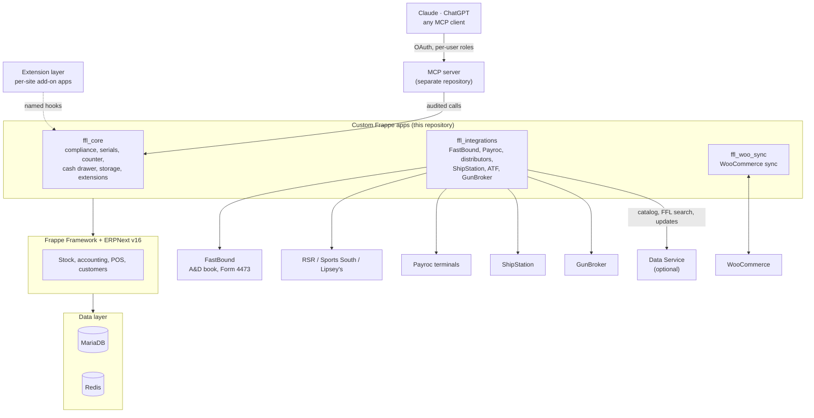

# Overview and architecture

OpenGunstore is three Frappe apps on stock Frappe and ERPNext v16. ERPNext stays the source of truth for stock, customers and accounting. The apps never patch Frappe or ERPNext: they work through doc events, custom-field fixtures, client scripts and whitelisted methods. The few overrides are declared in `ffl_core/hooks.py` (a document-class mixin that lets a ticket go negative only for trade-in credit, and two replaced whitelisted methods: the POS opening-entry check and OAuth client registration for MCP clients); `make ci-upgrade-test` re-checks them on every ERPNext bump.

## The three apps

| App | Owns |
|---|---|
| `ffl_core` | Firearm and serial rules, the bound book (`FFL Acquisition` / `FFL Disposition`), the Form 4473 workflow, trade-ins and receiving, consignment, the cash drawer, inventory counts, storage locations, the extension layer (`ffl_core.extensions`), the remote MCP connector API (`ffl_core/api/connector.py`), release notes. |
| `ffl_integrations` | Outbound integrations: FastBound, the card processor (Payroc, behind `ffl_integrations.payments`), distributors (RSR, Sports South, Lipsey's, behind `ffl_integrations.distributor`), ShipStation, ATF eZ Check, GunBroker, and the [Data Service](../data-service.md) client. |
| `ffl_woo_sync` | The WooCommerce connector: product and stock push, order intake, refunds, fulfilment status. |

They run on MariaDB and Redis. Pinned versions: [Pinned versions](../versions.md).

## Data flow

1. **Counter.** Staff work in ERPNext's POS and the apps' Desk pages. Every action becomes an ordinary ERPNext document: `POS Invoice` / `Sales Invoice`, `Serial No`, `Purchase Receipt`, `Stock Entry`, `Payment Entry`.
2. **`ffl_core` hooks.** `doc_events` on those documents enforce the rules (a firearm sale does not submit until its 4473 is done and NICS says Proceed) and write the bound book: an acquisition on receipt, a disposition on sale.
3. **`ffl_integrations`.** `doc_events` on `FFL Acquisition` / `FFL Disposition` mirror the book to FastBound. Card payments go through the active `CardProcessor`. Distributor quotes, orders and drop-ship go through a `DistributorProvider` per house; catalog reads go through the Data Service (or a local catalog).
4. **`ffl_woo_sync`.** `doc_events` on `Item`, `Serial No` and `Stock Ledger Entry` queue product and stock pushes to WooCommerce; web orders come back by webhook and become POS documents.

## Where things attach

| Attachment | How | Docs |
|---|---|---|
| Extensions | A separate Frappe app installed per site from Settings → Extensions. It plugs into the core only through the `gunshop_*` hooks, the `ffl_core.extensions` SDK and the JavaScript registry. | [Build an extension](../extensions/README.md) |
| Data Service | Optional HTTP service for the distributor catalog, the national FFL directory and the extension update feed. The POS works without it. | [Data Service](../data-service.md) |
| MCP connector | The POS is an OAuth authorization server; the MCP server ([opengunstore-mcp](https://github.com/Old-Steel-Arsenal/opengunstore-mcp)) calls the connector API with each user's own roles, and every call is audited. | [The MCP server](../ai/mcp.md) |
| REST | Every whitelisted method, documented from its docstring. | [API reference](../api/index.html) |

## Repository layout

| Path | Contents |
|---|---|
| `apps/` | The three apps. |
| `deploy/dev/` | The development stack (Docker Compose). |
| `deploy/prod/` | The production image, Compose files, upgrade scripts, the extension replay and agent, and the example extension `deploy/prod/tests/ext_hello`. |
| `scripts/` | Version bump, API-docs generator, extension scaffolding, store setup; CI helpers in `scripts/ci/`. |
| `docs/` | These docs. `docs/api/` is generated. |

Next: [Set up a dev environment](dev-environment.md).
