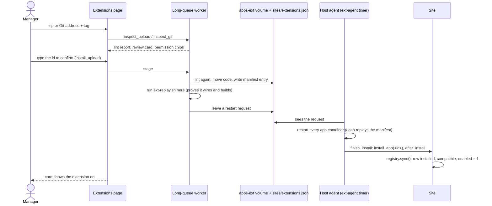

# Lifecycle

## Discovery: the registry

The core keeps one `POS Extension` row per extension on the bench: every app in `sites/apps.txt` other than `frappe`, `erpnext`, `ffl_core`, `ffl_integrations` and `ffl_woo_sync` whose `hooks.py` declares `gunshop_extension`. `ffl_core.extensions.registry.sync()` writes the rows. It runs after every `bench migrate`, after every app install and uninstall, on the Extensions page's **Refresh**, at the end of the install job, and from `bench --site <site> execute ffl_core.extensions.registry.sync`.

A row records the manifest snapshot, `installed_on_site`, `compatible` (with `incompatible_reason`) and the manager's switch, `enabled`. `sync()` never installs anything. It writes `enabled` only for a new row (on when compatible) and when an extension becomes installed on the site while compatible (switched on); otherwise the switch is the manager's alone. An extension gone from the bench and from the site loses its row; one whose hooks cannot be read is marked incompatible and kept.

## The effective state

```
effective = enabled ∧ installed_on_site ∧ compatible
```

Everything that runs follows `effective`, not `enabled`: `is_enabled`, `require_enabled`, `@extension_hook`, the JavaScript registry (`frappe.boot.gunshop_extensions[id].enabled` is already the effective state), and the scheduler wrapper. No row means off.

- **Off.** Hooks return `None`, endpoints raise `PermissionError`, registry items are not rendered, scheduled tasks are skipped. Data stays.
- **Paused.** A core upgrade that puts the core outside `requires_core` sets `compatible = 0`. The page shows **Paused** ("Needs core …"); the manager's switch is kept, and the extension runs again by itself once compatible.
- **`gunshop_extension_toggled(app, effective)`** fires once per change of the effective state while the extension is installed (a switch flip, or a compatibility change). Install and uninstall do not fire it ([Hooks](hooks.md#named-hooks)).

## Install from the Extensions page

**Settings → Extensions → Upload** takes a zip, or a public `https://<host>/<owner>/<repo>` with a branch or tag (shallow clone, no credentials; `.git` removed; `pyproject.toml` must be at the top). Both become the same upload.



Any failure while staging puts the volume and the manifest back as they were. One job runs on the pipeline at a time. Code added by hand (a manual install) appears after **Refresh** with an **Install** button, which runs `install_app` as a background job.

## Upgrade

The same upload path, for an id already on the bench that came from an upload, a Git fetch or the update source:

1. The version must be strictly higher (PEP 440). The same or an older version is refused; going back is an operator's restore.
2. The review card shows the permissions added and removed, and every release note between the two versions.
3. Stage: a database backup (`sites/.ext-backups/<site>/<id>/`), the old tree kept in `apps-ext/.previous/<id>`, the new tree swapped in.
4. The agent restarts the containers, then `bench migrate` runs your patches, fixtures and DocType changes. The switch and your data are kept.
5. A failed migrate leaves the card showing the backup path. Every further upload of that id is refused until an operator rolls it back ([Roll back an upgrade](../extensions-runbook.md#roll-back-an-upgrade)).

An extension shipped in the POS image cannot be upgraded by upload. Upgrades from the maintainers' update source show as **Update to {version}** on the card ([Release checklist](release.md#how-a-store-gets-the-new-version)).

## Uninstall

From the card: the manager types the id. The page refuses when any of the extension's DocTypes still holds records ("turn it off instead"). Otherwise a background job takes a database backup, runs Frappe's `remove_app` (your `before_uninstall`, then the module's DocTypes and tables are dropped), syncs the row and drops the upgrade rollback point. The code stays on the volume until an operator removes it.

Frappe's `remove_app` drops your module's DocTypes and deletes every record linked to your module through a `module` field (Custom Fields, Property Setters, Reports, Pages, Workspaces and the like created with `module` set). `before_uninstall` removes the rest: anything you added to core records without your module on it, such as roles, shortcuts on core workspaces, navbar items, or custom fields created without `module`. A minimal one:

```python
# acme_layaway/setup/uninstall.py   (hooks.py: before_uninstall = "acme_layaway.setup.uninstall.before_uninstall")
import frappe

from ffl_core.workspace_shortcuts import remove_shortcut

ROLES = ("Acme Layaway Manager",)

def before_uninstall():
    remove_shortcut("Acme Layaway")                      # a card on the core Settings workspace
    for name in frappe.get_all("Custom Field", filters={"fieldname": ["like", "acme\\_%"]}, pluck="name"):
        frappe.delete_doc("Custom Field", name, ignore_permissions=True, force=True)
    for role in ROLES:
        if frappe.db.exists("Role", role):
            frappe.delete_doc("Role", role, ignore_permissions=True, force=True)
```

It must be idempotent (safe to run twice), must not delete core records, and must leave no orphan Custom Field, Property Setter, Role, workspace shortcut, Scheduled Job Type or navbar item.

## Server side

Replay at container start, the agent, manual install and uninstall, and the rollback recipes: [Extensions runbook](../extensions-runbook.md).
