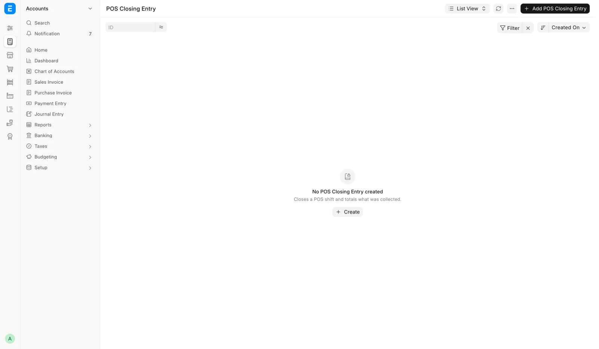
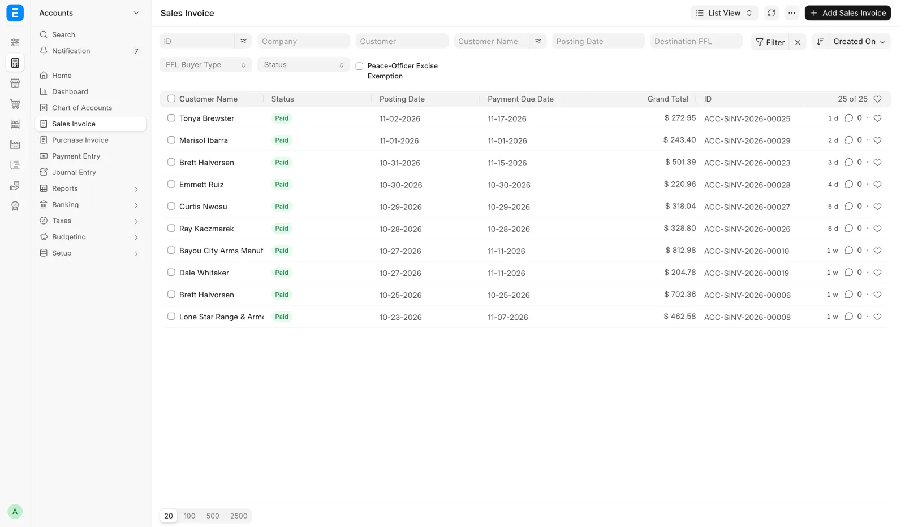

# Bookkeeping: selling, cards and orders

What the register, card payments, counter orders, web orders and GunBroker orders book. Part of [For the bookkeeper](bookkeeper.md).

## Register shifts and closings

<figure markdown>
{ .screenshot }
<figcaption>The POS Closing Entry list, shown before any shift has closed. Once a day is closed it holds one closing per shift, newest first.</figcaption>
</figure>

A register shift starts with a **POS Opening Entry** and ends with a **POS Closing Entry**. Submitting the closing posts that shift's register sales to stock and the ledger, consolidating its POS Invoices into a Sales Invoice.

- **Close the day** on the Cash Drawer page closes every open shift at once, as the nightly close would.
- At 23:00 store time a job builds a POS Closing Entry for every shift still Open, with counted equal to expected (zero variance), marks it not counted, and submits it.
- If nobody closed the day, the Cash Drawer page shows the day as not counted and books nothing for it. The next real count covers every day since the last one.
- On the nightly close, Card, Zelle and the other modes are taken as recorded. A customer's check or money order is booked to the bank, so it is not part of the drawer count.
- A shift opened in the last hour before the job runs is left alone. The next night's run takes it.
- **Close the POS** in the register menu closes one shift, but its cash figure is never a count. The drawer reads not counted until someone uses **Close the day**.

ERPNext's closing entry only picks up invoices created by the person who opened the shift. On a shared register, a sale rung by anyone else would show in the Sales Report while its stock and ledger never post. A sweep every fifteen minutes re-posts those sales:

1. Any firearm invoice whose immediate posting failed. These are never delayed or batched, because a sold gun must leave stock.
2. Any invoice from the last thirty days the nightly close left behind, fifty at a time, originals before their returns.

If an invoice keeps failing, the sweep raises a to-do for managers naming it, and the to-do closes itself once the sale posts. A shift left Open more than three days is treated as abandoned and stops holding its invoices back.

ERPNext on its own resumes a shift only for the person who opened it, and refuses a second shift on the same profile. OpenGunstore uses your own open shift if you have one, and otherwise puts you into the register's open shift.

## Firearm sales post at once

Ordinary register sales wait for the closing before stock and the ledger post. A firearm POS Invoice is consolidated into a Sales Invoice the moment the sale completes, so the serial leaves inventory at the instant of sale. This is a compliance requirement.

Recording the 4473 writes one **FFL Disposition** per gun, pushed to FastBound. The gate (Complete Order blocked until the 4473 status is Completed and NICS is Proceed) is enforced on the server.

## Register permissions the system adds

ERPNext's permissions stop short of letting a Sales User run the register end to end. On install and update the system adds register-only permissions:

- Create and submit POS Invoices, POS Opening Entries and POS Closing Entries.
- Create and submit the day's Sales Invoice, because posting a closing creates it under the person who closed.

A clerk still cannot cancel or amend a submitted sale or closing, delete a posted sale, or create a Journal Entry or Payment Entry, and has no ledger access.

ERPNext gives Sales Manager no access to items, accounts or Serial No records, and this system does not add them. A Sales Manager therefore also needs Sales User for the register and trade-ins.

Point of Sale is ERPNext's register and carries ERPNext's role list: Sales User, Sales Manager, Accounts User and Accounts Manager. Stock Manager and System Manager are not on it.

A counter login can run the 4473 and transfer-pickup reports because Sales User holds report access on POS Invoice and on **FFL Acquisition**.

## Trade-ins: what is booked

| Case | What is booked |
|---|---|
| Credit against the sale | A locked negative **Trade-in Credit** line for the acquisition cost on the POS Invoice. The FFL Acquisition is parked as a draft until the POS Invoice submits |
| Pay the seller now (credit unticked) | A Purchase Receipt from the `Individual Seller` placeholder supplier, and a seller payment from the drawer or the bank |
| Trade-ins worth more than the sale | A negative POS Invoice and a payout to the customer |

Credit against the sale. Until the POS Invoice submits, nothing is booked, no stock moves and nothing goes to FastBound. The draft FFL Acquisition carries source type Trade-in and the seller's name, address, ID type and number.

When the POS Invoice submits, the system:

1. Creates or reuses the Item. A used-firearm Item is created if none was picked.
2. Submits the FFL Acquisition.
3. Receives the gun as a Material Receipt (Stock Entry) at the acquisition cost, which creates the Serial No and puts it in the chosen storage location.
4. Pushes the acquisition to FastBound.

Pay the seller now. The system creates or reuses the Item, then creates a Purchase Receipt dated today, source Trade-in, with the gun in its storage location. It submits the FFL Acquisition (source Trade-in), books the payment from the drawer (Cash) or the bank (Zelle, Check, ACH), and pushes to FastBound.

If FastBound refuses, nothing above is kept. A cash payment reduces the drawer's expected cash at once. A wrong payment is undone on the Cash Drawer page, not in the accounting screens.

Trade-ins worth more than the sale. The ticket's Grand Total is negative and no payment is taken. Sales tax on the goods drops to 0.00 and never goes negative, so there is no tax refund.

The payout is Cash, Zelle, Check or ACH with a reference, and a cash payout leaves the drawer. Reversing it means cancelling the register ticket. A negative ticket is allowed only when trade-in credit makes it negative.

## Membership refunds and invoices

| Paid by | How it is refunded |
|---|---|
| Card | End it with **End it today**, then **Card refund** → **Refund**, type Return, on its Sales Invoice |
| Anything else | A credit note made by hand |

A membership invoice cannot be cancelled from the invoice ("… is the invoice of membership …"). Cancel it from the Memberships panel.

A declined renewal's invoice is voided. An unconfirmed renewal invoice stays open and is never charged again automatically.

## Card payments on a counter order

An approved terminal charge on a counter order (Create Order, Record Payment, or Balance due on a pickup ticket) is a **Payment Entry** on the Sales Invoice. Its transaction number is the terminal's reference, so the deposit reconciles against the processor batch.

The Sales Invoice books first and the card second. A declined card, a customer who backs out, or a timed-out terminal leaves the invoice on account with nothing recorded.

Two attempts never run at once on the same invoice. An approval interrupted before it was recorded is picked up and recorded on the next attempt, not charged twice.

Every attempt is a **Card Terminal Payment** record linked to the invoice: amount, status, card description, terminal reference and the Payment Entry it booked. The list is **Card payments** in the sidebar's Sales group, shown only while Payroc is on.

## Card Charges on a register sale

Every capture on a register sale is a row of the **Card Charges** table on the POS Invoice. The single Payroc fields above the table are totals of those rows. Only the payment integration writes them.

| Column | Holds |
|---|---|
| Captured Amount, Status, Card | The capture as the clerk saw it |
| Payroc Reference, Refunded Amount | The gateway reference and what has gone back |
| Attempt, Instruction ID, Gateway Response | Diagnostics for support |

## Card refunds and voids

| Action | What it books |
|---|---|
| **Card refund** → **Refund**, type "Return / price lowered" | A credit note takes the amount off the sale, sales tax included, in proportion to the lines. The refund is what the credit note comes to, which can be a cent off |
| **Card refund** → **Refund**, type "Collect again" | The invoice owes the amount again. Sales and tax are unchanged |
| Void on a counter order | The invoice owes the amount again |
| **Void Card Charge** on a register sale | Offered only on a Draft POS Invoice |

A "Return / price lowered" refund is refused on an invoice that sells stock items, carries a serial number, has a delivery (Delivery Note) or has a bound book entry.

A submitted register sale is not voided, because the books would then claim a payment that no longer exists. Refund a settled sale through a POS return.

A full list of every Payroc payment and refund for a date range, counter and web alike and matched to the POS, comes through the MCP server ([The MCP server](../../ai/mcp.md)), not a report. See [Month-end close](month-end.md).

## Correcting a charge the daily check flags

When the daily card charge check flags a charge no longer captured at Payroc, correct the books one of three ways:

- Collect again.
- Record the cash or other tender that replaced the card.
- Write it off.

The check never changes money itself. Which way to go is an accounting decision for a manager and the bookkeeper.

## What Create Order books

<figure markdown>
{ .screenshot }
<figcaption>Orders built on Create Order land as Sales Invoices. The list filters on Destination FFL and FFL Buyer Type.</figcaption>
</figure>

When an order is created, the system:

1. Builds and submits a Sales Order, then a Sales Invoice from it.
2. Applies destination-based sales tax, or none when the buyer is exempt, and the shipping charge with any tax it carries.
3. Books the payment (see the table below).
4. Emails the receipt to the address in **Receipt Email**.
5. Creates a Draft Distributor Order for each distributor leg, with the distributor the plan chose, under that distributor's stock number. If one cannot be built, the whole order is rolled back.
6. With **Dispose & ship now**, books one FFL transfer disposition per serial, issues the stock and queues the FastBound push. For a C&R destination, the ATF FFL Record saved from the license copy is the receiving license.
7. Takes each loose-stock line out of the storage location named when its stock leaves: at once with **Dispose & ship now**, otherwise when the order ships from the queue.
8. Pushes the shipment to ShipStation where it is enabled, so staff buy the label there.
9. Deletes the draft that was resumed, if any.
10. Emails the signing link when the buyer has not signed an agreement the sale needs (the Used Item Agreement, or one an item names), to the order's email or else the customer's.

| Payment | How it books |
|---|---|
| Full cash, Zelle, ACH or check | A counter tender on the invoice |
| A deposit | A separate Payment Entry |
| Any card charged on the terminal | A separate Payment Entry with the gateway's reference as its transaction number. The order books first, on account, and the payment is recorded after approval |

The order is created whether or not the agreement is signed. With **Dispose & ship now** and an unsigned agreement, the order is not disposed: the gun waits on Pending Order until it is signed.

The **Order Note** (staff) is saved on the invoice and kept off the customer's printed invoice.

## Editing an order replaces its invoice

Saving an edit cancels the original Sales Invoice and creates a replacement.

- Payments carry over to the replacement.
- A lower total books a refund with the chosen **Refund Method** and **Refund Reference**.
- A higher total leaves a balance outstanding.
- With **Carry payment to new buyer**, the existing payment is re-pointed to the new buyer's invoice, refunding only any difference, and the receipt notes who really paid.

A payment cannot move when it was taken in a closed period, is already matched to the bank, or its card charge was voided or refunded. Then the bookkeeper moves it by hand.

A placed distributor order is moved to the new invoice, not ordered again. A Draft or Queued distributor order is withdrawn and recreated.

Editing is refused once there is a booked disposition, a ShipStation push or mark-shipped, a submitted Delivery Note, or a completed pickup ticket (POS Invoice).

## Cancel Order

One call reverses the order:

1. Returns the firearms to stock and to the FastBound book, undoing any disposition.
2. Voids the ShipStation shipment.
3. Records a refund for whatever was paid.
4. Cancels the linked Sales Order.
5. Cancels the Sales Invoice, which is kept as the audit trail.

Nothing is deleted: the invoice, the dispositions and the refund all stay on the record.

A counter pickup whose gun left on a completed pickup ticket cannot be cancelled. While the pickup ticket (a $0 POS Invoice draft) is open, delete it first.

## Dispose and Mark Shipped on a counter order

- **Dispose** books one FFL Transfer disposition per serial, issues the stock and queues the FastBound push. On a web or GunBroker order it does the same through that channel's own path.
- **Mark Shipped (no ShipStation)** and **Mark Picked Up** also book the Delivery Note for any deferred non-firearm stock on the order, so inventory and cost of goods settle when the goods leave. Then they stamp the order shipped.
- **Record Payment** books on the **Payment received on** date, so a collection typed in late still lands in the period the deposit did.

## Web orders: what Dispose books

1. One FFL Transfer disposition per firearm serial into the bound book.
2. Issues the stock, so the gun leaves inventory.
3. Queues the FastBound push.
4. Books the revenue as a Sales Invoice mirroring the WooCommerce amounts. That invoice does not move stock again, because the disposition already did.
5. Retires the listing on the store the order came from.
6. Takes each loose-stock line out of the storage location picked.

Revenue is dated by **Transferred At** on the web order. Order Total, Total Tax, Shipping Total and Discount Total, in the order's currency, are copied from WooCommerce and not recomputed by the POS.

The web order keeps a hidden fulfillment status (Pending Fulfillment, Transferred, Cancelled), managed automatically. Only a paid Pending Fulfillment order appears on the queue. Web store statuses `processing`, `completed` and `awaiting-stock` count as paid.

## WooCommerce refunds on a web order

The web order's **WooCommerce Refunds** table has, per refund: refund id, amount, reason, when the POS recorded it, **Tax Refunded**, **Shipping Refunded** (before tax) and **Breakdown**.

| Breakdown | How the refund books |
|---|---|
| Fetched | Refunded tax comes off the invoice's tax line and refunded shipping off its shipping line, so sales tax payable drops |
| Pending | The whole refund books as a discount on the goods until the reconcile job reads the breakdown |
| Not in Woo, Rejected | A discount on the goods, and an alert is raised for each |

## GunBroker payments and invoices

**Mark Payment Received** creates no payment entry. A GunBroker order is paid before it is invoiced, and the invoice exists only once the guns are disposed.

The method, number, amount banked and deposit date recorded there are replayed onto a payment entry the moment the invoice is raised. Dispose raises the invoice, posts to the general ledger, writes the bound book disposition and pushes to FastBound.

GunBroker collects and files sales tax on its orders under its own license, so refunds go through GunBroker's process for the state filing to follow. When the POS detects a cancellation, refund or return on GunBroker, it raises an alert and changes no accounts.

If the gun has not shipped and money was taken, the correction is two entries (see "GunBroker refunds and chargebacks" on [Month-end close](month-end.md)). Then fill in **Refund Handled At** on the GunBroker Order, or it keeps appearing in the morning alert.
