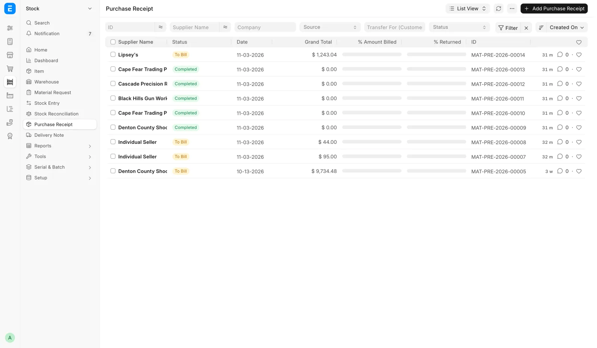
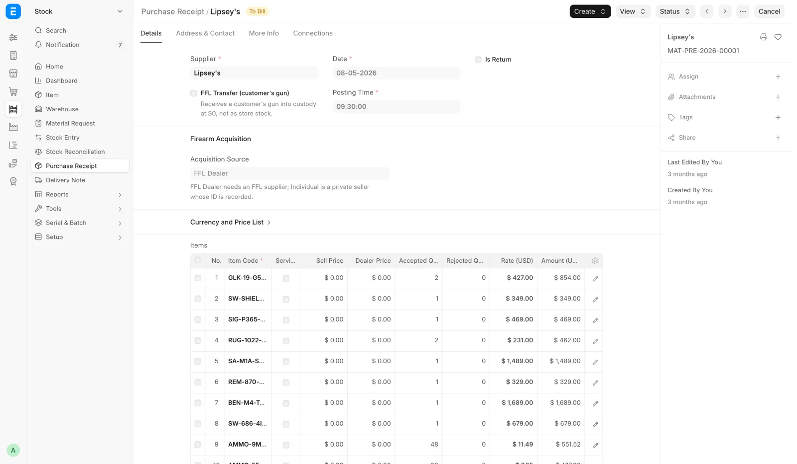

# Bookkeeping: stock and corrections

What receiving, distributor invoices, consignment, counts, the correction tools and the FastBound tools book. Part of [For the bookkeeper](bookkeeper.md).

## Distributor invoices and short shipments

- The Invoices view of Track Orders is read-only. Nothing there posts to the books.
- When a house short-ships, the cost invoice bills only what shipped.
- **Supplier** on the Distributor record is the vendor on receipts and cost invoices for that house.

## What a receive books

<figure markdown>
{ .screenshot }
<figcaption>Past receives, filtered by Source or Transfer For (Customer). A private-party buy shows the Individual Seller placeholder.</figcaption>
</figure>

Submitting Receive Goods is one transaction: either all of this happens or none of it.

1. Creates and submits a **Purchase Receipt**, the source document for the receive. Each distributor order's units get their own receipt against that order's supplier and invoiced cost. Each Outside POS invoice and the store stock each get their own receipt.
2. Writes one submitted FFL Acquisition per non-antique firearm serial (date, source, item, serial).
3. Stamps each Serial No: manufacturer, importer, model, caliber, year made, cost, sell price, service flag and zero-cost confirmation. On a `Consignment` receipt it also stamps the consignor and commission %.
4. Updates the Item: model, caliber and firearm type are kept current. Manufacturer only seeds a blank item, and importer is never written to the Item.
5. Applies the Sell Price: the item selling price for non-firearms and Uniform Pricing, the per-serial price otherwise, nothing on a customer transfer.
6. Puts the goods in their storage locations.
7. Books the seller payment on a private-party purchase.
8. Pushes to FastBound last, inside the same transaction. A rejection rolls back the receipt, serials, stock movement, locations, seller payment and acquisitions.
9. Hangs a gun received against a distributor order on that order as its held serial. For a counter pickup with a shift open, the $0 pickup ticket opens.

Every receipt starts each serial as the store's own gun and then records this stay's owner. A gun sold before and taken back never pays an earlier consignor or supplier again. Cancelling a receipt restores the serial to its state before that receipt.

<figure markdown>
{ .screenshot }
<figcaption>The submitted receipt behind a receive.</figcaption>
</figure>

A private-party purchase is booked against the placeholder supplier `Individual Seller`, created on first use. The real seller, ID and address live on the FFL Acquisition. FFL-dealer checks are skipped on that path.

Cancelling a receipt that paid a private seller leaves the seller payment recorded, and amending carries it over. A refund from the seller is undone on the Cash Drawer page.

Receipts are listed on the Purchase Receipt list and the Inventory Receipts report.

## Consignment: what a sale books

When a sale holding a consigned gun is submitted, the system freezes the commission % on the invoice line and books a **Journal Entry** against the consignor:

| Debit | Credit |
|---|---|
| Cost of goods sold, the consignor's share | **Consignment Payable**, against the consignor |

The consignor is a Supplier record named after the consignor's customer name. The sale posts at full price, so the line's profit is the commission. A 100% commission books nothing owed.

If the sale fails with `Consignment sale …: cannot book the consignor payable for … — no COGS account/cost center is configured.`, set the default expense account and cost center on the Company record, then submit again.

### What the store owes each consignor

The **Consignment Payable** account, created for the company and separate from ordinary payables, holds each consignor's balance. Two standard reports show it:

| Report | Filters | Owed |
|---|---|---|
| **General Ledger** | Account `Consignment Payable`, a date range, Group By `Group by Party` or one Party | Closing balance |
| **Accounts Payable** or **Accounts Payable Summary** | Payable Account the Consignment Payable account, Party Type `Supplier` | **Outstanding** per consignor |

Always use the account filter. A consignor whose name is also a Supplier you buy from would otherwise mix balances.

### Paying the consignor

You need **Accounts User** or **Accounts Manager**.

1. Create a new **Payment Entry**.
2. Set **Payment Type** to `Pay`, **Party Type** to `Supplier` and **Party** to the consignor.
3. Set **Paid From** to the cash or bank account the money comes from.
4. Set **Paid To** to **Consignment Payable**. The system proposes the ordinary payables account, and with that nothing is found to allocate against.
5. Click **Get Outstanding Invoices**, or add rows under References. The consignor's consignment Journal Entries appear as `Journal Entry` references.
6. Allocate the amount paid.
7. Save and submit. The balance drops at once in both reports.

There is no consignor statement, payout button or scheduled reminder.

### Cancelling a sale after the consignor was paid

Cancelling the original invoice cancels the consignor's Journal Entry too. If a Payment Entry already pays that Journal Entry, the cancel is not blocked and claws nothing back: the payment is detached and left unallocated, so the money is still paid out.

Check the consignor's outstanding balance first. If it is already zero for that sale, cancel the Payment Entry first so the books stay clean.

## Inventory count adjustments

Finishing an inventory count posts one **Stock Reconciliation** for the ticked non-serialized rows, dated the moment the count is finished. Each item is set to what was counted plus anything sold or received after it was scanned. The screen then reads "Stock Reconciliation {name} posted."

Firearms never go into the reconciliation: no disposition is created and FastBound is not called.

| Message | Meaning |
|---|---|
| "no cost on file — set the item's valuation rate, then adjust by hand" | An item counted above the books has no cost, so it cannot be adjusted |
| "The stock period is frozen through {date}; a stock count adjustment dated {date} cannot be posted." | The count is dated inside a frozen stock period |

## Storage locations never post

Placing, moving or undoing a storage location creates no stock entry, no ledger entry and no bound-book record. A location is a note on where something sits. Warehouse, stock value and the books are unchanged.

## Correct Cost: the ledger

**Correct Cost** creates one Stock Reconciliation dated today, revaluing exactly that serial. Quantity never moves, and a reconciliation that would change quantity is refused.

| Change | Debit | Credit |
|---|---|---|
| Cost goes up | The warehouse's stock account | The counter account, normally **Stock Adjustment** (profit and loss) |

No cash or accounts-payable entry is made unless "The amount actually paid to the seller was different" is ticked. Then the old-versus-new payment difference is booked against the cash drawer or bank account the seller was paid from.

If the gun was paid for and never booked, the bookkeeper posts a source-of-cost journal entry. The dialog's **Bookkeeping note** says so when the gun had almost no recorded cost.

- The serial's `purchase_rate` is updated. The Sales Report reads it for firearm cost of goods.
- Comments with the old cost, new cost, reason and user go on the reconciliation and the gun.
- FastBound's cost is not synced.
- Refused for a sold gun ("an already-sold gun's cost is realised and needs a separate journal entry"), a consigned gun, a non-firearm and a frozen accounting period.

## The other correction tools

| Tool | What it books |
|---|---|
| **Adjust Quantity** | A Stock Reconciliation setting the item to that quantity at that warehouse, the reason as a comment. Existing units keep their cost; added units take the same cost, or the item's cost when the warehouse held none |
| **+ Add Stock** | A submitted Stock Entry of type Material Receipt with the remarks on it. No Serial No and no bound-book entry |
| **Reassign Item** | Two stock movements at the gun's book value, out of the old item and into the new, same Serial No. The gun keeps its recorded cost |
| **Correct Serial** | Renames the Serial No in place. FastBound's item serial is edited in the same transaction |

**Reassign Item** repoints every submitted FFL Acquisition for the serial in place, keeping its identity, timestamp and FastBound link. **Correct Serial** repoints every submitted FFL Acquisition with the old serial and adds an audit line to each.

## Force Delete: what it removes

**Force Delete** is the override for an item that a submitted document refers to. In order, it:

1. Cancels the item's submitted invoices, delivery notes, stock entries, purchase receipts and orders, which keep their cancelled history.
2. Removes stock ledger entries, bins, Serial No records, batches and item prices.
3. Removes the item's FFL Acquisition and FFL Disposition records, then the item.

FastBound is untouched. Anyone without System Manager sees "Force-delete is restricted to System Manager."

## Stock movements from the FastBound tools

| Event | Stock effect |
|---|---|
| **Import Bound Book** | Each FastBound item becomes an Item, an FFL Acquisition and a Material Receipt. Matched by FastBound id, so a rerun skips imported items |
| **Sync Bound Book** | A Material Issue removes the guns FastBound shows as disposed, only those shown in the preview |
| `disposition.committed` for a gun disposed in FastBound with no POS sale | A Material Issue takes the gun out of stock, unless it is on an open order or part of a 4473; then an alert is raised and the gun is held |

Cancelling an acquisition whose gun is still in stock warns you to cancel its Material Receipt too, if the gun is leaving the books entirely.

## Redo 4473, the override and abandoned orders

| Action | What it does to the records |
|---|---|
| **Redo 4473** | Cancels the order's Retail Sale FFL Dispositions, sets the POS Invoice back to 4473 Pending with NICS blank, clears the FastBound and signed-PDF links, writes the reason on the order |
| **Manager Override 4473** | On the draft POS Invoice, books one Retail Sale FFL Disposition per gun with the override flag, reason and user (once per gun), and writes an F4473 record with Source `Paper / override`. FastBound is not updated |
| Clear Abandoned Order | Deletes FastBound's pending disposition, then deletes (not cancels) the draft POS Invoice. The reason goes to the Error Log and the draft can be restored from the recycle bin |
