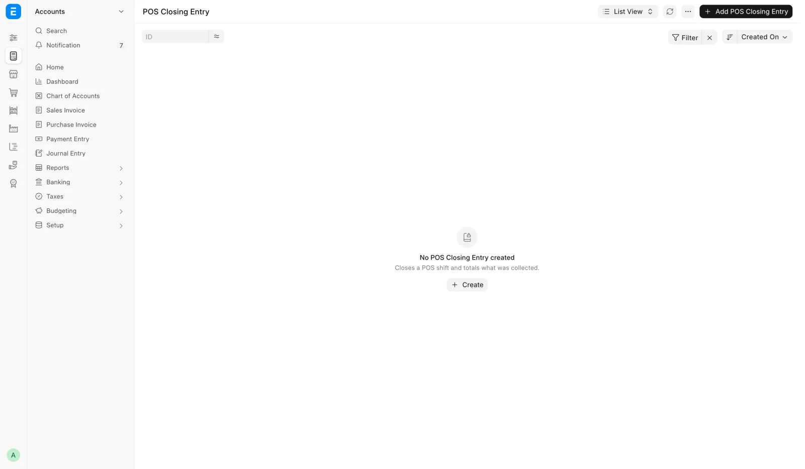
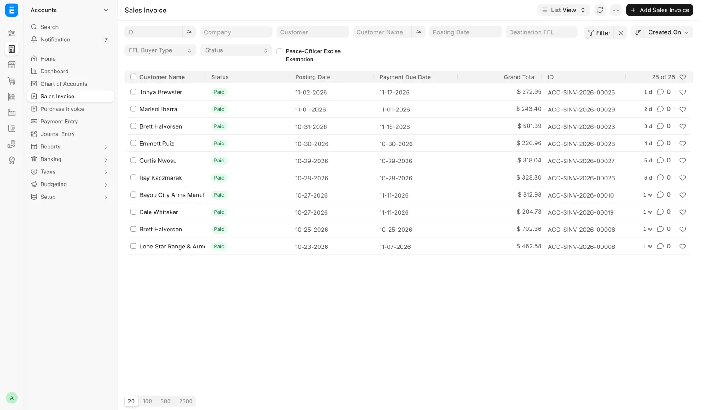
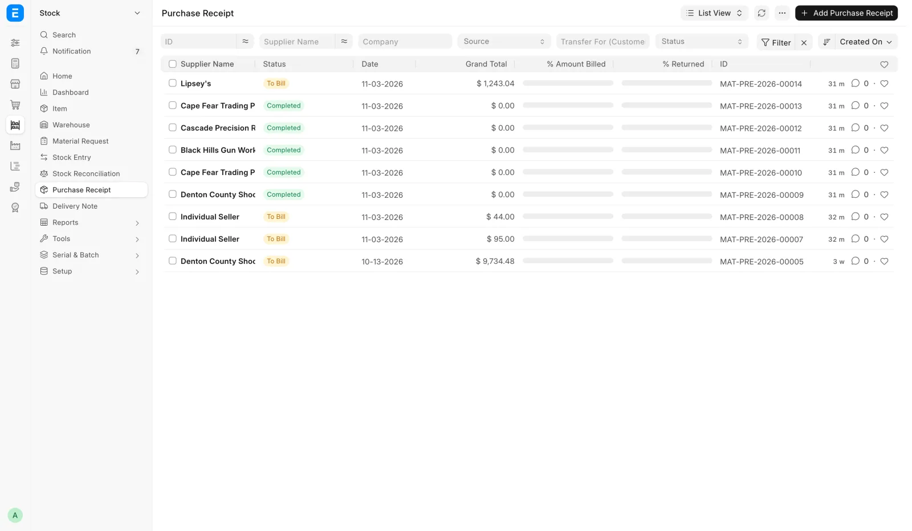
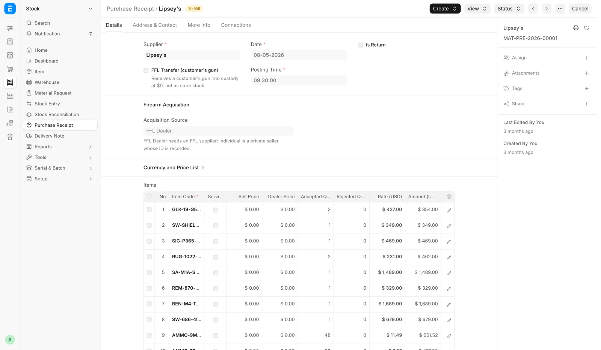

# For the bookkeeper

For the bookkeeper and the administrator, when you need to know what a counter, order, stock or compliance action books behind the screen.

The staff pages describe what a clerk sees. This page lists the documents and ledger entries behind those actions, grouped by area. Document type names here are the ERPNext names you see in the accounting screens.

| Area | Topics |
|---|---|
| Selling and the register | [Register shifts and closings](#register-shifts-and-closings), [Firearm sales post at once](#firearm-sales-post-at-once), [Register permissions](#register-permissions-the-system-adds), [Trade-ins](#trade-ins-what-is-booked), [Memberships](#membership-refunds-and-invoices) |
| Cards | [Card payments on a counter order](#card-payments-on-a-counter-order), [Card Charges on a register sale](#card-charges-on-a-register-sale), [Card refunds and voids](#card-refunds-and-voids), [Correcting a charge the daily check flags](#correcting-a-charge-the-daily-check-flags) |
| Orders | [What Create Order books](#what-create-order-books), [Editing an order](#editing-an-order-replaces-its-invoice), [Cancel Order](#cancel-order), [Dispose and Mark Shipped](#dispose-and-mark-shipped-on-a-counter-order), [Web orders](#web-orders-what-dispose-books), [Web refunds](#woocommerce-refunds-on-a-web-order), [GunBroker orders](#gunbroker-payments-and-invoices) |
| Distributors | [Distributor invoices](#distributor-invoices-and-short-shipments) |
| Receiving and stock | [What a receive books](#what-a-receive-books), [Consignment](#consignment-what-a-sale-books), [Inventory counts](#inventory-count-adjustments), [Storage locations](#storage-locations-never-post) |
| Corrections | [Correct Cost](#correct-cost-the-ledger), [Other correction tools](#the-other-correction-tools), [Force Delete](#force-delete-what-it-removes) |
| Cash drawer | [What each drawer entry books](#what-each-drawer-entry-books), [Cash drawer entries](#cash-drawer-entries) |
| Compliance records | [FastBound tools and stock](#stock-movements-from-the-fastbound-tools), [Redo 4473, override and abandoned orders](#redo-4473-the-override-and-abandoned-orders) |
| Reports and month-end | [Sales Report: what it reads](#sales-report-what-it-reads), [Sales Report and the books](#sales-report-and-the-books), [Clearing accounts](#clearing-accounts), [GunBroker checks in transit](#gunbroker-checks-in-transit), [Firearm dispositions](#firearm-dispositions-and-stock-adjustment), [Web accessory stock legs](#web-accessory-stock-legs), [Sales tax](#sales-tax-and-shipping-tax), [The GunBroker accounts](#the-gunbroker-accounts) |

## Register shifts and closings

<figure markdown>
{ .screenshot }
<figcaption>The POS Closing Entry list, shown before any shift has closed. Once a day is closed it holds one closing per shift, newest first.</figcaption>
</figure>

A register shift starts with a **POS Opening Entry** and ends with a **POS Closing Entry**. Submitting the closing posts that shift's register sales to stock and the ledger, consolidating its POS Invoices into a Sales Invoice.

- **Close the day** on the Cash Drawer page closes every open shift at once, as the nightly close would.
- At 23:00 store time a job builds a POS Closing Entry for every shift still Open, with counted equal to expected (zero variance), marks it not counted, and submits it.
- If nobody closed the day, the Cash Drawer page shows the day as not counted and books nothing for it. The next real count covers every day since the last one.
- On the nightly close, Card, Zelle and the other modes are taken as recorded. A customer's check or money order is booked to the bank, so it is not part of the drawer count.
- A shift opened in the last hour before the job runs is left alone. The next night's run takes it.
- **Close the POS** in the register menu closes one shift, but its cash figure is never a count. The drawer reads not counted until someone uses **Close the day**.

ERPNext's closing entry only picks up invoices created by the person who opened the shift. On a shared register, a sale rung by anyone else would show in the Sales Report while its stock and ledger never post. A sweep every fifteen minutes re-posts those sales:

1. Any firearm invoice whose immediate posting failed. These are never delayed or batched, because a sold gun must leave stock.
2. Any invoice from the last thirty days the nightly close left behind, fifty at a time, originals before their returns.

If an invoice keeps failing, the sweep raises a to-do for managers naming it, and the to-do closes itself once the sale posts. A shift left Open more than three days is treated as abandoned and stops holding its invoices back.

ERPNext on its own resumes a shift only for the person who opened it, and refuses a second shift on the same profile. OpenGunstore uses your own open shift if you have one, and otherwise puts you into the register's open shift.

## Firearm sales post at once

Ordinary register sales wait for the closing before stock and the ledger post. A firearm POS Invoice is consolidated into a Sales Invoice the moment the sale completes, so the serial leaves inventory at the instant of sale. This is a compliance requirement.

Recording the 4473 writes one **FFL Disposition** per gun, pushed to FastBound. The gate (Complete Order blocked until the 4473 status is Completed and NICS is Proceed) is enforced on the server.

## Register permissions the system adds

ERPNext's permissions stop short of letting a Sales User run the register end to end. On install and update the system adds register-only permissions:

- Create and submit POS Invoices, POS Opening Entries and POS Closing Entries.
- Create and submit the day's Sales Invoice, because posting a closing creates it under the person who closed.

A clerk still cannot cancel or amend a submitted sale or closing, delete a posted sale, or create a Journal Entry or Payment Entry, and has no ledger access.

ERPNext gives Sales Manager no access to items, accounts or Serial No records, and this system does not add them. A Sales Manager therefore also needs Sales User for the register and trade-ins.

Point of Sale is ERPNext's register and carries ERPNext's role list: Sales User, Sales Manager, Accounts User and Accounts Manager. Stock Manager and System Manager are not on it.

A counter login can run the 4473 and transfer-pickup reports because Sales User holds report access on POS Invoice and on **FFL Acquisition**.

## Trade-ins: what is booked

| Case | What is booked |
|---|---|
| Credit against the sale | A locked negative **Trade-in Credit** line for the acquisition cost on the POS Invoice. The FFL Acquisition is parked as a draft until the POS Invoice submits |
| Pay the seller now (credit unticked) | A Purchase Receipt from the `Individual Seller` placeholder supplier, and a seller payment from the drawer or the bank |
| Trade-ins worth more than the sale | A negative POS Invoice and a payout to the customer |

Credit against the sale. Until the POS Invoice submits, nothing is booked, no stock moves and nothing goes to FastBound. The draft FFL Acquisition carries source type Trade-in and the seller's name, address, ID type and number.

When the POS Invoice submits, the system:

1. Creates or reuses the Item. A used-firearm Item is created if none was picked.
2. Submits the FFL Acquisition.
3. Receives the gun as a Material Receipt (Stock Entry) at the acquisition cost, which creates the Serial No and puts it in the chosen storage location.
4. Pushes the acquisition to FastBound.

Pay the seller now. The system creates or reuses the Item, then creates a Purchase Receipt dated today, source Trade-in, with the gun in its storage location. It submits the FFL Acquisition (source Trade-in), books the payment from the drawer (Cash) or the bank (Zelle, Check, ACH), and pushes to FastBound.

If FastBound refuses, nothing above is kept. A cash payment reduces the drawer's expected cash at once. A wrong payment is undone on the Cash Drawer page, not in the accounting screens.

Trade-ins worth more than the sale. The ticket's Grand Total is negative and no payment is taken. Sales tax on the goods drops to 0.00 and never goes negative, so there is no tax refund.

The payout is Cash, Zelle, Check or ACH with a reference, and a cash payout leaves the drawer. Reversing it means cancelling the register ticket. A negative ticket is allowed only when trade-in credit makes it negative.

## Membership refunds and invoices

| Paid by | How it is refunded |
|---|---|
| Card | End it with **End it today**, then **Card refund** → **Refund**, type Return, on its Sales Invoice |
| Anything else | A credit note made by hand |

A membership invoice cannot be cancelled from the invoice ("… is the invoice of membership …"). Cancel it from the Memberships panel.

A declined renewal's invoice is voided. An unconfirmed renewal invoice stays open and is never charged again automatically.

## Card payments on a counter order

An approved terminal charge on a counter order (Create Order, Record Payment, or Balance due on a pickup ticket) is a **Payment Entry** on the Sales Invoice. Its transaction number is the terminal's reference, so the deposit reconciles against the processor batch.

The Sales Invoice books first and the card second. A declined card, a customer who backs out, or a timed-out terminal leaves the invoice on account with nothing recorded.

Two attempts never run at once on the same invoice. An approval interrupted before it was recorded is picked up and recorded on the next attempt, not charged twice.

Every attempt is a **Card Terminal Payment** record linked to the invoice: amount, status, card description, terminal reference and the Payment Entry it booked. The list is **Card payments** in the sidebar's Sales group, shown only while Payroc is on.

## Card Charges on a register sale

Every capture on a register sale is a row of the **Card Charges** table on the POS Invoice. The single Payroc fields above the table are totals of those rows. Only the payment integration writes them.

| Column | Holds |
|---|---|
| Captured Amount, Status, Card | The capture as the clerk saw it |
| Payroc Reference, Refunded Amount | The gateway reference and what has gone back |
| Attempt, Instruction ID, Gateway Response | Diagnostics for support |

## Card refunds and voids

| Action | What it books |
|---|---|
| **Card refund** → **Refund**, type "Return / price lowered" | A credit note takes the amount off the sale, sales tax included, in proportion to the lines. The refund is what the credit note comes to, which can be a cent off |
| **Card refund** → **Refund**, type "Collect again" | The invoice owes the amount again. Sales and tax are unchanged |
| Void on a counter order | The invoice owes the amount again |
| **Void Card Charge** on a register sale | Offered only on a Draft POS Invoice |

A "Return / price lowered" refund is refused on an invoice that sells stock items, carries a serial number, has a delivery (Delivery Note) or has a bound book entry.

A submitted register sale is not voided, because the books would then claim a payment that no longer exists. Refund a settled sale through a POS return.

A full list of every Payroc payment and refund for a date range, counter and web alike and matched to the POS, comes through the MCP server ([The MCP server](../../ai/mcp.md)), not a report. See [Month-end close](month-end.md).

## Correcting a charge the daily check flags

When the daily card charge check flags a charge no longer captured at Payroc, correct the books one of three ways:

- Collect again.
- Record the cash or other tender that replaced the card.
- Write it off.

The check never changes money itself. Which way to go is an accounting decision for a manager and the bookkeeper.

## What Create Order books

<figure markdown>
{ .screenshot }
<figcaption>Orders built on Create Order land as Sales Invoices. The list filters on Destination FFL and FFL Buyer Type.</figcaption>
</figure>

When an order is created, the system:

1. Builds and submits a Sales Order, then a Sales Invoice from it.
2. Applies destination-based sales tax, or none when the buyer is exempt, and the shipping charge with any tax it carries.
3. Books the payment (see the table below).
4. Emails the receipt to the address in **Receipt Email**.
5. Creates a Draft Distributor Order for each distributor leg, with the distributor the plan chose, under that distributor's stock number. If one cannot be built, the whole order is rolled back.
6. With **Dispose & ship now**, books one FFL transfer disposition per serial, issues the stock and queues the FastBound push. For a C&R destination, the ATF FFL Record saved from the license copy is the receiving license.
7. Takes each loose-stock line out of the storage location named when its stock leaves: at once with **Dispose & ship now**, otherwise when the order ships from the queue.
8. Pushes the shipment to ShipStation where it is enabled, so staff buy the label there.
9. Deletes the draft that was resumed, if any.
10. Emails the signing link when the buyer has not signed an agreement the sale needs (the Used Item Agreement, or one an item names), to the order's email or else the customer's.

| Payment | How it books |
|---|---|
| Full cash, Zelle, ACH or check | A counter tender on the invoice |
| A deposit | A separate Payment Entry |
| Any card charged on the terminal | A separate Payment Entry with the gateway's reference as its transaction number. The order books first, on account, and the payment is recorded after approval |

The order is created whether or not the agreement is signed. With **Dispose & ship now** and an unsigned agreement, the order is not disposed: the gun waits on Pending Order until it is signed.

The **Order Note** (staff) is saved on the invoice and kept off the customer's printed invoice.

## Editing an order replaces its invoice

Saving an edit cancels the original Sales Invoice and creates a replacement.

- Payments carry over to the replacement.
- A lower total books a refund with the chosen **Refund Method** and **Refund Reference**.
- A higher total leaves a balance outstanding.
- With **Carry payment to new buyer**, the existing payment is re-pointed to the new buyer's invoice, refunding only any difference, and the receipt notes who really paid.

A payment cannot move when it was taken in a closed period, is already matched to the bank, or its card charge was voided or refunded. Then the bookkeeper moves it by hand.

A placed distributor order is moved to the new invoice, not ordered again. A Draft or Queued distributor order is withdrawn and recreated.

Editing is refused once there is a booked disposition, a ShipStation push or mark-shipped, a submitted Delivery Note, or a completed pickup ticket (POS Invoice).

## Cancel Order

One call reverses the order:

1. Returns the firearms to stock and to the FastBound book, undoing any disposition.
2. Voids the ShipStation shipment.
3. Records a refund for whatever was paid.
4. Cancels the linked Sales Order.
5. Cancels the Sales Invoice, which is kept as the audit trail.

Nothing is deleted: the invoice, the dispositions and the refund all stay on the record.

A counter pickup whose gun left on a completed pickup ticket cannot be cancelled. While the pickup ticket (a $0 POS Invoice draft) is open, delete it first.

## Dispose and Mark Shipped on a counter order

- **Dispose** books one FFL Transfer disposition per serial, issues the stock and queues the FastBound push. On a web or GunBroker order it does the same through that channel's own path.
- **Mark Shipped (no ShipStation)** and **Mark Picked Up** also book the Delivery Note for any deferred non-firearm stock on the order, so inventory and cost of goods settle when the goods leave. Then they stamp the order shipped.
- **Record Payment** books on the **Payment received on** date, so a collection typed in late still lands in the period the deposit did.

## Web orders: what Dispose books

1. One FFL Transfer disposition per firearm serial into the bound book.
2. Issues the stock, so the gun leaves inventory.
3. Queues the FastBound push.
4. Books the revenue as a Sales Invoice mirroring the WooCommerce amounts. That invoice does not move stock again, because the disposition already did.
5. Retires the listing on the store the order came from.
6. Takes each loose-stock line out of the storage location picked.

Revenue is dated by **Transferred At** on the web order. Order Total, Total Tax, Shipping Total and Discount Total, in the order's currency, are copied from WooCommerce and not recomputed by the POS.

The web order keeps a hidden fulfillment status (Pending Fulfillment, Transferred, Cancelled), managed automatically. Only a paid Pending Fulfillment order appears on the queue. Web store statuses `processing`, `completed` and `awaiting-stock` count as paid.

## WooCommerce refunds on a web order

The web order's **WooCommerce Refunds** table has, per refund: refund id, amount, reason, when the POS recorded it, **Tax Refunded**, **Shipping Refunded** (before tax) and **Breakdown**.

| Breakdown | How the refund books |
|---|---|
| Fetched | Refunded tax comes off the invoice's tax line and refunded shipping off its shipping line, so sales tax payable drops |
| Pending | The whole refund books as a discount on the goods until the reconcile job reads the breakdown |
| Not in Woo, Rejected | A discount on the goods, and an alert is raised for each |

## GunBroker payments and invoices

**Mark Payment Received** creates no payment entry. A GunBroker order is paid before it is invoiced, and the invoice exists only once the guns are disposed.

The method, number, amount banked and deposit date recorded there are replayed onto a payment entry the moment the invoice is raised. Dispose raises the invoice, posts to the general ledger, writes the bound book disposition and pushes to FastBound.

GunBroker collects and files sales tax on its orders under its own license, so refunds go through GunBroker's process for the state filing to follow. When the POS detects a cancellation, refund or return on GunBroker, it raises an alert and changes no accounts.

If the gun has not shipped and money was taken, the correction is two entries (see "GunBroker refunds and chargebacks" on [Month-end close](month-end.md)). Then fill in **Refund Handled At** on the GunBroker Order, or it keeps appearing in the morning alert.

## Distributor invoices and short shipments

- The Invoices view of Track Orders is read-only. Nothing there posts to the books.
- When a house short-ships, the cost invoice bills only what shipped.
- **Supplier** on the Distributor record is the vendor on receipts and cost invoices for that house.

## What a receive books

<figure markdown>
{ .screenshot }
<figcaption>Past receives, filtered by Source or Transfer For (Customer). A private-party buy shows the Individual Seller placeholder.</figcaption>
</figure>

Submitting Receive Goods is one transaction: either all of this happens or none of it.

1. Creates and submits a **Purchase Receipt**, the source document for the receive. Each distributor order's units get their own receipt against that order's supplier and invoiced cost. Each Outside POS invoice and the store stock each get their own receipt.
2. Writes one submitted FFL Acquisition per non-antique firearm serial (date, source, item, serial).
3. Stamps each Serial No: manufacturer, importer, model, caliber, year made, cost, sell price, service flag and zero-cost confirmation. On a `Consignment` receipt it also stamps the consignor and commission %.
4. Updates the Item: model, caliber and firearm type are kept current. Manufacturer only seeds a blank item, and importer is never written to the Item.
5. Applies the Sell Price: the item selling price for non-firearms and Uniform Pricing, the per-serial price otherwise, nothing on a customer transfer.
6. Puts the goods in their storage locations.
7. Books the seller payment on a private-party purchase.
8. Pushes to FastBound last, inside the same transaction. A rejection rolls back the receipt, serials, stock movement, locations, seller payment and acquisitions.
9. Hangs a gun received against a distributor order on that order as its held serial. For a counter pickup with a shift open, the $0 pickup ticket opens.

Every receipt starts each serial as the store's own gun and then records this stay's owner. A gun sold before and taken back never pays an earlier consignor or supplier again. Cancelling a receipt restores the serial to its state before that receipt.

<figure markdown>
{ .screenshot }
<figcaption>The submitted receipt behind a receive.</figcaption>
</figure>

A private-party purchase is booked against the placeholder supplier `Individual Seller`, created on first use. The real seller, ID and address live on the FFL Acquisition. FFL-dealer checks are skipped on that path.

Cancelling a receipt that paid a private seller leaves the seller payment recorded, and amending carries it over. A refund from the seller is undone on the Cash Drawer page.

Receipts are listed on the Purchase Receipt list and the Inventory Receipts report.

## Consignment: what a sale books

When a sale holding a consigned gun is submitted, the system freezes the commission % on the invoice line and books a **Journal Entry** against the consignor:

| Debit | Credit |
|---|---|
| Cost of goods sold, the consignor's share | **Consignment Payable**, against the consignor |

The consignor is a Supplier record named after the consignor's customer name. The sale posts at full price, so the line's profit is the commission. A 100% commission books nothing owed.

If the sale fails with `Consignment sale …: cannot book the consignor payable for … — no COGS account/cost center is configured.`, set the default expense account and cost center on the Company record, then submit again.

### What the store owes each consignor

The **Consignment Payable** account, created for the company and separate from ordinary payables, holds each consignor's balance. Two standard reports show it:

| Report | Filters | Owed |
|---|---|---|
| **General Ledger** | Account `Consignment Payable`, a date range, Group By `Group by Party` or one Party | Closing balance |
| **Accounts Payable** or **Accounts Payable Summary** | Payable Account the Consignment Payable account, Party Type `Supplier` | **Outstanding** per consignor |

Always use the account filter. A consignor whose name is also a Supplier you buy from would otherwise mix balances.

### Paying the consignor

You need **Accounts User** or **Accounts Manager**.

1. Create a new **Payment Entry**.
2. Set **Payment Type** to `Pay`, **Party Type** to `Supplier` and **Party** to the consignor.
3. Set **Paid From** to the cash or bank account the money comes from.
4. Set **Paid To** to **Consignment Payable**. The system proposes the ordinary payables account, and with that nothing is found to allocate against.
5. Click **Get Outstanding Invoices**, or add rows under References. The consignor's consignment Journal Entries appear as `Journal Entry` references.
6. Allocate the amount paid.
7. Save and submit. The balance drops at once in both reports.

There is no consignor statement, payout button or scheduled reminder.

### Cancelling a sale after the consignor was paid

Cancelling the original invoice cancels the consignor's Journal Entry too. If a Payment Entry already pays that Journal Entry, the cancel is not blocked and claws nothing back: the payment is detached and left unallocated, so the money is still paid out.

Check the consignor's outstanding balance first. If it is already zero for that sale, cancel the Payment Entry first so the books stay clean.

## Inventory count adjustments

Finishing an inventory count posts one **Stock Reconciliation** for the ticked non-serialized rows, dated the moment the count is finished. Each item is set to what was counted plus anything sold or received after it was scanned. The screen then reads "Stock Reconciliation {name} posted."

Firearms never go into the reconciliation: no disposition is created and FastBound is not called.

| Message | Meaning |
|---|---|
| "no cost on file — set the item's valuation rate, then adjust by hand" | An item counted above the books has no cost, so it cannot be adjusted |
| "The stock period is frozen through {date}; a stock count adjustment dated {date} cannot be posted." | The count is dated inside a frozen stock period |

## Storage locations never post

Placing, moving or undoing a storage location creates no stock entry, no ledger entry and no bound-book record. A location is a note on where something sits. Warehouse, stock value and the books are unchanged.

## Correct Cost: the ledger

**Correct Cost** creates one Stock Reconciliation dated today, revaluing exactly that serial. Quantity never moves, and a reconciliation that would change quantity is refused.

| Change | Debit | Credit |
|---|---|---|
| Cost goes up | The warehouse's stock account | The counter account, normally **Stock Adjustment** (profit and loss) |

No cash or accounts-payable entry is made unless "The amount actually paid to the seller was different" is ticked. Then the old-versus-new payment difference is booked against the cash drawer or bank account the seller was paid from.

If the gun was paid for and never booked, the bookkeeper posts a source-of-cost journal entry. The dialog's **Bookkeeping note** says so when the gun had almost no recorded cost.

- The serial's `purchase_rate` is updated. The Sales Report reads it for firearm cost of goods.
- Comments with the old cost, new cost, reason and user go on the reconciliation and the gun.
- FastBound's cost is not synced.
- Refused for a sold gun ("an already-sold gun's cost is realised and needs a separate journal entry"), a consigned gun, a non-firearm and a frozen accounting period.

## The other correction tools

| Tool | What it books |
|---|---|
| **Adjust Quantity** | A Stock Reconciliation setting the item to that quantity at that warehouse, the reason as a comment. Existing units keep their cost; added units take the same cost, or the item's cost when the warehouse held none |
| **+ Add Stock** | A submitted Stock Entry of type Material Receipt with the remarks on it. No Serial No and no bound-book entry |
| **Reassign Item** | Two stock movements at the gun's book value, out of the old item and into the new, same Serial No. The gun keeps its recorded cost |
| **Correct Serial** | Renames the Serial No in place. FastBound's item serial is edited in the same transaction |

**Reassign Item** repoints every submitted FFL Acquisition for the serial in place, keeping its identity, timestamp and FastBound link. **Correct Serial** repoints every submitted FFL Acquisition with the old serial and adds an audit line to each.

## Force Delete: what it removes

**Force Delete** is the override for an item that a submitted document refers to. In order, it:

1. Cancels the item's submitted invoices, delivery notes, stock entries, purchase receipts and orders, which keep their cancelled history.
2. Removes stock ledger entries, bins, Serial No records, batches and item prices.
3. Removes the item's FFL Acquisition and FFL Disposition records, then the item.

FastBound is untouched. Anyone without System Manager sees "Force-delete is restricted to System Manager."

## What each drawer entry books

"The drawer should hold" is the cash account's balance plus cash from register sales still being posted in open shifts.

| Entry | Booked as |
|---|---|
| Deposit, cash from bank, cash expense, seller payment for received goods | A Journal Entry |
| Count difference | A Journal Entry to the cash over and short account, with the reason |
| The store's very first count | Sets the books to what was counted, with no loss booked; the accountant gets a note |
| "Paid outside the system" | Nothing |

Count differences and the first count change the Log balance but are not counted as cash in or out. Purchases received before **Cash tracking started** (Cash Drawer Settings) are left to the accountant.

When **Accounts a cash expense can go to** is empty, a cash expense can go to the standard accounts: Print and Stationery, Office Maintenance Expenses, Freight and Forwarding Charges, Postal Expenses, Meals, Entertainment Expenses and Miscellaneous Expenses.

On Cash Drawer Weekly, the week foots when "Daily lines add up to" equals "Cash ledger movement", Difference is 0.00, and the "Unclassified ledger lines" Note reads "None."

## Cash drawer entries

Every journal entry the drawer books (a deposit, cash from the bank, an expense, a seller payment, a count difference) can be undone only from the Cash Drawer page. Cancelling, reversing or amending one from the accounting screens is refused with a message saying where to go. This includes entries labeled **Owner took (old entries)**.

A register-ticket payout, where the store paid the customer for trade-ins, goes away by cancelling that ticket.

**First count & history** on Cash Drawer Weekly: the store's first count set the books to the drawer once. A later correction to the days before it is booked to it at the next count.

## Stock movements from the FastBound tools

| Event | Stock effect |
|---|---|
| **Import Bound Book** | Each FastBound item becomes an Item, an FFL Acquisition and a Material Receipt. Matched by FastBound id, so a rerun skips imported items |
| **Sync Bound Book** | A Material Issue removes the guns FastBound shows as disposed, only those shown in the preview |
| `disposition.committed` for a gun disposed in FastBound with no POS sale | A Material Issue takes the gun out of stock, unless it is on an open order or part of a 4473; then an alert is raised and the gun is held |

Cancelling an acquisition whose gun is still in stock warns you to cancel its Material Receipt too, if the gun is leaving the books entirely.

## Redo 4473, the override and abandoned orders

| Action | What it does to the records |
|---|---|
| **Redo 4473** | Cancels the order's Retail Sale FFL Dispositions, sets the POS Invoice back to 4473 Pending with NICS blank, clears the FastBound and signed-PDF links, writes the reason on the order |
| **Manager Override 4473** | On the draft POS Invoice, books one Retail Sale FFL Disposition per gun with the override flag, reason and user (once per gun), and writes an F4473 record with Source `Paper / override`. FastBound is not updated |
| Clear Abandoned Order | Deletes FastBound's pending disposition, then deletes (not cancels) the draft POS Invoice. The reason goes to the Error Log and the draft can be restored from the recycle bin |

## Sales Report: what it reads

Sales fan out across two document types, so the report reads both and counts each sale once:

- **POS Invoice**, submitted, for counter sales. Channel **POS**.
- **Sales Invoice**, submitted and not consolidated, for everything raised as an order. Channel **Web**, **GunBroker** or **Manual** by where the order came from.

Consolidated Sales Invoices are left out. They are the nightly roll-ups of POS Invoices the report already counted, so including them would double the day. Today's counter sales show at once, before the nightly close.

The **Tax lines** view reads per-line tax from the invoice's tax detail. It adds an order-level shipping row, and an unclassified-charge row for any tax account that is neither sales tax nor shipping.

## Sales Report and the books

- Net Sales is higher than the ledger income account by exactly the period's trade-in allowances, because Net Sales is gross of trade-in credits. Profit still ties to the ledger. On the netted figure a 15% gun would read about 39% margin.
- **Do not reconcile the Cost column against ledger cost of goods sold for non-serialized lines.** The ledger books those at actual first-in first-out cost, and the report estimates them from the bin's moving average. The gap grows with ammunition volume.
- **A refunded web order comes off its own lines.** The refund takes the refunded sales tax and shipping off the invoice's tax and shipping lines, not off the goods. In a month with refunds the Tax lines view shows lower tax and shipping, not a goods discount.
- A GunBroker sale shows zero sales tax. GunBroker collects and remits as the marketplace provider under its own license, so the tax lands on a marketplace liability account. Do not chase in-state GunBroker orders as missing-tax exceptions.
- **Marketplace fees are an expense, not cost of goods.** They sit in Channel Fees, never inside Cost.

Cost is computed, not stored. Nothing stores cost on an invoice line, so the report computes it per line:

| Line | Cost |
|---|---|
| Trade-in credit | Zero |
| Consigned gun | Net sales × (1 − commission rate) |
| Firearm | The sum of purchase prices on its serials |
| Anything else | Signed quantity × moving-average cost in that warehouse |

| Card | What it holds |
|---|---|
| **Sales Tax** | All sales tax charged in the period, including tax on shipping, excluding tax a marketplace collected. It should equal the period's Sales Tax Payable credits from sales invoices |
| **Marketplace sales** | Merchandise net plus freight income on GunBroker orders delivered to the store's state, excluding the marketplace's collected tax and buyer service fee |

## Clearing accounts

| Account | What the balance is | How to clear it |
|---|---|---|
| Payroc Card Clearing | Card takings not yet in the bank | Compare with bank deposits. The gap is processor fees |
| Woo Clearing | Web takings not yet settled | Same, against the WooCommerce settlement report |
| GunBroker Clearing | Card channel only | Zero while the store takes checks and money orders |

The daily card charge check reads the last week's card charges back from Payroc. It emails **Payroc: … card charge(s) no longer captured at the gateway** for any charge voided or refunded outside the POS, with a comment on its invoice. Resolve each before closing (see [Correcting a charge the daily check flags](#correcting-a-charge-the-daily-check-flags)).

## GunBroker checks in transit

GunBroker checks in transit are a bank-side item, not a clearing account. Checks and money orders go into the operating bank account named in GunBroker Settings (**Check deposit account**).

The bank reconciliation always carries a batch of deposits that have landed in the bank with nothing yet on the ledger. The receipt posts on its invoice date, never on the deposit date, and the money arrives before the gun is disposed.

Tie the batch out against the sum of the **Banked Amount** column on item 3 of GunBroker Cash Basis Adjustments. Do not use the sum of order totals, which differs on a short or over payment, and do not net refunds out of it.

## Firearm dispositions and Stock Adjustment

A firearm disposition leaves stock through a material issue that posts to **Stock Adjustment**. Debits on that account arising from firearm dispositions are cost of goods sold, not shrinkage.

Non-firearm lines such as ammunition and optics post to Cost of Goods Sold directly and are outside this manual reclassification.

## Web accessory stock legs

A web order's Sales Invoice does not move stock itself. Its firearms leave through the disposition, and its accessory lines leave through a Delivery Note raised against the invoice.

When that leg is missing, the Sales Report still shows a cost, because its cost comes from the bin valuation, not the ledger. The report cannot reveal the gap.

An open task is raised once on the Sales Invoice or web order for each of these:

- A stock leg that could not be issued.
- A revenue booking that keeps failing.
- An order whose only invoice is cancelled.
- A refund held because someone is holding the stock leg.
- An invoice left in draft on a total mismatch.

A submitted return against a web Delivery Note puts the goods back at their original valuation on the return's own date. The Sales Report does not net that out, so in such a month report cost exceeds ledger cost of goods sold by the returned amount.

## Sales tax and shipping tax

- With **Shipping Price Includes Sales Tax** on in FFL Settings (the default), the shipping price on an order is what the customer paid. The tax is carved out of it and reported as usual. Whether shipping is taxable depends on the state.
- A refunded web order takes the refunded tax and shipping off the invoice's own tax and shipping lines, so Sales Tax Payable drops by the refunded tax.
- Sales Tax Payable is always zero on a GunBroker order. GunBroker collects and remits as the marketplace provider into its own liability account, GunBroker MPF Sales Tax Payable. Check that account's credits instead.

Worked example at an 8.25% rate: $320.00 of goods with $23.10 of shipping carries $26.40 of tax on the goods and a $1.91 shipping tax row.

| Figure | Amount |
|---|---|
| Sales Tax card, and the Sales Tax Payable credit (8.25% of $343.10 taxable) | $28.31 |
| Wrong: adding the shipping tax again | $30.22, overstating tax due by $1.91 |
| The invoice's Total Taxes and Charges (not the tax figure: it includes $23.10 of shipping income) | $51.41 |

## The GunBroker accounts

| Account | What it holds | How it clears |
|---|---|---|
| GunBroker MPF Sales Tax Payable | Tax GunBroker collected as marketplace provider | Against the tax statement. Remit when GunBroker's statement says to, by journal entry |
| GunBroker Marketplace Fee Payable | The buyer service fee GunBroker charges the buyer through you | Against whichever statement carries it. The report lists it apart from the collected tax |
| Accrued GunBroker Fees | Final value fees and FFL document fees owed, accrued per item | Against GunBroker's fee bill, by journal entry |
| Marketplace Fees - GunBroker | The expense side of that accrual | A profit-and-loss expense, never cost of goods |
| GunBroker Clearing | The card channel's clearing account | Zero while the store takes checks only |

Settle these with journal entries, not purchase invoices. There is no payable to age.

The books accrue, and a return may be filed on the cash basis. Seven items bridge the two, and **GunBroker Cash Basis Adjustments** is the schedule.

A GunBroker order is always paid before it is invoiced, and the receipt posts on the invoice date, never on the deposit date. Otherwise reconciling the bank and reading the invoices would count the same check twice.

There is no refund button for GunBroker orders in the POS. GunBroker files the sales tax under its own license, so a refund issued in the POS would refund the buyer's tax while GunBroker still reports the original amount, and the store would absorb the difference.
