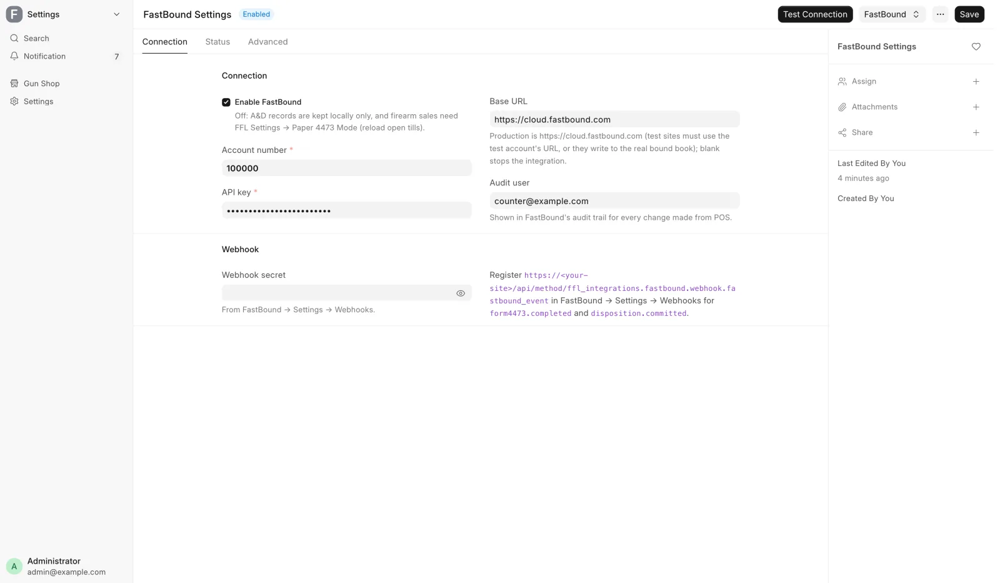
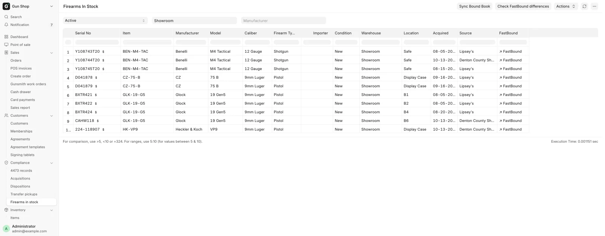

# FastBound

For the administrator who connects FastBound, and the manager who fixes a record it refused.

FastBound holds the electronic bound book. The POS writes to it whenever a gun is received or leaves, and reads back from it when a Form 4473 completes. Counter staff meet it only through failure messages, which link here.

<figure markdown>
{ .screenshot }
<figcaption>The connection form. Test Connection sits on the toolbar, the other two buttons under the FastBound menu beside it. All three depend on Enable FastBound.</figcaption>
</figure>

## What syncs

Out of the POS, automatically:

| Event | What goes to FastBound |
|---|---|
| A firearm is received | One acquisition per gun, with the source contact |
| A gun ships to another licensee | A `Dealer Transfer`, `FFL Transfer` or `Return` disposition |
| A gun is destroyed | A `Scrap` or `Destroyed` disposition, with both witnesses |
| A record is cancelled | A delete of the matching FastBound record |
| Firearm details are edited on a gun in the book | An in-place edit, after you confirm |
| A serial is corrected | An in-place serial edit, in the same transaction |

Each acquisition carries the date, the acquisition type, a note naming the receive source, the source contact and one item. The item carries manufacturer, model, serial, caliber and type, plus SKU, UPC, MPN, importer and cost.

The serial's own values win over the item's, and importer comes from the serial only. A blank in any of the five required fields is sent as the literal `Unknown`, which is why [Receive goods](../stock/receive-goods.md) makes you confirm them.

Into the POS, from FastBound: a retail sale's disposition is never pushed. When a 4473 completes, FastBound calls the webhook (below), and the POS books the disposition itself. `Retail Sale`, `Sale`, `Private Party Transfer`, `Donation`, `Gunsmithing` and `NFA` are never pushed automatically.

## Settings and buttons

Open **Settings**, then **FastBound (A&D Book)** under **Integrations**. FFL Settings and FastBound Settings are separate pages. [Integrations](integrations.md) covers every field: account number, API key, base URL, audit user, webhook secret, and the Status tab with the last import and the cached type lists.

**Enable FastBound** is the master switch. Its description: "Off: A&D records are kept locally only, and firearm sales need FFL Settings → Paper 4473 Mode (reload open tills)."

With it off, the three buttons below do not appear. With it on, **Test Connection** is on the toolbar, and **Sync FastBound Lists** and **Import Bound Book** are under the **FastBound** menu.

### Test Connection

Confirms the credentials work. Run it after changing the account number, the key or the base URL. On success: "FastBound connection OK. Account: <name>". A failure names the reason, such as `FastBound is not configured: ...` or `FastBound API error: ...`.

### Sync FastBound Lists

Refreshes the acquisition-type and disposition-type dropdowns from your FastBound account, so the choices on [the bound book](../compliance/bound-book.md) records match your account. It runs on its own once a day. Run it by hand after adding a custom type in FastBound. On success: "Synced N acquisition + M disposition type(s) from FastBound."

### Import Bound Book

A one-off migration. It pulls every item from your FastBound bound book and mirrors it into the POS as items, acquisitions and stock receipts. Items already imported, matched by their FastBound id, are skipped, so running it twice is safe.

1. Save the form first, or you are told to.
2. Click **FastBound**, then **Import Bound Book**.
3. Pick **Aggregate By**. `auto` groups by SKU, then UPC, then MPN, then manufacturer and model. `model` ignores SKU, UPC and MPN and groups by manufacturer, model and caliber. Pick `model` when your distributor SKUs are noisy.
4. Set **Page Size**, the items fetched per request. Default 100.
5. Tick **Dry Run** for the first run. It counts what would be imported and writes nothing.
6. Click **Start Import**.

A large book takes several minutes. The importer commits after every item, so a crash part way does not lose work. The result reports Fetched, Created (or Would create), Skipped (already imported) and Errors. Run it again without **Dry Run** once the counts look right.

## The webhook

FastBound calls a URL on this site when something happens there. Register it in FastBound under Settings → Webhooks for the events `form4473.completed` and `disposition.committed`. The URL is printed on the FastBound Settings form beside **Webhook secret**, with `<your-site>` standing for your site's address.

Deliveries are signed, and **Webhook secret** must match the one FastBound shows. A wrong or missing signature is refused.

`form4473.completed` does four things:

- Stamps the held order with the 4473 result and the NICS outcome, books the disposition for each gun, and unlocks the till.
- Writes or updates the [4473 record](../compliance/4473-records.md), whatever the NICS result and whether or not it matches an order here, and queues a private copy of the signed PDF. Copies that miss are retried every hour.
- Rings the bell of the counter's 4473 roles with the NICS result ([Form 4473 and NICS](../compliance/4473.md#when-a-result-comes-back)).
- Emails the buyer when a previously delayed check has proceeded.

`disposition.committed` confirms the disposition. It also catches a gun disposed directly in FastBound with no sale here. Such a gun is taken out of stock automatically, unless it is on an open order or part of a 4473: then an alert is raised and the gun is held instead.

## Failed pushes

A push failure does not lose the record. It parks it.

**Where the error shows.** The FFL Acquisition or FFL Disposition carries **FastBound Sync Error** with the reason, in FastBound's own words. A record is waiting when it is submitted and its **FastBound ID** is empty. It is stuck when the sync error is not empty.

**What retries on its own.** A daily job re-sends every submitted record with no FastBound ID, and a second daily job retries deletes that failed. A transient network error clears this way. Both skip records whose error begins `[TERMINAL]`, which need a person, and records marked `[NOT A&D]` are never pushed or retried.

**Where you see it.** The Dashboard's **A&D** block counts **Not logged**: records submitted more than 15 minutes ago that FastBound does not have. Under it, "N retrying · N need a person" splits them.

**Review N not logged** opens **Not in the bound book yet**, listing each **Record**, its **State** (**Will retry** or **Needs a person**) and its **Last error**. The button shows only to someone who can read both acquisitions and dispositions.

**Where you are told.** A push FastBound refuses for good rings the bell of every Stock Manager, Sales Manager and System Manager: "A&D book: FastBound refused <record type> <record> — <reason>". A daily digest also emails the alert recipients in [FFL Settings](ffl-settings.md), or every System Manager when that is blank:

```
[POS Alert] N FastBound record(s) stuck unsynced
```

Each line names the record and its error. A line beginning `[needs human]` is a terminal failure that will not be retried.

**Receiving is the exception.** The push during [Receive goods](../stock/receive-goods.md) happens while you wait, and a rejection undoes the whole receive, so there is no stuck state:

```
FastBound rejected this firearm, so nothing was received — fix the issue and
receive again.
```

Read the reason, correct the firearm details or the supplier's FFL, and receive again.

### Fix a failed push

1. Open the FFL Acquisition or FFL Disposition named in the alert, or click it in **Review N not logged**.
2. Read **FastBound Sync Error**.
3. Fix what it names. A missing manufacturer or caliber is fixed on the gun. A rejected FFL number is fixed on the receiving dealer ([Verify an FFL](../compliance/ffl-verification.md)).
4. Let the daily retry send it, or push it now: on the gun's Serial No, **Sync with FastBound** pushes that one gun.

Three errors need more than a fix and a retry:

- "Already disposed" in FastBound: do not push again. Either the transfer is already recorded there and the two records need linking, or it is wrong and should be voided in FastBound. Both are manager work.
- "Serial not found in FastBound": its acquisition never landed. Fix the acquisition first, then retry the disposition.
- Details wrong on the record itself: cancel and amend it. Cancelling a record whose gun is still in stock warns: "Serial <n> is still in stock. If this gun is leaving the books entirely, cancel its Material Receipt too; if you are amending the record, submit the amendment now."

If the record should never have been in the bound book at all, do not push it again. Mark it, as below.

!!! warning "Federal recordkeeping"
    Fix a failed disposition the same day. A gun that has left the building with no exit in the bound book is a recordkeeping gap, not a sync backlog.

### A record that does not belong in the bound book

Sometimes a submitted acquisition or disposition should never have been in the A&D book, and FastBound rightly refuses it. The usual case is an antique booked by mistake: FastBound never acquired the gun, so the record waits on the **Not logged** list for good.

A Stock Manager or System Manager who has checked the record can mark it as not in the bound book. The record is not cancelled, because its stock entry is right. It drops off the **Not logged** list, the daily retry and the stuck digest.

!!! danger "Only for records that never belonged in the book"
    Marking a record stops it ever reaching FastBound. Use it only when you have confirmed the gun is not a regulated firearm the store must book, such as an antique. A regulated gun's record must be fixed and pushed, never marked.

There is no button for this on any screen. It is done through an MCP client connected to the POS's **Full MCP Server** (open **Settings**, then **MCP Settings** under **FFL & Compliance**), signed in with your own POS account. See [The MCP server](../../ai/mcp.md).

1. Open the record and read **FastBound Sync Error**. Confirm it does not belong in the bound book, for example that its item is marked **Antique**.
2. Call `ffl_integrations.fastbound.reconcile.mark_not_in_bound_book` with `doctype` (`FFL Acquisition` or `FFL Disposition`), `name` and your `reason`.
3. Reopen the record. **FastBound Sync Error** now reads `[NOT A&D] ` followed by your reason, and a comment records who marked it and the error it had before.

If the record does belong after all, call `ffl_integrations.fastbound.reconcile.clear_not_in_bound_book` with the same `doctype` and `name`. The sync error is emptied, the daily retry pushes it again, and the Dashboard lists it until it lands. A comment records who cleared it. Both calls are written to the Connector Audit Log with your user.

## Checking the two books agree

Both tools are on the **Firearms In Stock** report: in the sidebar, **Compliance → Firearms in stock**. It opens for Stock User, Stock Manager and System Manager. Reading the report is item 4 of the [daily checks](../compliance/daily-checks.md#4-firearms-in-stock-against-fastbound).

<figure markdown>
{ .screenshot }
<figcaption>Both comparison tools sit on this report toolbar, not on a settings page. Location shows where each gun sits in the store.</figcaption>
</figure>

### Check FastBound differences

Compares every in-stock gun's manufacturer, importer, model, caliber and firearm type against the bound book. It runs in the background and reports when it finishes.

- If everything matches: "All in-stock firearms match FastBound."
- If not, the summary is titled "FastBound Scan: N gun(s) differ" and says: "Open each gun's Serial No and use 'Sync with FastBound':", followed by each serial and the fields that disagree.

To fix one gun:

1. Open the gun's Serial No.
2. Click **Sync with FastBound**. The dialog is **Reconcile with FastBound**, with each differing field and its two values.
3. For each field, pick **Use FastBound** to correct the POS, or **Use POS** to push your value into the bound book.
4. Click **Apply**.

A gun with no FastBound link offers to match it by serial number instead. A gun FastBound shows as disposed is not field-synced, because the stock mismatch has to be resolved first.

### Sync Bound Book

Finds guns in stock here but marked disposed in FastBound, usually because a sale was recorded there and never here. It needs Stock Manager, Sales Manager or System Manager.

It previews first. With nothing to do: "In sync — no in-stock firearm is marked disposed in FastBound." Otherwise it asks: "FastBound reports these N in-stock firearm(s) as disposed. Remove them from ERPNext stock (Material Issue)?" with the list. Confirming takes out exactly the guns you were shown.

## Troubleshooting

| You see | What it means | Fix |
|---|---|---|
| `FastBound is not configured: ...` | Account number, key or base URL is missing. | Fill them in, then **Test Connection**. |
| `FastBound API error: ...` | FastBound answered with an error. | Read the text. Usually the key or the account number. |
| Buttons missing on FastBound Settings | **Enable FastBound** is unticked. | Tick it, or work in Paper 4473 Mode. |
| `[POS Alert] N FastBound record(s) stuck unsynced` | Records failed to push. | Open each and [fix the push](#fix-a-failed-push). |
| A line beginning `[needs human]` in that digest | A terminal failure that will not be retried. | Fix it by hand. It will not clear itself. |
| A bell notice "A&D book: FastBound refused …" | FastBound refused a push for good. | [Fix the push](#fix-a-failed-push). |
| `... firearm serial '<n>' not found in FastBound — was its acquisition pushed?` | The gun was never acquired in the bound book. | Fix the acquisition first, then retry the disposition. |
| `... is already disposed in FastBound ... and cannot be disposed again.` | The bound book already records this gun leaving. | Manager work. Link the records or void the FastBound entry. |
| `FastBound rejected this firearm, so nothing was received` | A receive was refused and rolled back. | Fix what the message names and receive again. |
| **FastBound Sync Error** begins `[NOT A&D]` | A manager marked it as not in the bound book. | Nothing, unless it does belong. Then clear the mark. |
| `Say why this record is not in the bound book.` | The mark was asked for without a reason. | Give the reason. |
| `… is not a submitted record missing from the bound book — nothing to mark.` | The record is a draft, cancelled, or already in FastBound. | Nothing to mark. |
| `… is not marked as off the bound book.` | Clearing was asked for on a record with no mark. | Nothing to clear. |

## Related pages

- [The bound book](../compliance/bound-book.md) for the records being pushed.
- [Form 4473 and NICS](../compliance/4473.md) for the retail-sale flow that comes back.
- [Fix a mistake](../stock/corrections.md) for **Correct Serial** and **Reassign Item**.
- [Integrations](integrations.md) for every FastBound Settings field.
