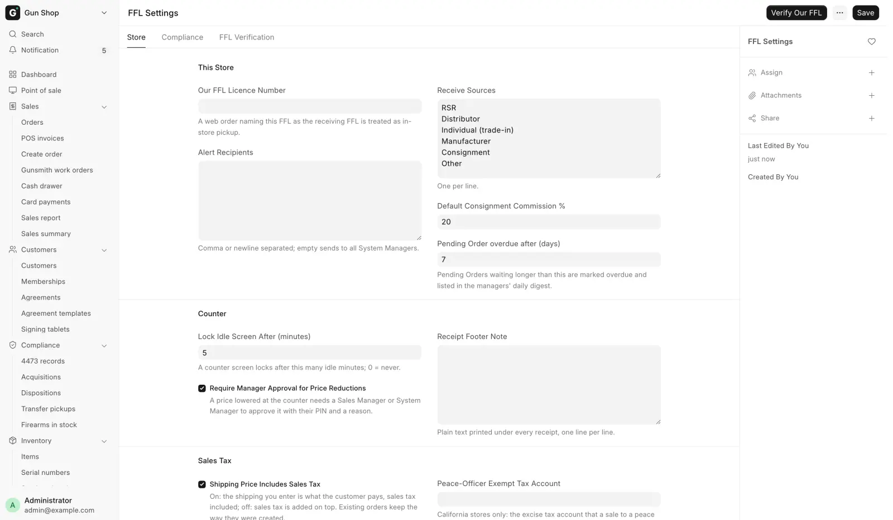

# FFL Settings

For the store's administrator, when you set up the store's own compliance configuration or change how the counter behaves.

FFL Settings holds who the store is, how 4473s are handled, how customer ID numbers are kept, and how other dealers' licenses are checked. System Manager only. Open **Settings**, then **FFL Settings** under **FFL & Compliance**.

<figure markdown>
{ .screenshot }
<figcaption>FFL Settings opens on the Store tab.</figcaption>
</figure>

The form has three tabs: **Store**, **Compliance** and **FFL Verification**.

!!! warning "These fields change how the counter behaves"
    Paper 4473 Mode changes what staff see on the register, from the next page load. Save once, then reload every open till.

## Store tab

### This Store

| Field | Default | What it does |
|---|---|---|
| **Our FFL Licence Number** | Blank | This store's own FFL |
| **Alert Recipients** | Blank | Who gets the system's alert emails |
| **Receive Sources** | A standard list | The Source choices on Receive Goods |
| **Default Consignment Commission %** | 20 | The store's cut on a consigned gun |
| **Pending Order overdue after (days)** | 7 | When a queue row counts as overdue |

**Our FFL Licence Number.** A web order that names this license as the receiving FFL is an in-store pickup, not a shipment. The buyer collects at the counter and completes a 4473 here, and the system refuses to book a transfer to the store itself. Blank changes nothing.

**Alert Recipients.** Emails, separated by commas or new lines. Sync failures, stuck-record digests and the daily overdue-orders email land here. Empty sends them to every System Manager. See [What runs automatically](background-jobs.md).

**Receive Sources.** One source per line. It fills the Source list on [Receive goods](../stock/receive-goods.md), on the FFL Acquisition form and on Purchase Receipt. The default list is RSR, Distributor, Individual (trade-in), Manufacturer, Consignment and Other. An edit shows the next time a form is refreshed.

**Default Consignment Commission %.** Used when the receipt line or the gun carries no rate of its own. It prefills the commission on Receive Goods for a `Consignment` receipt. Changing it leaves guns already received alone. See [Consignment](../stock/consignment.md).

**Pending Order overdue after (days).** A row older than this is marked overdue on [Pending Orders](../orders/pending-orders.md). Once a day, the counter orders that are blocked or older than this go out in one email, "Pending orders needing attention", to the Alert Recipients. Nothing is sent on a day with nothing stuck.

### Counter

**Lock Idle Screen After (minutes).** A counter screen locks after this many idle minutes, 5 by default. 0 means never.

**Require Manager Approval for Price Reductions.** On by default for a newly set-up store. A store upgraded from an earlier release starts with it off until a manager turns it on.

While it is on, these save only after a Sales Manager or System Manager approves with their counter PIN and a reason:

- a price lowered below list at the register, on Create Order, or on an order or invoice form;
- an invoice discount;
- a return.

A signed-in manager approves their own. Discounts the system gives, such as pricing rules and sale prices, never ask. See [Sell accessories](../counter/sell-accessories.md).

**Receipt Footer Note.** Store policy printed under every receipt, one line per line. Empty prints nothing. Plain text only: it goes into the receipt as written, so angle brackets and ampersands would be read as markup.

### Sales Tax

**Shipping Price Includes Sales Tax.** On by default. The shipping you enter on a taxed order is what the customer pays, with the tax inside it, and the receipt says "sales tax included". Off adds the tax on top. It affects new orders only. See [Build an order](../orders/build-an-order.md).

**Peace-Officer Exempt Tax Account.** California stores only. The account the 11% firearm and ammunition excise tax is booked to.

Once it is set, Create Order and the register offer the peace-officer exemption, which takes that tax off a sale and keeps sales tax. Blank offers nothing. A store whose company address is not in California cannot set it.

### Gunsmithing

**Gunsmith Labor Item.** The labor item a gunsmith work order charges. Empty uses `GUNSMITHING`. Whether labor is taxed follows this item's own tax template.

**Intake Authorization.** The agreement a customer signs when leaving a gun for gunsmith work. It must be a Per document agreement. Setup fills in the Gunsmithing Authorization template.

## Compliance tab

### 4473 and Customer IDs

**Paper 4473 Mode.** Tick this when 4473s and background checks are done outside the system, on paper and by phone or the FBI portal. This is the normal setup with FastBound switched off.

At the counter, **Record Paper 4473** then replaces the **FastBound 4473** button. Confirming it books the sale's bound book disposition for every gun on the ticket, stamped with who and when, and the sale can complete.

The duty does not change: the paper 4473 is still filled in and filed. Everything recorded this way lands on the Hand-Asserted 4473 Dispositions report, and on [Find a 4473](../compliance/4473-records.md) with the source **Paper / override**. Reload every open till after saving.

**Store Customer ID Numbers.** Off by default. Tick it to keep ID numbers and dates of birth on customer records. See [Customers](../counter/customers.md).

!!! danger "Turning Store Customer ID Numbers off erases data"
    Unticking it and saving erases every stored ID number and date of birth from customer records. The erase cannot be undone.

    The form first asks: "Turning this off erases N stored ID number(s) and date(s) of birth. Attached ID copies, change history and deleted records are kept. Continue?" **No** puts the tick back.

    A comment on FFL Settings records who did it and how many were erased.

### Customer Transfer-In

**Transfer Fee Item.** The service item charged for a customer transfer-in 4473. Empty uses `TRANSFER-FEE`, which the system creates the first time a transfer is started. Fill it in only to charge a different item.

**Default Transfer Fee.** The per-gun fee added to a transfer ticket at the register, $25 by default. Staff can change it on the sale. See [Customer transfers](../counter/transfers.md).

### Sale Agreements

**Require Agreements at Sale.** On by default. While it is on, a register sale or a counter invoice cannot be submitted until the customer has signed the agreements its items need. A counter order's Dispose waits for them too. See [Pending Orders](../orders/pending-orders.md).

Turned off, agreements are only offered: nothing is required, nothing blocks, and Create Order emails nothing. Sending one by hand, the signing page, paper copies and gunsmith intake authorizations work either way.

**Used Item Agreement.** The agreement every item marked Used needs, unless the item or its item group names its own. Empty turns this off. Shown only while Require Agreements at Sale is on.

A customer with **Is FFL Dealer** ticked needs none of these agreements, consignment settlements included. They are written for retail buyers. A customer's own gun handed over on an FFL transfer never needs the Used Item Agreement.

A manager can skip the agreements for one sale at the register (see [Customers](../counter/customers.md#skip-agreements-for-one-sale)).

When one sale holds several used guns, the customer signs one copy listing every gun, if the agreement's **Signed** field is **Each firearm sold**. For a separate copy per gun, open the agreement under **Customers**, then **Agreement templates**, and tick **One copy per gun**. It is off by default.

### Serial Numbers

**No-Serial Spellings.** More ways your bound book writes that a gun has no serial number, one per line. NONE, NONE MARKED, NSN, NO SERIAL, N/A and UNKNOWN are always recognized. A gun whose serial matches one of these is treated as having no serial number (see [FastBound](fastbound.md#import-bound-book)).

## FFL Verification tab

This tab sets how another dealer's license is checked against the ATF eZ Check service. See [Verify an FFL](../compliance/ffl-verification.md) for the day-to-day work.

| Field | Default | What it does |
|---|---|---|
| **Provider** | ATF Form Scraper | Where a live check is looked up |
| **Rate Limit (req/hr)** | 30 | The most ATF Form Scraper lookups an hour |
| **Cache TTL (minutes)** | 1440 (one day) | How long a result is reused |

| Provider | Behavior |
|---|---|
| ATF Form Scraper | Queries the ATF eZ Check form directly |
| Data Service | Uses the connection on [Data Service Settings](integrations.md#data-service-settings). The store and the web site share one cache and one request budget, and the answer includes a structured address. **Search ATF** then asks the service's national listing first and adds matching local records; a national row is saved only when picked |
| Manual Only | No live verification. Every live lookup answers `EZ Check provider unavailable: Manual Only mode — live verification disabled.` |

How the cache works:

- A stored record is reused only when it was verified live and is inside **Cache TTL (minutes)**. A record loaded from the ATF bulk list was never verified live, so it is never treated as fresh.
- **Verify FFL** and **Lookup by FFL #** always make a live call, and refresh the cache.
- When the provider is down or the rate limit is hit, the system falls back to the stored record. It errors only when there is none, so a number looked up before keeps working through an ATF outage and a brand-new number does not.

| You see | Fix |
|---|---|
| `EZ Check provider unavailable: Local rate limit exceeded` | Too many live lookups this hour. Wait, or raise **Rate Limit (req/hr)** |
| `EZ Check provider unavailable: Manual Only mode — live verification disabled.` | Change **Provider** |
| `Data Service: shared EZ Check budget exhausted` | Wait, or switch **Provider** to ATF Form Scraper |

**Verify Our FFL** on the toolbar runs the provider against the store's own license. It is the form's connection test. Success shows a green message with the licensee name and expiry date. Failure shows an orange dialog, "FFL verification did not succeed", with the status or error. The button shows only when the integrations app is installed.
