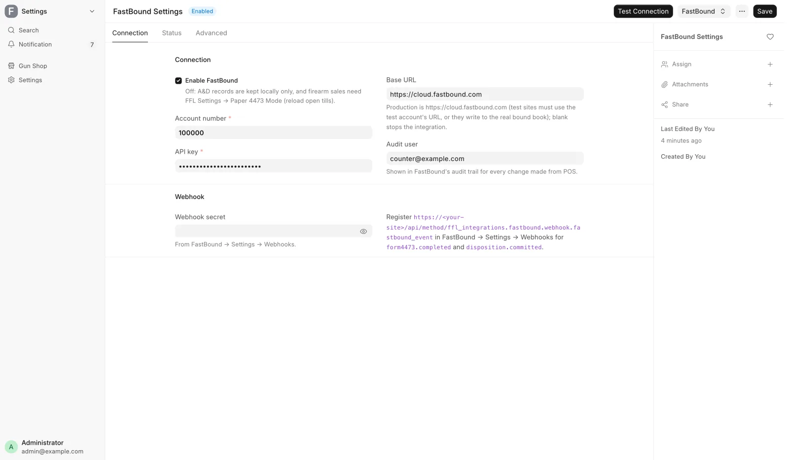
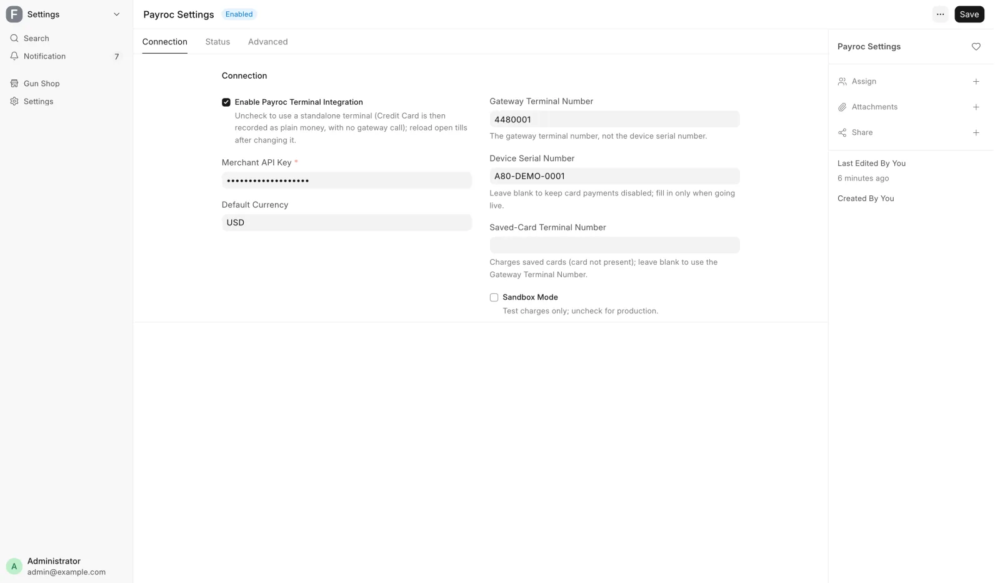
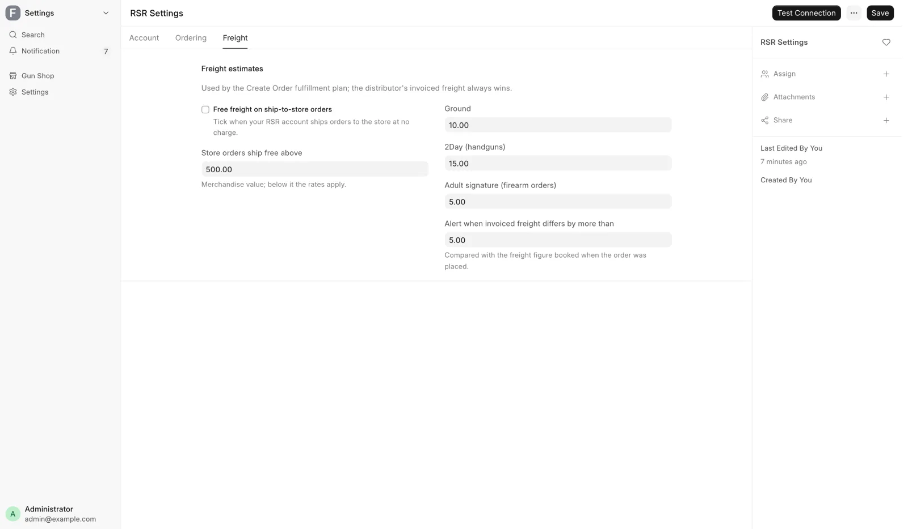
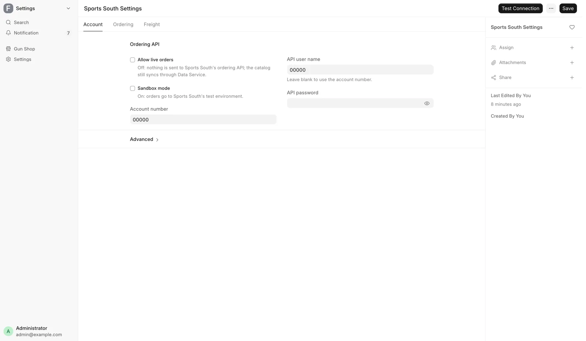
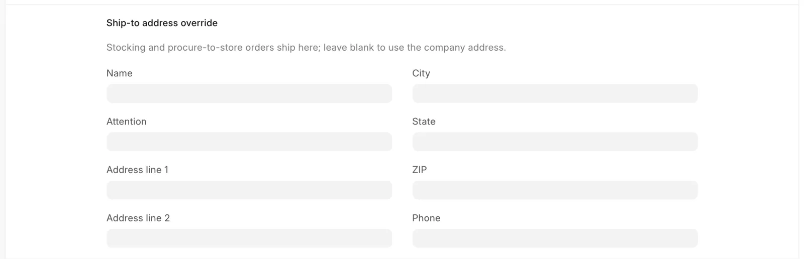
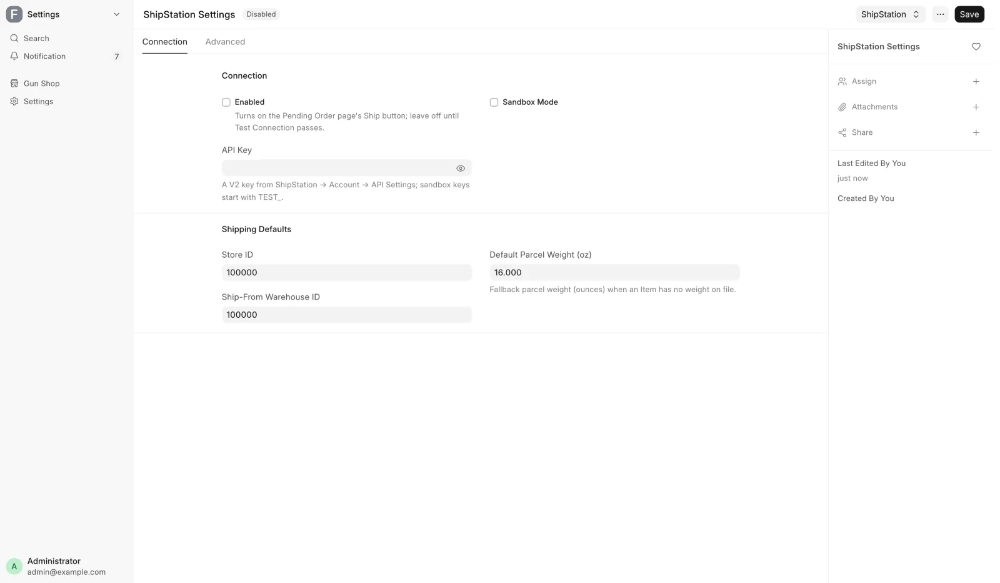
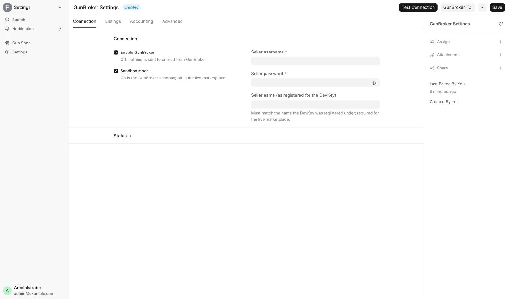
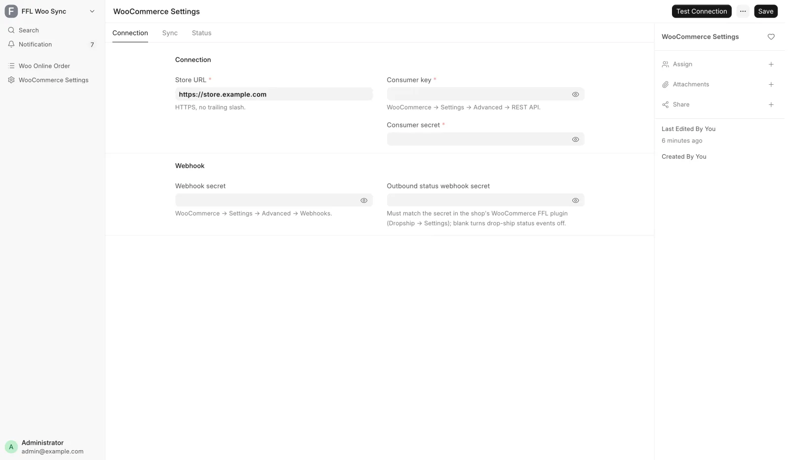
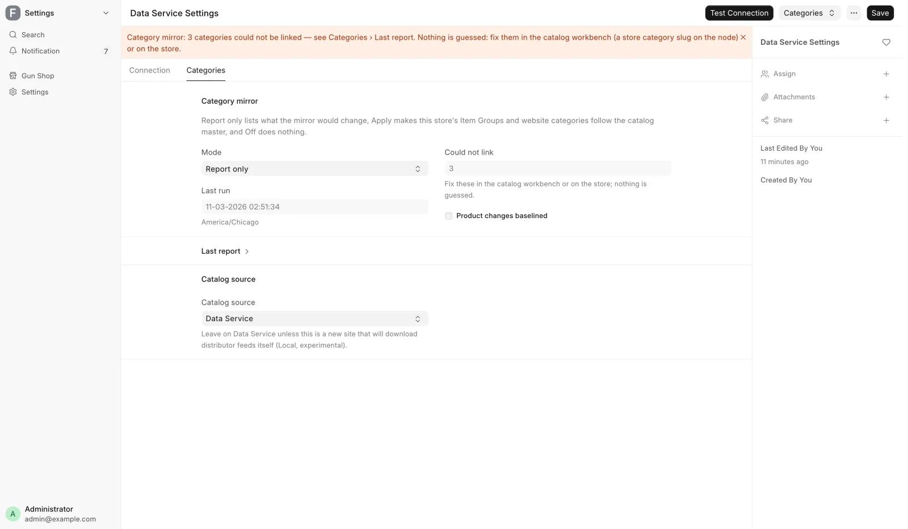

# Integrations

For the store's administrator, when you connect an outside system, change its credentials, or find out why it stopped working.

There is one settings page per outside system, all of them System Manager only. Every one holds credentials, so treat these pages like the keys to the store.

!!! warning "Never read a secret back out"
    API keys, passwords and webhook secrets are stored encrypted, to be written once. Do not copy them into a message, a ticket or a document. If a credential is wrong, replace it rather than reading it.

Each section says where to open the page, what it connects to, the fields you touch, how to test it, and where its status and last error show.

| Page | Open it from |
|---|---|
| [FastBound Settings](#fastbound-settings) | **Settings** → **FastBound (A&D Book)** |
| [Payroc Settings](#payroc-settings) | **Settings** → **Payments (Credit Card)** → **Credentials** on the Payroc card |
| [RSR Settings](#rsr-settings) | **Settings** → **Distributors** → **Account & shipping** on the RSR card |
| [Sports South Settings](#sports-south-settings) | **Settings** → **Distributors** → **Account & shipping** on the Sports South card |
| [Lipseys Settings](#lipseys-settings) | **Settings** → **Distributors** → **Account & shipping** on the Lipsey's card |
| [ShipStation Settings](#shipstation-settings) | **Settings** → **ShipStation Settings** under **POS & Sales** |
| [GunBroker Settings](#gunbroker-settings) | **Settings** → **GunBroker (Marketplace)** |
| [WooCommerce Settings](#woocommerce-settings) | **Settings** → **WooCommerce (Online Store)** |
| [Data Service Settings](#data-service-settings) | **Settings** → **Data Service (FFL & Catalog)** |

## FastBound Settings

Connects to FastBound, the electronic bound book and the place electronic 4473s are completed. See [FastBound](fastbound.md).

<figure markdown>
{ .screenshot }
<figcaption>Three tabs: Connection, Status, Advanced.</figcaption>
</figure>

**Connection tab.**

| Field | What it is |
|---|---|
| **Enable FastBound** | The master switch |
| **Account number** | The FastBound account |
| **API key** | The credential |
| **Base URL** | `https://cloud.fastbound.com` in production. Blank stops the integration |
| **Audit user** | The identity sent with every call, for FastBound's audit trail |

Turn **Enable FastBound** off and bound book records are kept in the POS only. Gun sales then need **Paper 4473 Mode** in [FFL Settings](ffl-settings.md), with every open till reloaded.

**Webhook section.** **Webhook secret** comes from the Settings, then Webhooks page in FastBound. The form prints the webhook address to register there.

**Status tab.** **Last import**, **Items imported** and **Import errors** record the last bound book import. **Acquisition types**, **Disposition types** and **Lists synced at** are FastBound's cached pick lists.

**Advanced tab.** **Look up FFL on push** is on by default. Leave it on outside a test account. **Request Timeout (s)** defaults to 30.

**Buttons.** **Test Connection** on the toolbar. Under the **FastBound** menu, **Sync FastBound Lists** refreshes the cached types and **Import Bound Book** pulls items in.

## Payroc Settings

Connects to the Payroc card gateway and the terminal at the counter. See [Take payment](../counter/payments.md).

<figure markdown>
{ .screenshot }
<figcaption>The Connection tab: credentials, then Multiple Card Readers. Status and Advanced are separate tabs.</figcaption>
</figure>

**Connection tab.**

| Field | What it is |
|---|---|
| **Enable Payroc Terminal Integration** | The master switch |
| **Require Card Reference (manual terminal)** | Standalone mode only, on by default |
| **Merchant API Key** | The credential |
| **Gateway Terminal Number** | The gateway's terminal number, not the device serial |
| **Device Serial Number** | The physical terminal's serial |
| **Saved-Card Terminal Number** | Charges saved cards. Blank uses the Gateway Terminal Number |
| **Payment Page Secret** | Lets managers key in a card number on Payroc's payment page. Blank keeps that off |
| **Default Currency** | USD |

Untick **Enable Payroc Terminal Integration** to run without the integrated terminal. Cards are then run on a standalone terminal, the register records Credit Card as plain tender, and the **Card payments** row leaves the sidebar.

In that standalone mode, **Require Card Reference (manual terminal)** means a card sale or refund cannot complete until the terminal's approval code is typed in.

Leave **Device Serial Number** blank and card payments stay off, and a charge attempt errors. Fill it in only after the terminal is paired. Leave **X-Integration-ID (ISV only)** blank for a plain merchant key.

**Multiple Card Readers.** For a store with more than one card reader, add a row per reader to **Card Readers**: a **Reader Name** the counter will recognize, the reader's **Device Serial Number**, and **Enabled**. Untick **Enabled** to take a reader out of use.

With two or more enabled, each register computer asks once which reader it uses (see [Take payment](../counter/payments.md#stores-with-more-than-one-card-reader)).

**Sandbox Mode**, on the Connection tab, points calls at the Payroc test host; untick it for production.

**Advanced tab.** **X-Integration-ID (ISV only)**, **Base URL Override** and **Request Timeout (seconds)** are for unusual setups.

**Status tab.** **Last Token Refreshed At** and **Last Charge At** are read-only.

**Buttons.** This page has no test button. Test from the Payments hub, where the Payroc card has **Test Connection**, an **Enabled** switch and **Credentials**.

## RSR Settings

Connects to RSR Group's ordering interface and holds the freight rates the order plan estimates with. The RSR catalog comes through the catalog source on [Data Service Settings](#data-service-settings), not through these fields. See [Distributor setup](distributors.md).

**Account tab.**

| Field | What it is |
|---|---|
| **Allow live orders** | The ordering master switch, off by default |
| **Dealer account #** | The account for stocking and procure-to-store orders |
| **Dealer API password** | Its password |
| **API base URL** | Under **Advanced**. RSR's production server by default |

While **Allow live orders** is off, nothing is sent to RSR and the catalog still syncs. RSR's test environment is test.rsrgroup.com.

A **Catalog feed (local catalog)** section shows only when Data Service Settings has **Catalog source** set to **Local**. It holds **FTP host**, **FTP port**, **Key dealer feed**, **FTP username**, **FTP password** and **Skip TLS certificate check (not recommended)**. RSR issues the FTP login with the account.

**Ordering tab.**

| Field | What it is |
|---|---|
| **Flag a hold after (days)** | When an order RSR is holding raises an alert |
| **POS indicator** | The code RSR assigned to this integration |
| **Order email** | The shop's email. RSR requires it, and orders fail while it is blank |

With **Allow live orders** on, the form will not save without **Dealer account #**, **POS indicator** and **Order email**.

**Freight tab.** The rates Create Order's plan estimates RSR freight with. The freight RSR invoices always replaces the estimate.

<figure markdown>
{ .screenshot }
<figcaption>The ship-to-store rule on the left, the rates and the signature fee on the right.</figcaption>
</figure>

| Field | Default | Used when |
|---|---|---|
| **Free freight on ship-to-store orders** | Off | Tick when RSR ships to the store at no charge |
| **Store orders ship free above** | 500.00 | A store order above this ships free |
| **Ground** | 10.00 | The rate otherwise |
| **2Day (handguns)** | 15.00 | The rate when the order holds a handgun |
| **Adult signature (firearm orders)** | 5.00 | Added to firearm orders, except free store orders |
| **Alert when invoiced freight differs by more than** | 5.00 | Invoiced freight versus the estimate |

The RSR card on the hub reads the store rule back as **Ship to store: free** or **free over** the threshold.

**Buttons.** **Test Connection** on the toolbar checks the catalog service. With **Allow live orders** on, it also signs in with each account number filled in and flags a blank **Order email**. It places no order. The RSR card on the Distributors hub runs the same test.

## Sports South Settings

Connects to Sports South's ordering services: the account, what goes out with each order, where store orders ship, and freight. The catalog comes through the Data Service. Four tabs: Account, Ordering, Freight and Status.

<figure markdown>
{ .screenshot }
<figcaption>The Account tab, with Advanced collapsed under the account fields.</figcaption>
</figure>

**Account tab.**

| Field | What it is |
|---|---|
| **Allow live orders** | The master switch, off by default |
| **Sandbox mode** | Sends orders to Sports South's test environment (Source 99994) |
| **Account number** | Your account number, also the API user name and Source |
| **API user name** | Blank uses the account number |
| **API password** | The credential |
| **API base URL** | Under **Advanced** |

While **Allow live orders** is off, nothing reaches the ordering API and the catalog still syncs. A blue banner shows while sandbox ordering is on. With **Allow live orders** on, the form will not save without **Account number** and **API password**.

**Ordering tab.** **Flag a hold after (days)** sets when an order the house is holding raises an alert. The tab has five sections.

**FFL email and sales message.**

- **Email the transfer FFL automatically** is on by default. After a gun order is submitted, it emails the transfer dealer's FFL copy to **Sports South fulfillment email**. Sports South requires that copy within three business days.
- **CC on FFL emails** is an optional shop mailbox for a copy.
- **Sales message on every order** is an optional note to your sales representative.

**Ship codes.**

- **Ground ship code** defaults to G, Ground Premium, for long guns, ammunition and accessories.
- **2-Day Air ship code** defaults to 2 and goes on any order with a handgun, because handguns ship by air only. N is Next-Day Air.
- **Accessory / ammunition orders ship Ground Economy** sends non-gun orders by discount carrier for $7.95, with no claims, traces, address changes or intercepts.

**Firearm orders — delivery options** and **Accessory / ammunition orders — delivery options.** **Signature**, **Adult signature** and **Insurance** for each kind of order, all off by default. Without insurance, carrier claims cap at $100.

**Price check.** Sports South charges its current price, not the price on the order. **Alert when the filled price exceeds the quote by** sends an alert past that difference, 2% by default.

**Ship-to address override.** Where stocking and procure-to-store orders ship. Leave every field blank and they ship to the company's own address, the one receipts print.

Fill in any field and the whole section becomes the destination, never mixed with the company address. An override needs at least **Address line 1**, **City**, **State** as two letters, and **ZIP**. If the address in use is incomplete, placing the order fails rather than shipping somewhere unchecked.

<figure markdown>
{ .screenshot }
<figcaption>On the Ordering tab. Left blank, as here, store orders ship to the company address.</figcaption>
</figure>

**Freight tab.** Estimates only: the freight on Sports South's invoice replaces them once the parcel ships.

- The first section holds one flat rate per service, from **Handgun, 2-Day Air** to **Next-Day Air**.
- **Per-order fees** holds **Signature**, **Adult signature**, **Insurance, % of order** and **Insurance minimum**. Each is added when the matching delivery option on the Ordering tab is ticked.
- **Shipped to the store** holds the rule for orders to the shop.

| A store order holding | Ships free from | Otherwise pays |
|---|---|---|
| Handguns | 3 handguns, or 750.00 of handguns | **Handgun, 2-Day Air** |
| Long guns, ammunition, accessories | 500.00 | 5.00, **Long guns / ammo / accessories below that** |

Those are the defaults. An order holding both pays the higher charge, and only the air upgrades keep the flat rates. The Sports South card on the hub reads the rule back in one line. **Alert when invoiced freight differs by more than**, 5.00 by default, works as it does for RSR.

**Status tab.** **Credits polled through**, **Last credit poll** and **Last error** track the daily credit memo poll. The poll books Sports South's credits for short-shipped lines against their distributor orders. All three are read-only, and the tab appears once one has a value.

**Buttons.** **Test Connection** on the toolbar checks the catalog service. With **Allow live orders** on, it also flags an empty ship code and signs in to the ordering API. It places no order.

| Message you see | Fix |
|---|---|
| Sports South Settings: the ship-to address override (Ordering tab) is incomplete | Complete the override, or clear every field |
| The company address of … is incomplete | Complete the company's address, or fill in the override |
| Ground ship code is empty — placement fails until it is set | Enter G for Ground and 2 for 2-Day Air |
| Automatic FFL emails need a Sports South fulfillment email address | Enter the address, or untick the automatic email |

The first two appear in the **Error** field of a Sports South distributor order that failed to place.

## Lipseys Settings

Connects to Lipsey's ordering API. The catalog comes through the Data Service or, with a [local catalog](../../data-service.md#local-catalog), from Lipsey's own feeds with the dealer login. Four tabs: Account, Ordering, Freight and Status.

Lipsey's lets in only computers it has approved. The API must be reached from the address you gave Lipsey's when you asked for API access.

**Account tab.**

| Field | What it is |
|---|---|
| **Allow live orders** | The master switch, off by default |
| **Customer number** | Optional. The dealer account's number |
| **Dealer login** (**Email**, **Password**) | Your Lipsey's sign-in, used for stocking and procure-to-store orders |
| **Drop-ship login** | Lipsey's separate drop-ship account |
| **API base URL** | Under **Advanced** |

- While **Allow live orders** is off, nothing is sent to Lipsey's and the catalog still syncs. With it on, the form will not save without the dealer login.
- With **Customer number** filled in, a dealer login that answers for another Lipsey's account is refused. The drop-ship login is not checked against it.
- Orders placed with the dealer login ship to the address on that Lipsey's account, so the POS sends no address.
- Until **Drop-ship login** is filled in, the hub and the planner offer no Lipsey's drop-ship.
- With a local catalog, saving this page is also the retry after Lipsey's refused the dealer login. The catalog stops dialing until then.

**Ordering tab.** **No confirmation email from Lipsey's** stops Lipsey's own email for orders placed from the POS. Leave it off: that email is how you check an order whose answer never came back.

Tick **Accessory drop-ship orders ship overnight** to ask for overnight shipping on accessory drop-ships. Lipsey's bills those at overnight rates, so the POS gives no freight estimate for them.

**Freight tab.** The flat rates Create Order estimates Lipsey's drop-ship freight with, per order. **Drop-ship firearm order** is 9.95 by default with adult signature included, and **Drop-ship accessory order** is 8.00.

The freight Lipsey's invoices always replaces the estimate. Orders shipped to your store are not estimated, and Create Order reads **freight unknown**.

**Status tab.** An order is marked shipped the day after Lipsey's ships it. **Shipping polled through** shows the last day read for each login, and **Last shipping poll** when. **Last error** holds the last failure.

**Buttons.** **Test Connection** on the toolbar checks the catalog service. With **Allow live orders** on, it also signs in with each login filled in and makes one small read. It places no order.

**Lipsey's orders in the POS.**

- Several POS orders can share one Lipsey's order number. Each keeps its own PO.
- Lines take the quantity and price Lipsey's confirmed when the order was placed. A line Lipsey's could not fill is marked cancelled.
- A line Lipsey's answer leaves out, on an order it did answer, counts as ordered and is marked **UNCONFIRMED**. The admins are told to check it at Lipsey's, and Receive Goods can match units to it straight away.
- An order whose answer never came back, after a timeout for example, goes to **Error** and is never re-sent by itself. Lipsey's cannot look an order up by PO, so check the confirmation email or your Lipsey's account first.

| Message you see | Fix |
|---|---|
| … the order may or may not have been placed … | Look for the PO at Lipsey's. If it is there, do not place it again |
| Lipseys Settings: Allow live orders is off | Turn **Allow live orders** on |
| Lipsey's placed nothing: … | Fix what the reason names, then place a new order |

The first and last appear in the **Error** field of a Lipsey's distributor order.

## ShipStation Settings

Connects to ShipStation for outbound labels and tracking. See [Ship or hand over an order](../orders/ship-or-hand-over.md) and [Web orders](../orders/web-orders.md).

<figure markdown>
{ .screenshot }
<figcaption>Status, credentials and shipping defaults.</figcaption>
</figure>

| Section | Field | What it is |
|---|---|---|
| Status | **Enabled** | The switch for the **Ship** button on Pending Orders. Leave it off until Test Connection passes |
| Status | **Sandbox Mode** | Points at the test host |
| Credentials | **API Key** | The ShipStation V2 key. Sandbox keys start with `TEST_` |
| Credentials | **Base URL Override** | The V2 endpoint by default |
| Credentials | **Request Timeout (s)** | 30 by default |
| Shipping Defaults | **Store ID** | The ShipStation store orders are created under |
| Shipping Defaults | **Ship-From Warehouse ID** | The store's origin address in ShipStation |
| Shipping Defaults | **Default Parcel Weight (oz)** | Used when an item has no weight, 16 by default |

**Buttons.** **Test Connection** under the **ShipStation** menu on the toolbar. This page has no last-error field. Failures land in the error log and the alert email.

## GunBroker Settings

Connects to the GunBroker marketplace for listings and orders. See [List a gun online](../stock/list-online.md), [GunBroker orders](../orders/gunbroker-orders.md) and [Web store and GunBroker setup](online-channels.md).

<figure markdown>
{ .screenshot }
<figcaption>Four tabs: Connection, Listings, Accounting and Advanced. Status is a section on the Connection tab.</figcaption>
</figure>

**Connection.** **Enable GunBroker** is the master switch, off by default. While it is off nothing is sent or read, and the **GunBroker orders** row leaves the sidebar. **Sandbox mode** is on by default; untick it for the live marketplace. **Seller username** and **Seller password** are the account login.

**Status section.** **Last listing push**, **Listings pushed**, **Last sweep**, **Orders synced up to (UTC)**, **Orders synced** and **Last error** are read-only. Read **Last error** first when listings or orders stop moving.

**Listings tab.** The defaults used when a gun is sent up:

- **Ship-from ZIP**, **Country**, **Duration (days, fixed price)**, **Auto-relist (fixed price)**, **Inspection period**, **FFL required**, **Ships internationally** and **Photos per listing**.
- Either the account's own excluded states or an explicit **Excluded states** list.
- Auction defaults: **Listing type offered**, **Auction length (days)** and **Auto-relist (auction)**.
- Shipping defaults: who pays, and fallback rates for long guns, handguns and accessories, used when a listing has no rate. A long-gun rate of zero makes the system refuse the listing.
- Payment methods, as tick boxes. Personal check and card checkout are off by default.
- The **Category map** table maps firearm type, item group or antique status to a GunBroker category. An item's own category id overrides it, and picking a **Category** in the Send to GunBroker dialog saves that id on the item.
- **Blocked title phrases**, one per line, and a **Description footer** added to every listing. Its links and images must be secure.

**Accounting tab.** **Check deposit account** must be the operating bank account, not a clearing account. **Card clearing account**, **FFL doc fee (per item)** and the **Final value fee tiers** table complete the fee model. See [Month-end close](month-end.md).

**Advanced tab.** **Scheduled sync** switches the order poll and listing sweeps on. It also holds **Auto-acknowledge orders**, **Paid-not-shipped alert (days)** at 7, **End listings via** and a one-time **Re-read orders since** back-fill.

The API section on the same tab holds the request timeout, the counter check budget, page size and a base URL override for testing.

**Buttons.** **Test Connection** on the toolbar, and **Fetch Listing Defaults** to pull the account's own listing settings down. Both show only once **Enable GunBroker** is ticked; otherwise every call would answer "GunBroker is switched off".

## WooCommerce Settings

Connects to the retail web store. See [List a gun online](../stock/list-online.md) and [Web store and GunBroker setup](online-channels.md).

<figure markdown>
{ .screenshot }
<figcaption>Connection, Sync and Status tabs.</figcaption>
</figure>

**Connection tab.**

| Field | What it is |
|---|---|
| **Store URL** | Must be secure, with no trailing slash |
| **Consumer key**, **Consumer secret** | From the web store's Settings, Advanced, REST API page |
| **Webhook secret** | From the web store's Settings, Advanced, Webhooks page |
| **Outbound status webhook secret** | Signs status events sent to the website. Blank sends none |
| **Send customer emails to the shop** | Off by default. Every hour, sends customers added or changed at the counter to the website's marketing list |

Leave **Outbound status webhook secret** blank unless an extension you installed asks you to set it. **Send customer emails to the shop** needs that secret, and a website plugin that accepts the list. People who unsubscribed on the website stay unsubscribed.

**Sync tab.**

| Field | Default | What it does |
|---|---|---|
| **Enable sync** | Off | The master switch for push, reconcile and audit |
| **Reconcile frequency** | Daily | Every 2 Hours, Daily, Weekly or Disabled |
| **Follow the catalog category tree** | On | Website categories follow the shared category list |
| **Request Timeout (s)** | 30 | |

While **Enable sync** is off, nothing is pushed, reconciled or audited, and the **Web orders** row leaves the sidebar. With **Follow the catalog category tree** on, a product push sets its category from the shared list (see [Data Service Settings](#data-service-settings)). Untick it to leave the website's categories alone.

**Status tab.** **Last push**, **Items pushed**, **Last reconcile**, **Last order audit** and **Last error** are read-only. Last order audit is the daily check for web orders missing from the POS.

**Buttons.** **Test Connection** on the toolbar reads one product with the saved credentials and writes nothing. Press it after every change here. Push, delist and reconcile run from the item and gun forms and the scheduled jobs. When something is wrong, read **Last error** on the Status tab.

## Data Service Settings

An optional connection to a hosted catalog service. The POS works without it. Connected, the store reads distributor catalogs and the category list from it, and looks up FFLs when [FFL Settings](ffl-settings.md) uses the Data Service provider. See [Data Service](../../data-service.md) for what works without it and how to run a local catalog.

**Connection tab.**

| Field | What it is |
|---|---|
| **Catalog source** | **Data Service**, or **Local** |
| **Endpoint** | The service's base address, with no trailing path |
| **Client ID** | Issued by the service operator; identifies this store |
| **Secret** | This store's key, stored encrypted |

With **Local**, the POS downloads each distributor's feeds with the store's own credentials and serves the catalog from its own database. A distributor record may override the catalog service for its own house.

**Status tab.** **Catalog API contract**, **Checked at** and **Last error** are read-only and record the last **Test Connection**. The tab appears once a test has recorded one of them.

**Categories tab.** The shared category list is the one source of category names, parents and order. The store's item groups and its website categories follow it. **Mode** decides what the category mirror does on each run, every 15 minutes:

| Mode | What happens |
|---|---|
| Off | Nothing runs |
| Report only | The default. Lists what it would link, create, rename or move, and changes nothing |
| Apply | Makes those changes and follows the catalog's product category changes |

**Last run** and **Could not link** are read-only. **Could not link** counts categories the last run could not link, such as a duplicate, a conflict or a missing parent. Nothing is guessed: fix them in the catalog or on the website.

The full result is under **Last report**. While anything could not be linked, an orange banner at the top of the form says how many.

<figure markdown>
{ .screenshot }
<figcaption>The Categories tab: the mirror's mode, its last run and its report.</figcaption>
</figure>

**Buttons.** **Test Connection** on the toolbar checks the catalog for every enabled distributor and shows one line per house. Under **Categories**, **Run category mirror** runs the mirror now in its current mode, and its report lands on the Categories tab.
