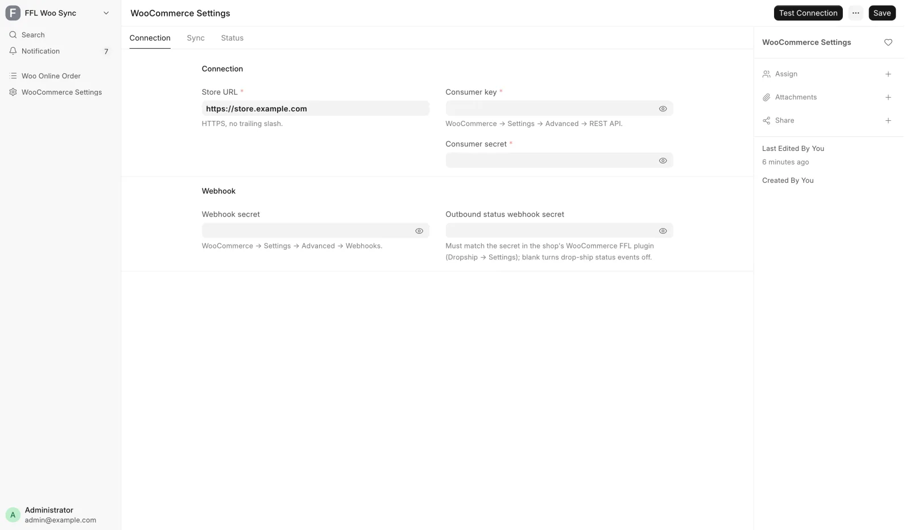
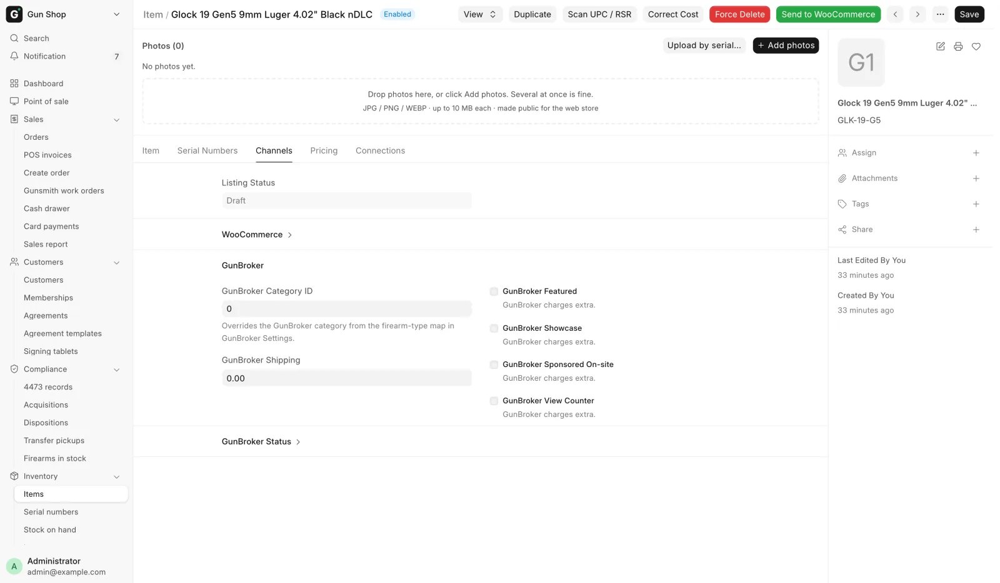
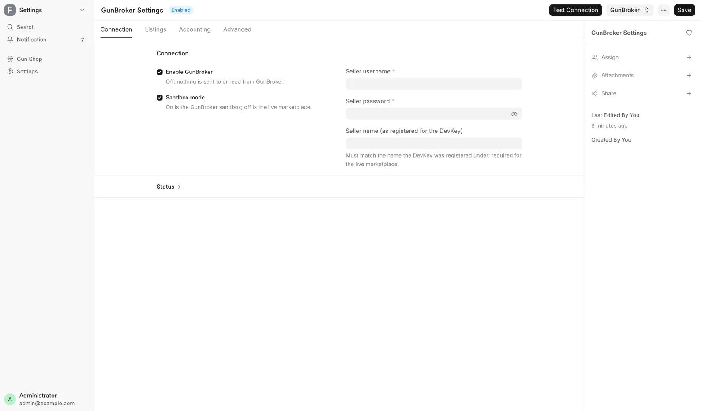

# Web store and GunBroker setup

For the administrator, when connecting the WooCommerce store or GunBroker, or when a listing, a price or a stock figure online looks wrong. Staff listing steps are on [List a gun online](../stock/list-online.md), and the orders on [Web orders](../orders/web-orders.md) and [GunBroker orders](../orders/gunbroker-orders.md).

## Who owns price and stock

The POS does. It is the system of record for what a gun costs and whether it is available, and it pushes both to the store and to GunBroker. A price edited on WooCommerce or on a GunBroker listing does not change the POS, and the next push overwrites it.

Orders travel the other way and land on the Pending Order page. The channels keep their own order record: the POS does not edit or cancel a web order, and it cannot unwind a GunBroker sale. Both online channels sell the same guns out of the same safe, so each one is told the moment a gun is spoken for anywhere else.

## WooCommerce

Open **Settings**, then **WooCommerce (Online Store)** under **Integrations**. Every field is described in [Integrations](integrations.md).

<figure markdown>
{ .screenshot }
<figcaption>The Connection tab: the store address, the REST API pair, the webhook secret and the outbound status webhook secret. Enable sync, the category switch and the status fields sit on the two tabs beside it.</figcaption>
</figure>

The form has three tabs. **Connection** holds the store address, the REST API pair, the webhook secret and the outbound status webhook secret. **Sync** holds **Enable sync**, the category switch and **Reconcile frequency**, and **Status** shows how the connection is doing.

With **Enable sync** off, the scheduled work stops: nothing is reconciled or audited. The buttons on the Item and Serial No forms still push.

### Product shapes

| Listed from | Store product | SKU and stock |
|---|---|---|
| Item, not a firearm | One product | SKU is the item code, stock is the quantity on hand |
| Item, firearm with **Uniform Pricing** | One product for the model | Stock is the number of free guns |
| Serial No, any other firearm | One product per gun | SKU is `ITEM::SERIAL`, stock is 1 or 0 |

The per-gun buttons are hidden on a uniform-priced firearm or a non-firearm, because a per-gun product would double-count the model's stock.

### What the store receives

<figure markdown>
{ .screenshot }
<figcaption>The Item form's Channels tab. The WooCommerce section, collapsed here, records the product id, the listed flag, the last sync and the last error.</figcaption>
</figure>

| On the store | Comes from |
|---|---|
| Product title | Item Name, or the Serial No's own item name for a per-gun product |
| Description | Item description, or the gun's own when it has one |
| Regular price | Selling Price on the Item, or Sell Price on the Serial No |
| Sale price and dates | Sale Price with its from and to dates |
| Photos | Gallery rows in order, then the single image field |
| Stock quantity | Calculated by the POS (see below) |
| GTIN field | UPC |
| Caliber, Condition, Manufacturer, Model | The matching fields, as store attributes |
| Category | The shared category list (see below) |
| MAP | **MAP** on the Item. A used gun carries none |

Photos for a gun resolve in this order: the serial's gallery, the serial's single image, the Item's gallery, then the Item's image. Private uploads are made public as part of the push, because the store fetches them anonymously.

After a product is published once, edits made in WordPress to the title, description, images, attributes or categories are protected. Automatic jobs rewrite only price, sale price, stock, the published or draft state, and machine-written fields such as MAP. Other POS content reaches the store when a person presses **Send to WooCommerce**.

### Categories follow the shared list

The POS and the website use one category list. Each Item files under a node of it: its **Catalog Category** for a distributor catalog product, otherwise its Item Group. The product's web category is that node's category on the store.

- A category is created on the website only once it has a product for sale. Until then its products show under the nearest category above it.
- When a new category appears, products already on the website that belong in it move into it. Only the category changes, and categories outside the shared list (a Clearance category, say) are kept.
- A push never creates a category.

The switch is **Follow the catalog category tree** on the **Sync** tab, on by default. Off, the category job skips the store and pushes leave categories alone. Preview what the job would change on the **Categories** tab of **Data Service Settings**.

### How stock is kept in step

The POS sends a calculated figure, not a raw warehouse count.

- **Non-firearm**: everything in the bins, less stock held in customer custody, less units sold on a web order that has not shipped.
- **Uniform-priced firearm**: Active guns that no web order holds, less any pending web order that owes a unit without naming a gun.
- **Per-gun firearm**: 1 when the gun is Active and free. 0 when a web order holds it, another channel holds it, it is no longer Active, or it is archived as sold.

Submitting or cancelling a counter invoice, a stock movement, or a change to a watched field queues an update. Many changes at once go to the store in one request. A gun a marketplace sold is set to draft as well as stock 0, because it might come back.

Units a web customer paid for, waiting on the shelf to ship, are held from the register. Ringing one is refused with "Held for a web order" unless a Sales Manager rings it, and then the invoice notes it.

A sold gun's page stays published at stock 0 with the sold marking. The realized price is written only when the sale came through a web order, the one path that carries an exact line total.

### The reconcile job

Every two hours a job checks whether the store is due a reconcile, and if so repairs what has drifted. It runs only when **Enable sync** is ticked, **Reconcile frequency** is not Disabled, and enough time has passed. The choices are Every 2 Hours, Daily, Weekly and Disabled.

1. Item-level products: stock, regular price, and the sale price with its dates. A product with no price is drafted.
2. Per-gun products on Active guns: the stock figure, 1 or 0.
3. Listed guns that are no longer Active, held by another channel, or held as a customer transfer. These come down, and a sold gun gets its sold page.

Every push this job makes is limited to the POS-owned fields, so it never overwrites content curated in WordPress.

### Checking the connection

The **Status** tab shows when the POS last pushed, when the reconcile last completed, and the last failure in the store's own words. **Test Connection** on the toolbar reads one product back and changes nothing.

On each web order, **FFL Raw Meta (fallback)** keeps the dealer data the storefront sent, for when no ATF record matched. **Site** names the store the order came from.

## GunBroker

Open **Settings**, then **GunBroker (Marketplace)** under **Integrations**. Every field is described in [Integrations](integrations.md).

<figure markdown>
{ .screenshot }
<figcaption>GunBroker Settings has four tabs: Connection, Listings, Accounting and Advanced.</figcaption>
</figure>

- **Enable GunBroker** off: nothing is listed or polled, and the buttons do not appear on any form.
- **Sandbox mode** decides the market. Off, a listing is a real offer to a real buyer, and a seller cannot cancel a completed sale.
- The category map in Settings files each firearm type under a GunBroker category. An antique needs its own row flagged Antique, because it never takes the modern category.
- The long gun and handgun shipping defaults apply when a gun has no rate of its own.

### Orders and the poll

Every fifteen minutes the POS asks GunBroker for orders changed since **Orders synced up to (UTC)** on the **Connection** tab. The mark moves forward only after a whole batch is processed. Left blank, the first run starts from now and does not read back through history.

### The counter check

When a gun is scanned at the counter, the POS asks GunBroker once whether it has a buyer. The time allowed is **Counter check budget (s)** on the **Advanced** tab, shared across the whole invoice rather than spent per gun. A sold answer blocks the sale. No answer in time lets the sale go ahead, so an outage at GunBroker does not stop the shop.

### Ending listings

A 403 answer from GunBroker moves **End listings via** to Manual Only, and listings must then be ended by hand on GunBroker. Do not switch it back to Delete Endpoint after a permission alert until GunBroker support confirms the permission. Trying it can cost another double sale.

## Listing messages

| You see | Fix |
|---|---|
| Not sent to WooCommerce: this is a customer's firearm held for an FFL transfer | Nothing to fix. A customer's gun cannot be listed. |
| Some guns were not sent | The message lists each serial and its reason. Fix those and send again. |
| Not sent to WooCommerce (channel_reserved) | Another channel already sold this gun. Check GunBroker. |
| A product shows in the wrong website category | Check **Follow the catalog category tree**, then preview **Categories** on Data Service Settings. |
| No GunBroker category is configured for firearm type … | Add a row to the category map, or set the Item's **GunBroker Category ID**. |
| No GunBroker antique category is configured for firearm type … | Add a row flagged Antique to the category map, or set the Item's **GunBroker Category ID**. |
| GunBroker category … is not one this gun can be listed under | The list changed while the dialog was open. Close it and send again. |
| No sell price is set, so there is nothing to send | Price the record in the POS, then send again. |
| This gun is on GunBroker as an auction, so its price is set by the bidders | End the auction and list it again to change the opening figure. |
| GunBroker cannot find this listing but shows the same SKU as sold | Check GunBroker. If it was not sold, use **Clear "Sold Unknown"**. |
| End it on GunBroker by hand | Open the item on GunBroker and use End Item Early. Until then it can be bought. |
| … came in on consignment but has no consignor recorded … | Set the **Consignor** on the Serial No, then send again. |
| The listing is live, but some of the extra photos failed to upload | Add them on GunBroker. |
| A photo was skipped: GunBroker takes JPG, PNG and GIF only | Add that photo on GunBroker in one of those formats. |
| A photo could not be read and was left off the listing | Check the photo on the Serial No. |
| A note about an image or link in the description | Nothing. The description was made safe for buyers' browsers. |

## When a listing did not go out

A gun in stock that is not on the site or on GunBroker usually failed after the click, because pushes are queued. Read the channel's last error first, then send that one gun or item again from its own form.

**WooCommerce** failures start `WooCommerce sync failed:`, `WooCommerce delist failed:` or `WooCommerce API error:`, followed by the store's own reason. WooCommerce Settings keeps the latest in **Last error** on the Status tab.

A photo the push could not make public is written into **Woo Sync Error** on the serial, for example `Serial No S1 gallery row 1: could not make image … public — <reason>`. The push makes public only the files in the image field and the gallery, never other attachments.

**GunBroker** keeps its state on the Serial No:

| Field | What it tells you |
|---|---|
| **GunBroker Push Pending** | A listing went out and the result was never confirmed. A second send is blocked, because GunBroker would take two live listings for one gun |
| **GunBroker Push Attempted At** | When that attempt happened. The recovery grace period runs from here |
| **GunBroker Delisted** | Someone ended the listing. Nothing re-lists it automatically; **Send to GunBroker** does, and clears the flag |
| **GunBroker Price Dirty** | The price changed and GunBroker has not been told. The next sweep sends it |
| **GunBroker Missing Count** | How many sweeps in a row found no such listing |

`Serial <serial> cannot be listed: <reason>.` names the listing term GunBroker cannot use, most often the price or the duration. A push still pending after a day means the recovery scan did not settle it: check the listing on GunBroker before sending again.
