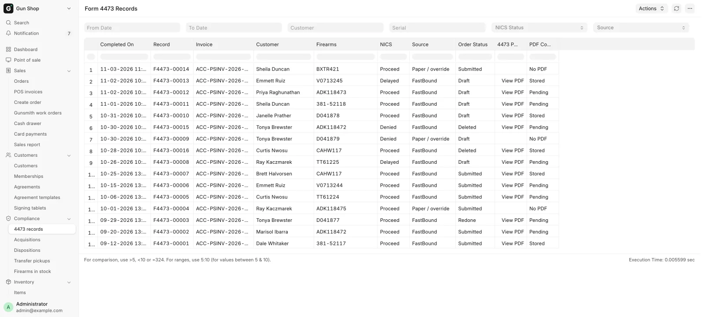

# Find a 4473

For counter staff and managers, when you need to confirm a 4473 was completed, answer a question about an old sale, or pull the signed PDF.

Every completed Form 4473 gets a permanent record, with a private copy of the signed form when FastBound has one. The record stays whatever happens to its order and whatever the NICS result was, because FastBound cannot list completed 4473s back to the POS.

## Before you start

- The report and the PDFs open for Sales User, Sales Manager and System Manager, the roles that run a 4473 at the register. Stock User or Stock Manager alone cannot open them.
- A signed PDF exists only for a 4473 done in FastBound. A paper 4473 or a manager override has a record but no PDF.
- The PDF holds the buyer's name, date of birth and address. Open it only when you need it. Every view is logged with your name.

## Find a 4473

1. In the sidebar, open **Compliance → 4473 records**. From the Dashboard, use **All records** on the **Open 4473s** block, or **All records → Compliance → 4473 records**.
2. The report opens with every completed 4473, newest first.
3. Narrow it with **From Date**, **To Date**, **Customer**, **Serial** (part of a serial is enough), **NICS Status** or **Source**.

<figure markdown>
{ .screenshot }
<figcaption>Every completed 4473, newest first. Order Status says what became of the sale since; View PDF opens the signed form.</figcaption>
</figure>

| Column | What it shows |
|---|---|
| **Completed On** | When the 4473 was completed. |
| **Record** | The 4473 record, named `F4473-<number>`. |
| **Invoice** | The order or orders it ran on. Click to open one. |
| **Customer**, **Firearms** | The buyer, and the serials on the form. |
| **NICS** | `Proceed`, `Delayed`, `Denied` or `Cancelled`. |
| **Source** | `FastBound`, or `Paper / override`. |
| **Order Status** | What became of the order. See below. |
| **4473 PDF** | **View PDF** when a signed form can be shown. |
| **PDF Copy** | Whether the POS holds its own copy. See below. |

| Order Status | Meaning |
|---|---|
| `Submitted` | The sale completed. |
| `Draft` | The order is still held. |
| `Cancelled` | The order was cancelled after it completed. |
| `Deleted` | The order is gone, such as a denied buyer's draft or a cleared abandoned order. |
| `Redone` | A manager ran **Redo 4473** and a new form covers the order. |
| `No POS order` | FastBound reported a completed 4473 that matched no order here. |

## Open the signed PDF

1. Find the row.
2. Click **View PDF**. The signed form opens in a new browser tab.
3. Save or print it from there.

If your browser blocks the new tab, a message offers **Open the signed 4473**. Click it.

The same form opens from the order. In the sidebar, open **Sales → POS invoices** and open the sale. An order whose 4473 was done in FastBound carries a **View Signed 4473** button.

The PDF comes from the POS's own copy when there is one. Otherwise the POS fetches it from FastBound while you wait, then keeps a copy.

| PDF Copy | Meaning |
|---|---|
| `Stored` | The POS holds its own copy. |
| `Pending` | Not copied yet. The POS retries once an hour. |
| `Failed` | Copying failed five times. **View PDF** still asks FastBound. |
| `Not Found` | FastBound kept answering that it has no such form. |
| `No PDF` | A paper 4473 or a manager override. There is nothing to copy. |

## What happens next

- When FastBound reports a completed 4473, its record appears here and a copy of the signed PDF is queued at once.
- A paper 4473 or a manager override appears with Source `Paper / override` and no PDF. **Redo 4473** marks those records NICS `Cancelled` ([Form 4473 and NICS](4473.md#redo-4473)).
- Every **View PDF** and **View Signed 4473** is logged with the user and the time. Nobody can delete a 4473 record.

!!! warning "Federal recordkeeping"
    The 4473 record and its PDF copy are a convenience, not the store's filed 4473. Keep the signed form exactly as ATF requires, on paper or in FastBound.

## Troubleshooting

| You see | Fix |
|---|---|
| **No 4473 PDF**: "…has no signed 4473 PDF on file…" | For a paper form, use the filed paper copy. Otherwise open the 4473 in FastBound. |
| **FastBound unavailable**: "FastBound is not enabled or not set up on this site…" | No copy is stored and FastBound is off here. A manager checks [FastBound](../admin/fastbound.md). |
| **FastBound unavailable**: "FastBound did not answer…" or "did not return the 4473 PDF" | Try again, or open the 4473 in FastBound. |
| **4473 not found** | FastBound has no such form in the store's account. Check in FastBound. |
| `F4473-<number> is a 4473 record — it cannot be deleted.` | Nothing to fix. Records are kept for good. |
