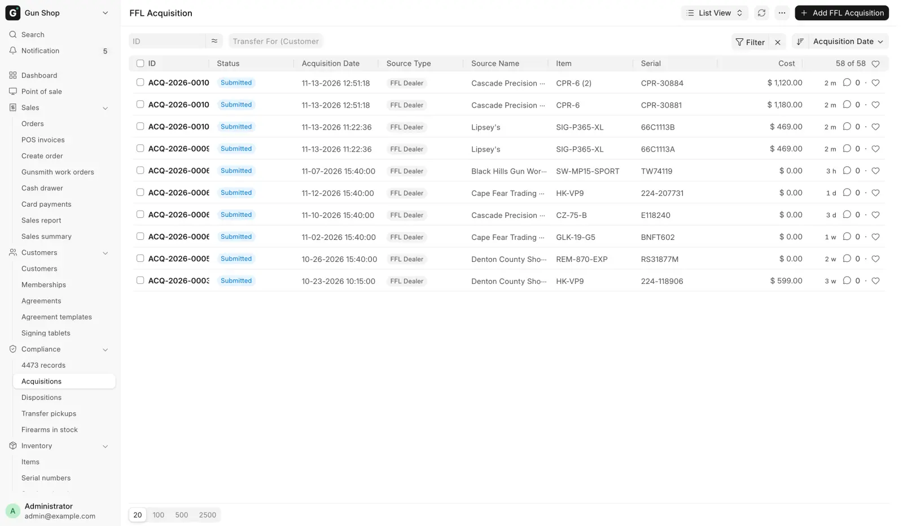
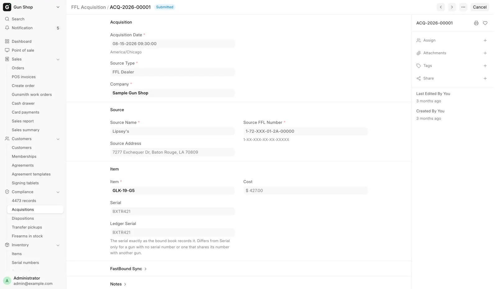
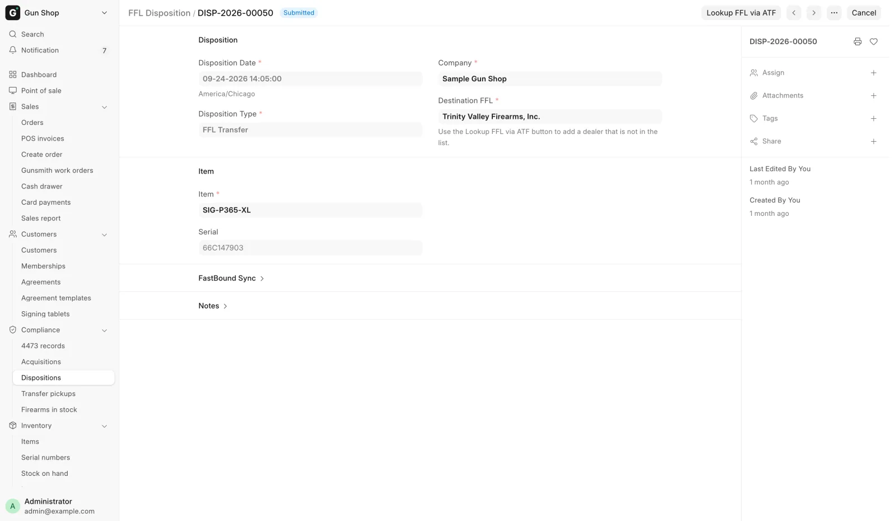
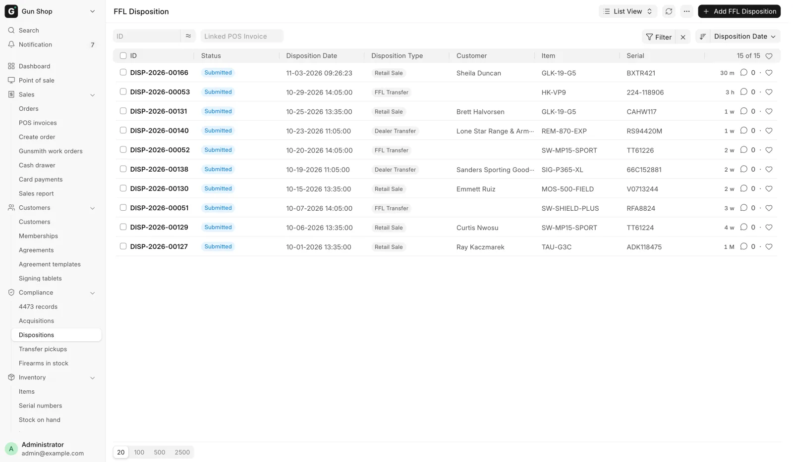

# The bound book

For managers and anyone who reads or checks the acquisition and disposition (A&D) book.

Two records make up the book: an **FFL Acquisition** for each gun coming in, and an **FFL Disposition** for each gun going out. The pages you already use create both for you. Beside them sits the [4473 record](4473-records.md), one per completed Form 4473, kept even when its order is deleted.

## Where the records come from

Every routine path writes them. Creating one by hand is for the rare case no routine path reaches, and the forms refuse several shapes outright.

| Event | Record written |
|---|---|
| A gun is received through [Receive goods](../stock/receive-goods.md): a distributor order, a parcel from **Incoming shipments**, a private seller | One acquisition per serial |
| A [trade-in](../counter/trade-ins.md) | An acquisition with source type `Trade-in`. Credit on a sale waits as a draft until the sale completes. A trade-in the store pays for on the spot is booked at once. |
| A retail sale at the register, once the [4473](4473.md) is complete, including the $0 pickup ticket | A disposition |
| A dealer transfer or web order shipped from [Pending Orders](../orders/pending-orders.md) | A disposition. A gun shipped to a C&R (Type 03) collector leaves as an `FFL Transfer`. |

To read them, open **Compliance → Acquisitions** or **Compliance → Dispositions** in the sidebar. Sales User and Sales Manager can read acquisitions. Dispositions open for Stock User, Stock Manager and System Manager only.

<figure markdown>
{ .screenshot }
<figcaption>Every gun the store has received. One row is one physical firearm.</figcaption>
</figure>

## FFL Acquisition

The A side: one record per physical gun received, named `ACQ-<year>-<number>`.

<figure markdown>
{ .screenshot }
<figcaption>One acquisition: when the gun arrived, who it came from, and which serial it names.</figcaption>
</figure>

| Field | Notes |
|---|---|
| **Acquisition Date** | Required. When the store took possession. |
| **Source Type** | Required. `Individual`, `FFL Dealer`, `Manufacturer`, `Importer`, `Estate`, `Pawn` or `Trade-in`. Decides what the form asks next. |
| **Receive Source** | Your own buying channel, carried from the receipt. The list is kept in FFL Settings. |
| **Acquisition Type** | The FastBound acquisition type, synced from your account. Blank uses a default from the source type. |
| **Company** | Required. |

### Source

Who the gun came from. The fields shown depend on the source type.

| Field | Shown for |
|---|---|
| **Source Name**, **Source Address** | Always. The name is required. |
| **Source First Name**, **Source Middle Name**, **Source Last Name**, **Source Suffix** | Individual, Trade-in, Estate, Pawn. FastBound records a private seller's name in parts. |
| **Source FFL Number** | FFL Dealer only, and required there. Format `1-XX-XXX-XX-XX-XXXXX`. |
| **ID Type**, **ID Number**, **ID Document** | Individual, Trade-in, Estate, Pawn. The document is stored privately. |
| **Seller (Customer)** | Individual, Trade-in, Estate, Pawn. Links to the customer record. |
| **Transfer For (Customer)** | Always. Set when the gun is a customer transfer-in. Feeds Pending Transfer Pickups. |

A dealer source with no license number is refused under **FFL Required**: "Source FFL number is required when source type is 'FFL Dealer'." A private source with no identification is refused under **ID Required**: "ID type and number are required for source type '<type>'."

### Item and FastBound

**Item**, **Serial** and **Cost** name the gun. The serial fills in by itself when the item has exactly one in-stock serial.

**FastBound ID**, **Last Synced** and **FastBound Sync Error** are read-only. An empty FastBound ID on a submitted record means FastBound does not have it yet. See [FastBound](../admin/fastbound.md#failed-pushes).

Submitting the record puts the gun in the book. To amend one, cancel it and create a replacement that names the original.

## FFL Disposition

The D side: one record per gun leaving, named `DISP-<year>-<number>`.

<figure markdown>
{ .screenshot }
<figcaption>One disposition: the type, the destination FFL and the serial that left. The 4473 and NICS fields sit below on a retail sale.</figcaption>
</figure>

| Disposition Type | Used for |
|---|---|
| `Retail Sale` | A sale to an individual with a 4473. Made by the register, never by hand. |
| `FFL Transfer` | Sending a gun to another licensee. |
| `Return` | Sending a gun back to where it came from. |
| `Scrap` | Destruction. Both witnesses are required. |
| `Gunsmithing` | Work by another licensee. |
| `Dealer Transfer` | A transfer to a dealer. |
| `NFA` | An NFA transfer. |

When FastBound is reachable, the list is your FastBound account's own, so you may see more types. `Sale`, `Donation` and `Private Party Transfer` are always removed. Picking one anyway is refused under **Disposition Type Not Supported**: handle that kind of transfer in FastBound.

`Retail Sale` is hidden on a new record. Creating one by hand is refused under **4473 Handled by FastBound**: "Retail Sale dispositions are created by FastBound after 4473 + NICS completion — do not create them manually."

### Destination and item

- **Customer** shows, and is required, for a Retail Sale.
- **Destination FFL** shows, and is required, for `FFL Transfer`, `Dealer Transfer` and `Return`. It picks a license from the store's [FFL library](ffl-verification.md).
- For `Scrap`, **Destruction Witnesses** appears, and **Witness 1** and **Witness 2** are both required.
- **Item** and **Serial** name the gun, with optional links to the **Sales Invoice** and **Sales Order**. Changing the item clears a serial that does not belong to it, so a leftover value cannot dispose the wrong gun.

For those three transfer types, **Lookup FFL via ATF** sits on the toolbar. It opens **Lookup Destination FFL via ATF EZ Check** and takes an **FFL Number** in the format `1-99-999-99-9X-99999`, hyphens optional. **Lookup & Use** runs the live ATF check, saves the license to the library and fills the field.

### Compliance

These fields show on a Retail Sale. The last two appear once the override is ticked.

| Field | Notes |
|---|---|
| **4473 Status** | `N/A`, `Pending` or `Completed`. Must be `Completed` to submit. |
| **NICS Status** | `N/A`, `Proceed`, `Delayed`, `Denied` or `Cancelled`. Must be `Proceed` to submit. |
| **Manual Override (4473 bypass)** | Marks a disposition somebody asserted instead of one FastBound committed. |
| **Override Reason** | Required whenever the override is ticked. |
| **Override By** | Read-only. Who asserted it. |

Creating an override disposition needs Sales Manager or System Manager. With **Paper 4473 Mode** on, a counter role is enough, because recording the paper form is then the store's normal way of working.

!!! warning "Federal recordkeeping"
    An override disposition satisfies the sale exactly like a FastBound-committed one. Every one lands on the [Hand-Asserted 4473 Dispositions](daily-checks.md#3-hand-asserted-4473-dispositions) report, which a manager reads back, and gets a [4473 record](4473-records.md) with Source `Paper / override` and no PDF.

## If submit is refused

Most checks run when you submit, not when you save, so a draft can be staged. A manager can stage a transfer, look the receiving dealer up, then submit.

| You see | Fix |
|---|---|
| `Serial No <n> does not exist.` | Receive the gun first, or pick from the in-stock list. |
| `Serial No <n> belongs to Item <a>, not <b>.` | The serial and the item disagree. Pick the right one. |
| `Retail Sale disposition requires 4473 status = 'Completed'.` or `NICS status = 'Proceed'` | The form or the check is not done. See [Form 4473 and NICS](4473.md). |
| `Destination FFL number is required for <type> disposition.` | Pick or look up the receiving dealer. |
| `Serial number is required to submit a disposition.` | Pick the gun. |

<figure markdown>
{ .screenshot }
<figcaption>Every gun booked out, with the disposition type that took it out.</figcaption>
</figure>

## Antique firearms

A gun whose item is marked **Antique** gets no acquisition and no disposition. It is pre-1899 or otherwise exempt, so it never enters the book, nothing goes to FastBound, and there is no 4473 or NICS check at sale. It is still serialized stock and still shows on Firearms In Stock.

**Antique** can only be ticked on an item with no guns in the book. Otherwise it is refused under **Already in Bound Book**: "A gun in the bound book leaves only via a disposition, not by flagging its Item antique."

An antique booked by mistake is refused by FastBound and waits on the Dashboard's **Not logged** list. A Stock Manager or System Manager who has checked it can mark it as not belonging in the book: see [FastBound](../admin/fastbound.md#a-record-that-does-not-belong-in-the-bound-book).
