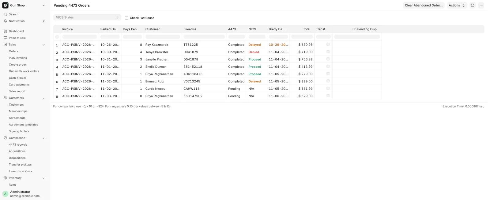
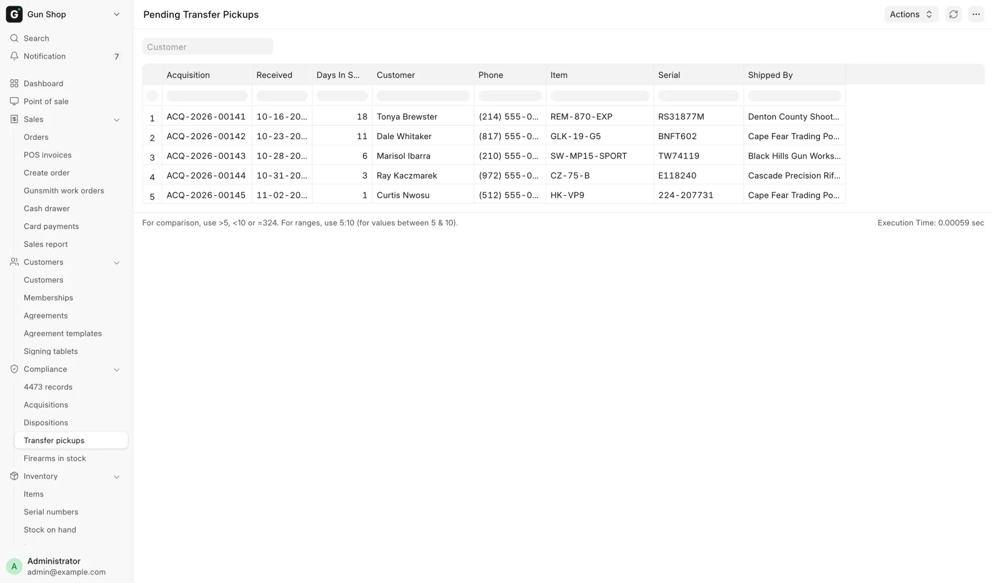
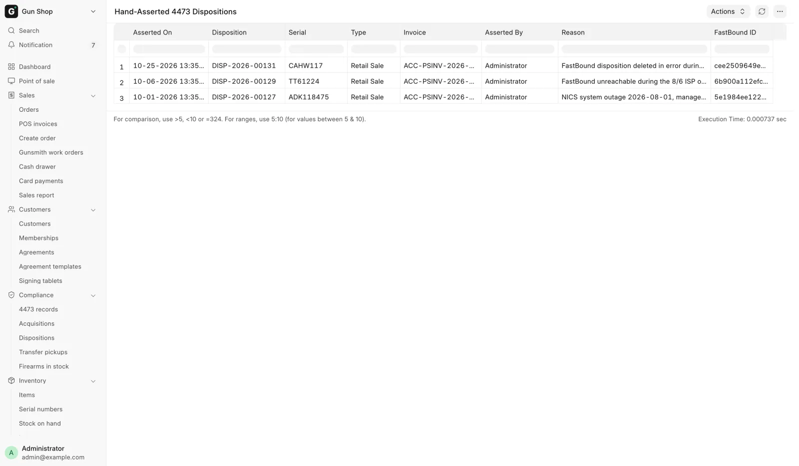
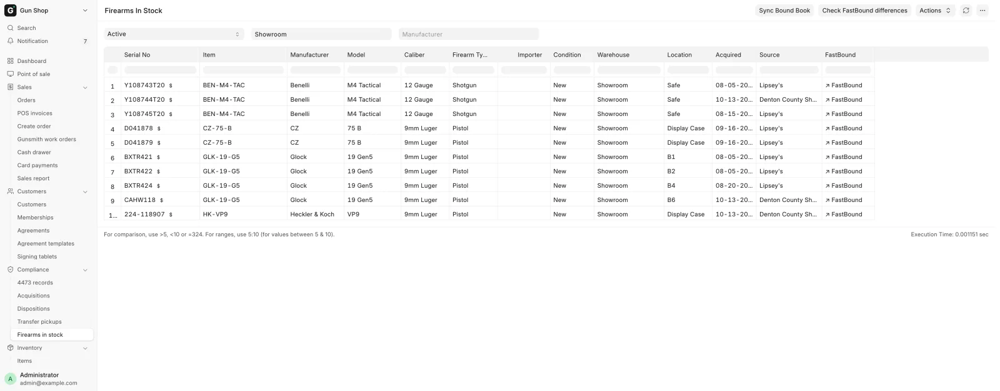

# Daily checks

For the manager or whoever opens the store, every morning before the first customer.

## Start on the Dashboard

Signing in lands you on the [Dashboard](../start/dashboard.md). The line under its title sums up what is waiting, for example "3 forms open, 2 transfers waiting on pickup, and 1 A&D record not in the bound book yet." Three blocks are compliance:

| Block | What it shows |
|---|---|
| **Open 4473s** | Checks started, gun not yet handed over. Tabs **Ready**, **Delayed**, **In progress** and **All** (the only tab with Denied and Cancelled). |
| **Waiting on pickup** | Customers' transfer guns, oldest first. Amber after 21 days in the store. |
| **A&D** | Today's **Acquired** and **Disposed**, and **Not logged**: records FastBound does not have 15 minutes after they were made. |

On **A&D**, click **Review N not logged**. A **Will retry** row is pushed again by the daily retry. A **Needs a person** row will not clear itself: follow [Failed pushes](../admin/fastbound.md#failed-pushes). With FastBound switched off, the block reads **FastBound off**.

Check the bell too. It holds each NICS result and any record FastBound refused for good.

## The routine

| Check | Looking for | How often |
|---|---|---|
| 1. **Pending 4473 Orders** | Customers to call, Brady dates that have arrived | Daily |
| 2. **Pending Transfer Pickups** | Customers' guns nobody has collected | Daily |
| 3. **Hand-Asserted 4473 Dispositions** | Overrides and paper forms to review | Daily if you can, weekly at the least |
| 4. **Firearms In Stock** against FastBound | Guns the two books disagree about | Weekly, or when an alert points at it |

## 1. Pending 4473 Orders

Every held order carrying a regulated firearm, oldest first. It is not in the sidebar: open it from the Dashboard under **All records → Compliance → Pending 4473 orders**.

<figure markdown>
{ .screenshot }
<figcaption>Held firearm orders, oldest first, with the third business day printed. A manager also sees Clear Abandoned Order… on the toolbar.</figcaption>
</figure>

| Column | Meaning |
|---|---|
| **Invoice**, **Total** | The held order and its value. |
| **Parked On**, **Days Pending** | When the check started, and calendar days since. |
| **Customer**, **Firearms** | Who to call, and the serials on the ticket. |
| **4473**, **NICS** | The form and the check status. NICS is red for Denied, orange for Delayed, green for Proceed. |
| **Brady Day 3** | The third business day. Orange once passed while still Delayed. |
| **Transfer?** | Ticked for a customer transfer-in, not a sale. |
| **FB Pending Disp.** | A pending disposition FastBound holds on the gun. Filled only with **Check FastBound** ticked. |

Work it in three passes. Use the **NICS Status** filter to take one outcome at a time; `N/A` finds orders where no check has started.

1. **Denied.** The sale cannot go ahead. A manager refunds the card or returns the cash, then deletes the draft.
2. **Delayed with an orange Brady Day 3.** Federal law lets the dealer transfer at their discretion from today. Decide, and call the customer either way. The rules are on [Form 4473 and NICS](4473.md#delayed-checks-and-the-brady-date).
3. **4473 still Pending.** Nobody finished the form. Call the customer, or chase whoever left it open.

A ticked **Transfer?** means the gun is already the customer's, so the conversation is different. To confirm that a 4473 no longer on this list was completed, look it up in [Find a 4473](4473-records.md).

**Check FastBound** is a filter that asks FastBound, gun by gun, whether an abandoned 4473 left a pending disposition holding it. It is off by default because it makes one call per firearm. A gun held that way reads Available in the bound book, but its next real disposition fails.

### Clear an abandoned order

For a Sales Manager or System Manager, when nobody is coming back for a draft and FastBound still holds a pending disposition on its gun.

1. On the report, click **Clear Abandoned Order…**. The dialog is **Clear an abandoned 4473 order**.
2. Pick the **POS Invoice**. Only drafts are offered.
3. Type a **Reason**.
4. Click **Delete FastBound pending disposition & close order**.
5. Confirm.

FastBound's pending disposition is deleted first, then the draft. If FastBound cannot be reached or refuses, nothing changes. A completed order is refused with `Only a DRAFT order can be cleared`.

The draft is deleted, not cancelled, and can be restored from the recycle bin. The reason goes to the Error Log, because the order is gone. Any [4473 record](4473-records.md) for it stays.

## 2. Pending Transfer Pickups

Customers' guns in the safe, oldest first. Every row is somebody else's property the store is holding. In the sidebar, open **Compliance → Transfer pickups**. Counter accounts with the Sales User role can open it.

<figure markdown>
{ .screenshot }
<figcaption>Somebody else's property, oldest first. Start at the top.</figcaption>
</figure>

The columns are **Acquisition**, **Received**, **Days In Store**, **Customer**, **Phone** (their mobile, blank when none), **Item**, **Serial** and **Shipped By**. A row appears once a transfer is received with a **Transfer for Customer** named, and disappears when the gun leaves stock.

Ring the top of the list. A blank **Phone** is a customer record to fix first. Filter by **Customer** when somebody rings you. See [Customer transfers](../counter/transfers.md).

## 3. Hand-Asserted 4473 Dispositions

Every disposition somebody asserted instead of one FastBound committed: a manager's 4473 override, or a paper 4473 recorded at the counter. It opens for System Manager and Sales Manager only.

<figure markdown>
{ .screenshot }
<figcaption>Newest first, no filters. The Reason column carries the whole story, and FastBound ID sits at the far right.</figcaption>
</figure>

It is not in the sidebar or on the Dashboard. Type **Hand-Asserted 4473 Dispositions** into the search bar and open it. The columns are Asserted On, Disposition, Serial, Type, Invoice, Asserted By, Reason and FastBound ID, newest first, up to 500 rows, with no filters.

The same forms appear in [Find a 4473](4473-records.md) with Source `Paper / override`, including forms whose order was later deleted or redone. Read each new row and ask three questions:

1. **Does the reason make sense?** "FastBound down, form completed on the terminal" is a reason. A one-word reason is not.
2. **Is the pattern normal?** One override in a month is an incident. Several a week from one person is a habit worth a conversation.
3. **Did FastBound catch up?** An empty **FastBound ID** means FastBound still does not carry this disposition. In paper mode it stays empty. With FastBound running, an empty one means somebody needs to reconcile.

!!! danger "This is the whole control"
    An asserted disposition satisfies the sale gate exactly like a real one. Reading this report back is what makes an override an audited exception. If nobody reads it, the override is a hole in the record.

## 4. Firearms In Stock against FastBound

The two books have to agree about what is on the rack and what each gun is. In the sidebar, open **Compliance → Firearms in stock**. It opens for Stock User, Stock Manager and System Manager.

<figure markdown>
{ .screenshot }
<figcaption>The report opened on its filter bar, with Location before Acquired and the FastBound link as the last column. A dash in that column is itself a finding.</figcaption>
</figure>

It lists every serialized firearm, filtered by **Stock Status** (default `Active`), **Warehouse** and **Manufacturer**. Details show the gun's own value, or the model's when the gun has none. Importer comes from the gun only, so a blank importer means no import marking.

**Location** is the gun's place in the store, blank when it has none ([Find and move stock](../stock/find-and-move.md)). The **FastBound** column links to the gun in the bound book, or shows a dash when it has no link. A dash on a regulated gun is itself a finding.

Two buttons compare the books. Both are described on [FastBound](../admin/fastbound.md#checking-the-two-books-agree).

- **Check FastBound differences** lists the guns whose details differ, and in which fields.
- **Sync Bound Book** finds guns in stock here but disposed in FastBound, and offers to take them out of stock after a preview.

While you are there, look for two mismatches by eye. A gun on the rack but not on the report was never received properly. A gun on the report but not on the rack was sold or transferred without being booked out.

## Where alerts go

The system also pushes alerts, so nothing waits on you opening a report.

**The bell** shows in the app only. Who gets which notice is on [the Dashboard](../start/dashboard.md) page; the compliance ones are NICS results and "A&D book: FastBound refused …".

**Email** goes to **Alert Recipients** in [FFL Settings](../admin/ffl-settings.md), or to every System Manager when that is blank. Every subject starts `[POS Alert]`:

| Alert | When | How often |
|---|---|---|
| `N FastBound record(s) stuck unsynced` | A bound-book record has a sync error, other than one marked `[NOT A&D]` | Once a day at most |
| `N trade-in draft(s) not yet in the bound book` | A trade-in draft is older than today | Twice a day at most |
| `Payroc: N card charge(s) no longer captured at the gateway` | A card charge was voided or reversed outside the POS | When found |

The trade-in reminder follows the next-business-day rule in 27 CFR 478.125(e). It runs whether or not FastBound is on, because the obligation is the store's. See [Trade-ins](../counter/trade-ins.md).

GunBroker sends its own daily audit emails, one per kind of problem. They are listed on [GunBroker orders](../orders/gunbroker-orders.md#daily-alerts).

Some conditions raise an assigned to-do for Stock Manager, Sales Manager and System Manager instead, one per document. A serial mismatch between a 4473 and its order is also posted as a comment on the order.

!!! note
    Set **Alert Recipients** to a real, monitored address. Left blank, these alerts go to every System Manager, which is often nobody's inbox.
