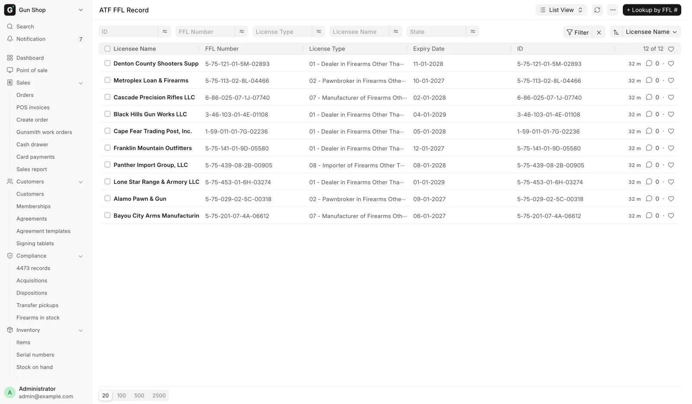
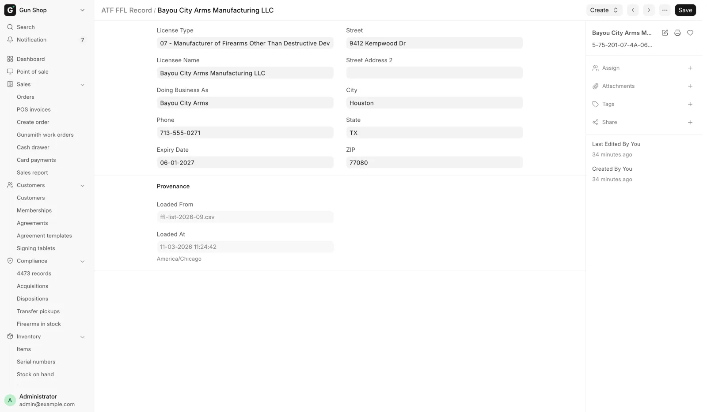
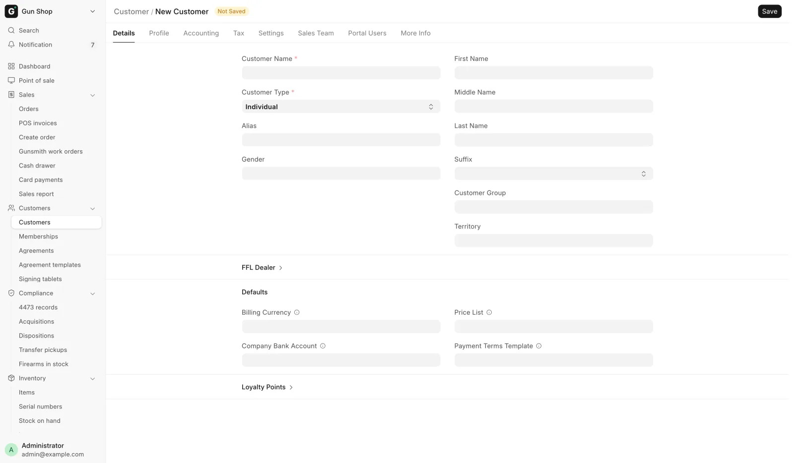

# Verify an FFL

For anyone receiving a gun from a dealer, or shipping one to a dealer or a collector.

A firearm cannot ship to a dealer unless their license is on file, verified and unexpired, and it cannot be received from a supplier who is not set up as an FFL dealer. A C&R (Type 03) collector is the one exception to the live check, because the ATF directory lists no collectors. See [C&R (Type 03) collectors](#cr-type-03-collectors).

## The FFL library

Every license the store has looked up is kept as an **ATF FFL Record**, named by the FFL number. Open the list from **Settings**, then **ATF FFL Record** under **FFL & Compliance**.

<figure markdown>
{ .screenshot }
<figcaption>Every license the store has looked up, kept locally and searchable by number.</figcaption>
</figure>

A record carries **License Type**, **Licensee Name**, **Doing Business As**, the address, **Phone** and **Expiry Date**. Its **Provenance** section shows **Loaded From**, **Loaded At** and **Live-Verified At**. A record loaded in bulk from the ATF's published list was never checked live, so its Live-Verified At is empty.

<figure markdown>
{ .screenshot }
<figcaption>One license. Provenance records where it was loaded from and when. Live-Verified At shows only once the record has been checked live.</figcaption>
</figure>

The library is the destination side of a transfer: a [disposition](bound-book.md) picks its **Destination FFL** from here.

### Look up a license by number

1. On the ATF FFL Record list, click **+ Lookup by FFL #**. The dialog is **Lookup FFL Record**.
2. Type the **FFL Number** in the format `1-99-999-99-9X-99999`. Hyphens are optional.
3. Click **Lookup & Save**.

The lookup runs the live ATF check and saves the result. The message names the record and the licensee, green when the status is Verified and orange otherwise.

The same lookup appears in two more places: **Lookup FFL via ATF** on a [disposition](bound-book.md), and a **FFL Dealer? Lookup by FFL #** panel in the quick-add dialog for a new supplier, which fills the supplier from the license.

### Make a customer or supplier from a license

A license on its own is a directory entry, not somebody you can trade with. Under **Create** on the record:

- **Create Dealer Customer**, for a dealer you ship guns to.
- **Create Supplier**, for a dealer you buy guns from.

Either one creates the party already marked as an FFL dealer, carrying the license number and linked to the record, then opens it. If a party already carries that number, it opens that one instead: "<type> <name> already carries this FFL — opening it."

Picking **Business (FFL)** as the buyer on [Build an order](../orders/build-an-order.md) and entering the license also creates the dealer customer.

## Search ATF and Verify FFL

The Customer and Supplier forms carry an **FFL** button group. It appears only when **Is FFL Dealer** is ticked, so tick it and save first.

<figure markdown>
{ .screenshot }
<figcaption>A new Customer, before Is FFL Dealer is ticked. Tick it inside the FFL Dealer section and save, and the FFL button group appears on the toolbar.</figcaption>
</figure>

### Search ATF

Use it when you know the dealer's name but not their number.

1. Click **Search ATF**. The dialog is **Search ATF FFL**.
2. Type into **FFL # or licensee name**.
3. Click **Search**. Results list **FFL #**, **Licensee**, **City, State** and **Expiry**.
4. Click **Pick** on the right row.

Picking fills in the license number, type, licensee name, licensed premises address and expiry, and sets the status to `Pending`. The message says: "Filled from ATF FFL Record. Click Verify FFL to confirm against the live ATF."

When the store uses the Data Service for lookups, the search also asks the national listing and shows matches before you pick one. If the service cannot be reached, the local library answers alone.

### Verify FFL

This is the step that turns `Pending` into `Verified`.

1. Open the saved customer or supplier.
2. Click **Verify FFL**.

The result is stamped on the party: **EZ Check Status**, **EZ Check Last Run**, the licensee name, the licensed address and the expiry date. The message reads "FFL status: Verified" in green, "FFL status: Expired" in orange, or "FFL status: Failed" in red.

**EZ Check Status** is `Pending`, `Verified`, `Failed` or `Expired`. A lookup that finds nothing, and a provider that cannot be reached, both land on `Failed`.

Every **Verify FFL** and **Lookup by FFL #** runs a live check. When the ATF or the provider is down, a license looked up before keeps working from the library, but a brand-new number cannot be verified until it is back. Provider and rate-limit settings are on [FFL Settings](../admin/ffl-settings.md).

## The shipping rule

A firearm cannot leave the store to a dealer whose license is not verified and unexpired. The check runs when the shipment is booked, however the order was built. The refusal is titled **Dealer FFL Not Shippable**, or **Destination FFL Expired** for a destination picked on the order.

| Reason you see | What is wrong |
|---|---|
| `No FFL number on file.` | The customer is marked a dealer but has no license number. |
| `FFL not verified (status: Pending).` | The license was filled in but never verified live. |
| `FFL not verified (status: Failed).` | The last verification failed. |
| `FFL expired <date>.` | The license has expired. |
| `FFL expired (no expiry on file).` | No expiry date is recorded, which counts as blocked. |

Shipping is stricter than receiving. Receiving accepts `Pending`, so a first purchase from a new supplier is not blocked. Shipping does not, because here the store hands the gun over.

Two more blocks apply to a destination picked on an order:

- **Destination FFL Address Incomplete**: the license has no street or no valid state. The address is needed to work out sales tax.
- **Destination FFL Unresolved**: the dealer's FFL number matches no license at all.

The fix is the same each time. Open the dealer, run **Search ATF** if the address is thin, then **Verify FFL**.

## C&R (Type 03) collectors

A collector with a Curio & Relic license holds a real FFL, so a C&R-eligible gun can ship to their licensed premises. The ATF directory holds no Type 03 licenses, so **Verify FFL** and **Lookup by FFL #** never find one. You read the license copy instead.

On the order, in **Destination FFL**:

1. Tick **C&R (Type 03) — ships to the collector's own license**. The lookup buttons give way to a form.
2. Type the **C&R License Number** as printed, in the form `1-99-888-03-7C-12345`. A collector who has ordered before fills in the rest from the record on file.
3. Type or check **License Expires**, **Collector Name**, **Licensed Premises Address**, **City**, **State** and **ZIP** as they appear on the copy.
4. Click **Use this C&R license**. The message reads "C&R license saved — the order ships to the licensed premises."

The license is saved to the library with a note naming who read the copy, and becomes the order's destination. The ship-to is the licensed premises, sales tax follows that address, and the gun leaves the bound book as an `FFL Transfer`.

A web order for a collector is checked against the same rules when it is disposed ([Web orders](../orders/web-orders.md)). The full order steps are on [Ship a firearm to another dealer](../orders/ship-to-dealer.md).

| You see | Fix |
|---|---|
| `Missing C&R details: …` | Fill in the blank field. |
| `… is not a Type 03 (Curio & Relic) license — the fourth group must be 03…` | The number is not a collector's license. Check the copy. |
| `C&R license <n> expired on <date>.` | The gun cannot ship to an expired license. |
| `"<value>" is not a valid US state.` | Fix the state. |

!!! warning "Federal recordkeeping"
    You are attesting that you read these details from the collector's license, and the record names you. Keep the copy with the order's records. The system does not check that the gun is a curio or relic. That judgment stays with the person shipping it.

## Troubleshooting

| You see | Fix |
|---|---|
| **Dealer FFL Not Shippable** | Read the reason, then re-verify the dealer. |
| `Cannot receive firearm from supplier '<name>' — not registered as FFL Dealer.` | Tick **Is FFL Dealer** on the supplier, run **Search ATF**, then **Verify FFL**. |
| `FFL number '<n>' not found in ATF EZ Check.` | Check the number with the dealer. |
| `'<value>' doesn't look like an FFL number. Expected format: 1-99-999-99-9X-99999` | Retype it. Hyphens are optional. |
| `EZ Check provider unavailable: …` or `Data Service: shared EZ Check budget exhausted` | Wait and try again. If it keeps happening, a manager checks [FFL Settings](../admin/ffl-settings.md). |
