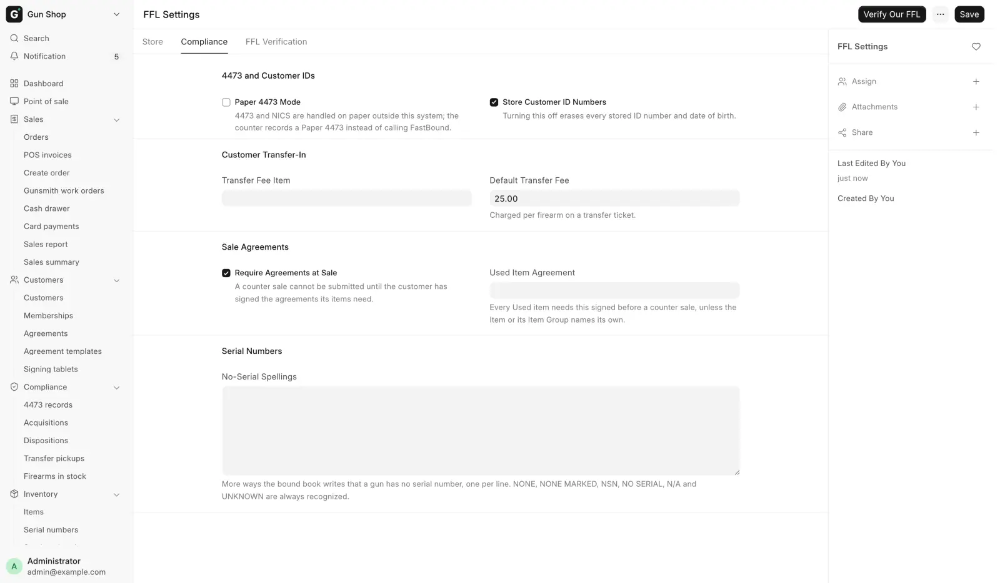

# Compliance

For counter staff and managers, to see what the system records for ATF purposes and where to find it.

Counter staff meet most of this at the register. A manager owns the reviews.

## What the system records

- Every gun in and out. Receiving a regulated firearm writes an [acquisition](bound-book.md) with the date, source and serial, and sends it to FastBound. A gun leaving writes a [disposition](bound-book.md) naming where it went.
- **The 4473 gate.** A retail sale is held until a completed [Form 4473](4473.md) and a NICS Proceed are on record. Every completed 4473 gets a permanent [4473 record](4473-records.md) that cannot be deleted, with a copy of the signed form when FastBound has one.
- **Licenses.** A gun cannot ship to a dealer whose license is not [verified against the ATF directory](ffl-verification.md), and cannot be received from a supplier not set up as an FFL dealer.
- Who said so. Every hand-asserted 4473, paper or override, is stamped with who asserted it and why.

Antique firearms are tracked as serialized stock and kept out of all of this.

## What it does not do for you

The system records what you tell it and stops some steps happening out of order. It cannot check that a form was really filled in or that a check really cleared, so every hand-asserted entry stores a name and a reason.

Completing and filing the 4473, running the background check, keeping the bound book accurate, producing records on demand and knowing your state's law remain the licensee's responsibility. Nothing in this guide is legal advice.

!!! warning "Federal recordkeeping"
    Bound-book entries for a firearm you have taken possession of are due by the close of the next business day (27 CFR 478.125(e)). A trade-in applied as credit on a sale waits as a draft until that sale completes, and the draft is not in the book. The system emails a reminder when one is overdue.

    A trade-in the store pays for on the spot books at once. See [Trade-ins](../counter/trade-ins.md).

## Where you see it

The [Dashboard](../start/dashboard.md) is the morning view. Three blocks are compliance: **Open 4473s**, **Waiting on pickup** and **A&D**. The bell rings for each NICS result and for a record FastBound refused for good.

In the sidebar, the **Compliance** group holds **4473 records**, **Acquisitions**, **Dispositions**, **Transfer pickups** and **Firearms in stock**. A counter account with the Sales User role opens 4473 records, Acquisitions and Transfer pickups. Dispositions and Firearms in stock open for Stock User, Stock Manager and System Manager only.

## I need to...

| I need to... | Go to |
|---|---|
| Run or record the 4473 on a sale | [Form 4473 and NICS](4473.md) |
| Find a completed 4473 or open its signed PDF | [Find a 4473](4473-records.md) |
| Read what an acquisition or disposition holds | [The bound book](bound-book.md) |
| Verify a dealer's license before shipping or receiving | [Verify an FFL](ffl-verification.md) |
| Know what to check every morning | [Daily checks](daily-checks.md) |
| See who overrode a 4473 and why | [Daily checks](daily-checks.md#3-hand-asserted-4473-dispositions) |
| Fix a record FastBound refused | [FastBound](../admin/fastbound.md#failed-pushes) |
| Sell a gun at the counter | [Sell a gun](../counter/sell-a-gun.md) |
| Receive a customer's transfer gun | [Customer transfers](../counter/transfers.md) |
| Change compliance settings | [FFL Settings](../admin/ffl-settings.md) |

<figure markdown>
{ .screenshot }
<figcaption>Compliance behavior starts here: Paper 4473 Mode, the customer transfer fee, whether customer ID numbers are kept, and the no-serial spellings.</figcaption>
</figure>
