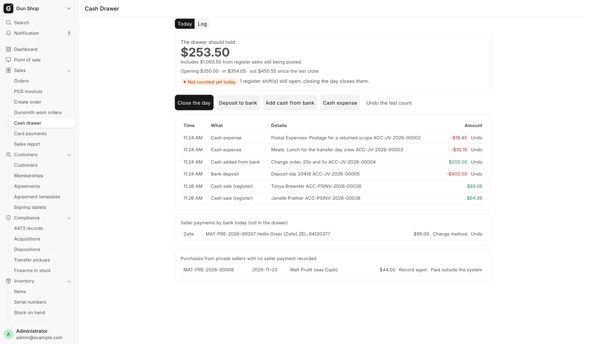
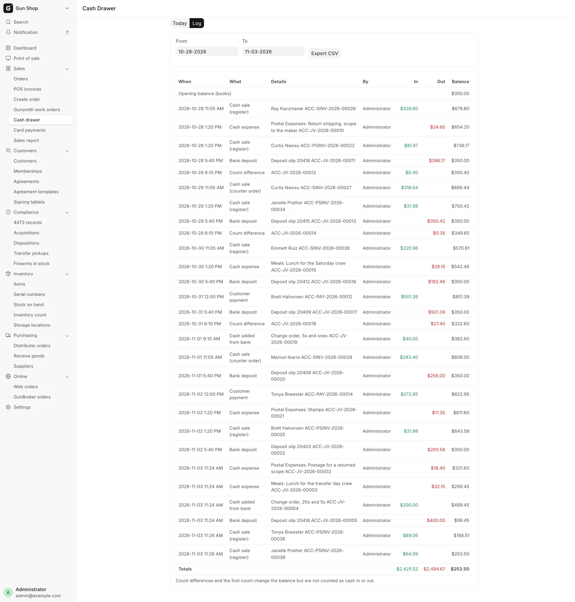
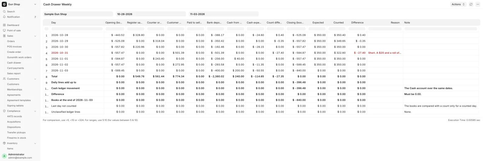

# Cash drawer

For counter staff at the end of every day, and whenever cash goes to or from the bank or pays a small expense. Managers use the same page to undo a mistake and to settle what private sellers are owed.

<figure markdown>
{ .screenshot }
<figcaption>What the drawer should hold, the four buttons, and every cash movement since the last count.</figcaption>
</figure>

## Before you start

- Open it from **Cash drawer** in the sidebar's **Sales** group, or from the **Cash drawer** card on the [Dashboard](../start/dashboard.md).
- You need **Sales User**, **Sales Manager**, **Stock Manager** or **System Manager**. Undoing anything is **Sales Manager** or **System Manager** only.
- You never type what the drawer should hold. The page works it out from every cash sale, refund and payment. You only type what you counted.

## The Today tab

The big figure at the top is **The drawer should hold**: the cash in the books, plus cash from register sales that are still being posted. Under it a line reads "Opening … · in … · out … since the last close", and a pill says whether today has been counted.

| Pill | Meaning |
|---|---|
| **Not counted yet today** | Nobody has closed today's drawer |
| **Counted at 6:02 PM: $812.00 · Matches the books** | Closed, and the count agreed |
| **Counted at …: … · $3.50 short** | Closed with a difference |
| **Counted at …: … · first count, books set to it** | The store's very first count |

If register shifts are still open, the page says how many. Closing the day closes them.

Below the buttons, the list shows every cash movement since the last count: the time, what it was, the record behind it and the amount.

| Line | Why the drawer moved |
|---|---|
| **Cash sale (register)** | A cash sale at the register |
| **Cash sale (counter order)** | A cash payment taken on Create Order |
| **Cash paid on an open order** | Cash taken at the register on an unfinished order, such as a part payment or payment before the 4473 clears. It counts from the moment you click **Take Payment** |
| **Customer payment** | Cash taken against an order later, for example at pickup |
| **Cash refund** | Cash handed back on a return |
| **Seller paid for a gun**, **Seller paid for received goods** | Cash paid to a private seller |
| **Customer paid for trade-ins** | A ticket where the trade-ins came to more than the sale |
| **Bank deposit**, **Cash added from bank** | Cash taken to the bank or brought back |
| **Cash expense** | A small purchase paid from the till |
| **Count difference**, **First count** | What a count booked |
| **Owner took cash (old entry)** | Cash an owner took, on old records only |

## Close the day

Count the drawer once, at the end of the day, and confirm once.

1. Count the cash in the drawer.
2. Click **Close the day**.
3. Type the total in **Cash counted in the drawer**.
4. Read the lines under it. They say what the books expect and how far off your count is, for example "You counted $808.50: $3.50 short."
5. If the drawer is off by the store's limit or more ($20 unless changed), a **Why is it off?** box appears. Write a short reason.
6. Click **Close the day**.

The page shows **Day closed** with the difference, and the pill turns green.

### What happens next

- Every register shift still open is closed and its sales are posted.
- Any difference is recorded as cash over or short, with your reason.
- Your count becomes the opening for the next day.
- The store's very first count sets the books to what you counted. Nothing is recorded as a loss, and the accountant gets a note.

Only one count is kept per day. If the count was wrong, a manager clicks **Undo the last count**: the day reads as not counted again, and the shifts it closed stay closed. Count again afterwards. Only the latest count can be undone.

If nobody counts, the register shifts still close at 23:00 and the day stays **Not counted**. The next real count covers every day since the last one. See [A day at the counter](../start/day-at-the-counter.md).

## Deposit to bank

1. Click **Deposit to bank**.
2. Type the **Amount**.
3. Add the **Deposit slip or reference (optional)**.
4. Check the bank account named under the fields.
5. Click **Record deposit**.

## Add cash from bank

When you bring change or a float back from the bank:

1. Click **Add cash from bank**.
2. Type the **Amount put in the drawer**.
3. Add the **Withdrawal slip or reference (optional)**.
4. Click **Record**.

## Cash expense

For a small purchase paid out of the till, such as postage or office supplies.

1. Click **Cash expense**.
2. Type the **Amount paid (tax included)**. The field shows the limit for one expense.
3. Pick **What it was for**. The list holds only the expense types a manager allowed.
4. Write **What was bought**.
5. Optionally attach a **Photo of the receipt (optional)**. It must be a new photo, not one used for another expense.
6. Click **Record expense**.

An expense over the limit is refused. Pay it by card or from the bank instead.

## Undo a mistake (managers)

Managers see **Undo** next to a deposit, cash from the bank, a cash expense or a seller payment for received goods.

1. Click **Undo** on the line.
2. Confirm **Undo this entry? The cash goes back into the drawer total.**

An entry cannot be undone once a count was taken after it. Undo that count first, or tell your accountant. Entries are never deleted, only undone, so the log keeps both.

!!! warning "Undo here, not in the accounts"
    Cash entries can only be taken back on this page. The accounting screens refuse to cancel them and point back here. A trade-in payout is taken back by cancelling its register ticket.

## Seller payments

Two lists at the foot of the Today tab are about paying private sellers. Those payments start on [Trade-ins](trade-ins.md) and [Buy from a private seller](../stock/private-seller.md).

**Seller payments by bank today (not in the drawer)** lists today's seller payments made by Zelle, check or ACH. They never touched the drawer. A manager can click **Change method** to correct how the seller was paid, or **Undo**.

**Purchases from private sellers with no seller payment recorded** shows to managers only. It lists private purchases from Receive Goods with no payment standing, either never recorded or undone. For each one:

1. Click **Record payment** (or **Record again** after an undo). **How was the seller paid?** opens.
2. Pick **Paid by**: Cash, Zelle, Check or ACH.
3. For anything but cash, type the **Check number, Zelle confirmation or ACH reference**.
4. Click **Record**.

For a seller paid some other way, for example a check written from the accounting system, click **Paid outside the system**. Write how the seller was paid and click **Mark as paid outside**. Nothing is recorded as cash and the purchase leaves the list.

A purchase received before the store started tracking cash here is left to the accountant.

## The Log tab

<figure markdown>
{ .screenshot }
<figcaption>Every cash movement for the dates chosen, with who did it and the balance after each line.</figcaption>
</figure>

The **Log** tab lists every cash movement between **From** and **To**, oldest first, with **When**, **What**, **Details**, **By**, **In**, **Out** and the running **Balance**. It starts from **Opening balance (books)**, ends with the **Totals**, and opens on the last seven days.

A line entered later than the date it belongs to says when it was entered. Count differences and the first count change the balance but are not counted as cash in or out. Click **Export CSV** to download the dates on screen, at most a year at a time.

## The weekly report (managers)

**Cash Drawer Weekly** gives one row per day: sales, payments, refunds, seller payments, bank moves, expenses, the expected cash, the count and any difference with its reason. A day whose difference needed a reason shows red.

Open it from [All records](../start/dashboard.md) on the Dashboard. It needs **Sales Manager**, **Accounts User**, **Accounts Manager** or **System Manager**.

<figure markdown>
{ .screenshot }
<figcaption>One line per day. The lines at the foot prove the days add up.</figcaption>
</figure>

The lines at the foot are the check. **Daily lines add up to** must equal **Cash ledger movement**, the **Difference** under them must read 0.00, and on the **Unclassified ledger lines** row the **Note** must read **None.** See [Month-end close](../admin/month-end.md).

## Cash Drawer Settings (System Manager)

Open **Settings**, then **Cash Drawer Settings** under **POS & Sales**.

| Field | What it does |
|---|---|
| **Count difference that needs a reason** | A close this far off needs a written reason and shows red on the weekly report. $20 until changed |
| **Biggest cash expense** | A single expense above this cannot be paid from the drawer. $200 until changed |
| **Accounts a cash expense can go to** | The choices under **What it was for**. Empty means the standard list (see [For the bookkeeper](../admin/bookkeeper.md)) |
| **Cash tracking started** | When the store began tracking cash here. Earlier purchases are left to the accountant |

## Troubleshooting

| You see | Fix |
|---|---|
| **Today's cash was already counted at …** | Someone closed today already. A manager undoes that count if it was wrong |
| **The cash the drawer should hold changed while you were counting** | A sale landed mid-count. Read the new figure, recount if needed, confirm again |
| **The drawer is … short of the books. Write a short reason, then close the day.** | Write the reason and close again |
| **A register shift did not close** | Your count is saved. A manager closes that shift by hand (see [A day at the counter](../start/day-at-the-counter.md)) |
| **A count was taken after that entry, so it cannot be undone any more.** | Undo the count first, or tell your accountant |
