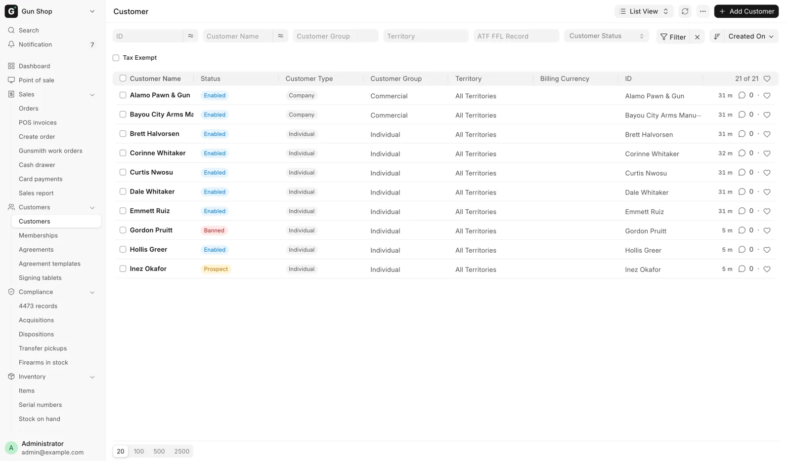
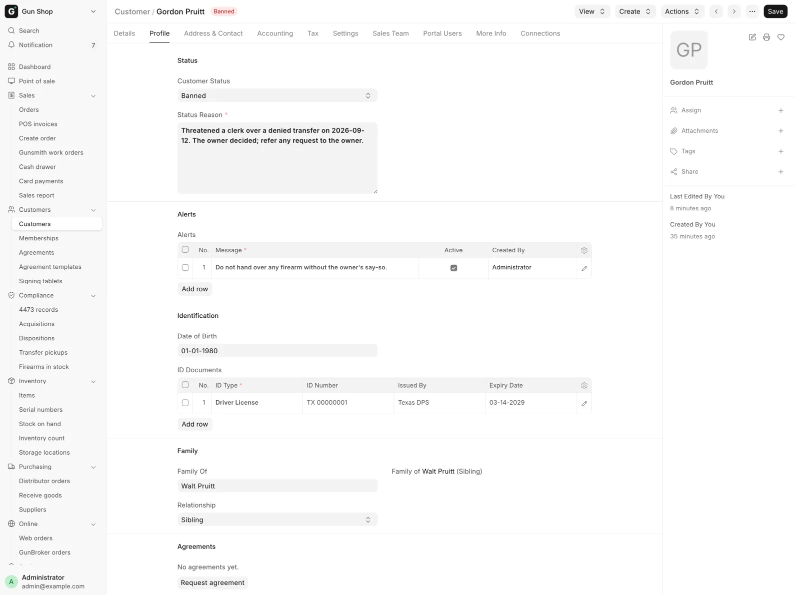
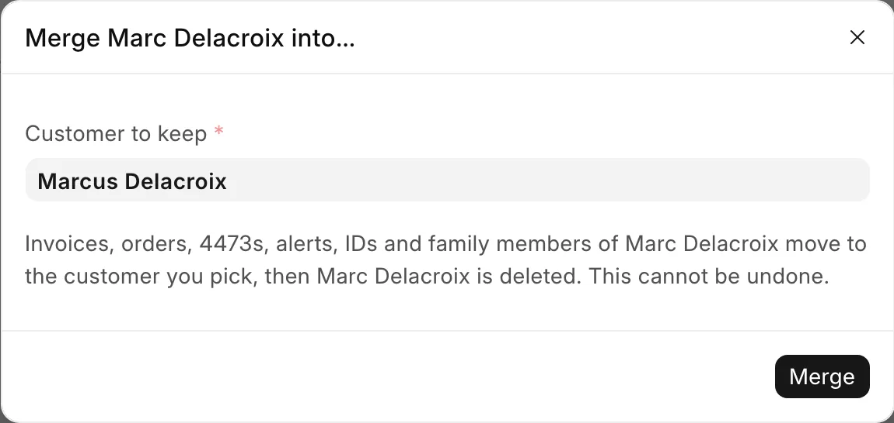

# Customers

For counter staff adding or looking up a customer, and for managers keeping customer records clean. Every sale, 4473 and order belongs to a customer.

## Before you start

- Open the customer list from **Customers** in the sidebar, or one customer from search (++ctrl+k++).
- **Add customer** on the [Dashboard](../start/dashboard.md) opens a new one.
- At the register, the customer box at the top of the cart can add a new customer without leaving the sale.
- Merging two records needs **Sales Manager** or **System Manager**.

## Add a customer

<figure markdown>
{ .screenshot }
<figcaption>The Customer list. A Banned, Inactive or Prospect customer carries a colored status.</figcaption>
</figure>

The **New Customer** dialog is the same at the register and on the customer list.

1. Leave the type on **Individual** for a person.
2. If you have the customer's driver license or state ID, click into **Scan ID**.
3. Scan the barcode on the back of the card and wait for the whole barcode to go through. The dialog fills the name and address and shows **ID scanned:** with the name it read.
4. With no scan, type **First Name** and **Last Name**, plus **Middle Name** and **Suffix** if there are any.
5. Fill in or correct the address and contact details.
6. Save.

Type the name exactly as it reads on the customer's ID. That name goes on the 4473 and into the bound book.

If your store keeps ID numbers (see [Storing ID numbers](#storing-id-numbers)), the dialog also asks for **Date of Birth**, **Driver License #** and **License Expiry**, and a scan fills them. The license becomes a row under **ID Documents** on the Profile tab.

## Email and phone

**Email** and **Phone** sit on the customer's first tab, **Details**, under the name. A value you type there becomes the customer's main email or phone, and the old one stays on file as a second. Receipts, membership renewals and agreement links go to that email.

## At the register

When you pick a customer at the top of the cart, a line of colored labels shows under the name. It lists what you need to know before you ring the sale:

- The status, when it is not Active. A **Banned** customer is stopped with a red box until a manager types an **Override reason** and clicks **Override ban (30 min)**.
- A green member badge with the plan, the month the membership runs to, and any benefit with a daily limit, for example `Gold · to 2027-04 · Range 1/2 today`. See [Memberships](memberships.md#member-prices).
- An ID about to expire or expired, the customer's agreements, and the family the customer belongs to.

An agreement still to sign is a label you can click. It opens the agreement so you can send it to the tablet, show a QR code or email a link. **Agreements** under the name lists them all.

### Skip agreements for one sale

When a sale is waiting on an unsigned agreement and the customer cannot sign now, a manager can let this one sale go without it.

1. Click **Agreements** under the customer's name.
2. Click **Skip for this sale (manager)**. **Skip agreements for this sale** lists what is being skipped.
3. The manager picks their name in **Manager** and types their **PIN** (or password). A **Reason (optional)** goes on the sale.
4. Click **Skip**, then complete the sale within 15 minutes.

The skip works once, for the next sale to that customer. The sale gets a note saying what was skipped and who approved it.

## The Profile tab

<figure markdown>
{ .screenshot }
<figcaption>Status, alerts, identification and family on one tab.</figcaption>
</figure>

Open a customer and click **Profile**, the tab after the first one.

| Section | What it holds |
|---|---|
| **Status** | **Customer Status** and, for any status but Active, a **Status Reason** |
| **Alerts** | Notes for whoever serves this customer next: a **Message** and an **Active** box |
| **Identification** | **Date of Birth** and **ID Documents** (type, number, issuer, dates, **Copy of ID**) |
| **Family** | **Family Of** and **Relationship**, or the head of a family's members |
| **Merged Emails and GunBroker IDs** | Shown only after a merge |

Each alert records who added it and when. **Copy of ID** is kept as a private file: use the attach button on the row to upload it.

### Customer status

A new customer is **Active**. Set **Customer Status** to:

- **Inactive** for someone who no longer shops here.
- **Prospect** for someone who has not bought yet.
- **Banned** for someone the store will not serve. A reason is required.

The status shows on the customer list and at the top of the record: **Banned** in red, **Prospect** in orange, **Inactive** in gray. Filter the list by **Customer Status** to find them.

!!! note
    **Banned** stops a sale at the register and on Create Order until a manager overrides it for 30 minutes. **Inactive** and **Prospect** are records for staff and stop nothing.

### Family

A family is one level deep: a head of the family and the people under them, for example a spouse and children who buy on the same account.

1. Open the head of the family.
2. Go to **Family** and click **Add family member**.
3. The **New Customer** dialog opens with the last name and address filled in. Pick the **Relationship**: Spouse, Child, Parent, Sibling, Guest or Other.
4. Save. The member appears in the list.

A member's own record shows **Family of** with a link to the head. A member cannot have members of their own. A head with members cannot join another family or be deleted.

## Memberships and saved cards

Under **Agreements** on a customer, **Memberships** sells and manages the customer's memberships, and **Saved cards** lists the cards kept on file. See [Memberships](memberships.md) and [Take payment](payments.md#save-a-card-to-charge-later).

## Storing ID numbers

Whether the system keeps ID numbers and dates of birth is a store decision. A manager sets **Store Customer ID Numbers** in [FFL Settings](../admin/ffl-settings.md), on the **Compliance** tab under **Customer Records**.

- **On**: ID numbers and dates of birth are kept on the customer record.
- **Off**: the fields are hidden and every save blanks them. Only the attached ID copy and the ID type, issuer and dates are kept.

!!! warning
    Turning the switch from on to off erases the ID numbers and dates of birth already stored. Attached ID copies, change history and deleted records are kept.

## Merge two records of the same person

A manager merges the duplicate into the record to keep.

<figure markdown>
{ .screenshot }
<figcaption>Pick the customer to keep. The record you started from is the one that goes away.</figcaption>
</figure>

1. Open the **duplicate**, the record that should go away.
2. Click **Actions**, then **Merge into…**.
3. In **Customer to keep**, pick the record that stays.
4. Read the warning and click **Merge**.

!!! danger "This cannot be undone"
    Invoices, orders, 4473s, alerts, IDs and family members of the duplicate move to the customer you keep, then the duplicate is deleted.

What you will see on the kept record afterwards:

- The duplicate's alerts and ID documents, without repeats, and its date of birth if the kept record had none.
- **Banned**, with the reason, if the duplicate was banned.
- The duplicate's email addresses and GunBroker user ID under **Merged Emails and GunBroker IDs**. A later web or GunBroker order from one of them lands on this record. Nobody can edit those rows.
- A comment saying who merged what.

The merge is refused for the web store's own customer, the walk-in customer and a register's default customer. It is also refused for two FFL dealers with different license numbers, and when it would put one family inside another. If only the duplicate is an FFL dealer, merge the other way round so the license stays on file.

## Troubleshooting

| You see | Fix |
|---|---|
| **Enter a reason before marking … as Banned.** | Fill in **Status Reason** and save |
| **… is already a family member of …** | Families are one level deep. Add the person to the head's family |
| **… has family members of their own, so they cannot join another family.** | Move their members first |
| **… is an FFL dealer and … is not.** | Merge the other record into the dealer |
| **A customer cannot be merged into itself.** | Pick a different customer to keep |
