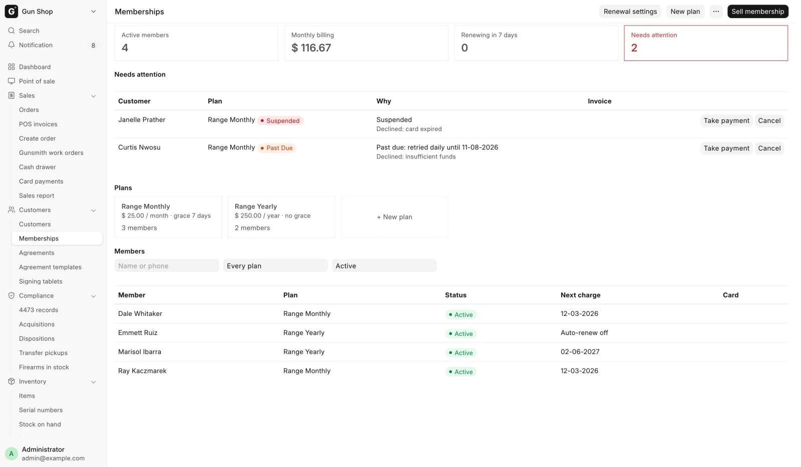

# Memberships

For counter staff selling a monthly or yearly membership, and for managers who set up plans and follow up failed renewals. Nothing changes at the counter until a manager creates a plan.

## Before you start

- Open the **Memberships** page from **Customers**, then **Memberships**, in the sidebar.
- A membership is sold to a named customer, never the walk-in customer.
- Give the customer an email address. Renewal receipts and the yearly reminder go by email only.
- Memberships are not rung up on the register. The register refuses a plan's product with **Sell memberships from the customer's Memberships panel (Customer form), not the register.**
- Auto-renew needs card on file switched on (see [Card voids and refunds](../manager/card-refunds.md#switch-on-card-on-file)). The renewal card is saved when the first membership payment is charged on the terminal. A card saved at the register cannot be used for renewals.

## Create a plan

A **Sales Manager** or **System Manager** does this.

1. On the Memberships page, click **New plan**.
2. Type the **Plan name**.
3. Choose **Billed**: Monthly or Yearly.
4. Enter the **Price per period**.
5. Open **More options** if you need any of the fields below.
6. Click **Create plan**.

| Field | What it does |
|---|---|
| **Registration fee** | Charged once, on the customer's first invoice for this plan |
| **Auto-renew by default** | Pre-ticks **Auto-renew** when the plan is sold |
| **Grace period when a renewal is declined** and **Grace days** | Off: the first declined renewal suspends the membership. On: the card is retried every morning for the grace days first |
| **Membership terms** | An agreement the customer signs on the tablet for each new membership |
| **Description** | Your own note |

Saving a plan makes its product, and a fee product when there is a registration fee. For a tax-exempt plan, open its **Billed Item** on the plan record afterwards and set an exempt tax template.

### Change or stop a plan

- Click a plan's card to change it.
- Untick **On sale** to stop new sign-ups. Current members stay as they are.
- A new **Price per period** is what every current member pays at their next renewal.
- **Billed** cannot be changed once the plan has members.

## Member prices

A plan can give its members lower prices at the register and on invoices. A manager sets them on the plan form: click a plan's card, then **Member prices: set them on the plan form**. Add a row to **Benefits** under **Member Benefits** for each price.

| Field | What it does |
|---|---|
| **Applies To** | **Item**, **Item Group** (sub-groups too) or **Price List** (the items priced in it) |
| **Benefit** | **Percent off**, **Amount off**, **Fixed price**, or **Price-list price** (that list's own price) |
| **Percent, Amount or Price** | The number for the benefit. Not used for Price-list price |
| **Daily Limit per Member (0 = None)** | How many units a member gets at this price each day |
| **Only on Days** | For example `Sat, Sun`. Blank means every day |
| **Reason Shown on the Sale** | What the sale line says. Blank shows, for example, `Member 10% (Gold)` |

The plan card on the Memberships page lists its benefits under the price.

### At the register

Pick the customer first. Each line a benefit covers is repriced by itself, and **Discount Reason** on the line says why. A member who holds an Active membership, or a Past Due one still in its grace, gets the price.

- When more than one price applies, the lowest wins. A sale price lower than the member price is kept instead.
- When the daily limit is used up, the line stays at its regular price and a message says which sales used it.
- A gun priced one by one only gets a member price from a benefit that names its item. Trade-in credit, deposits and membership fees never do.
- If the total changes as you click **Complete Order**, the register says so and stops. Collect the new total and click **Complete Order** again.

Orders from Create Order, web orders and GunBroker orders keep their own prices.

1. Open the customer, find **Memberships** under **Agreements**, and click **Sell membership**. From the Memberships page, click **Sell membership** at the top and pick the customer.
2. Choose the **Plan**.
3. Leave **Auto-renew** ticked to charge the card on the terminal and keep it for renewals. Untick it to take cash or another payment method.
4. Click **Continue**.
5. If the plan has terms, the **Request agreement** dialog opens. Send it to the tablet, show the QR code or email the link. **Get terms signed** on the row reopens it.
6. Click **Collect payment**.
7. With auto-renew, the terminal charges the card. The customer first signs the card-on-file authorization if they have not.
8. Without auto-renew, pick the **Payment Method** (Cash, Credit Card, Zelle, ACH or Check/Money Order) and click **Take payment**.

The membership turns **Active** when its invoice is paid in full.

If the store cannot save cards right now, the system asks **Take this payment without auto-renew?**. A membership paid without a saved card has auto-renew off.

To abandon a sign-up nobody paid for, click **Drop** and give a reason. Drop is refused once a payment or card charge touched the invoice.

## The Memberships panel

Each membership on the customer shows its status and the buttons that fit it.

| Status | Meaning |
|---|---|
| **Pending** | Waiting for the first payment |
| **Active** | Paid up |
| **Past Due** | The renewal was declined. The card is retried each morning until **Grace until** |
| **Suspended** | The renewal failed with no grace, or the grace ran out |
| **Cancelled**, **Expired** | Over |

| Button | Who | What it does |
|---|---|---|
| **Turn auto-renew off** / **Turn auto-renew on** | Counter staff | On needs a card saved while paying for a membership with auto-renew |
| **Change card** | Counter staff | Pick another saved card for renewals |
| **Take payment** | Counter staff | Pays an overdue renewal with any payment method |
| **Retry card** | Manager | Charges the saved card now for an overdue renewal |
| **Look up card charge** | Manager | Shows instead of **Retry card** when the processor never confirmed a charge |
| **Cancel** | Manager | Asks for a **Reason**. Runs to the end of the paid period. Tick **End it today** to end it now |

Cancelling does not refund. For a card payment, cancel with **End it today**, then refund the invoice with **Card refund**, **Refund**, type **Return** (see [Card voids and refunds](../manager/card-refunds.md#refund-part-or-all-of-a-charge)). A membership paid another way needs a credit note made by the bookkeeper.

## Renewals

Every morning at 7 AM store time, each auto-renewing membership whose period has ended is charged to its saved card.

| Result | What happens |
|---|---|
| Approved | The next period starts the day after the last one ended. The receipt is emailed |
| Declined | The renewal invoice is voided. With grace: **Past Due**, retried each morning. Without: **Suspended** |
| No card the system can charge | No invoice is made. Handled as declined |
| The processor never answered | The invoice stays open and is not charged again on its own. A manager follows up (see below) |
| The processor refused the request | The status stays the same. The charge is tried again tomorrow |

A renewal paid late keeps the original dates. A suspended member who pays starts again that day, and the months in between are not billed. Yearly members get a reminder email before their charge; monthly members get none.

## Follow up renewals (managers)

The tiles at the top of the Memberships page show **Active members**, **Monthly billing**, **Renewing in 7 days** and **Needs attention**. Below them, **Needs attention** lists each problem with the reason and its invoice.

{ .screenshot }

| Why | What to do |
|---|---|
| **Card charge not confirmed** | Click **Look up card charge** (see below) |
| **Past due: retried daily until** a date, or **Suspended** | **Retry card**, or **Take payment** at the counter |
| **Renewal not tried yet**, **Renewal not charged** | **Retry card** or **Take payment**. Check [Renewal settings](#renewal-settings) if the page warns about them |
| **Sign-up not paid since** a date | **Take payment** or **Drop** |

When **Look up card charge** still says not confirmed:

1. Check the processor's portal for the charge.
2. If there is none, open the renewal invoice and click **Charge saved card**.
3. Click **Release as not charged**.

No **Retry card** button means the saved card cannot be charged. Use **Change card** on the customer's panel, or **Take payment**.

The members list searches by **Name or phone** and filters by plan and status. It shows **Active** by default. Click a row to open the customer.

## Renewal settings

Click **Renewal settings** on the Memberships page, or open **Settings**, then **Membership Settings** under **POS & Sales**. Sales Manager and System Manager.

| Field | What it does |
|---|---|
| **Charge renewals automatically** | On by default. Off: nothing is charged and the page warns **Renewals are not charged automatically. Turn on Charge renewals automatically in Renewal settings.** |
| **Yearly renewal reminder (days before)** | 7 by default. 0 sends no reminder |

## Troubleshooting

| You see | Fix |
|---|---|
| **… already has a … membership of …** | Work from the customer's existing membership |
| **… has no card saved for recurring charges.** | This membership ends at its period end. Sell the next one on the terminal with **Auto-renew** ticked |
| **… has a payment or a card charge on it.** | Finish the payment, or refund it first, then drop or cancel |
| **… is the invoice of membership …** | Cancel from the Memberships panel, not the invoice. Refund with **Card refund** or a credit note |
