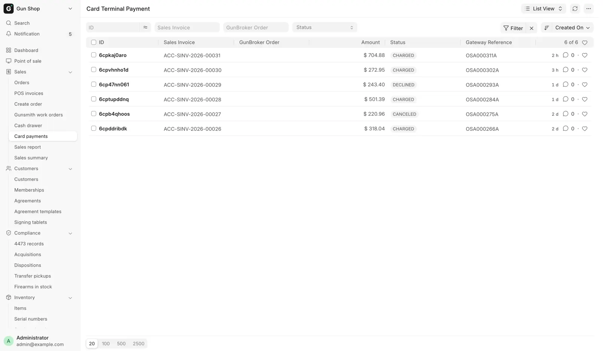

# Take payment

For counter staff, when a customer pays at the register or on a counter order. Managers who need to void or refund a card read [Card voids and refunds](../manager/card-refunds.md).

## Modes of payment

| Mode | What you record |
|---|---|
| **Cash** | Nothing. It goes in the drawer |
| **Credit Card**, store terminal connected | Nothing. The approval comes back from the terminal |
| **Credit Card**, standalone terminal | The approval code from the terminal receipt, if the store asks for it |
| **Zelle** | The Zelle confirmation number, always |
| **ACH** | Nothing at the register. On a counter order, the ACH reference |
| **Check/Money Order** | The check or money order number, always |

A sale can be split across several modes. Enter an amount against each one on the payment screen before you click **Complete Order**.

### Zelle

1. Click **Complete Order**. The **Zelle Transaction Number** dialog opens.
2. Type the confirmation number from the customer's app or the bank.
3. Click **Confirm**.

Closing the dialog cancels the checkout. Without the number the deposit cannot be matched to the sale later.

### Check or money order

1. Click **Complete Order**. The **Check or Money Order Number** dialog opens.
2. Type the number printed on the check or money order.
3. Confirm it.

Closing the dialog cancels the checkout. A check goes to the bank, not the drawer, so keep the paper apart from the cash you count.

### References on a counter order

On a counter order, Zelle, ACH and check numbers go in **Transaction Number / Approval Code**. That box appears on [Build an order](../orders/build-an-order.md), on **Record Payment** in [Pending Orders](../orders/pending-orders.md), and in the **Balance due** box on a pickup ticket.

### Approval codes on a standalone terminal

If your store swipes cards on a terminal that is not connected to this system, and the store requires it, the **Card Approval Code** dialog asks for the code on the terminal receipt. Refunds are asked too. A sale split across two cards asks once for each card.

!!! warning "Never type a card number"
    The approval code is a short code, usually six to eight characters. It is not the batch number and not the last four digits. A value that looks like a card number is refused.

## Charge a card on the store terminal

With the store's card terminal connected, **Complete Order** runs the card before the sale goes through.

1. Click **Complete Order**. The **Card payment** dialog opens. Any card already taken on this sale is listed at the top.
2. Check **Charge this card**. It starts at the whole card balance. Type a smaller amount to split the sale across more than one card.
3. Click **Charge**.
4. **Waiting for terminal** appears with the amount. The customer dips or taps their card.
5. On approval a green message shows the authorization code. Repeat for the next card until the card part is covered.

Only the **Cancel** button closes the waiting dialog. Cancelling mid-charge is safe: if the card went through anyway, the charge is recorded and a manager can void it.

When the order already has card money on it, such as a deposit or the first card of a split, the **Credit Card** tile says "Already charged … — enter only the amount to charge now." Type only today's charge.

When a ticket's trade-ins are worth more than the sale, there is nothing to charge. See [Trade-ins](trade-ins.md#trade-ins-worth-more-than-the-sale).

| You see | What to do |
|---|---|
| Approved, with an authorization code | Carry on |
| **Payment not completed** with a decline reason | Try another card or another mode |
| Only part of the amount approved | Ask a manager to reverse the charge, then take payment again |
| **Terminal timed out** | Nothing was charged. Try again |
| **Terminal error** | Nothing was charged. Check the terminal, then try again |

### Two blocks you may hit

- **Partial approval on file**: an earlier try took only part of the amount. The order is not paid. A manager voids that charge, then you take payment again.
- **Charged amount mismatch**: the cart changed after the card was charged, often on a held gun order edited while it waited for the 4473. A manager voids the charge, then you take payment again.

## Card payments on a counter order

An order built on [Create Order](../orders/build-an-order.md) takes card payments in three places. Each uses the same terminal steps as the register.

| Where | When |
|---|---|
| Create Order, **Charge via Terminal** | Right after the order is created, for the whole total or a deposit |
| Pending Orders, **Record Payment** with **Credit Card** | Any later payment against the balance |
| The register, the **Balance due** box on a pickup ticket | The rest of the money when the gun is handed over |

The order is saved first and the card second. A declined card or a customer who backs out leaves the order owing money with nothing recorded, so charge again or take another mode. A charge interrupted before it was recorded is picked up on the next try, never charged twice.

### A card already run on the Virtual Terminal

Do not run the terminal again.

1. In **Record Payment** or the **Balance due** box, tick **Already charged on Virtual Terminal**.
2. Type the approval code from the Virtual Terminal receipt in **Transaction Number / Approval Code**.

On Create Order, untick **Charge via Terminal** and the **Card Approval Code** is asked for instead. If the store's terminal is not set up, the system says **Terminal not configured** and points you to the same tick box.

### The Card payments list

Every terminal try on a counter order is kept with the amount, the status, the card description and the terminal's reference. Nothing in it is typed by hand. Open it from **Card payments** in the sidebar's **Sales** group. It shows only while the store terminal is switched on.

<figure markdown>
{ .screenshot }
<figcaption>Every terminal try on a counter order: the invoice, the amount, the status and the processor's reference.</figcaption>
</figure>

On a register sale, each card used is a row in the **Card Charges** table on the ticket, with **Captured Amount**, **Status**, **Card**, **Payroc Reference** and **Refunded Amount**. A sale split across three cards has three rows.

## Save a card to charge later

With the customer's signed authorization, a card paid at the terminal can be kept on file and charged later against a counter order's balance. A System Manager has to switch this on first (see [Card voids and refunds](../manager/card-refunds.md#switch-on-card-on-file)).

Before you start, the customer must be a named customer, not the walk-in customer.

1. In the **Card payment** dialog on the register, or **Record Payment** with **Credit Card** in Pending Orders, tick **Save this card**.
2. Charge the card as usual.
3. If the customer has not signed the card-on-file authorization, it goes to the signing tablet or shows as a QR code. **Waiting for the signature** stays open for up to ten minutes.
4. The card is charged once it is signed. **Cancel** goes back to the card dialog.

A green **Card saved for later charges** confirms it. **Card charged but not saved** says why the card could not be kept. The money still counts on the sale.

The customer's cards are listed under **Saved cards** below **Agreements** on the customer. A card saved here is not used for membership renewals. See [Memberships](memberships.md).

Charging a saved card later, and removing one, are manager jobs. See [Card voids and refunds](../manager/card-refunds.md#charge-a-saved-card).

## What happens next

- The sale or order shows as paid, and the receipt carries the payment.
- Cash shows on the [Cash drawer](cash-drawer.md) page as soon as it is taken.
- Card payments carry the terminal's reference, so the bank deposit can be matched.

## Troubleshooting

| You see | Fix |
|---|---|
| The terminal never came back and the register is still waiting | Let it finish. It reads the outcome from the processor rather than guessing |
| A message says money moved but could not be recorded | Stop. Do not retry. Write down the invoice number and get a manager |
| The register refuses a card amount | It is more than what is left to pay by card. Take the rest another way |
| **Terminal not configured** | Tick **Already charged on Virtual Terminal** and type the approval code |
| Any other card problem | See [Card voids and refunds](../manager/card-refunds.md#when-a-charge-went-wrong) |

GunBroker orders are never refunded here. See [GunBroker orders](../orders/gunbroker-orders.md).
