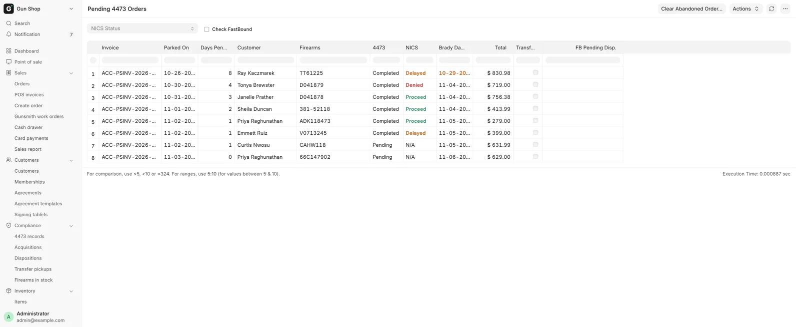

# Sell a gun

For counter staff, every time a gun the store owns leaves with a buyer at the counter. The register will not finish the sale until the Form 4473 and the background check are recorded.

## Before you start

- You need **Sales User**, **Sales Manager** or **System Manager**. An Accounts User can open the register but cannot run or record a 4473.
- The gun must be received and in stock. If it is not, book it in through [Receive goods](../stock/receive-goods.md) first.
- The order needs a named customer. The 4473 will not start without one.

!!! warning "Federal recordkeeping"
    Nothing here replaces the 4473 itself or the background check. The system records that they happened and writes the bound-book disposition. The form still has to be filled in correctly and filed.

## Ring the gun

1. Open **Point of sale** in the sidebar.
2. Pick the customer at the top of the cart.
3. Scan the barcode on the gun, or search for the model and click the product card.
4. If the card shows a price range (for example `$549.00 – $799.00`), the model is priced gun by gun. The line goes into the cart and **Item Details** opens with the serials listed, each with its own price.
5. Pick the gun you have physically taken off the rack. The line reprices to that gun's price.
6. Add anything else the customer is buying. Ammunition and accessories ride on the same ticket.
7. Click **Checkout**.

The serial dropdown starts on **— pick in-stock serial —** with an orange border. It lists the in-stock guns of the model cheapest first, and picks for you only when every unit costs the same or there is exactly one in stock.

!!! warning "Pick the gun you are actually handing over"
    The serial you choose is the serial on the 4473 and the one that leaves the bound book. Scanning the barcode on the gun itself is the reliable way to get it right.

The purple **Transfer (4473)** button above **Checkout** is not for this. It is for a gun the customer already owns, shipped in by another dealer. See [Customer transfers](transfers.md).

## Run the 4473

After **Checkout**, a wide colored button above **Complete Order** shows where the 4473 stands.

| Label | What it means |
|---|---|
| **FastBound 4473** (grey) | Nothing started yet. Click it to begin |
| **Awaiting 4473** (orange) | Started in FastBound, not finished coming back |
| **4473 Complete** (green) | Form complete and NICS Proceed. The order can complete |
| **Record Paper 4473** (grey) | The store keeps paper 4473s. Click to record one |
| **4473 Recorded** (green) | The paper 4473 is recorded on this order |
| **4473 Not Configured** (red) | Neither route is on. A manager has to fix a setting |

To run it in FastBound:

1. Click **FastBound 4473**. The **Start FastBound 4473** dialog lists the in-stock serials for each firearm on the ticket.
2. Confirm the serial for each gun.
3. Click **Open FastBound**. A FastBound tab opens.
4. In FastBound, click **Start New 4473**.
5. Scan or type the serial, fill in the buyer's details, and have the customer sign in FastBound.
6. Click **Save & Commit** in FastBound.

Back at the register, the order is parked as a draft and a fresh cart opens for the next customer. NICS can take minutes or days.

If a gun on the ticket has no in-stock serial, the dialog says so and **Open FastBound** stays disabled. Receive the gun first.

The paper route, a red **4473 Not Configured**, **Manager Override 4473** and **Redo 4473** are on [Form 4473 and NICS](../compliance/4473.md).

## Take payment before the 4473 clears

You can collect the money while the 4473 and NICS are pending. The main button on the payment screen says what its click does:

| Button | What a click does |
|---|---|
| **Take Payment** | Takes the payment, then parks the order |
| **Paid — waiting for 4473** | Checks the 4473 again, and completes the order if it has cleared |
| **Save — waiting for 4473** | Trade-ins exceed the sale: saves the order, pays nothing out until it completes |
| **Complete Order** | Completes the sale. Shown once the 4473 has cleared, or with no firearm |

After **Take Payment** you see **Payment taken — order held for 4473** and the order stays a draft. With a payout ticket you see **Order saved — waiting for the 4473**. The message says what to do next for your store's 4473 route.

!!! danger "A denied buyer"
    The gun does not go out. A manager reverses the money and then deletes the draft: **Void Card Charge** for a card, or return the cash. See [Card voids and refunds](../manager/card-refunds.md).

## Finish a parked order

Three ways back to an order waiting on a 4473:

- At the register, **Recent Orders** with the status filter on **Draft**. Open the order and click **Complete Order**.
- On the [Dashboard](../start/dashboard.md), the **Open 4473s** card. Its **Ready** tab holds orders whose NICS came back Proceed; **Complete** on a row opens the order.
- The **Pending 4473 orders** report, under **All records** on the Dashboard. It lists every parked firearm order with its 4473 and NICS status, how long it has waited and the Brady third business day.

The bell rings for Sales User, Sales Manager and System Manager when a NICS result lands (Proceed, Delayed or Denied), and again when a delayed check clears. Click the notification to open the order.

<figure markdown>
{ .screenshot }
<figcaption>The morning queue: who to ring, and what to clear.</figcaption>
</figure>

Work it every morning. [Daily checks](../compliance/daily-checks.md) explains each column.

### Refresh 4473 status

The small square button with a circular arrow beside the 4473 button is **Refresh 4473 status**. Click it when the badge still says **Awaiting 4473** but you believe the 4473 is done. It checks the store's own records first, then asks FastBound. Paper stores do not have it.

| It tells you | Do this |
|---|---|
| The 4473 is complete and you can Complete Order | Finish the sale |
| The order was out of date and has been corrected | Carry on; the status is now right |
| FastBound has not sent the completed 4473 back yet | Wait, and refresh later |
| Could not reach FastBound, local records only | Try again in a minute |
| **FastBound already shows this firearm as disposed** | A manager confirms NICS Proceed and uses the override |
| No serial on this order yet | Click **FastBound 4473** to start |

## Hand over a gun on a pickup ticket

A pickup ticket is a $0 draft for a gun somebody already bought on an order: a pickup-in-store order whose gun came from a distributor, or a web order placed against your license. The money lives on the order, so the ticket stays at $0. See [Deposits and special orders](../orders/special-orders.md).

The ticket appears in **Recent Orders** by itself when the gun is received and a shift is open. If no shift was open, **Pickup** on [Pending Orders](../orders/pending-orders.md) opens it. Its label reads the order's state: **Paid**, **Deposit … · … due** or **Unpaid · … due**.

1. Open the ticket from **Recent Orders**. The gun and its serial are already on it.
2. Run the 4473 and the background check as above.
3. Click **Checkout**, then **Complete Order**.
4. If the order still owes money, the **Balance due on …** box opens. Pick a **Payment Method** (Cash, Credit Card, Zelle, ACH or Check/Money Order).
5. Check the **Amount**. It starts at the whole balance.
6. For Zelle or ACH type the confirmation number, and for a check the check number, in **Transaction Number / Approval Code**. A card already run on the Payroc Virtual Terminal: tick **Already charged on Virtual Terminal** and type its approval code.
7. Click **Collect**. Credit Card runs the terminal; the other methods are recorded as received.

Once the order is paid and the 4473 has cleared, the order completes and the gun leaves the bound book on this ticket. The gun cannot leave while the order owes money: "… still owes … — collect the balance on the order before handing over the gun." Collecting less than the balance leaves the rest to collect before hand-over.

## What happens next

- The bound book records a disposition for each gun, and it goes to [FastBound](../admin/fastbound.md).
- The gun leaves stock, and the web store, the moment the sale completes. It does not wait for the nightly close.
- The 4473 is kept for good in [the 4473 records](../compliance/4473-records.md) with the store's copy of the signed PDF. **View Signed 4473** on the sale opens it.
- If a Delayed check later comes back Proceed, the buyer gets one email.

## Troubleshooting

| You see | Fix |
|---|---|
| **Pick the gun** | Open the cart line and pick the serial in **Item Details** |
| **Payment taken — order held for 4473** | Finish the 4473, reopen from **Recent Orders** (**Draft**), click **Complete Order** |
| **Customer required** | Pick the customer at the top of the cart, then start the 4473 |
| **No firearms in this cart — 4473 is not needed.** | Complete the sale normally |
| No in-stock serial for an item in the dialog | Receive the gun through [Receive goods](../stock/receive-goods.md) |

More 4473 messages are on [Form 4473 and NICS](../compliance/4473.md).
