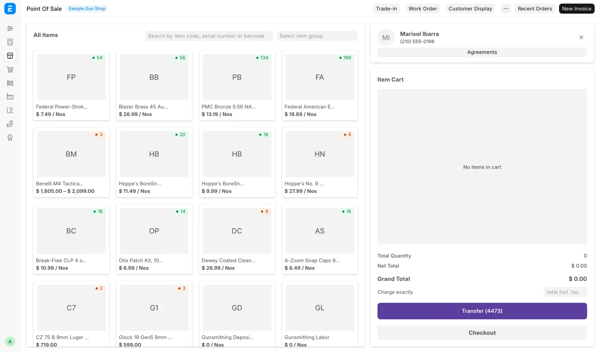
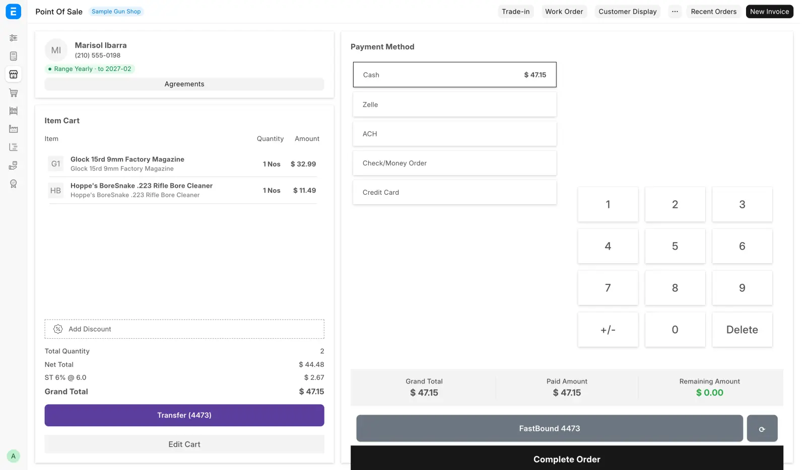

# Sell accessories

For counter staff, for every walk-in sale of ammunition, optics, holsters, cases and parts at the register. A sale with a gun on the ticket also needs [Sell a gun](sell-a-gun.md).

<figure markdown>
{ .screenshot }
<figcaption>Item search and product cards on the left, the cart on the right, with Trade-in and Customer Display in the toolbar.</figcaption>
</figure>

## Before you start

- Open the register from **Point of sale** in the sidebar, or **Open POS** on the [Dashboard](../start/dashboard.md).
- You need **Sales User** or **Sales Manager**. See [Roles and sign-in](../start/roles.md).
- A shift has to be open. If none is, the register asks you to open one. See [A day at the counter](../start/day-at-the-counter.md#2-open-the-register).

## Ring up the sale

1. Scan the barcode, or type part of the name into the item search and click the product card.
2. The line lands in the cart on the right. Click the line to change quantity or price in the **Item Details** panel.
3. If **Taken from** appears at the top of **Item Details**, pick the storage location you took the item from. When the item sits in one place only, it is already picked.
4. Pick the customer at the top of the cart. A walk-in can stay on the default customer unless you need the sale on their record. To add one, see [Customers](customers.md).
5. Click **Checkout**.

**Taken from** never blocks a sale. Leave it on **— pick where it came from —** and the units show up on the **Not placed** list for someone to confirm later. **Not in a location** is for stock that was never put away. See [Find and move stock](../stock/find-and-move.md).

## Take cash

<figure markdown>
{ .screenshot }
<figcaption>The payment screen: payment methods on the left, the number pad on the right.</figcaption>
</figure>

1. On the payment screen, click **Cash**.
2. Enter the amount tendered. The screen shows the change to give.
3. Click **Complete Order**.

The receipt prints, the cart clears and the register is ready for the next customer. For cards, Zelle, checks and split payments, see [Take payment](payments.md).

## What happens next

- The receipt prints, and the sale shows on the [Sales Report](../manager/sales-report.md) and the [Cash drawer](cash-drawer.md).
- Accessories have no 4473 and no bound-book entry. They leave stock when someone clicks **Close the day** on the Cash drawer page, or at the nightly close.

## Units held for a web order

Units that web customers have already paid for are not the counter's to sell. If a sale would take them, completing it is refused with **Held for a web order**, naming the item and the web order numbers.

Ship those units to the web customer, or ask a manager. A **Sales Manager** or **System Manager** can ring the sale, and the invoice notes it.

## Charge an exact total

When you quoted the customer a round figure with tax included, type it in **Charge exactly**, the box under the cart total above **Checkout**. The line prices are worked back from it before tax, in proportion to each line, so the cart lands on that total. Trade-in credit lines keep their amount.

If the cart cannot land on the exact cents, the register says **Landed on …, not …**. Adjust one line by hand.

The box needs **Allow Rate Change** on the register's POS Profile. It does nothing on a pickup ticket, because a pickup's money is on its order.

## Lower a price

While **Require Manager Approval for Price Reductions** is on in FFL Settings, a price below the list price needs a manager. That covers a line price typed lower, a line discount, **Charge exactly** landing under the list prices, and an invoice discount.

1. Change the price and click **Checkout**.
2. The **Manager approval needed** dialog lists each lowered line, with list price and new price.
3. The manager picks their name under **Manager** and types their counter PIN. A manager without a PIN, or whose PIN is off after five wrong tries, clicks **Use password instead** and types their password.
4. The manager picks a **Reason**. **Other** needs the **Details**.
5. Click **Approve**. The sale saves and moves on to payment.

A wrong PIN shows under the field and the dialog stays open. **Cancel** stops the save and leaves the cart as it was. The sale keeps who approved, the reason and when.

Nothing asks when:

- a **Sales Manager** or **System Manager** is signed in (the sale records them as the approver);
- the price is at or above the list price, or a pricing rule or a sale price brought it down;
- the line was already saved at that price (lowering it again asks again; raising it never does);
- the system set the price as the ticket opened: a pickup, transfer or gunsmith pick-up ticket, a trade-in credit, a web or GunBroker order.

The list price is the gun's own price for a firearm line with a serial, the cheapest priced gun of that model in stock for a firearm line with no serial yet, and the register's price list for everything else.

[Create Order](../orders/build-an-order.md) asks the same way. Distributor lines are not checked there, and an edit asks only about a price lowered in that edit.

### Returns

While the same setting is on, a return needs a manager too. At **Checkout** on the return the same dialog lists what comes back and the refund, and the manager approves with their PIN and a reason. Adding more to the return afterwards asks again.

A manager signed in is not asked. Returns the system makes itself (a web or GunBroker refund, a gunsmith deposit refund) are not asked.

## Held and draft orders

An order that cannot finish yet waits as a draft: a firearm sale parked for a 4473, a transfer, or a deposit nobody collected. To come back to one, click **Recent Orders** in the toolbar and set the status filter to **Draft**.

Each draft carries labels, in the list and in the summary when you click it:

| Label | What it means |
|---|---|
| **Not paid** | No money the register can confirm is on the order |
| **Paid $500.00 of $1,000.00** | Part paid, for example a card deposit |
| **Paid** | Paid in full. On a pickup ticket, the order behind it is paid |
| **Deposit $200.00 · $450.00 due** | A pickup ticket with a deposit; the register collects the rest at hand-over |
| **Unpaid · $650.00 due** | A pickup ticket with nothing paid yet |
| **Card in progress** | A card charge is still open on the terminal. Wait for it or cancel it first |
| **Cash $50.00 entered · not confirmed** | An amount was typed but the order was never completed or held. It may never have been collected |
| **4473 not started**, **Awaiting 4473**, **4473 Complete**, **Record Paper 4473**, **4473 Recorded**, **4473 Not Configured** | Where the firearm's 4473 stands. See [Sell a gun](sell-a-gun.md#run-the-4473) |

**Card in progress** can also show what an earlier card took, for example **Card in progress · Paid $712.25 of $3,084.04**. Count the drawer before you rely on a **Cash … entered · not confirmed** amount. The labels show the order as the list loaded; refresh after a 4473 finishes.

!!! note "Money already taken is kept"
    A reopened draft keeps the payment already recorded on it, such as a card capture or a cash and Zelle split. Do not re-enter the payment, and never charge the card a second time.

## The extra toolbar buttons

These sit in the toolbar at the top of the register, to the left of **Recent Orders**. An extension your store has switched on can add its own after them.

| Button | What it does |
|---|---|
| **Trade-in** | Books a gun the customer trades in and puts the allowance on the ticket. See [Trade-ins](trade-ins.md) |
| **LE Exempt** | California stores only: takes the excise tax off a sale to a peace officer. See below |
| **Customer Display** | Opens a second window that mirrors the cart for the customer |

Put the **Customer Display** window on the second monitor and leave it open. It follows the cart by itself. If nothing opens, the browser blocked the popup: allow popups for this site and click **Customer Display** again.

### Peace-officer excise exemption (California)

An active or retired peace officer, or the agency that employs one, pays no California excise tax on firearms, precursor parts and ammunition. Sales tax is still charged. The button appears only in a California store whose FFL Settings name the excise tax account.

1. Pick the customer on the ticket first. The certificate is kept on their record.
2. Click **LE Exempt**.
3. Pick the **Exempt buyer**.
4. Click **Upload CDTFA-230-FET** and attach their certificate.
5. Click **Apply exemption**. The excise line leaves the cart and the button reads **LE Exempt ✓**.

To undo it, click **LE Exempt ✓**, then **Remove exemption**. The ticket cannot be saved with the exemption on and no certificate, or with another customer's certificate.

## Troubleshooting

| You see | Fix |
|---|---|
| **Held for a web order** | Ship the units to the web order, or ask a manager to ring the sale |
| **Manager approval needed** | A manager approves in the dialog, or put the price back |
| **This price approval has expired or was used. Ask a manager again.** | Save again; approvals last 15 minutes and cover one save |
| **Landed on …, not …** | Adjust one line's price by hand |
| **POS not ready.** | Wait for the page to finish loading and click again |
