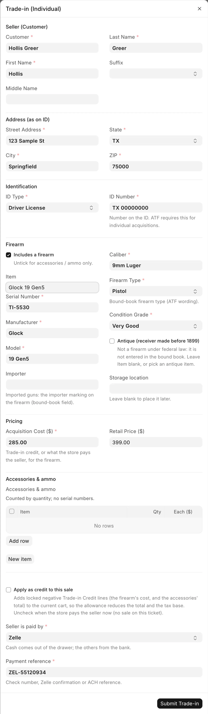
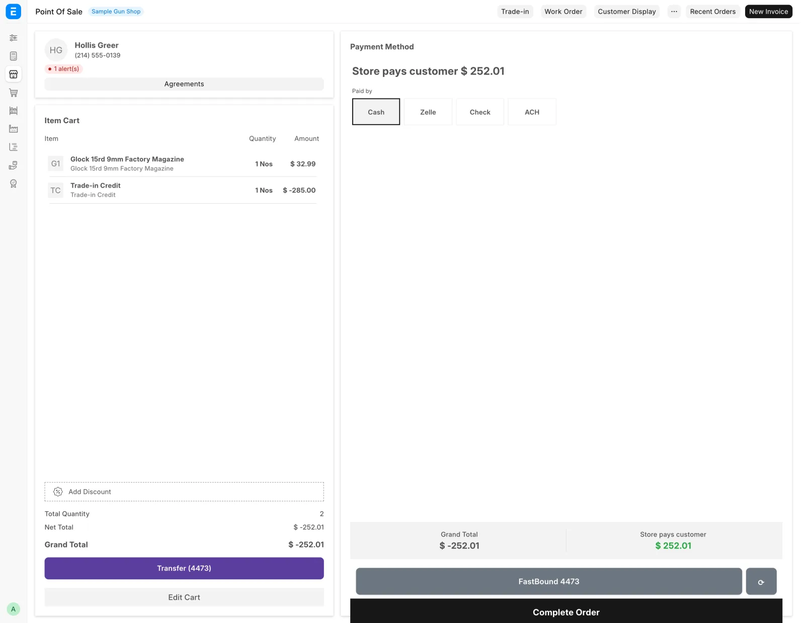

# Trade-ins

For counter staff, when a customer at the register trades a gun in against a sale, or sells it to the store outright. A purchase with nobody at the register, such as an estate buy, goes through [Buy from a private seller](../stock/private-seller.md).

## Before you start

- This dialog is for guns bought from a private person only. A gun from a dealer or a distributor goes through [Receive Goods](../stock/receive-goods.md).
- You need **Sales User**, **Stock Manager** or **System Manager**. A shift lead who has only **Sales Manager** also needs **Sales User**.
- To apply the trade as credit, pick the customer on the register first.
- To pay the seller now instead, the seller must be a customer record. You pick them in the dialog's **Customer** box.
- Have the seller's photo ID in hand. You need their name and address exactly as printed on it.
- You can file the gun under an existing used-gun model, or leave **Item** blank and one is made for this gun. Creating new models is a stock manager's job.

## Take the trade-in

1. On the register, click **Trade-in**. The **Trade-in (Individual)** dialog opens.
2. Under **Seller (Customer)**, confirm the **Customer**. It starts as the register's customer and fills the name and address below.
3. Check **First Name**, **Middle Name**, **Last Name** and **Suffix** against the ID. First and last name are required.
4. Under **Address (as on ID)**, fill in **Street Address**, **City**, **State** and **ZIP**. All four are required. Use the two-letter state code.
5. Under **Identification**, pick the **ID Type** and type the **ID Number**.
6. Under **Firearm**, search **Item** for the model this gun files under, or create one such as `Glock19 USED`. The search covers your own models and the distributor catalog.
7. Fill in **Serial Number**, **Manufacturer**, **Model**, **Caliber**, **Firearm Type** and **Condition Grade**. **Importer** is optional, for imported guns.
8. Pick a **Storage location** if you know where the gun goes. Only free slots are offered. Leave it blank to place it later from [Find and move stock](../stock/find-and-move.md).
9. Under **Pricing**, enter the **Acquisition Cost ($)**: the credit or payment the seller gets. **Retail Price ($)** can be set later.
10. Leave **Apply as credit to this sale** ticked to take it off this sale. Untick it to pay the seller now (see below).
11. Click **Submit Trade-in**.

<figure markdown>
{ .screenshot }
<figcaption>Seller, ID and firearm details, the storage location, and the choice between a credit and paying the seller now.</figcaption>
</figure>

## Credit against the sale

With **Apply as credit to this sale** ticked, the allowance comes off this ticket and lowers both the total and the tax.

- The message reads "Trade-in recorded" with the credit amount, and a locked Trade-in Credit line appears in the cart.
- The gun is not in the bound book or in stock yet. It books when the sale completes.
- The credit line cannot be tapped or edited. To change the amount, remove the line and click **Trade-in** again.
- A sale with a trade-in credit cannot take an invoice discount, typed or from a coupon or pricing rule. Put the discount on the item line instead.

Running the dialog again for the same serial refreshes the pending trade-in. It never makes a second one.

!!! warning "Federal recordkeeping"
    If the dialog reports **Credit Line Not Added**, do not complete the checkout. The buyer would pay full price and the gun would never book. Reopen the cart and click **Trade-in** again for the same serial. It reuses the pending record.

## Pay the seller now

Untick **Apply as credit to this sale** when the store buys the gun with no sale on this ticket.

1. Pick **Seller is paid by**: Cash, Zelle, Check or ACH. Cash is the default.
2. For anything but cash, type the **Payment reference**: the check number, Zelle confirmation or ACH reference.
3. Click **Submit Trade-in**.

The message reads "Trade-in recorded · Item … · Receipt …. The payment to the seller is booked." The gun is in stock and the bound book at once. Cash comes off what the [cash drawer](cash-drawer.md) should hold straight away. If the payment was recorded wrong, a manager fixes it on the Cash Drawer page.

## Trade-ins worth more than the sale

When the trade-in credits come to more than what the customer buys, the deal stays on one ticket and the store pays the customer the difference.

<figure markdown>
{ .screenshot }
<figcaption>The payment screen of a ticket the store pays out on. There is nothing to tender.</figcaption>
</figure>

1. Add the goods and take the trade-in with **Apply as credit to this sale** ticked.
2. Click **Checkout**. The screen shows **Store pays customer** and the amount instead of the payment modes. **Grand Total** reads below zero.
3. Under **Paid by**, pick **Cash**, **Zelle**, **Check** or **ACH**. Cash is picked already.
4. For anything but cash, type the check number or confirmation number in the box marked "(required)".
5. Click **Complete Order**.

The receipt shows the items sold, the trade-in allowance, the tax and "Paid to customer" with the method and reference. The tax on the goods comes down to $0.00, never below. A cash payout leaves the drawer at once. To take a payout back, cancel the ticket.

If the ticket also has a gun, the button reads **Save — waiting for 4473** and nothing is paid out until the 4473 clears. See [Sell a gun](sell-a-gun.md).

The store can pay out only for guns bought from a private person. If a card was already charged on the order, a manager has to void it first.

## What happens next

- The gun gets its own record, with the condition grade you entered, so stock reports and the web listing describe it correctly.
- The purchase goes into the bound book with the source **Trade-in** and the seller's name, address and ID, then on to FastBound. If FastBound refuses a pay-now buy, nothing is kept.
- Add barrel length, finish and year made afterwards on the gun's own record (see [Models, serials and prices](../stock/items-and-serials.md)).

A gun the store once sold and now takes back starts a new stay. An earlier consignor or supplier is never paid again for it.

## The next-business-day deadline

A credit trade-in that never reached a completed sale leaves the gun out of the bound book. Under 27 CFR 478.125(e) the entry is due by the close of the next business day after the store took possession. A pay-now buy is booked at once and never waits.

Every hour the system looks for trade-ins (and private, estate or pawn purchases) dated before today that are still drafts. It emails a reminder titled:

```
[POS Alert] N trade-in draft(s) not yet in the bound book
```

The email names each draft, its serial and its seller. For each one, do one of these:

- Complete the checkout.
- Submit the acquisition directly if the store keeps the gun (see [The bound book](../compliance/bound-book.md)).
- Delete the draft if the customer took the gun back.

The reminder goes at most twice a day, to **Alert Recipients** in [FFL Settings](../admin/ffl-settings.md), or to every System Manager when that list is empty. It runs whether or not FastBound is on, because the obligation is the store's. An abandoned cart is the usual cause.

## Trade-in or Receive Goods

| Use | When | Bound book source |
|---|---|---|
| **Trade-in** on the register | The seller is at the counter | `Trade-in` |
| [Buy from a private seller](../stock/private-seller.md) | Several guns, an estate buy, nobody at the register | `Individual` |

Receive Goods collects the same seller identity and address, adds an optional **Seller ID Document** upload, and asks how the seller was paid.

## Troubleshooting

| You see | Fix |
|---|---|
| `Select the POS customer (the buyer) before applying a trade-in credit.` | Pick the customer on the register, then reopen the dialog |
| **Credit Line Not Added** | Do not check out. Reopen the cart and click **Trade-in** again for the same serial |
| `Missing required fields: ...` or `Seller address is incomplete — missing: ...` | Fill in the named fields. Use a two-letter state and a five-digit ZIP |
| `Serial '<serial>' is already on file. Edit the existing item instead.` | Check the gun's record before buying it |
| A card was charged on this order. A manager has to void it before the store can pay the customer. | Ask a manager to void the card charge |
