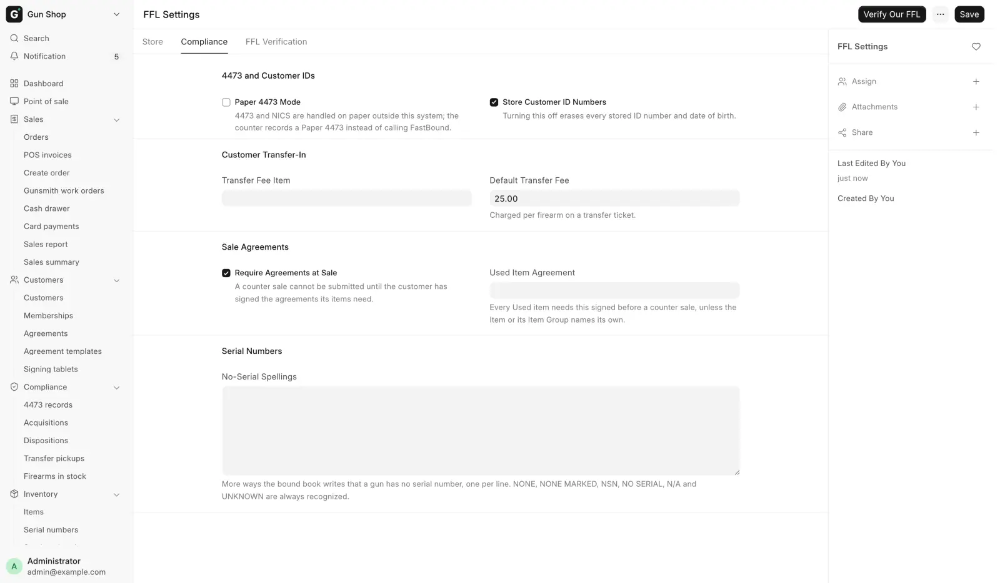

# Customer transfers

For counter staff, when a customer bought a gun somewhere else, had it shipped to this store, and comes in to collect it. The store receives the gun, runs the Form 4473 and the background check, and charges a transfer fee. The store never sells the gun, because it already belongs to the customer.

!!! warning "Federal recordkeeping"
    A transfer to a private individual is a disposition out of this store's bound book. It needs a 4473 and a background check exactly like a sale. Only the money is different.

## Before you start

- You need a role that can run a 4473: **Sales User**, **Sales Manager** or **System Manager**.
- The customer must not be an FFL dealer. A dealer-to-dealer shipment is a different job (see [Ship a firearm to another dealer](../orders/ship-to-dealer.md)).

## 1. Receive the customer's gun

Do this when the box arrives from the other dealer, on [Receive Goods](../stock/receive-goods.md).

1. Tick **FFL Transfer (customer's gun)**.
2. In **Transfer for Customer**, name the person who will collect the gun.
3. Add the gun as usual and submit.

**Transfer for Customer** is what puts the gun on the pickup list and links it to the customer. Leave it blank and the gun never shows as waiting.

With the box ticked:

- The gun goes into customer custody, not sellable stock.
- **Cost** and **Sell Price** are locked at zero. The store did not buy the gun and cannot sell it.
- Only serialized firearms are allowed. A customer's accessory belongs on a separate receive.
- **Storage location** is hidden on the card.
- The gun can never be listed online.

If you untick the box after adding lines, those lines become ordinary purchases at $0, and the page asks for a real cost before it submits.

## 2. Run the transfer at the register

1. At the register, pick the customer collecting the gun.
2. Click the purple **Transfer (4473)** button on the cart, above **Checkout**. The cart can be empty.
3. In the **Customer Transfer (4473)** dialog, scan or type the serial of each gun and press ++enter++ after each one. Typing a few characters filters the in-stock list.
4. Check the list under the box. Click ✕ to remove a gun added by mistake.
5. Check **Transfer Fee (per firearm)**. It starts at the store's default and you can change it for this ticket.
6. Click **Open FastBound**. In Paper 4473 Mode the button reads **Start Transfer**.
7. Complete the 4473 and the background check, in FastBound or on paper. See [Form 4473 and NICS](../compliance/4473.md).
8. When the check clears, open **Recent Orders**, set the status filter to **Draft** and reopen the order.
9. Take the fee and click **Complete Order**.

## What happens next

- The ticket holds one $0 line per gun and one **Transfer Fee** line for the number of guns. You are not asked to price the guns.
- The 4473 starts, FastBound opens in a new tab, and the order waits as a draft until the check clears.
- When the order completes, the gun leaves stock and the disposition goes into the bound book.

## Where the fee comes from

Both values are in [FFL Settings](../admin/ffl-settings.md), on the **Compliance** tab under **Customer Transfer-In**.

| Field | What it is |
|---|---|
| **Transfer Fee Item** | The service charged for a transfer. Made the first time the transfer dialog is used |
| **Default Transfer Fee** | The per-firearm amount put on a transfer ticket. You can change it on each sale |

<figure markdown>
{ .screenshot }
<figcaption>The Compliance tab holds the transfer fee item and the default amount.</figcaption>
</figure>

## Guns waiting to be collected

The **Waiting on pickup** card on the [Dashboard](../start/dashboard.md) shows the four guns that have waited longest, and turns a gun amber past 21 days. **View all** on the card, or **Transfer pickups** in the sidebar's **Compliance** group, opens the whole **Pending Transfer Pickups** report. [Daily checks](../compliance/daily-checks.md) explains how to work it.

A gun drops off the list the moment it leaves stock.

## Background check emails

A transfer ticket sends the same NICS notifications as a sale: Proceed, Delayed or Denied, and again when a delayed check clears. A check that came back Delayed and later proceeds also emails the customer once to say the gun is ready to collect. See [Form 4473 and NICS](../compliance/4473.md) for which address it uses.

## Troubleshooting

| You see | Fix |
|---|---|
| **No firearms in stock** | Receive the customer's gun first, on Receive Goods with **FFL Transfer (customer's gun)** ticked |
| **Not for dealer transfers** | The customer is an FFL dealer. A counter transfer is for individuals. Handle a dealer shipment through the bound book disposition |
| **Customer required** | Pick the customer, then click **Transfer (4473)** |
| The serial is not found, or the gun is missing from the list | Check the serial, and that the gun was received. A gun already on this order is not offered twice |
