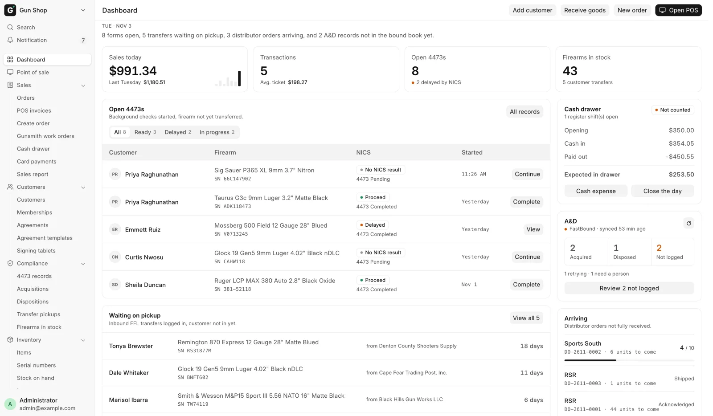
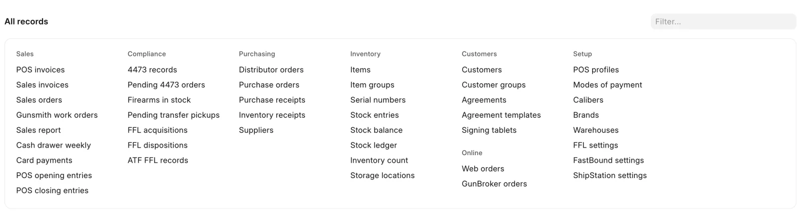
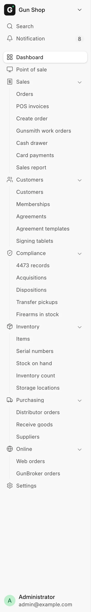
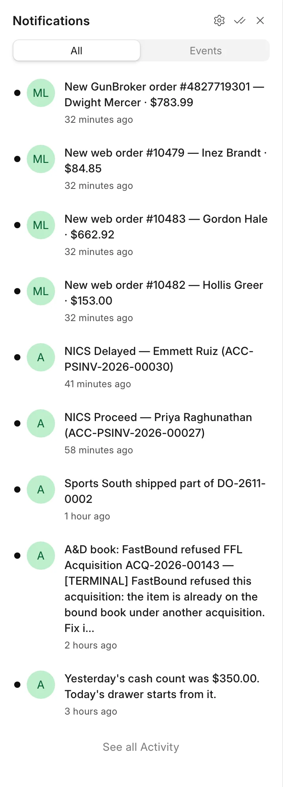

# The Dashboard

Everyone lands on the Dashboard after signing in. It shows what is waiting on
someone today: open 4473s, transfer guns waiting for their owner, the cash
drawer, the bound book and distributor orders on the way. The sidebar on the
left and **All records** at the foot of the page reach everything else.

<figure markdown>
{ .screenshot }
<figcaption>Today's figures across the top, the 4473 and pickup lists on the left, the drawer, the bound book and arriving orders on the right.</figcaption>
</figure>

## Getting here

The Dashboard opens by itself when you sign in. Its address is
`/desk/store-overview`. To come back to it from anywhere, click
**Dashboard** at the top of the sidebar. An old bookmark to the Gun Shop
workspace lands here too.

The page asks for fresh figures every minute while it is on screen, so you can
leave it open on a back-office screen.

## What you see depends on your login

Each block on the page checks your roles on its own. A block you are not allowed
to see is left out, and the rest of the page moves up. A counter clerk
sees no stock count, and a receiving helper sees no sales figures. If one block
fails to load it says **This could not be loaded. The rest of the page is up to
date.** and every other block still works.

The page opens for **Sales User**, **Sales Manager**, **Stock User**, **Stock
Manager**, **Accounts User** and **System Manager**. See
[Who can do what](roles.md).

## The buttons at the top

| Button | Opens |
|---|---|
| **Open POS** | The [Point of Sale](../selling/pos.md) register |
| **New order** | [Create Order](../selling/create-order.md) |
| **Receive goods** | [Receive Goods](../inventory/receive-goods.md) |
| **Add customer** | A new [customer](../selling/customers.md) record |

A button only shows when your login can open the page behind it.

Under the date, one sentence sums up what is waiting, for example "3 forms open,
5 transfers waiting on pickup, and 2 distributor orders arriving." When nothing
is waiting it reads **Nothing is waiting on anyone right now.**

## The figures across the top

| Tile | What it shows |
|---|---|
| **Sales today** | Today's net sales, returns included. Below it, the whole of the same weekday last week. The seven small bars are the last seven days, today last. Click the figure to open the [Sales Report](../reports/sales-report.md). |
| **Transactions** | How many sales today, not counting returns, and the **Avg. ticket**. |
| **Open 4473s** | Firearm orders parked for a 4473, and how many are delayed by NICS. |
| **Firearms in stock** | Every gun on the books. Below it, how many are customer transfers. Click the figure to open Firearms In Stock. |

The sales tiles use the Sales Report's own figures, so the two always agree.

## Open 4473s

Background checks started, firearm not yet transferred. The tabs sort the parked
orders by NICS result:

| Tab | Holds |
|---|---|
| **All** | Every parked firearm order, Denied included |
| **Ready** | NICS came back **Proceed** |
| **Delayed** | NICS came back **Delayed** |
| **In progress** | No NICS result yet |

Each tab lists its five newest orders: the customer, the gun and its serial, the
NICS result, and when the order was started. The button on the right of a row
says what to do next:

- **Complete** on a Proceed order. It opens the order so you can finish the sale.
- **Continue** on an order with no NICS result yet.
- **View** on anything else.

**All records** at the top of the card opens the 4473 records report. See
[Selling a firearm](../selling/firearm-sale.md) and
[4473 records](../compliance/4473-records.md).

## Waiting on pickup

Inbound FFL transfers logged in, customer not in yet. The four guns that have
waited longest are listed, oldest first, with who shipped them and how many days
they have sat. A gun past 21 days turns amber. **View all** opens the whole
Pending Transfer Pickups report. See [Customer transfers](../selling/transfers.md).

## Cash drawer

What the drawer should hold right now, from the books:

| Line | Meaning |
|---|---|
| **Opening** | What the last count carried forward |
| **Cash in** | Cash sales, payments and cash from the bank since then |
| **Paid out** | Refunds, seller payments, deposits and expenses since then |
| **Expected in drawer** | What a count should find |

The pill on the right reads **Counted** once someone has closed today's drawer,
and **Not counted** until then. **Cash expense** and **Close the day** both open
the [Cash Drawer](../selling/cash-drawer.md) page, where you do the work.

## A&D

Today's bound-book activity, when FastBound is switched on. With FastBound off
the card only says **FastBound off**.

- **Acquired** and **Disposed** count today's bound-book entries.
- **Not logged** counts records submitted here more than 15 minutes ago that
  FastBound does not have yet. The line under it splits them into those the
  system is retrying and those that need a person.
- The small refresh button recounts now instead of waiting for the minute.

**Review N not logged** opens the **Not in the bound book yet** list: each
record, its state (**Will retry** or **Needs a person**) and the last error.
"Will retry" records are pushed again by the daily retry. "Needs a person" means
someone has to fix the cause and push again. See
[FastBound](../compliance/fastbound.md).

!!! warning "Federal recordkeeping"
    A record on this list is in this system but not yet in the bound book of
    record. Work the "Needs a person" ones the same day.

## Arriving

Distributor orders not fully received, in the order Receive Goods lists them.
Each row shows the distributor, the order number and how many units are still to
come. Once part of an order has come in, the row shows a bar of units received.
**Receive goods** at the foot of the card opens
[Receive Goods](../inventory/receive-goods.md).

## All records

<figure markdown>
{ .screenshot }
<figcaption>Every list, report and setting, grouped. Type in Filter… to narrow it.</figcaption>
</figure>

At the foot of the page, **All records** lists every list, report and setting
your login can open, in groups: **Sales**, **Compliance**, **Purchasing**,
**Inventory**, **Customers**, **Online** (while a web store or GunBroker is
switched on), one group for each switched-on extension that adds links, and
**Setup** last.
Type part of a name in the **Filter…** box and the groups narrow as you type.

Reports and lists that have no place in the sidebar live here, for example
**Pending 4473 orders**, **Cash drawer weekly**, **Inventory receipts**,
**POS opening entries** and **FFL settings**.

## The sidebar

<figure markdown>
{ .screenshot }
<figcaption>The sidebar every Gun Shop page shares.</figcaption>
</figure>

The sidebar on the left is the way around. It is the same on every Gun Shop
page.

| Row or group | What it holds |
|---|---|
| **Dashboard** | This page |
| **Point of sale** | The [register](../selling/pos.md) |
| **Sales** | **Orders** (the [Pending Order queue](../selling/pending-orders.md)), **POS invoices**, **Create order**, **Cash drawer**, **Card payments**, **Sales report** |
| **Customers** | **Customers** |
| **Compliance** | **4473 records**, **Acquisitions**, **Dispositions**, **Transfer pickups**, **Firearms in stock** |
| **Inventory** | **Items**, **Serial numbers**, **Stock on hand**, **Inventory count**, **Storage locations** |
| **Purchasing** | **Distributor orders**, **Receive goods**, **Suppliers** |
| **Online** | **Web orders**, **GunBroker orders** |
| **Settings** | The Settings workspace |

Click a group name to open or close it.

A row for an integration your store has switched off is hidden: **Web orders**
without the web store, **GunBroker orders** without GunBroker, **Card payments**
without the Payroc terminal. A group with nothing left in it is hidden too. An
extension that is switched on can add its own group, which sits above **Settings**.

!!! note "Orders is the Pending Order queue"
    The sidebar calls the Pending Order page **Orders**. The guide calls it the
    Pending Order queue. They are the same page.

At the top of the sidebar sit **Search** and **Notification**. Your name at the
foot of the sidebar opens your own menu. See
[Getting started](index.md#finding-anything).

## Notifications

<figure markdown>
{ .screenshot }
<figcaption>A NICS result, a new web order and a distributor shipment, each linked to its record.</figcaption>
</figure>

**Notification**, the bell near the top of the sidebar, shows a count when
something new has arrived. Click it to open the list, and click an entry to open
the record it is about. The system rings it for these events:

| Event | Example | Who gets it |
|---|---|---|
| A NICS result lands on a sale: Proceed, Delayed or Denied | NICS Delayed — Jane Doe (ACC-PSINV-2026-00001) | Sales User, Sales Manager, System Manager |
| A delayed check clears | Delayed NICS cleared: Proceed — Jane Doe (…) | Sales User, Sales Manager, System Manager |
| A paid web order or a GunBroker order comes in | New web order #1001 — Jane Doe · $612.40 | Sales User, Sales Manager, Stock Manager, System Manager |
| A distributor ships an order to the store, in full or in part | RSR shipped DO-2601-0001 | Sales User, Sales Manager, Stock Manager, System Manager |
| FastBound refuses a bound-book record for good | A&D book: FastBound refused FFL Acquisition … — reason | Sales Manager, Stock Manager, System Manager |

These notices stay in the app. None of them is emailed. Each one rings once per
event, so a repeated message from FastBound or the web store does not ring twice.
The shared **Administrator** login never receives them, so give every person
their own login.

The same list also carries the system's own notices, such as a to-do assigned to
you when a sale cannot be posted. A distributor gives no arrival date, so
"shipped" is the last news the bell can give about an order. Watch **Arriving**
for what is still to come.
