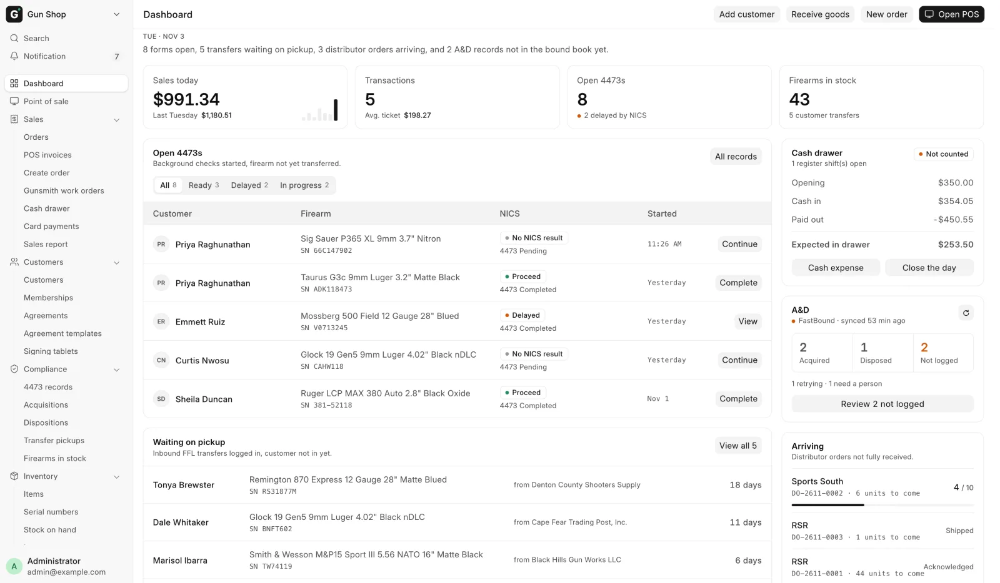

# User guide

For everyone who works in an FFL gun shop that runs OpenGunstore: counter staff, inventory staff, managers and the bookkeeper. You need retail experience, not software knowledge.

<figure markdown>
{ .screenshot }
<figcaption>The Dashboard is where every day starts.</figcaption>
</figure>

New here? Read [Your first day](start/first-day.md), then [A day at the counter](start/day-at-the-counter.md).

## Find your section

| Section | What it covers |
|---|---|
| [Start here](start/first-day.md) | Signing in, the Dashboard, the sidebar, roles, and a whole day from open to close |
| [At the counter](counter/index.md) | Selling a gun or accessories, payment, customers, memberships, transfers, trade-ins, the cash drawer |
| [Orders and shipping](orders/index.md) | Orders built away from the register, shipping to a dealer or a customer, deposits, web and GunBroker orders |
| [Stock](stock/index.md) | Receiving, buying from private sellers, distributor orders, the store map, counts, photos, online listings, fixes |
| [Compliance](compliance/index.md) | Form 4473 and NICS, the bound book, verifying an FFL, the daily checks |
| [Manager tools](manager/index.md) | Reports, the Sales Report, card voids and refunds, the store map, Settings |
| [Admin and bookkeeper](admin/index.md) | Month-end, integrations, FFL Settings, FastBound, distributor and web store setup |
| [AI assistants](ai/index.md) | Connecting Claude, ChatGPT or Grok to the store, and how to work with one |
| [Help](help/troubleshooting.md) | [Troubleshooting](help/troubleshooting.md) and the [glossary](help/glossary.md) |

## How a gun moves through the system

1. A gun arrives through [Receive goods](stock/receive-goods.md). The system creates its serial record, asks where it goes on the shelf, and books it into the [bound book](compliance/bound-book.md).
2. While it sits in the safe, it can be [listed online](stock/list-online.md) on your web store and on GunBroker.
3. When it sells, the [4473](compliance/4473.md) gate holds the sale until the form and the background check clear.
4. Then the sale completes, the bound book records the disposition and the gun leaves stock.

The money from each sale shows in the [cash drawer](counter/cash-drawer.md) and the [Sales Report](manager/sales-report.md).

## Conventions in this guide

- **Bold** text is a button, field or tab exactly as it appears on screen.
- Text in quotes or code blocks is the wording the system shows.
- A warning box marks something that affects federal recordkeeping. Read it before you act.
- Developer and self-hosting material is in the [developer documentation](../developers/index.md).
