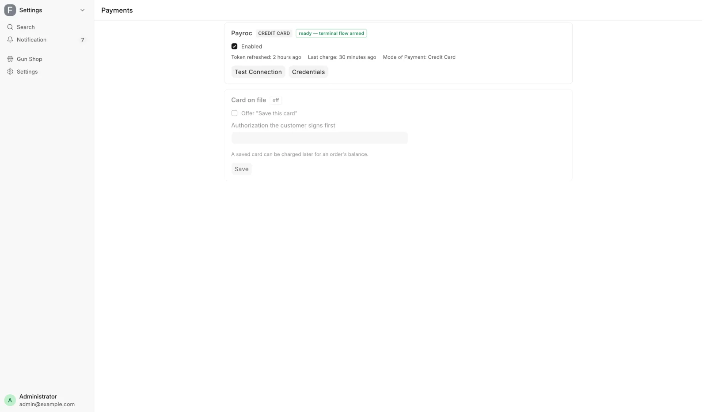

# Card voids and refunds

For managers (**Sales Manager** or **System Manager**), when card money has to go back to a customer, a card charge went wrong, or a saved card is charged. Counter staff take card payments on [Take payment](../counter/payments.md).

## Before you start

- Every action on this page needs **Sales Manager** or **System Manager**. The Payments hub needs **System Manager**.
- A register sale and a counter order have different buttons. A register sale is fixed on its register ticket. A counter order (built on [Create Order](../orders/build-an-order.md)) is fixed on its invoice.
- Open either one by searching for its number: press ++ctrl+k++ (++cmd+k++ on a Mac) and type it.

## Void a card charge on a register sale

Use this on a held gun sale where the buyer was denied, or a sale that is called off the same day. It reverses an unsettled charge and puts the money back on the customer's card.

1. Open the register ticket. The red **Void Card Charge** button shows only while the ticket is a **Draft**.
2. Click **Void Card Charge**.
3. If the sale was split across cards, choose which charge to void. One is reversed per click.
4. Type a reason, for example a NICS denial or a cancelled sale.
5. Click **Void the charge**.
6. Delete the draft, or take payment again.

!!! warning "Same business day only"
    A void works only before the card batch closes. A completed sale is refunded through a return instead, so the button is not offered there.

## Unlock a stuck refund on a register return

A refund that ended with an unknown outcome locks the return, because it may or may not have reached the customer's card.

1. Check the Payroc portal first. Confirm that no refund landed for this return.
2. Open the return and click **Unlock Card Refund**.
3. Write what you checked in the reason box.
4. Click **I verified in Payroc — unlock**.

Unlocking allows one full-amount retry. If the first refund did land, the retry pays the customer twice. **If the portal shows any refund landed, do not unlock.** Send it to the back office, where the rest is settled by hand in the portal.

### When the card integration is switched off

If the original sale was charged on the store terminal but the integration is now off, the return cannot send the refund.

1. Issue the refund in the Payroc portal.
2. Open the return and click **Confirm Portal Refund**.
3. Enter the **Portal refund reference**, the refund's own reference from the portal. Never a card number.
4. Write what you checked and click **I refunded it in Payroc — record**.

The return can then go through. Recording it moves no money.

## Void or refund a card on a counter order

Open the order's invoice. While it has a card charge with money left, the **Card refund** button shows **Void** and **Refund**.

### Void the whole charge

Use **Void** before the processor settles the charge, usually the same day.

1. Click **Card refund**, then **Void**.
2. Pick the **Card charge** if there is more than one.
3. Type the **Reason**.
4. Click **Void**.

The order owes the amount again. If the processor says the charge already settled, refund it instead. A charge that was partly refunded cannot be voided.

### Refund part or all of a charge

1. Click **Card refund**, then **Refund**.
2. Pick the **Card charge** and set the **Amount**.
3. Choose the **Type** (see the table).
4. Type the **Reason** and click **Refund**.

| Type | Use it when |
|---|---|
| **Return / price lowered** | Goods or a service came back, or the price dropped. The sale and its sales tax come down by the amount |
| **Collect again** | The sale stands and the money will come another way. The order owes the amount again |

A **Return** is refused on an order that sells stock, carries a serial number or a delivery, or has a bound book entry. The dialog says why. Use **Cancel Order** (see [Change or cancel an order](../orders/change-an-order.md)) or a sales return, or choose **Collect again**.

A Return can come out a cent off the amount you typed. If it is further off, the dialog says what to enter.

### When the processor does not confirm

The message reads **Not confirmed**. Do not try again, because the money may have moved.

1. Look the charge up in the processor's portal.
2. On the invoice, click **Card refund**, then **Resolve card reversal**.
3. Under **The portal shows**, choose **It happened — book it** and type the **Portal reference**, or **It did not happen — unlock**.
4. Write what you checked and click **Resolve**.

Until then that charge cannot be voided or refunded.

## Charge a saved card

A card saved at the terminal with the customer's authorization can pay a counter order's balance (see [Take payment](../counter/payments.md#save-a-card-to-charge-later)).

1. Open the counter order's invoice. **Charge saved card** shows while it owes money and the customer has a saved card.
2. Click **Charge saved card**.
3. Pick the **Card**. **Amount** starts at the whole balance and cannot be more.
4. Click **Charge**.

A decline records nothing and says **Card not charged**. If the dialog reads **Charge not confirmed**, do not take another payment for that amount. Click **Charge saved card** again in a few minutes and it looks the charge up. If the portal shows no charge, click **Release as not charged** and fill in **What you checked in the portal**.

To remove a card, open the customer, find **Saved cards** below **Agreements**, click **Remove** and give a reason. The processor forgets the card and it can never be charged again.

## When a charge went wrong

| Situation | What to do |
|---|---|
| The terminal timed out or was cancelled | Let the register finish. It reads the outcome from the processor before deciding |
| Only part of the amount was approved | Take the rest another way. The register refuses more than what is left to pay by card |
| A message says the money moved but could not be recorded | Stop. Do not retry the charge, refund or void. Note the invoice number and reconcile against the Payroc portal by hand. An alert email also goes out |
| A void or refund was not confirmed | Use **Resolve card reversal**, above |

## The daily card charge check

A charge voided or refunded on the terminal's own menu or in the Payroc portal never reaches the POS, so the sale keeps reading paid.

Once a day the system reads the last week's card charges back from Payroc. Any charge Payroc no longer holds gets a comment on its invoice and an email titled **[POS Alert] Payroc: … card charge(s) no longer captured at the gateway**.

The email goes to **Alert Recipients** in [FFL Settings](../admin/ffl-settings.md), or to every System Manager when that list is empty. The check only reports.

1. Ask whoever ran the terminal what happened.
2. Have the books corrected with your bookkeeper: collect the payment again, record the cash or other payment that replaced the card, or write it off.

## The Payments hub

Open **Settings**, then **Payments (Credit Card)** under **Integrations**. It is **System Manager** only, because its switch arms live money movement.

<figure markdown>
{ .screenshot }
<figcaption>One card per card processor, with whether it is ready, when its token was refreshed and its last charge.</figcaption>
</figure>

Each processor card shows:

- Whether the integration is switched on, and whether it is ready (switched on **and** holding its key).
- **Token refreshed** and **Last charge**, so you can see money is flowing.
- A connection test, with how many terminals the key may use and which is the default.
- A link to the processor's own settings, where the key is kept (see [Integrations](../admin/integrations.md)).

Switching a processor off is always allowed. With it off, **Credit Card** stays a normal mode of payment and cards are swiped on a standalone terminal.

### Switch on card on file

1. Under **Customers**, open **Agreement templates** and make an agreement that is **Active** with **Signed** set to **Per customer**.
2. On the Payments hub, find the **Card on file** card.
3. Pick the **Authorization the customer signs first**.
4. Tick **Offer "Save this card"** and click **Save**.

The card reads **on, but the active processor cannot save cards** when the processor cannot keep cards.

## GunBroker refunds

No screen in this system refunds a GunBroker order. Refund on GunBroker first, then the bookkeeper mirrors it here. See [GunBroker orders](../orders/gunbroker-orders.md) and [Month-end close](../admin/month-end.md).
