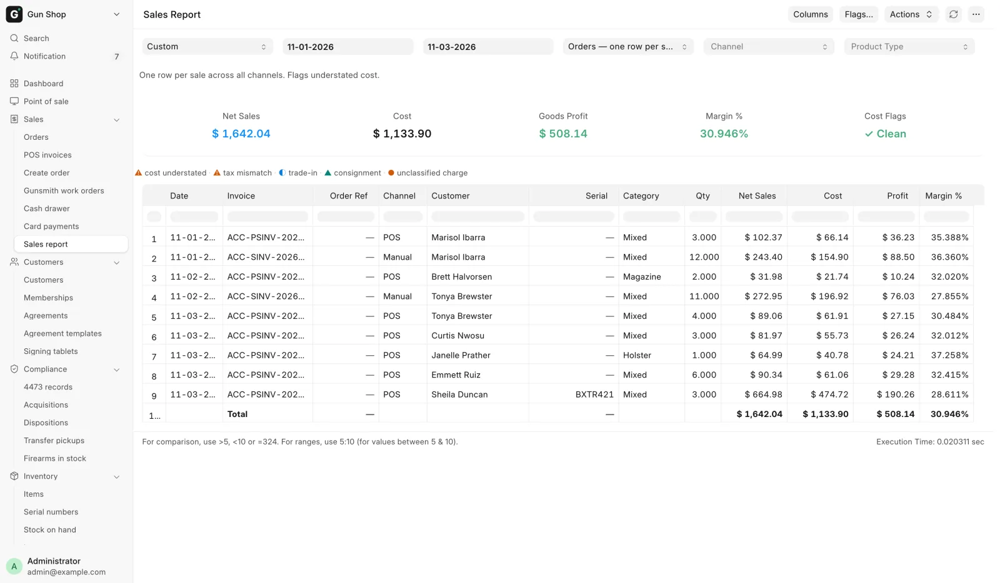
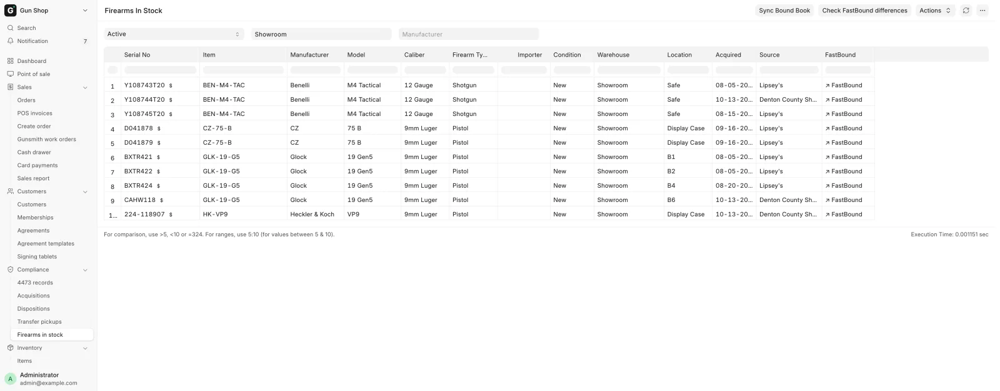
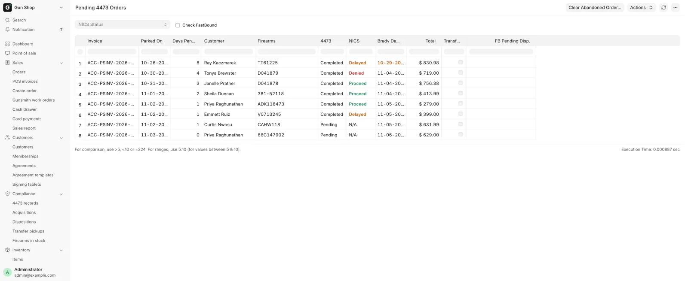
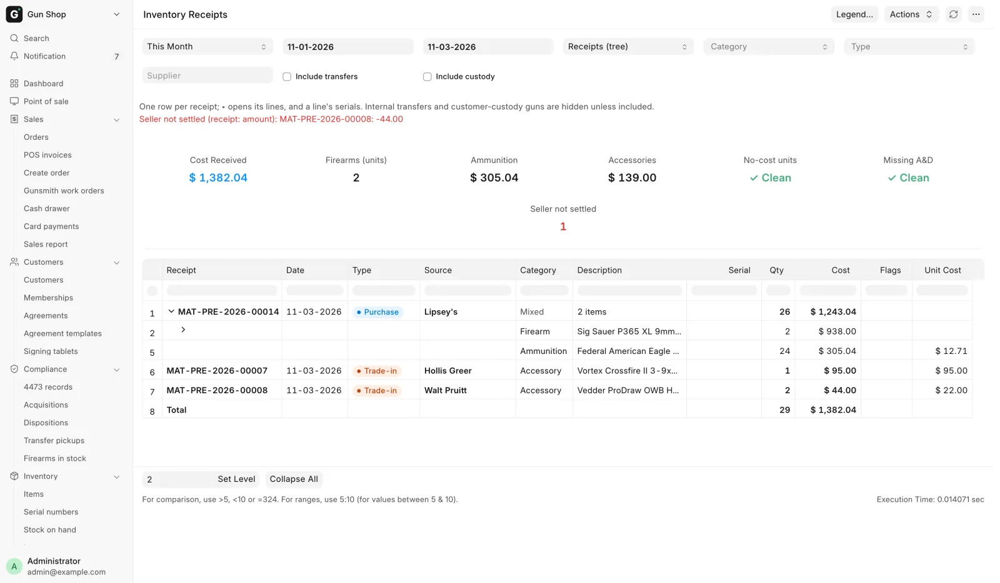
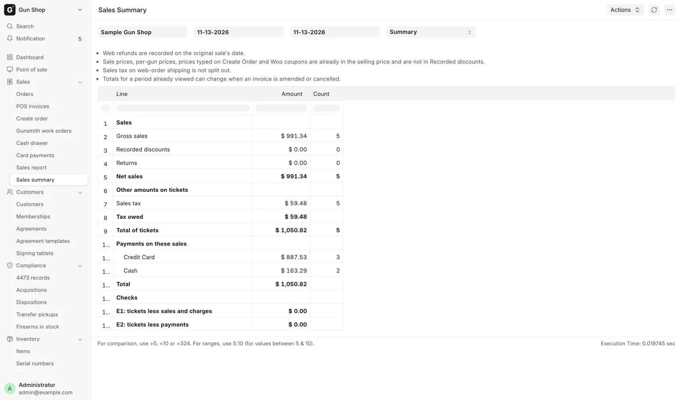
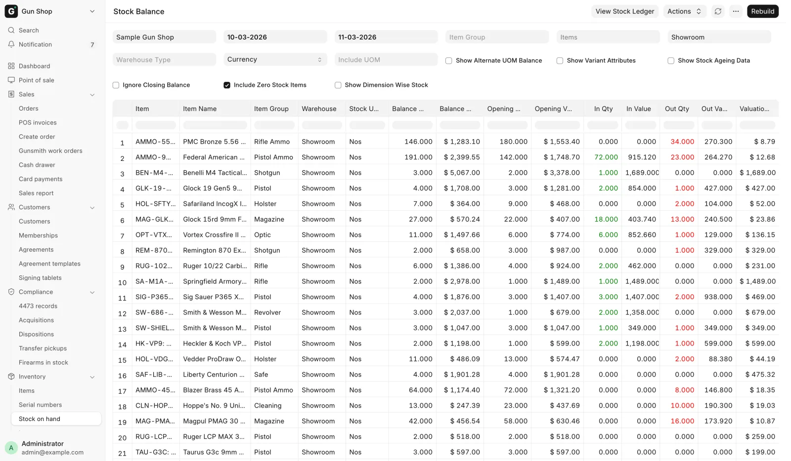

# Reports

For managers and the bookkeeper, when you need to answer a question about stock, sales, cash or compliance.

Counter staff see most of these as cards on the [Dashboard](../start/dashboard.md), which are cut from the same reports.

<figure markdown>
{ .screenshot }
<figcaption>Every report opens as a filter bar, a summary strip and a table. Here the Sales Report over a custom date range.</figcaption>
</figure>

## Open a report

1. Open the **Dashboard**.
2. Scroll to **All records** at the foot of the page.
3. Type part of the report's name in the **Filter…** box.
4. Click the report.

Six reports also have their own row in the sidebar:

| Sidebar row | Report |
|---|---|
| **Sales** → **Sales report** | Sales Report |
| **Sales** → **Sales summary** | Sales Summary |
| **Compliance** → **4473 records** | Form 4473 Records |
| **Compliance** → **Transfer pickups** | Pending Transfer Pickups |
| **Compliance** → **Firearms in stock** | Firearms In Stock |
| **Inventory** → **Stock on hand** | Stock Balance |

## Every report

| Report | For | The question it answers |
|---|---|---|
| Firearms In Stock | Inventory | Which guns do we physically have right now, by serial? |
| Pending 4473 Orders | Counter, manager | Which parked gun sales are waiting on a 4473 or NICS? |
| Pending Transfer Pickups | Counter | Whose transfer gun is in the safe, and how long has it sat? |
| Form 4473 Records | Counter, manager | Which 4473s are on file, and where is each signed form? |
| Cash Drawer Weekly | Manager, bookkeeper | What moved the drawer each day, and did the count agree? |
| Inventory Receipts | Bookkeeper, inventory | What entered stock this period, from whom, at what cost? |
| Sales Report | Manager, bookkeeper | What did we sell, on every channel, and what did we make? |
| Sales Summary | Manager | What were sales, discounts, returns, tax and payments for a period, on one page? |
| Hand-Asserted 4473 Dispositions | Manager | Which bound book entries did a person vouch for instead of FastBound? |
| GunBroker Statement Reconciliation | Bookkeeper | Does GunBroker's bill agree with our books, order by order? |
| GunBroker Cash Basis Adjustments | Tax preparer | What bridges the accrual books to a cash-basis return? |
| Stock Balance | Inventory | How many of each item are on hand, per warehouse? |
| Stock Ledger | Inventory | Every stock movement, one row each |

Card attempts on the terminal are a list, not a report: **Card payments** in the sidebar's **Sales** group. See [Take payment](../counter/payments.md).

## The counter queues

**Firearms In Stock** lists every firearm in stock: maker, model, caliber, condition, warehouse, its shelf **Location** (blank when not placed), when and where it came from, and a link to its FastBound record. Filter by Stock Status, Warehouse or Manufacturer.

A manager sees three more controls on it:

- **Sync Bound Book** compares the in-stock list with FastBound and offers to remove guns FastBound shows as gone.
- **Check FastBound differences** starts a field-by-field comparison in the background.
- A small `$` link beside each serial opens the correct-cost dialog. See [Fix a mistake](../stock/corrections.md).

<figure markdown>
{ .screenshot }
<figcaption>The by-serial floor view. Stock Status, Warehouse and Manufacturer decide which guns list.</figcaption>
</figure>

**Pending 4473 Orders** has one row per parked gun sale, with the 4473 status, the NICS status, days pending, the total and a Transfer flag. The **Brady Day 3** column is three business days after the sale was parked. Antique firearms are left out.

Denied rows show red and Delayed rows orange. A Delayed row past its Brady date has its date highlighted too. Filter by NICS Status. See [Form 4473 and NICS](../compliance/4473.md).

<figure markdown>
{ .screenshot }
<figcaption>The parked-gun queue, oldest first, with the Brady date.</figcaption>
</figure>

**Pending Transfer Pickups** lists every gun received for a customer and still in the safe, oldest first. It shows the customer's mobile number and who shipped it. This is the call-the-customer list. Filter by Customer.

**Form 4473 Records** lists every completed 4473 on file, FastBound or paper, newest first. **View PDF** opens the store's copy of the signed form. Filter by date, Customer, Serial, NICS Status or Source. See [Find a 4473](../compliance/4473-records.md).

## The back-office reports

**Inventory Receipts** covers everything that entered stock in a date range. It sorts receipts into four categories (Firearm, Ammunition, Accessory, Other) and ten classes, such as Purchase, Trade-in, Intake, Return, Adjustment, Revaluation, Transfer and Custody. Gun parts count as accessories.

It has three views:

| View | Shows |
|---|---|
| Receipts | A tree: each receipt, then its lines, then each unit |
| Summary | Category by class |
| Units | One flat row per unit, the one to export |

Moves between your own warehouses and customers' guns held for them are hidden until you tick **Include transfers** or **Include custody**.

The summary cards show Cost Received, firearm units, ammunition and accessory cost, and three warning counts: units with no cost, units with no bound book entry, and **Seller not settled**.

**Seller not settled** counts private-seller purchases whose payment does not match the receipt. A red line under the filters names each receipt and the amount.

<figure markdown>
{ .screenshot }
<figcaption>Receipts view. The cards total the whole period. Set Level and Collapse All, under the table, open and close the tree.</figcaption>
</figure>

**Sales Summary** puts one period on one page, for a **Company** between **From Date** and **To Date**. It counts the same sales as the Sales Report, in the same numbers. Pick a **View**:

| View | Shows |
|---|---|
| Summary | Sales, discounts, returns, then shipping and tax, then the payments taken on those sales |
| Category | The same totals by item group |
| Register | By register |
| Employee | By who opened the ticket |

<figure markdown>
{ .screenshot }
<figcaption>Sales Summary for one day, Summary view.</figcaption>
</figure>

In Summary, **Recorded discounts** counts only discounts the sale records. A sale price, a per-gun price or a price typed on Create Order is already in the selling price. **Tax owed** is sales tax plus excise. The two **Checks** rows at the foot come to 0.00; anything else is shown in red, so ask your bookkeeper.

**Hand-Asserted 4473 Dispositions** is the review list of every bound book entry a person vouched for instead of FastBound. Two things write one: a manager forcing a stuck electronic 4473 through, and the counter recording a paper 4473 in Paper 4473 Mode.

Each row shows when, the serial, the disposition type, the sale, who vouched, their reason, and whether FastBound has since caught up. It shows the latest 500 and has no filters. Read it on a schedule, or the check it gives you is worth nothing.

**Cash Drawer Weekly** has one row per day for a **Company** between **From** and **To**. Each row shows what moved the drawer, the expected cash, the count, the difference and the reason. A day whose difference needed a reason shows red. See [Cash drawer](../counter/cash-drawer.md).

**GunBroker Statement Reconciliation** and **GunBroker Cash Basis Adjustments** are the bookkeeper's. See [Month-end close](../admin/month-end.md).

**Stock Balance** runs in the background. It opens empty until you set the filters and click **Generate New Report**. Once a run exists the button reads **Rebuild**.

<figure markdown>
{ .screenshot }
<figcaption>Stock Balance for one warehouse over a month.</figcaption>
</figure>

## Filter and export

The filter bar sits above the table, and the report re-runs when you change a filter. Sales Report and Inventory Receipts have a **Period** picker: Today, This Week, This Month, Last Month, This Quarter and Year to Date. Typing a From or To date sets it back to Custom.

To export:

1. Open the menu at the top right of the report.
2. Click **Export**.
3. Pick Excel or CSV.

## Who can open which report

| Report | Roles |
|---|---|
| Pending 4473 Orders, Pending Transfer Pickups | Counter and stock roles |
| Form 4473 Records | Sales User, Sales Manager, System Manager |
| Firearms In Stock | Stock User, Stock Manager, System Manager |
| Sales Report, Sales Summary | Sales Manager, Accounts Manager, System Manager |
| Cash Drawer Weekly | Sales Manager, Accounts User, Accounts Manager, System Manager |
| Inventory Receipts | Stock Manager, Purchase Manager, Accounts User, Accounts Manager, System Manager |
| The two GunBroker reports | Accounts Manager, System Manager |

See [Roles and sign-in](../start/roles.md).
