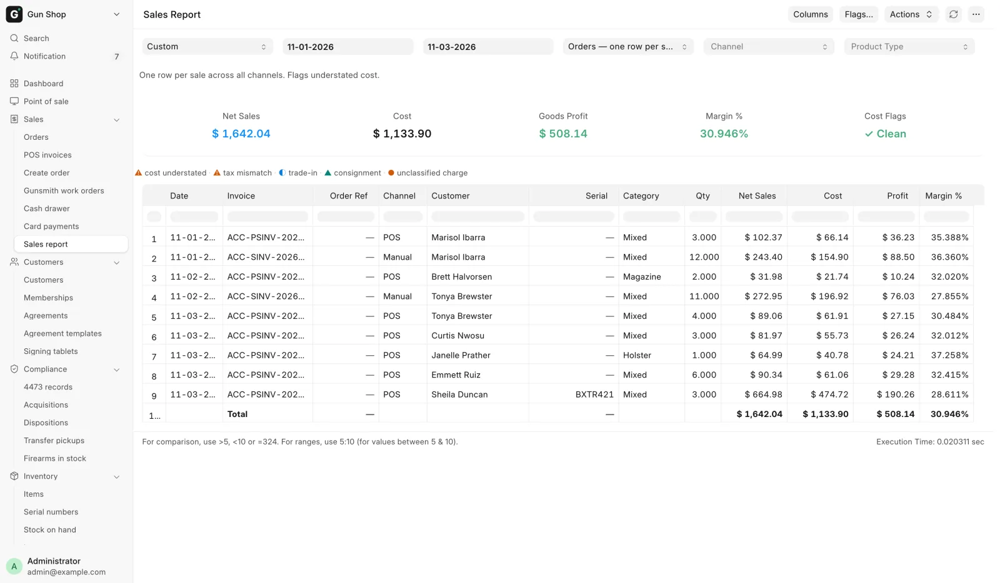

# Sales Report

For managers, every day, and for the bookkeeper at month end: revenue and profit for a date range across every channel.

Open it from the sidebar: **Sales**, then **Sales report**.

<figure markdown>
{ .screenshot }
<figcaption>Orders view: the filter bar, five summary cards, then one row per sale.</figcaption>
</figure>

## What it counts

Every finished sale is counted once:

- Counter sales from the register, channel **POS**. They show the moment they are rung up, before the nightly close.
- Orders, channel **Web**, **GunBroker** or **Manual**, depending on where the order came from.

How the report avoids counting a sale twice is on [For the bookkeeper](../admin/bookkeeper-month-end.md#sales-report-what-it-reads).

## Filters

| Filter | What it does |
|---|---|
| Period | Today, This Week, This Month, Last Month, This Quarter, Year to Date. Fills From and To |
| From, To | The date range. Both are required. Editing either sets Period back to Custom |
| View | Orders, Orders + line detail, or Tax lines (CSV export) |
| Channel | Blank for all, or POS, Web, GunBroker, Manual |
| Product Type | Blank for all, or Firearms, Non-Firearms |

Product Type is judged per sale, not per line: a sale with any gun on it counts as Firearms. A filter value the report does not know is refused, so an unfiltered total is never passed off as a filtered one.

## The three views

| View | Use it for |
|---|---|
| **Orders** | The default, one row per sale. The view a manager reads |
| **Orders + line detail** | The same rows. Click a row's **Lines** cell to see its product, shipping and tax lines. Sorting is off here |
| **Tax lines** | One row per line, for the bookkeeper's tax worksheet. Its CSV always has every tax column |

## The columns

The Orders view has these columns, in order: Date, Invoice, Order Ref, Channel, Customer, Serial, Category, Qty, Net Sales, Cost, Profit, Margin %, Channel Fees, Profit after Fees, Trade-in Applied, Trade-in Paid Out, Total.

| Column | Means |
|---|---|
| Order Ref | The web or GunBroker order number. A dash for a counter sale |
| Serial | The guns on the sale |
| Category | The item's group, or **Mixed** when the sale spans several |
| Channel Fees | The marketplace's cut. Profit after Fees is what is left |
| Trade-in Applied | The trade-in allowance taken off the goods |
| Trade-in Paid Out | What the store paid out when trade-ins came to more than the sale |
| Total | The amount actually charged |

The **Tax lines** view adds a **Consignment?** column, ticked on a consigned gun's line.

To choose columns, click **Columns** on the toolbar. Total, Channel Fees, Profit after Fees, Trade-in Applied and Trade-in Paid Out start hidden in the Orders view, and they are always in the export. Your choice is kept per view on this browser, and **Reset to default** puts back the starting set. The Invoice column cannot be hidden.

## The summary cards

| Card | Means |
|---|---|
| Net Sales, Cost, Goods Profit, Margin % | Totals for the rows shown |
| Cost Flags | **Clean** in green means nothing to check. Red counts rows to look at |
| Sales Tax | In the two line views only. All sales tax the store charged, shipping tax included |
| Excise Tax | In the two line views, when the period collected excise tax. Not part of Sales Tax |
| Shipping | In the two line views only |
| **Marketplace sales** | In a line view filtered to GunBroker. Sales delivered to the store's own state |

Those views also get an **Excise Tax** column for such a period, for example California's firearm excise.

In the two line views the flag card is called **Data Flags**. **Sales Tax** leaves out tax GunBroker collected, so never add shipping tax on top of it.

## How profit is worked out

Profit is Net Sales minus Cost, and Margin % is profit divided by Net Sales, both before tax. Cost is worked out per line:

| Line | Cost used |
|---|---|
| Trade-in credit | Zero. The allowance buys a gun into stock |
| Consigned gun | Net sales less the store's commission, so profit is the commission. See [Consignment](../stock/consignment.md) |
| Firearm | The purchase price recorded on each gun |
| Anything else | Quantity times the item's average cost in that warehouse |

Net Sales counts the full price before trade-ins. A $1,300 gun sold against an $800 trade-in shows Net Sales of $1,300, not $500. Profit is the same either way, and the margin stays honest.

## Open the sale behind a row

Click the Invoice link to open the sale. The Customer and serial links open their own records. In the Orders + line detail view, click **Lines** for the breakdown. When trade-ins came to more than the sale, it also shows **Paid to customer**.

## Before you quote a number

- A flagged row understates cost. A warning symbol means a gun on that sale has no purchase price, so profit looks too good. [Fix the cost](../stock/corrections.md) first.
- A GunBroker sale shows zero sales tax. That is correct: GunBroker collects and pays it as the marketplace.
- Marketplace fees are not cost. They sit in Channel Fees, so a gun costs the same on every channel.
- A refunded web order lowers tax and shipping, not the goods line.
- Net Sales is higher than the books' income by the period's trade-in allowances. Profit still agrees.

Click **Flags…** on the toolbar for the full symbol list:

| Symbol | Means |
|---|---|
| Warning, orange | Cost understated, or line tax disagrees with the tax charged |
| Dot, orange | A charge that is neither sales tax nor shipping |
| Half circle, blue | A trade-in allowance on this sale |
| Triangle, teal | A consigned gun: profit is the store's commission |

Before anyone uses this report for a filing, the Cost Flags or Data Flags card must read **Clean**. How the report compares with the books is on [For the bookkeeper](../admin/bookkeeper-month-end.md#sales-report-and-the-books).
