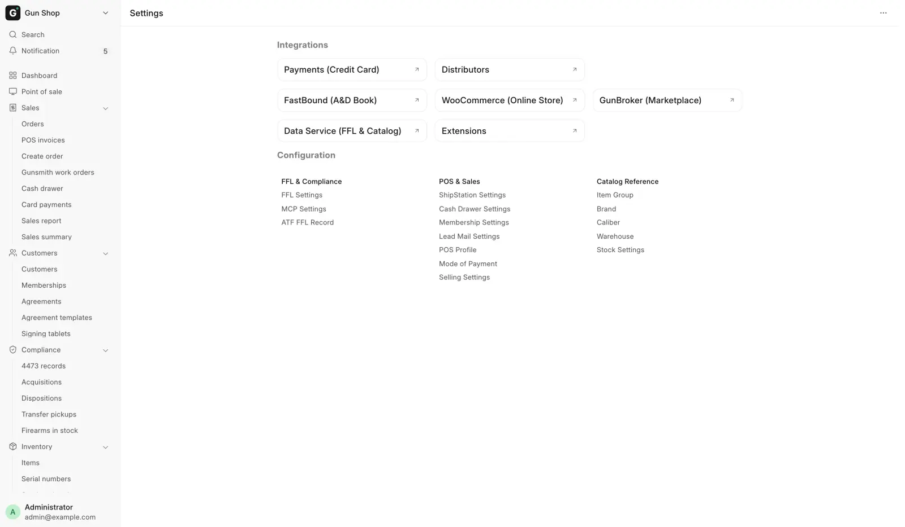
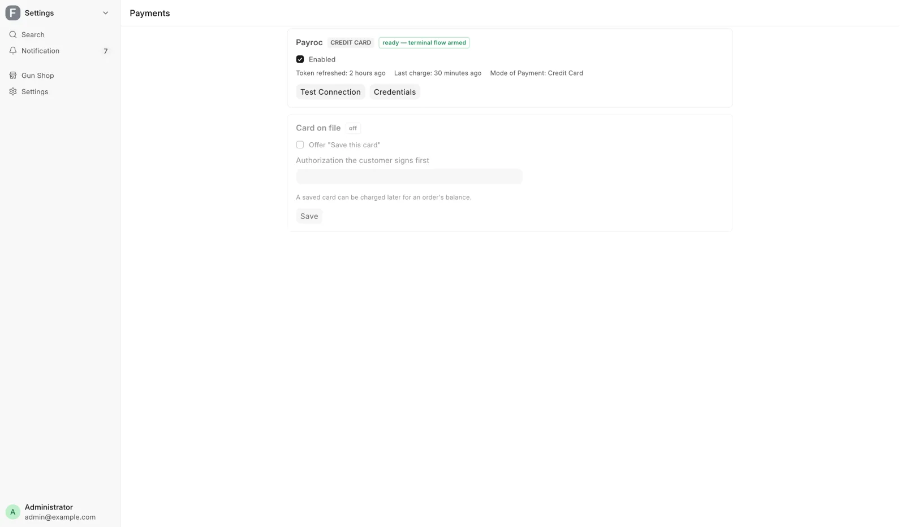

# Settings

For managers and administrators, when you change how the store is set up or connect an outside system.

Open it from **Settings**, the last row of the sidebar.

<figure markdown>
{ .screenshot }
<figcaption>Integrations across the top, configuration cards below.</figcaption>
</figure>

!!! warning "A settings change applies to the whole store"
    Nothing here is personal. Switching something off closes it for every till and every user, and some changes apply only after a till reloads. Most pages here need System Manager. If you are not sure what a field does, ask before you save.

## What is on the page

**Integrations** across the top holds one shortcut per outside system:

| Shortcut | Opens |
|---|---|
| **Payments (Credit Card)** | The Payments hub |
| **Distributors** | The Distributors hub. See [Distributor setup](../admin/distributors.md) |
| **FastBound (A&D Book)** | FastBound Settings |
| **WooCommerce (Online Store)** | WooCommerce Settings |
| **GunBroker (Marketplace)** | GunBroker Settings |
| **Data Service (FFL & Catalog)** | Data Service Settings |
| **Extensions** | The Extensions page |

**Configuration** below holds three cards of store setup:

| Card | Links |
|---|---|
| **FFL & Compliance** | FFL Settings, MCP Settings, ATF FFL Record |
| **POS & Sales** | ShipStation Settings, Cash Drawer Settings, Membership Settings, Lead Mail Settings, POS Profile, Mode of Payment, Selling Settings |
| **Catalog Reference** | Item Group, Brand, Caliber, Warehouse, Stock Settings |

Several of these are also under **Setup** in **All records** on the [Dashboard](../start/dashboard.md).

### The store logo

The logo at the top of the screen is the **Application Logo** in **Navbar Settings**. A black-on-white logo shows as a white box in dark mode, so upload a second version in the same place under **Dark Mode Logo**. Left empty, the Application Logo shows in both themes.

## The Payments hub

The Payments hub has one card per card processor. Each card shows whether it is enabled and ready, the mode of payment it uses, and when it last took money. **Test Connection** checks it, and **Credentials** opens its settings page.

Below them, the **Card on file** card turns on [saving a card to charge later](../counter/payments.md). Tick **Offer "Save this card"**, pick the **Authorization the customer signs first**, and click **Save**.

<figure markdown>
{ .screenshot }
<figcaption>One card per card processor. This one is enabled and ready, with its last token refresh and last charge.</figcaption>
</figure>

## Every settings page

| Page | Where to open it | What it controls |
|---|---|---|
| FFL Settings | **FFL & Compliance** card | Our FFL number, alerts, counter rules, shipping tax, 4473 mode, transfer fee, customer ID numbers, FFL verification. See [FFL Settings](../admin/ffl-settings.md) |
| MCP Settings | **FFL & Compliance** card | Whether AI assistants can connect, read-only or full |
| ATF FFL Record | **FFL & Compliance** card | The ATF license records other dealers are checked against |
| ShipStation Settings | **POS & Sales** card | Shipping labels, ship-from address, parcel defaults |
| Cash Drawer Settings | **POS & Sales** card | The drawer's limits (below) |
| Membership Settings | **POS & Sales** card | Automatic renewal charges and the yearly reminder. See [Memberships](../counter/memberships.md) |
| Lead Mail Settings | **POS & Sales** card | Mail domains that never become a CRM lead: other businesses you block, and the store's own |
| POS Profile | **POS & Sales** card | Each register's warehouse, price list and payment methods |
| Mode of Payment | **POS & Sales** card | The tender types and the account each posts to |
| Selling Settings | **POS & Sales** card | Store-wide selling defaults, such as customer naming |
| Item Group | **Catalog Reference** card | The product category tree that drives firearm rules and reports |
| Brand | **Catalog Reference** card | The manufacturer list |
| Caliber | **Catalog Reference** card | Calibers for items, guns and the web store filter |
| Warehouse | **Catalog Reference** card | Stock locations, including the warehouse for customers' guns |
| Stock Settings | **Catalog Reference** card | Store-wide stock defaults, such as valuation |
| FastBound Settings | **FastBound (A&D Book)** | The bound book connection |
| Payroc Settings | **Credentials** on the Payments hub | The card terminal |
| RSR Settings, Sports South Settings, Lipseys Settings | **Account & shipping** on the house's card on the Distributors hub | Ordering account, order details, freight |
| GunBroker Settings | **GunBroker (Marketplace)** | Marketplace login, listing defaults, fees |
| WooCommerce Settings | **WooCommerce (Online Store)** | The web store connection |
| Data Service Settings | **Data Service (FFL & Catalog)** | The optional shared catalog and FFL lookup service |

The connection pages are described field by field in [Integrations](../admin/integrations.md).

## MCP Settings

**MCP Settings** switches on the read-only and the full MCP server, the connection an AI assistant such as Claude uses. Once a switch is on, it shows its server address and a command ready to copy.

Staff sign in with their own account, and the assistant can do only what their role allows. **Connector Audit Log** on the form opens the permanent record of every action taken through a connector. System Manager only. See [the MCP server](../../ai/mcp.md).

## Cash Drawer Settings

| Field | Default | What it does |
|---|---|---|
| **Count difference that needs a reason** | $20 | A count off by this much or more needs a reason |
| **Biggest cash expense** | $200 | The largest expense the drawer pays out |
| **Accounts a cash expense can go to** | | The expense accounts offered |

**Cash tracking started** is read-only. System Manager only. See [Cash drawer](../counter/cash-drawer.md).

## Extension settings

An extension with settings shows a **Settings** button on its card on the Extensions page, while the extension is turned on. See [Extensions](../../extensions/README.md) for turning one on, off or updating it.
