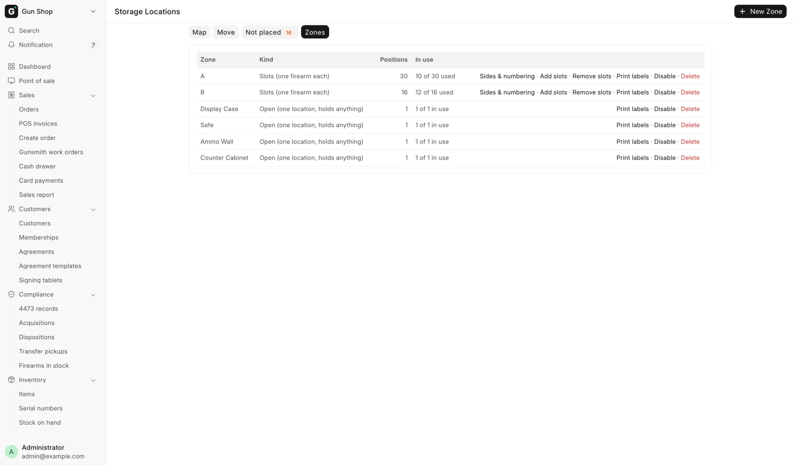
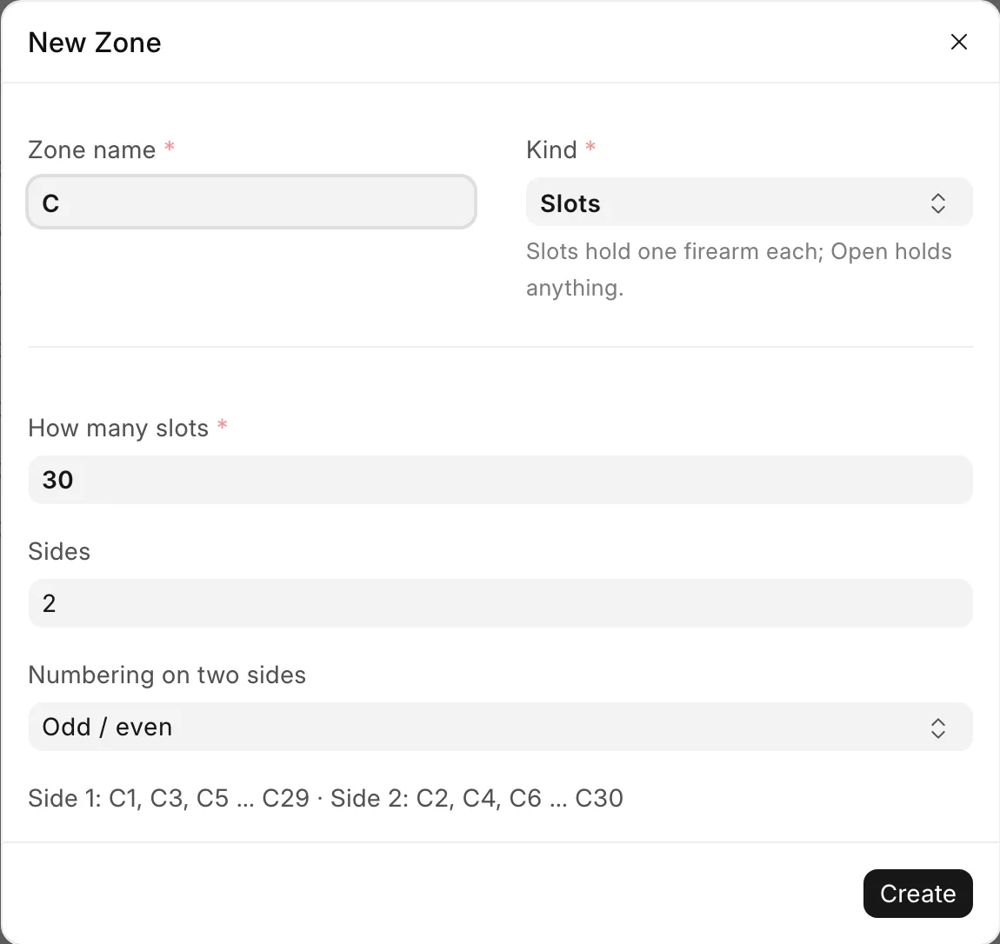
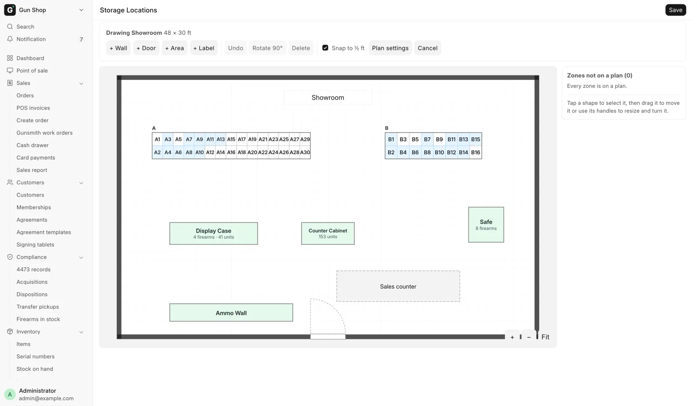

# Set up the store map

For stock managers, when you set up the racks, cases and safes the shop uses, print their labels, or draw a room's floor plan.

Everyone else finds and moves stock on the same page; see [Find and move stock](../stock/find-and-move.md). Open it from the sidebar: **Inventory**, then **Storage locations**.

## Before you start

- Only a **Stock Manager** or **System Manager** sees the **Zones** tab and the **Edit layout** button. A Sales Manager does not.
- A zone is either a bank of numbered slots, one gun each, or one open location such as a display case that holds anything.

<figure markdown>
{ .screenshot }
<figcaption>The Zones tab: one row per zone, with its kind, positions and what is in use.</figcaption>
</figure>

## Create a zone

1. Open the **Zones** tab and click **New Zone**.
2. Type a short **Zone name**, like A or Display Case.
3. Pick the **Kind**: **Slots** for numbered slots, one firearm each (A1, A2…), or **Open** for one location with no limit. Make one Open zone per rack or case.
4. For a Slots zone, type **How many slots (one firearm each)**.
5. For a Slots zone, type **Sides**. A two-sided rack is 2: 30 slots make 15 a side. Leave it empty to fit the slots to the shape on the map.
6. For two sides, pick **Numbering on two sides**: **Odd / even** (1, 3, 5 down one side, 2, 4, 6 facing them) or **In order** (1, 2, 3 down the first side, then the second).
7. Check the preview line under the fields. It shows the labels the zone will get.
8. Click **Create**.

<figure markdown>
{ .screenshot }
<figcaption>The New Zone window. The preview shows each side's labels before you create the zone.</figcaption>
</figure>

## Change a zone

Each row of the **Zones** tab shows **Zone**, **Kind**, **Positions** and **In use**, and these links:

| Link | What it does |
|---|---|
| **Sides & numbering** | Redraws a Slots zone. Every slot keeps its name and contents |
| **Add slots** | Adds slots at the end. Type **How many more slots** |
| **Remove slots** | Deletes the last slots. Type **How many to remove from the end**. They must be empty |
| **Print labels** | One label per position, with its name and barcode |
| **Disable** / **Enable** | Takes an empty zone out of use, or back |
| **Delete** | Removes an empty zone |

To disable or enable one slot, tap it on the **Map** tab and use **Disable** or **Enable** in its window. A slot or zone named on past sales or receipts cannot be deleted; disable it instead.

## Draw a floor plan

Draw one floor plan per room. Everyone then sees the shop as a map. Drawing works on a computer, a phone or an iPad.

1. On the **Map** tab, click **Create floor plan** (the first time) or **+ Floor plan**.
2. Type the room's **Name**, like Showroom, and its **Width (ft)** and **Depth (ft)**. A rough size is fine.
3. Click **Create**. The drawing opens.
4. Under **Zones not on a plan**, tap a zone to drop it in the middle of the view, then drag it into place. **Place all** places every zone at once.
5. Add the room's features with **+ Wall**, **+ Door**, **+ Area** and **+ Label**.
6. Tap a shape to select it. Drag it to move it, drag a square handle to resize it, or drag the round knob to turn it. **Rotate 90°** turns it a quarter turn. The side panel takes exact sizes.
7. For a Slots zone, set **Lines of slots** for how many lines run along the long side, or leave it empty.
8. Click **Save**.

While drawing, **Undo** takes back the last change and **Delete** removes the selected shape. On a zone, Delete reads **Take off plan**: the zone stays but is on no plan. **Snap to ½ ft** keeps shapes on a half-foot grid. **Cancel** throws your changes away.

<figure markdown>
{ .screenshot }
<figcaption>Drawing a floor plan: zones, walls and doors, with the side panel for exact sizes.</figcaption>
</figure>

To change a plan later, pick it on the **Map** tab and click **Edit layout**. **Plan settings** changes its name and size, and has **Delete this plan**. Deleting a plan leaves its zones as they are, on no plan.

## Troubleshooting

| You see | Fix |
|---|---|
| "{zone} still holds something. Move it out first, then delete." (or "then disable.") | Move its contents out on the **Move** tab first. |
| "{location} is recorded on past documents…, so it cannot be deleted. Disable it instead." | Click **Disable** instead. |
| "A zone called {name} already exists. Pick another name." | Pick another name. |
| "Someone else saved this plan at {time}. Reload to see their changes, then make yours again." | Reload the page and redo your change. |
