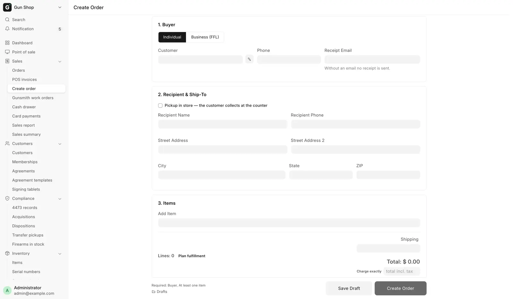
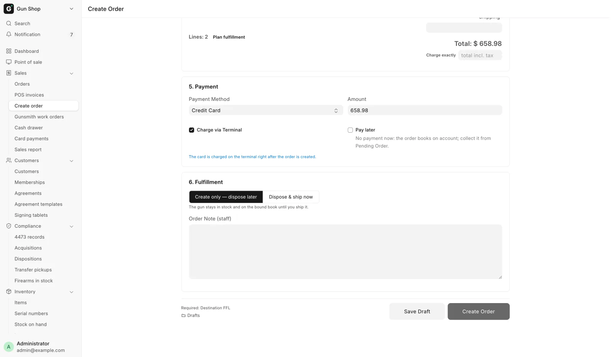

# Build an order and its splits

For counter staff, when the buyer is not walking out with the goods today: a gun mailed to a dealer, accessories shipped to a home, or something the store has to order in.

You build every such order on the **Create Order** page. Open it from **Create order** under **Sales** in the sidebar, or click **New order** at the top of the [Dashboard](../start/dashboard.md).

<figure markdown>
{ .screenshot }
<figcaption>Create Order runs top to bottom. Buyer type first, then the buyer, the ship-to and the items, with payment and fulfillment below the fold.</figcaption>
</figure>

This page explains the screen. Walk-throughs: [Ship a firearm to another dealer](ship-to-dealer.md), [Ship accessories to a customer](ship-to-customer.md), [Deposits and special orders](special-orders.md).

## Before you start

- You need one of these roles: Sales User, Sales Manager, Stock Manager, or System Manager. See [Roles and sign-in](../start/roles.md).
- The register must be set up for the store that holds the guns. No register shift is needed.
- The page never runs a Form 4473. A gun handed over at your counter goes through the register instead. See [Sell a gun](../counter/sell-a-gun.md).

## Steps

1. Pick the buyer type: **Individual** or **Business (FFL)**.
2. Fill in the buyer.
3. For a firearm, set the **Destination FFL**. See [Ship a firearm to another dealer](ship-to-dealer.md).
4. Fill in **Recipient & Ship-To**, or tick **Pickup in store — the customer collects at the counter**.
5. Add the items.
6. If any line comes from a distributor, click **Plan fulfillment**, then **Apply plan**.
7. Take the payment, or tick **Pay later**.
8. Pick how the order ships: **Create only — dispose later** or **Dispose & ship now**.
9. Click **Create Order**.

The bar at the bottom lists what is still missing after "Required:". It turns green with "Ready to create." when nothing is.

## Buyer Type

Pick **Individual** for a retail customer. Pick **Business (FFL)** when the buyer is another licensed dealer buying on its own license.

An individual's firearms may not leave the store until the order is paid in full. A business may ship on account. A **Business (FFL)** order cannot include a distributor line.

## Buyer

For an individual, pick the **Customer** (FFL dealers are not listed) and fill in **Receipt Email**, which is required. **Phone** fills from the customer when blank. To add someone new, see [Customers](../counter/customers.md).

The pencil beside **Customer** opens **Fix Customer Name**: type the spelling in **Correct Name** and click **Rename**. It renames the customer everywhere, so use it for spelling fixes only.

For a business buyer, see [Ship a firearm to another dealer](ship-to-dealer.md#a-dealer-buying-on-its-own-license).

In California, a peace officer or law enforcement agency can be exempt from the firearm excise tax. See [Peace-officer excise exemption](ship-to-customer.md#peace-officer-excise-exemption-california).

## Items

Type into **Add Item**. One box takes a scanned barcode, a SKU or part of a name, or a firearm serial number. Store stock is listed first, then distributor results.

Scanning a serial adds that exact gun at its tag price in one step.

A firearm from the list opens a card with **Serial (in stock)**, **Qty** and **Price**. Pick the serial and the price follows that gun. Quantity is one per serial. Click **Add to Order**. A serial already on the order is refused a second time.

A distributor result sits under **Catalog API — not in local stock**. Pick one, set **Qty** and **Price** (MAP when known, else MSRP), and click **Add to order**. The line is tagged **API**, "choose source in the plan".

Gun parts are not firearms. An upper, a barrel or a conversion kit takes no serial and its quantity can change.

### The line table

Each line shows a **Firearm** tag where it applies, the serial, quantity, **Cost** (what it costs you, **—** when unknown), **Price** and subtotal. Price can be changed on every line, quantity on non-firearm lines. The ✕ button removes a line.

- **Taken from.** A line of loose stock from your shelf shows a dropdown of the [storage locations](../stock/find-and-move.md) that hold it. Pick the one you took it from. **Taken from: not said** is allowed; the units then wait on the Not placed list for someone to confirm.
- **Charge exactly.** Type the total the customer pays, tax included, and press <kbd>Enter</kbd>. The line prices are worked back from it. Shipping stays as it is, so the total must be more than the shipping.
- **A price below the list price** asks for a manager when you click **Create Order**, as on the register. See [Sell accessories](../counter/sell-accessories.md). Distributor lines are not checked.

Below the table sit **Shipping**, a tax preview and the **Total**. The real tax is worked out from the ship-to when the order is created. See [Sales tax follows the ship-to](ship-to-customer.md#sales-tax-follows-the-ship-to).

## Plan fulfillment: the splits

One order can be filled from your own stock and from distributors at once. Each source becomes a leg of the order.

Click **Plan fulfillment** next to the line count (a highlighted pill while a line needs a source). The **Fulfillment plan** dialog opens. Rows are your lines. Columns are **Local stock** and every enabled distributor.

| Cell | Meaning |
|---|---|
| **_N_ in stock** | Your own stock covers the line |
| **serial in hand** | The line already has a gun from your stock |
| **short _N_ — click to split** | Some stock, not enough. Click to split the line |
| Cost · **qty**, **Ship to store** | The distributor can send it to your store |
| **—** | The distributor does not carry it |
| **unavailable** | The distributor could not be asked. Other columns still work |

1. Read the suggestion. The plan picks local stock when it covers the line, otherwise the cheapest distributor that can fill it. A line you planned before keeps its choice while it still works.
2. Click a different cell to change a line's source.
3. Click **Apply plan**. It reads **Applying…**, then "Fulfillment plan applied." and the dialog closes.

A line that fails is listed under **Plan partially applied**; choose again. Changing the quantity of a distributor line later marks it **unconfirmed**: run the plan again.

**Ship to store** has the distributor send the goods to you. A firearm is received into your bound book like any other and held for this order. Freight estimates and greyed buttons are explained on [Order from a distributor](../stock/distributor-orders.md#freight-on-the-fulfillment-plan).

An order with a distributor line always waits on [Pending Orders](pending-orders.md), whatever you pick under fulfillment. Its distributor legs are placed there with **Place order**.

## Payment

<figure markdown>
{ .screenshot }
<figcaption>Charge exactly sits under the total. On a store with the card terminal, Credit Card adds Charge via Terminal.</figcaption>
</figure>

| Control | Notes |
|---|---|
| **Payment Method** | Cash, Credit Card, Zelle, ACH, or Check/Money Order |
| **Amount** | The full total. Type less for a deposit |
| **Zelle / ACH Transaction Number**, **Check / money order number**, **Card Approval Code** | Required for that method |

Less than the total shows a deposit note with the balance due. **Pay later** takes nothing now; collect it from Pending Orders.

A card on the terminal (**Charge via Terminal**, ticked by default) is charged after the order is created:

1. Click **Create Order**. The order books on account first.
2. **Waiting for terminal** opens. The customer dips or taps the card.
3. On approval the payment is recorded on the order. The **Order Created** dialog shows the authorization code.

If the card is declined or times out, the order still exists on account. Click **Retry card**, or collect later with **Record Payment** on [Pending Orders](pending-orders.md). A terminal-paid order ships from Pending Orders, never at once.

A card already run on the Virtual Terminal: untick **Charge via Terminal** and type the **Card Approval Code** from the receipt. More on cards in [Take payment](../counter/payments.md).

!!! warning "Never type a card number"
    The reference boxes are for an approval or confirmation code. A full card number is refused.

## Fulfillment

- **Create only — dispose later** (the default) puts the order on [Pending Orders](pending-orders.md). The gun stays in stock and in the bound book until you ship it.
- **Dispose & ship now** books the transfer and takes the gun out of stock as the order is created.

**Order Note (staff)** is internal. It shows on Pending Orders and stays off the customer's printed invoice.

!!! danger "Dispose is a bound book entry"
    Disposing books the transfer in the bound book and sends it to FastBound. Do this only when the gun is really leaving. Undoing it means cancelling the whole order.

## What happens next

- The receipt is emailed to **Receipt Email**.
- The **Order Created** dialog links the **Sales Order** and **Sales Invoice** and says what was paid and whether the order was disposed or queued. **Print Invoice** prints it.
- With ShipStation, the shipment is sent there so you can buy the label. A missing agreement signature emails the signing link; the gun then waits on Pending Orders until it is signed (use **Resend link** there if the email failed).

## Save Draft and Drafts

**Save Draft** parks the half-built form. Drafts are shared shop-wide.

**Drafts** lists them with who touched each last and its total. **Load** restores one; ✕ deletes it. A draft reserves nothing: a gun that sold since is dropped from the form with the reason.

To change an order after it is created, see [Change or cancel an order](change-an-order.md).

## Troubleshooting

| You see | Fix |
|---|---|
| Required: Fulfillment plan (unconfirmed distributor lines) | Click **Plan fulfillment**, then **Apply plan** |
| _N_ line(s) have no feasible channel — remove them. | Nothing can fill the line. Remove it or lower its quantity |
| Individual orders must be paid IN FULL before shipping | Collect the balance, or pick **Create only — dispose later** |
| Card not charged — on account, … outstanding | The order exists. Click **Retry card**, or collect from Pending Orders |
| Some firearms are no longer available | A gun on the draft sold since. Pick a replacement |

More messages: [Troubleshooting](../help/troubleshooting.md).
