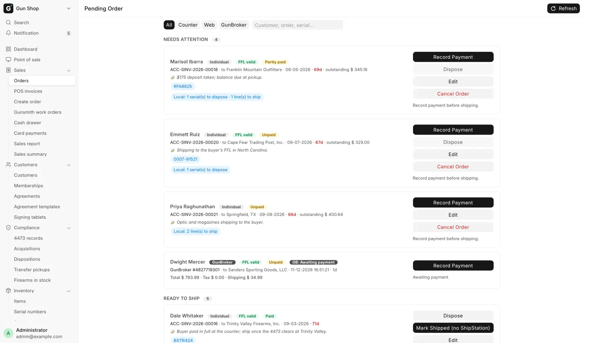

# Pending Orders

For counter staff, several times a day, to see every order that still owes something: a gun to book out, money to collect, goods to order or receive, or a parcel to ship.

Open it from **Orders** under **Sales** in the sidebar. The page is titled **Pending Order**.

<figure markdown>
{ .screenshot }
<figcaption>Filter chips and search on top, then the orders grouped by what has to happen next. Each card carries only the buttons that order is allowed.</figcaption>
</figure>

## Before you start

- You need one of these roles: Sales User, Sales Manager, Stock Manager, or System Manager.
- **Refresh** at the top right reloads the queue. The page also reloads when you come back to it and after every action.
- An empty queue reads "Nothing waiting — every order is shipped and paid."
- New web and GunBroker orders, and distributor parcels shipped to the store, also ring the notifications bell.

## Three kinds of row

| Row | Comes from | Tag on the card |
|---|---|---|
| Counter order | [Create Order](build-an-order.md) | **Individual** or **Business (FFL)** |
| Web order | A paid WooCommerce order | **Web** |
| GunBroker order | A sale won on GunBroker | **GunBroker** |

What a card can do depends on which kind it is. See [Web orders](web-orders.md) and [GunBroker orders](gunbroker-orders.md) for those two. A row leaves the queue once nothing is left to book out, collect or ship, and no distributor leg is still open.

## Find a row

1. Pick a chip above the list: **All** (the default), **Counter**, **Web** or **GunBroker**.
2. Type in the search box ("Customer, order, serial…"). It matches the customer, the order number and the serials.

When nothing fits, the page reads "Nothing matches this filter."

Each card shows how many days it has waited, for example **· 3d**. Past the limit in **Pending Order overdue after (days)** on [FFL Settings](../admin/ffl-settings.md) (7 unless changed) the count turns red. Every morning managers get an email listing the counter orders that are blocked or overdue, and nothing is sent when nothing is stuck.

## The sections

Rows are grouped by the next thing somebody has to do, oldest first. The number beside each heading is how many rows it holds.

| Section | What is in it |
|---|---|
| **Needs attention** | Something blocks the row. The reason is on the card. |
| **To place with distributor** | A counter order with a draft distributor order you can place now. |
| **Waiting on distributor** | Goods on their way, or a web order still waiting for its serial. |
| **Ready to ship** | Everything is in hand and paid where it must be. |
| **Ready for pickup** | The customer collects here, and the goods are in hand. |
| **Shipped — dispose** | The parcel left and a gun still has to be booked out of the bound book. |

Why a row is in **Needs attention**:

| Reason on the card | What it means |
|---|---|
| _Distributor_ killed / short-shipped / hold / placement failed … | A distributor leg is in trouble. See [Fix a distributor leg in trouble](ship-or-hand-over.md#fix-a-distributor-leg-in-trouble). |
| Serial rejected | A serial typed on the web store did not match free stock. |
| FFL expired | The receiving license on file has lapsed. |
| Awaiting payment | A GunBroker sale whose payment has not been recorded. |
| Unpaid — record payment before shipping | An individual's order that ships still owes money. |
| Shipped on account — record payment | The goods left and the order still owes money. |

## Read a card

The top line carries the customer name and a run of badges.

| Badge | Meaning |
|---|---|
| **FFL valid** | The receiving license is on file and unexpired. |
| **FFL expired / unverified** | The license lapsed or was never verified. Dispose is blocked. |
| **Paid** / **Partly paid** / **Unpaid** | Payment state of the order. |
| **✓ Disposed** | Every gun on the order is booked out. |
| **✓ ShipStation** | The shipment was sent to ShipStation, with its number when there is one. |
| **WC** / **GB** | The live WooCommerce or GunBroker status. |
| **Serial conflict** | A serial from the web store was rejected. |
| **Awaiting signature** | The buyer has not signed an agreement this order needs. |
| **In-store pickup** | The customer collects here. Reads **In-store pickup · counter order open** once its pickup ticket is open. |

The line under it links the order's invoice, web order or GunBroker order. It then names where the goods go: the receiving dealer, the ship-to city and state, or "Counter pickup". The order date, the days waited and any balance follow, and a staff note typed on Create Order shows with a 📝 mark.

Serials show as pills. Blue pills are guns still to book out. Grey pills are guns already in the bound book, kept so a finished order still shows what it held.

A counter order with distributor legs has a second strip:

- **Local**, with the serials and lines still owed from your own stock.
- An amber pill, "_N_ firearm(s) awaiting arrival", while guns ordered to the store have not been received.
- One pill per distributor order: the distributor, **to store** for a ship-to-store leg, the order number and its status. A received leg reads **arrived** or **partly arrived**. Red means Error and amber means Hold. Click a pill to open that distributor order.

### Agreements

A counter order whose gun needs a signed agreement shows an **Agreements** strip. Each agreement (with the gun's serial, when signed per gun) reads **signed**, **sent, link open until** a date and time, **link expired**, **signature expired**, or **not signed**. The strip updates by itself when the customer signs.

To send the link again:

1. Click **Resend link**.
2. Check the email address in the dialog, and change it if needed.
3. Send it. The old link stops working.

One link covers every unsigned gun on the order, unless the agreement has **One copy per gun** ticked. Booking a gun out before the customer signs is covered under [Book the guns out](ship-or-hand-over.md#book-the-guns-out-dispose).

## Which button do I need

Each card shows only the buttons that row is allowed, and the next step for its section is highlighted. A greyed-out button has a short line under it saying why.

| Button | Use it to |
|---|---|
| **Dispose** | [Book the guns out of the bound book](ship-or-hand-over.md#book-the-guns-out-dispose) |
| **Ship** | [Send the parcel to ShipStation for a label](ship-or-hand-over.md#ship-with-shipstation) |
| **Mark Shipped (no ShipStation)** / **Mark Picked Up** | [Close the shipping without ShipStation](ship-or-hand-over.md#mark-an-order-shipped-without-shipstation) |
| **Record Payment** | [Collect money on a counter order](ship-or-hand-over.md#collect-a-payment-record-payment) |
| **Mark Payment Received** | [Record a banked GunBroker payment](ship-or-hand-over.md#record-a-gunbroker-payment) |
| **Pickup** / **Open counter order** | [Hand a gun over at the counter](ship-or-hand-over.md#hand-a-gun-over-at-the-counter-pickup) |
| **Place order** | [Send draft distributor orders](ship-or-hand-over.md#place-the-distributor-order) |
| **Fulfill from local stock** | [Serve a line from the shelf](ship-or-hand-over.md#serve-a-line-from-the-shelf) |
| **Re-source** / **Cancel line** | [Fix a distributor leg in trouble](ship-or-hand-over.md#fix-a-distributor-leg-in-trouble) |
| **Edit** / **Cancel Order** | [Change or cancel an order](change-an-order.md) |

## Troubleshooting

| You see | Fix |
|---|---|
| Awaiting serial from WooCommerce | Enter the gun's serial on the WooCommerce Edit Order screen. |
| **Serial conflict** badge | The serial is not free stock, is the wrong item, or is held by another order. Correct it on the WooCommerce order. |
| is an individual order with an outstanding balance | Use **Record Payment**, then ship. |
| Some distributor orders were not placed | Read each reason, fix it, and place again. |
| A row you expected is missing | It may be finished. A row leaves once nothing is left to book out, collect or ship. Search **All**. |

More messages are on [Ship or hand over an order](ship-or-hand-over.md#troubleshooting) and [Change or cancel an order](change-an-order.md).
