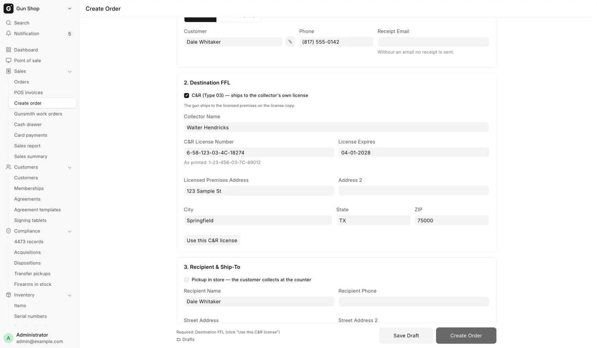

# Ship a firearm to another dealer

For counter staff, when a gun leaves the store by mail: to the buyer's own dealer, to a collector's C&R license, or to a dealer buying on its own license.

The buyer fills in their Form 4473 at the receiving dealer, not at your counter. Your job is to send the gun only to a license that is verified and current, and to book the transfer when it really leaves.

## Before you start

- The receiving dealer's license must be on file as an **ATF FFL Record**, unexpired, with a street address and a state. See [Verify an FFL](../compliance/ffl-verification.md).
- A collector's C&R license is typed in from the license copy instead. See [A C&R collector](#a-cr-collector).
- An individual buyer must pay in full before the gun leaves. A dealer buying for itself may ship on account.
- The screen itself is explained on [Build an order and its splits](build-an-order.md).

## A customer's gun to their dealer

1. Open **Create order** under **Sales** in the sidebar.
2. Click **Individual**.
3. Pick the **Customer** and check the **Receipt Email**.
4. Scan the gun's serial into **Add Item**, or pick it from the list.
5. Under **Destination FFL**, click **Lookup by FFL #**, type the **FFL Number** and click **Lookup**. A license not yet on file is fetched and created.
6. Click **Verify FFL** to check the license against ATF eZ Check. The card below shows the licensee, the address and **Valid to** with a date.
7. Check the ship-to. It fills from the license premises and locks, with "Locked to the destination FFL address (firearms ship to the FFL)."
8. Take the full payment under **Payment**.
9. Under **Fulfillment**, leave **Create only — dispose later**, or pick **Dispose & ship now** if the gun is going in the box today.
10. Click **Create Order**.

The **Destination FFL** section appears only once the order has a firearm, and not on a pickup order. The order cannot be created without one. A license that is expired, not on file, or missing a street or a valid state is refused, because the state decides sales tax.

To unlock the ship-to, clear the FFL.

## A dealer buying on its own license

1. Open **Create order** and click **Business (FFL)**.
2. Pick the dealer in **FFL (ATF Record)**, or use **Lookup by FFL #**. Click **Verify FFL** to refresh it.
3. Check the card: the licensee, the address and **Valid to**, or **Expired / unverified**.
4. Add the items and finish the order as above. Payment may be left on account.

The page finds or creates the dealer's customer record and sets the destination to their own license, so it does not ask for a separate one. A business order cannot include a distributor line.

### Tax exempt

Business buyers get **Tax Exempt (resale/exemption certificate on file)**. Ticking it drops sales tax from this order and stores the exemption on the customer when you create the order.

Click **Upload Certificate** to attach a PDF, PNG or JPG; once one is attached the page offers **view** and **replace**. The checkbox alone is what exempts the order. Whether you also need the paper certificate is a question for your accountant and your state.

## A C&R collector

A licensed collector may receive a curio or relic on their own C&R (Type 03) license. The ATF directory holds no Type 03 licenses, so **Verify FFL** and **Lookup by FFL #** never find one. You type it in from the license copy.

<figure markdown>
{ .screenshot }
<figcaption>With the C&R box ticked, the lookup buttons give way to the fields read off the license copy.</figcaption>
</figure>

1. Under **Destination FFL**, tick **C&R (Type 03) — ships to the collector's own license**.
2. Type the **C&R License Number** exactly as printed, for example 1-99-888-03-7C-12345. The fourth group must be 03.
3. Fill in **License Expires**, **Collector Name**, **Licensed Premises Address**, **City**, **State** and **ZIP**. **Address 2** is optional.
4. Click **Use this C&R license**. "C&R license saved — the order ships to the licensed premises." appears and the ship-to locks to the premises.

A collector who has ordered before is on file, and the blanks fill in. Anything you type replaces the stored value, so correct a renewed expiry or a new address here.

Ticking or unticking the box clears the destination, so the order never ships to a license that is no longer on screen. The license is checked again when the order is created, and a wrong format, a lapsed date or an unreadable state is refused with its reason.

From here it is an ordinary FFL transfer. Sales tax follows the premises state, and the gun leaves the bound book as an FFL transfer when you dispose it. How C&R orders are disposed is on [Ship or hand over an order](ship-or-hand-over.md).

## Sales tax

Tax follows the receiving license's premises state. Another state's premises means no sales tax; your own state means the normal rate. See [Sales tax follows the ship-to](ship-to-customer.md#sales-tax-follows-the-ship-to).

## Ship it

If you picked **Create only — dispose later**, the order waits on [Pending Orders](pending-orders.md). When the gun is boxed, dispose and ship it there. See [Ship or hand over an order](ship-or-hand-over.md).

!!! warning "Dispose is a bound book entry"
    Disposing books the transfer to the receiving license in the bound book. Do it only when the gun is really leaving. Undoing it means cancelling the whole order.

## What happens next

- The disposition is booked to the receiving license and sent to [FastBound](../admin/fastbound.md).
- The gun leaves stock.
- With ShipStation, the shipment appears there so you can buy the label.

## Troubleshooting

| You see | Fix |
|---|---|
| Required: Destination FFL | Pick and verify the receiving dealer |
| Required: Destination FFL (click "Use this C&R license") | Click **Use this C&R license** |
| Destination FFL … is not on file — verify it first. | Use **Lookup by FFL #**, then **Verify FFL** |
| Destination FFL Expired | Run **Verify FFL** to refresh it. If it is still expired, ask the buyer for another dealer |
| Destination FFL Address Incomplete | Run **Verify FFL** again. If it stays incomplete, ask a manager to complete the ATF FFL Record |

C&R refusals and other messages: [Troubleshooting](../help/troubleshooting.md).
