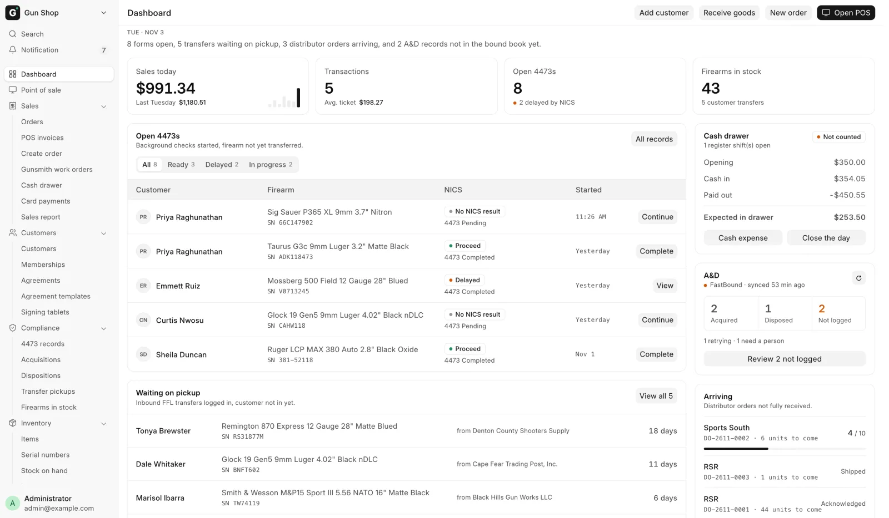
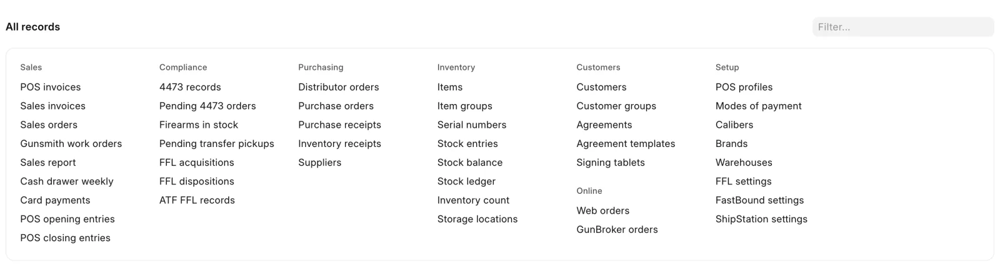
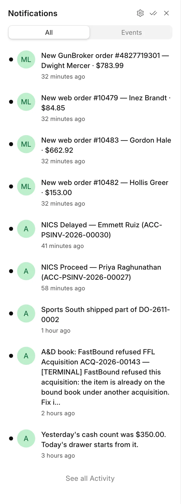

# The Dashboard

For everyone, every morning and through the day: the Dashboard shows what is waiting on someone today. Open 4473s, transfer guns waiting for their owner, the cash drawer, the bound book and distributor orders on the way.

<figure markdown>
{ .screenshot }
<figcaption>Today's figures across the top, the 4473 and pickup lists on the left, the drawer, the bound book and arriving orders on the right.</figcaption>
</figure>

## Getting here

The Dashboard opens by itself when you sign in. To come back from anywhere, click **Dashboard** at the top of the sidebar.

The page refreshes its figures every minute while it is on screen, so you can leave it open on a back-office screen.

## What you see depends on your login

Each block checks your roles on its own. A block you are not allowed to see is left out, and the rest moves up. A counter clerk sees no stock count, and a receiving helper sees no sales figures.

If one block fails to load it says **This could not be loaded. The rest of the page is up to date.** Every other block still works.

The page opens for **Sales User**, **Sales Manager**, **Stock User**, **Stock Manager**, **Accounts User** and **System Manager**. See [Roles and sign-in](roles.md).

## The buttons at the top

| Button | Opens |
|---|---|
| **Open POS** | The register. See [Sell accessories](../counter/sell-accessories.md) |
| **New order** | Create Order. See [Build an order](../orders/build-an-order.md) |
| **Receive goods** | [Receive goods](../stock/receive-goods.md) |
| **Add customer** | A new [customer](../counter/customers.md) record |

A button only shows when your login can open the page behind it.

Under the date, one sentence sums up what is waiting, for example "3 forms open, 5 transfers waiting on pickup, and 2 distributor orders arriving." When nothing is waiting it reads **Nothing is waiting on anyone right now.**

## The figures across the top

| Tile | What it shows |
|---|---|
| **Sales today** | Today's net sales, returns included, against the same weekday last week, with bars for the last seven days. Click it for the [Sales Report](../manager/sales-report.md). |
| **Transactions** | How many sales today, not counting returns, and the **Avg. ticket**. |
| **Open 4473s** | Firearm orders parked for a 4473, and how many NICS delayed. |
| **Firearms in stock** | Every gun on the books, and how many are customer transfers. Click it for Firearms In Stock. |

The sales tiles use the Sales Report's own figures, so the two always agree.

## Open 4473s

Background checks started, firearm not yet handed over. The tabs sort the parked orders by NICS result:

| Tab | Holds |
|---|---|
| **All** | Every parked firearm order, Denied included |
| **Ready** | NICS came back **Proceed** |
| **Delayed** | NICS came back **Delayed** |
| **In progress** | No NICS result yet |

Each tab lists its five newest orders: customer, gun and serial, NICS result, and when it started. The button on a row says what to do next:

- **Complete** on a Proceed order opens it so you can finish the sale.
- **Continue** on an order with no NICS result yet.
- **View** on anything else.

**All records** at the top of the card opens the 4473 records report. See [Sell a gun](../counter/sell-a-gun.md) and [Find a 4473](../compliance/4473-records.md).

## Waiting on pickup

Customer transfer guns logged in, owner not in yet. The four guns that have waited longest are listed, oldest first, with who shipped them and how many days they have sat. A gun past 21 days turns amber.

**View all** opens the whole Pending Transfer Pickups report. See [Customer transfers](../counter/transfers.md).

## Cash drawer

What the drawer should hold right now, from the books:

| Line | Meaning |
|---|---|
| **Opening** | What the last count carried forward |
| **Cash in** | Cash sales, payments and cash from the bank since then |
| **Paid out** | Refunds, seller payments, deposits and expenses since then |
| **Expected in drawer** | What a count should find |

The pill on the right reads **Counted** once someone has closed today's drawer, and **Not counted** until then. **Cash expense** and **Close the day** both open the [Cash drawer](../counter/cash-drawer.md) page, where you do the work.

## A&D

Today's bound-book activity, when FastBound is switched on. With FastBound off the card says **FastBound off**.

- **Acquired** and **Disposed** count today's bound-book entries.
- **Not logged** counts records made here more than 15 minutes ago that FastBound does not have yet. The line under it splits them into those the system is retrying and those that need a person.
- The small refresh button recounts now.

**Review N not logged** opens the **Not in the bound book yet** list: each record, its state (**Will retry** or **Needs a person**) and the last error. "Will retry" records are pushed again by the daily retry. "Needs a person" means someone has to fix the cause and push again. See [FastBound](../admin/fastbound.md#failed-pushes).

!!! warning "Federal recordkeeping"
    A record on this list is in this system but not yet in the bound book of record. Work the "Needs a person" ones the same day.

## Arriving

Distributor orders not fully received, in the order Receive Goods lists them. Each row shows the distributor, the order number and how many units are still to come, with a bar once part has arrived.

**Receive goods** at the foot of the card opens [Receive goods](../stock/receive-goods.md). A distributor gives no arrival date, so "shipped" in the bell is the last news about an order. Watch **Arriving** for what is still to come.

## All records

<figure markdown>
{ .screenshot }
<figcaption>Every list, report and setting, grouped. Type in Filter… to narrow it.</figcaption>
</figure>

At the foot of the page, **All records** lists every list, report and setting your login can open, in groups: **Sales**, **Compliance**, **Purchasing**, **Inventory**, **Customers**, **Online** (while a web store or GunBroker is on), one group per switched-on extension, and **Setup** last. Type part of a name in **Filter…** to narrow it.

Lists and reports with no place in the sidebar live here, for example **Pending 4473 orders**, **Cash drawer weekly**, **Inventory receipts**, **POS opening entries** and **FFL settings**.

The sidebar is described in [Your first day](first-day.md#the-sidebar).

## Notifications

<figure markdown>
{ .screenshot }
<figcaption>A NICS result, a new web order and a distributor shipment, each linked to its record.</figcaption>
</figure>

**Notification**, the bell near the top of the sidebar, shows a count when something new arrives. Click it to open the list, and click an entry to open its record.

| Event | Example | Who gets it |
|---|---|---|
| A NICS result lands on a sale: Proceed, Delayed or Denied | NICS Delayed — Jane Doe | Sales User, Sales Manager, System Manager |
| A delayed check clears | Delayed NICS cleared: Proceed — Jane Doe | Sales User, Sales Manager, System Manager |
| A paid web order or a GunBroker order comes in | New web order #1001 — Jane Doe · $612.40 | Sales User, Sales Manager, Stock Manager, System Manager |
| A distributor ships an order to the store, in full or in part | RSR shipped DO-2601-0001 | Sales User, Sales Manager, Stock Manager, System Manager |
| FastBound refuses a bound-book record for good | A&D book: FastBound refused … — reason | Sales Manager, Stock Manager, System Manager |

These notices stay in the app and none is emailed. Each rings once per event, so a repeated message from FastBound or the web store does not ring twice. The shared **Administrator** login never receives them.

The same list carries the system's own notices too, such as a to-do assigned to managers when a sale cannot be posted.
