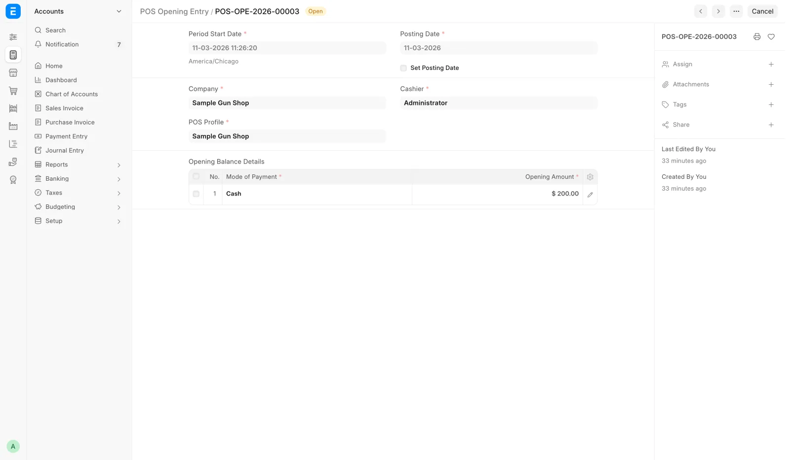
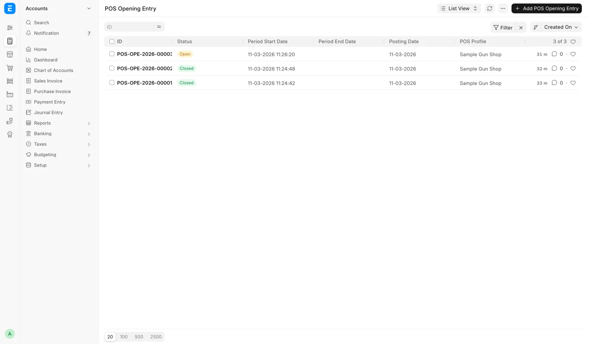

# A day at the counter

For counter staff and shift leads: one working day from opening the register to counting the drawer, with links to each task.

## 1. Check what is waiting

Start on the [Dashboard](dashboard.md). It takes five minutes.

1. **Cash drawer** card: yesterday should read counted. If it still reads **Not counted**, count the drawer now on the [Cash drawer](../counter/cash-drawer.md) page.
2. **Open 4473s**: ring the Delayed customers whose Brady date has passed, and clear anything denied. See [Daily checks](../compliance/daily-checks.md).
3. **Waiting on pickup**: ring whoever's gun has sat longest. See [Customer transfers](../counter/transfers.md).
4. **A&D**: **Not logged** should read 0. Work anything that needs a person. See [FastBound](../admin/fastbound.md#failed-pushes).
5. The bell: NICS results, new web and GunBroker orders, distributor shipments, bound-book refusals, and any to-do about a sale that could not post.

## 2. Open the register

The register runs on shifts. When you open **Point of sale** and no shift is running, the **Create POS Opening Entry** dialog appears.

1. Check **Company**.
2. Pick the **POS Profile** for this register.
3. In **Opening Balance Details**, enter an **Opening Amount** for each mode of payment, or leave them at zero.
4. Click **Submit**.

<figure markdown>
{ .screenshot }
<figcaption>The shift the dialog opens: an opening amount for each mode of payment.</figcaption>
</figure>

The drawer's opening figure does not come from this dialog. The [Cash drawer](../counter/cash-drawer.md) page carries the last count forward as the next day's opening.

### Several clerks, one shift

Only one shift runs on the register at a time, and everyone shares it. The second person to open the register that day joins the shift already open, whoever started it.

!!! note "Your name is still on your own sales"
    Sharing a shift does not share credit. Each sale records the person who rang it, and each 4473 attestation records the person who confirmed it.

## 3. Sell

| The customer wants to | Go to |
|---|---|
| Buy ammo, optics or accessories | [Sell accessories](../counter/sell-accessories.md) |
| Buy a gun and take it home | [Sell a gun](../counter/sell-a-gun.md) |
| Collect their own gun shipped in by another dealer | [Customer transfers](../counter/transfers.md) |
| Trade a gun in | [Trade-ins](../counter/trade-ins.md) |
| Order something, or have it shipped | [Orders and shipping](../orders/index.md) |
| Pay by card, Zelle, check or split | [Take payment](../counter/payments.md) |

Everything else is on [At the counter](../counter/index.md).

## 4. Close the day

At the end of the day, count the drawer and click **Close the day** on the [Cash drawer](../counter/cash-drawer.md) page. That one step:

- closes every register shift still open and posts the day's register sales;
- records any difference between your count and the books, with a reason when it is large;
- carries the count forward as the next day's opening.

The count is the only record of the cash in the drawer. Nothing else in the system counts it. A customer's check or money order goes to the bank, so it is not part of the drawer count.

## What happens overnight

- At 23:00 store time, any shift still open is closed and its sales are posted. This close never counts the cash, so the drawer reads **Not counted** until someone counts it. The next real count covers every day since the last one.
- A shift opened in the last hour before 23:00 is left for the next night.
- Firearm sales do not wait: a gun leaves stock the moment its sale completes.
- Every fifteen minutes the system re-posts any sale that missed its close. If one keeps failing, managers get a to-do naming it, and the to-do closes itself once the sale posts.

The register's own **Close the POS** menu item closes one shift but never counts the cash. Use **Close the day** instead.

Closing a stale shift by hand, outside the register, is for a **Sales Manager**, **Stock Manager** or **System Manager**.

<figure markdown>
{ .screenshot }
<figcaption>Every shift the register has run, newest first. Yesterday's should all read Closed.</figcaption>
</figure>

If a shift from yesterday is still Open on the **POS Opening Entry** list (under **All records** on the Dashboard), last night's close missed it. Close the day on the Cash drawer page.

## Troubleshooting

| You see | Fix |
|---|---|
| **Please add Mode of payments and opening balance details.** | Pick a POS Profile so its payment modes load, then enter the amounts |
| **POS Opening Entry Cancelled** or **Outdated POS Opening Entry** | Refresh the page; open a new shift if asked |
| **A register shift did not close** after Close the day | Your count is saved. A manager closes that shift by hand |
| A shift from a previous day is still Open | Close the day on the Cash drawer page, then check that yesterday's sales posted |
