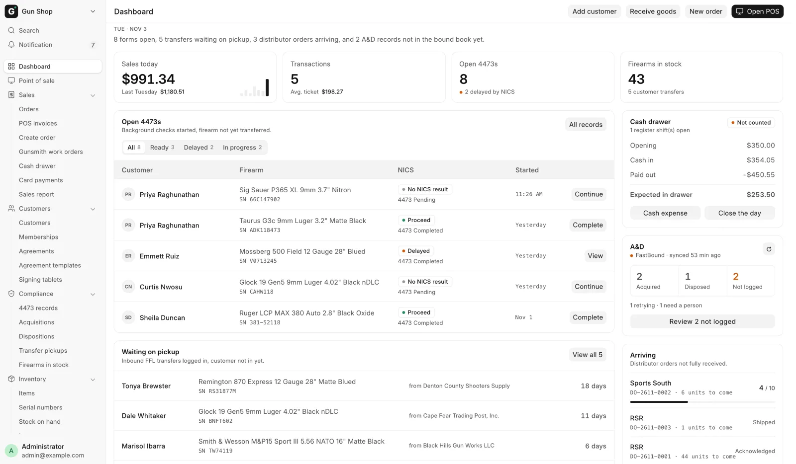
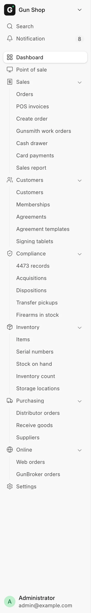

# Your first day

For anyone new to the store's system, on their first day. It shows you how to get around; [A day at the counter](day-at-the-counter.md) then walks through a full day.

## Sign in

Open the store's system address in a browser and sign in with the email address and password your manager gave you. Every person has their own login, because the system records who rang each sale, received each gun and attested each 4473. See [Roles and sign-in](roles.md).

After you sign in you land on the **Dashboard**. A link someone sends you to a specific record still opens that record.

## The Dashboard

<figure markdown>
{ .screenshot }
<figcaption>The Dashboard: what is waiting today, with the sidebar on the left.</figcaption>
</figure>

The Dashboard shows today's sales, firearm orders waiting on a 4473, transfer guns waiting for their owners, the cash drawer, the bound book and distributor orders on the way. Its buttons open the register, a new order, Receive Goods and a new customer. [The Dashboard](dashboard.md) explains every block.

## The sidebar

<figure markdown>
{ .screenshot }
<figcaption>The sidebar every Gun Shop page shares.</figcaption>
</figure>

The sidebar on the left is the way around, and it is the same on every page. Click a group name to open or close it.

| Row or group | What it holds |
|---|---|
| **Dashboard** | The [Dashboard](dashboard.md) |
| **Point of sale** | The register: [Sell accessories](../counter/sell-accessories.md), [Sell a gun](../counter/sell-a-gun.md) |
| **Sales** | **Orders**, **POS invoices**, **Create order**, **Cash drawer**, **Card payments**, **Sales report** |
| **Customers** | **Customers** |
| **Compliance** | **4473 records**, **Acquisitions**, **Dispositions**, **Transfer pickups**, **Firearms in stock** |
| **Inventory** | **Items**, **Serial numbers**, **Stock on hand**, **Inventory count**, **Storage locations** |
| **Purchasing** | **Distributor orders**, **Receive goods**, **Suppliers** |
| **Online** | **Web orders**, **GunBroker orders** |
| **Settings** | The [Settings](../manager/settings.md) workspace, mostly for managers |

A row for something your store has switched off is hidden: **Web orders** without the web store, **GunBroker orders** without GunBroker, **Card payments** without the Payroc terminal. A group with nothing left in it is hidden too. An extension that is switched on can add its own group above **Settings**.

Anything that is not in the sidebar is under **All records** at the foot of the Dashboard. Type part of a name in its **Filter…** box.

!!! note "Orders is Pending Orders"
    The sidebar calls the queue of open orders **Orders**. This guide calls it [Pending Orders](../orders/pending-orders.md). They are the same page.

## The bell

**Notification**, the bell near the top of the sidebar, shows a count when something new arrives: a background check result, a web or GunBroker order, a distributor shipment, or a bound-book refusal. Click an entry to open its record. These notices stay in the app and are never emailed. See [the full list](dashboard.md#notifications).

## Find anything

Press ++ctrl+k++ (++cmd+k++ on a Mac) anywhere to open the search bar. The same search sits at the top of the sidebar as **Search**. Type part of a customer name, a serial number, an invoice number or a page name, and pick from the list.

Press ++shift+slash++ to see the **Keyboard Shortcuts** for the page you are on.

## Models and serial numbers

The system keeps one record per model (an **Item**, such as one pistol model) and one record per physical gun (a **Serial No**). Ammunition, optics and parts are counted by quantity, with no serial numbers. A firearm can be priced on the model, or gun by gun on each serial. See [Models, serials and prices](../stock/items-and-serials.md).

## Dark mode and language

Your theme and language are remembered for your login on every device.

To switch the theme:

1. Click your own name at the foot of the sidebar and choose **Settings**.
2. Open **Appearance**.
3. Under **Theme**, pick **Light**, **Dark** or **Automatic**. Automatic follows the device's own setting.

Or press ++ctrl+shift+g++ to open the **Switch Theme** dialog.

To switch the language, open the same **Settings**, go to **Preferences** and click **Change Language**.

## Where to find help

- [Troubleshooting](../help/troubleshooting.md) for a message you do not recognize.
- [Glossary](../help/glossary.md) for a term you do not recognize.
- **What's New in POS** for what changed in the latest update. Click the store name (**Gun Shop**) at the top of the sidebar, then choose **What's New in POS**. The notes also open once by themselves the first time you sign in after an update.

When a control refuses to do something, read its message. It names the setting or the person that can unblock it.
