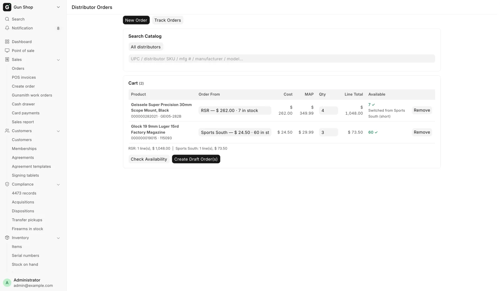
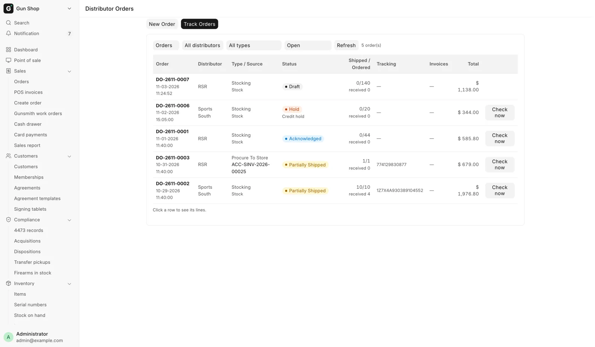
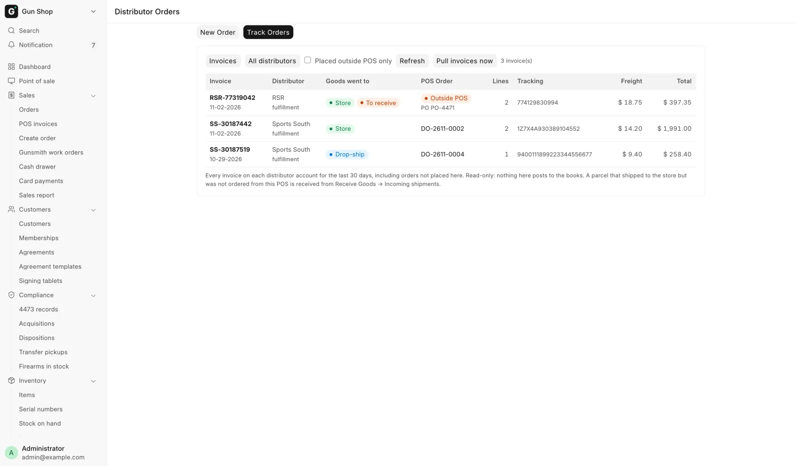

# Order from a distributor

For purchasing staff and managers, when you buy stock for your own shelf from a wholesale house, or follow an order already on its way.

You search every house at once, build one cart and create draft orders. A person confirms each order before anything is placed. Nothing on this page places an order by itself.

## Before you start

- The page opens for System Manager, Purchase Manager, Purchase User and Stock Manager. The same roles create, confirm and cancel orders.
- A house needs **Enabled** and **Stocking** ticked on the distributors hub to take an order. See [Distributor setup](../admin/distributors.md).
- Open **Distributor orders** under **Purchasing** in the sidebar. The page has two tabs: **New Order** and **Track Orders**.

## New Order

<figure markdown>
{ .screenshot }
<figcaption>One search across every enabled house. Each cart line shows the house it will be ordered from.</figcaption>
</figure>

1. Type into **Search Catalog**. It searches UPC, distributor SKU, manufacturer number, manufacturer and model after two characters. To search one house, pick it in the box above, which starts on **All distributors**.
2. Read the row. **Distributor · Cost · Qty** lists every house that carries it. The cheapest house that can fill one unit is in bold. An **FFL** tag means the item needs a license.
3. Set **Order Qty** and press **Add**. Adding the same product again raises the quantity.
4. Check **Order From** on each cart line. It starts on the cheapest house that holds enough. Pick another house to override it.
5. Press **Check Availability**. **Available** shows each house's live count with ✓ or ✗. A short line moves to a house that can fill it and reads "Switched from _House_ (short)". This is a check, not a reservation.
6. Press **Create Draft Order(s)**. **Created Orders** lists each order made.
7. Press **Confirm & Queue** on each order, or **Confirm & Queue All**. See [Confirm and queue](#confirm-and-queue).

The totals line under the cart gives the line count and cost per house. MAP and MSRP are shown for judgement only; nothing clamps a price to MAP.

### How the cart is split

**Create Draft Order(s)** makes at least one order per house, and more where it must:

- Firearms and accessories never travel on the same order.
- A cart over 400 SKUs is split into several orders.
- Different lanes use different accounts at the house, so they are separate orders.

Orders made here are **Stocking** orders. If one house refuses, its lines stay in the cart so you can fix them and try again.

## Confirm and queue

Confirming is the moment the order becomes real. The dialog asks "Confirm and queue ... for placement?" because placement cannot be undone from your side. A retry never places the same order twice.

Open an order from **Created Orders** or **Track Orders** to see its buttons:

| Button | Shown when | What it does |
|---|---|---|
| **Confirm & Queue** | The order is Draft | Confirms and sends it for placement |
| **Shipping service…** | Draft, and the house offers a choice | Picks the carrier service. The amount is an estimate |
| **Receive** | A line is invoiced and not yet received | See [Receive a distributor delivery](receive-distributor.md) |
| **Check status now** | The order is live at the house | Pulls invoice, tracking and serials now |
| **Cancel Order** | Not Complete or Cancelled | Under **Actions**. Asks for a reason |

An order raised from a counter sale may be placed on a deposit, because the goods land on your own shelf. The customer still pays the balance before taking them.

!!! warning "Cancelling after placement"
    Cancelling an order that is live at the house marks it Cancelled here and withdraws nothing at the house. Phone or email the house first. In the cancel dialog, tick **_House_ has confirmed the cancellation (phone / email)** once they agree; leave it clear and operations are alerted to arrange it.

## Track Orders

**Track Orders** has two views, picked in the first box: **Orders** and **Invoices**. **Refresh** reads the view again.

### Orders

<figure markdown>
{ .screenshot }
<figcaption>Every open distributor order, whatever it is for, with what has shipped and arrived.</figcaption>
</figure>

Every distributor order is listed: stocking orders and ship-to-store orders for a customer. Filter by house, type and status; status starts on **Open**.

| Column | Shows |
|---|---|
| **Type / Source** | The order type, and the sale it is for. **Stock** for the shelf |
| **Status** | Where it is, with the house's hold reason or error |
| **Shipped / Ordered** | Units invoiced against ordered, and received here |
| **Tracking**, **Invoices** | What the house has reported |

Click a row to see its lines. RSR orders stay open until RSR has really shipped them, and the real tracking number appears when it does.

Statuses refresh from each house every 30 minutes. A Stock Manager or System Manager can press **Check now** on a live order.

**Placed outside POS, not invoiced yet** lists orders placed on a house's account somewhere else, such as its website or by phone. Only a house that can list its orders appears (Sports South).

### Invoices

<figure markdown>
{ .screenshot }
<figcaption>Every invoice on each distributor account, matched to a POS order or marked Outside POS.</figcaption>
</figure>

Every invoice on each distributor account from the last 30 days, whoever placed the order. Invoices are pulled every hour. **Pull invoices now** asks at once; press **Refresh** a minute later. Tick **Placed outside POS only** to see the ones no POS order matches. Click a row to see its lines, including the serial numbers the house shipped.

**POS Order** shows the matching order, or an **Outside POS** pill. For a parcel that came to the store with no POS order, **Goods went to** also reads **Received** or **To receive**. Receive it from Receive Goods → **Incoming shipments**. See [Receive a distributor delivery](receive-distributor.md).

"Likely POS order _DO-…_ — awaiting link" means the invoice matches an open POS order. The status poll links the two; receive the order. This view is read-only.

## The status walk

| Status | Meaning |
|---|---|
| **Draft** | Not yet confirmed. Nothing sent |
| **Queued** | Confirmed, waiting to be placed |
| **Placed** | The house has the order |
| **Acknowledged** | The house accepted it and said what it will ship |
| **Hold** | The house is holding it. The reason is on the order |
| **Partially Shipped** | Some lines shipped. More may follow |
| **Complete** | Finished |
| **Cancelled** | Ended without completing |
| **Error** | Placement failed. It can be queued again once fixed |

When the house ships, the bell rings: "_House_ shipped _DO-…_" or "_House_ shipped part of _DO-…_", with the customer's name when the order is for one. The house gives no arrival date. The Dashboard's **Arriving** card lists orders not yet fully received.

Live orders are checked every thirty minutes, slowing to every two hours, with an alert once an order sits unchanged for fourteen days.

## Freight on the fulfillment plan

When a counter order has distributor lines, the [fulfillment plan](../orders/build-an-order.md#plan-fulfillment-the-splits) shows a column per house, in the priority order set on the hub. On a cost tie the higher-priority house wins.

A greyed **Ship to store** button means the house cannot fill the line, with the reason underneath:

| Reason | Why |
|---|---|
| ship to store is switched off for this distributor | **Stocking** is off for that house |
| insufficient distributor stock | The house holds fewer than the line needs |

The line under the grid names the legs and shows the sale total, distributor cost, estimated freight and margin. One line per distributor order follows with **to store**, the line count and the freight or **free**. A house's firearms and accessories count as separate orders.

- The estimate comes from each house's Freight tab. It reads **(partial)** when a house could not estimate, and that house reads **freight unknown**. The invoiced freight always replaces it.
- RSR sells full cases at its case price when shipped to the store. The cell then reads, for example, **Ship to store: Case of 50 at $7.83 each — 20 more fill a case**, and the order line shows the same under **Case Price**.
- Drop-ship lines pay the unit cost, and the cost RSR acknowledges replaces the estimate.
- A Lipsey's order to the store is not estimated. A Sports South order to the store uses its store shipping rule.
- A Sports South order shows **Signature**, **Adult signature** and **Insurance** checkboxes, starting from its settings. Changing one updates the estimate and goes to Sports South with the order.

After **Apply plan**, planned lines are tagged **Ship to store** with the house, and the note "Ordered to the store — serial assigned and held when it arrives" on a firearm, or "Ordered to the store — ships once it arrives" otherwise. **Fulfillment** then lists the legs with **Estimated distributor freight**.

When you edit an order whose distributor order is placed, those lines show one greyed cell, "Already ordered on … — not re-routable here", and their freight is not quoted again.

## Troubleshooting

| You see | Fix |
|---|---|
| Cart is empty. | Search and add lines first |
| Can't order from _House_: distributor _House_ is not enabled. | Order from another house, or ask a manager to turn **Enabled** on |
| Can't order from _House_: ship to store is switched off for this distributor. | Order from another house, or ask a manager to turn **Stocking** on |
| Distributor order short-shipped: _DO-…_ (alert email) | The house shipped fewer units. If the order was for a customer, deal with the short units by hand |
