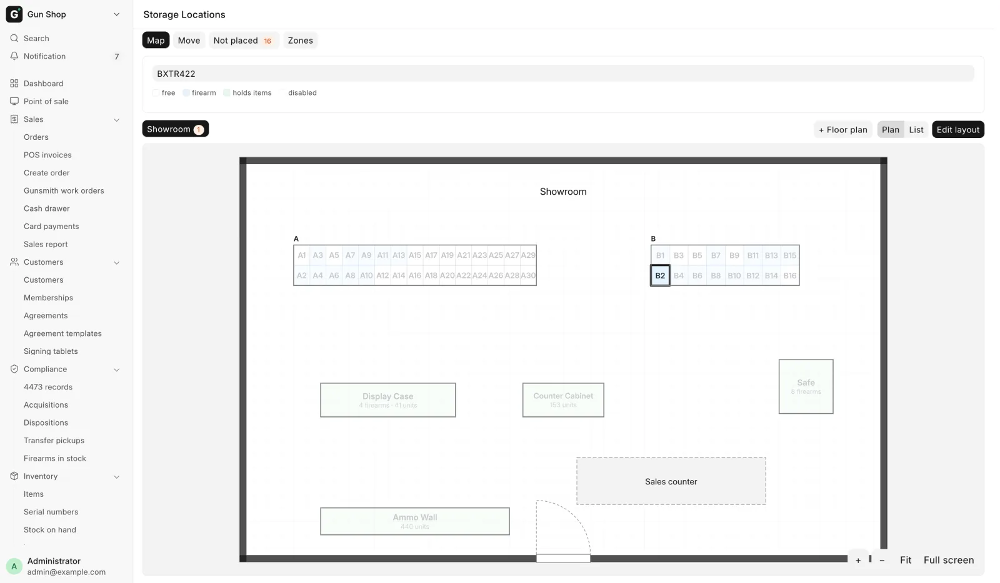
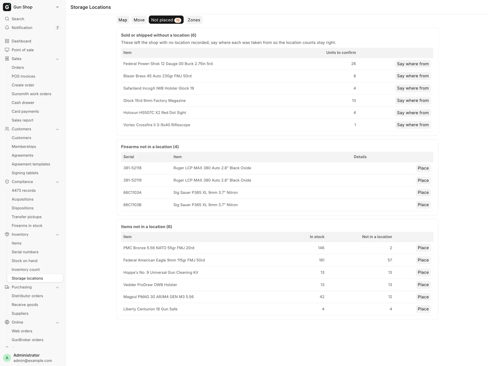

# Find and move stock

For counter and stock staff, when you need to find where a gun sits, put stock away, or move it to another rack, case or safe.

The **Storage Locations** page shows where every gun and product sits in the shop. Open it from the sidebar: **Inventory**, then **Storage locations**.

<figure markdown>
{ .screenshot }
<figcaption>The Map tab shows the floor plan with each rack's slots. A search lights up one gun.</figcaption>
</figure>

!!! note "A location is only a note"
    Nothing on this page moves stock or touches the books. A location records where something sits in the shop. The stock, its warehouse, its value and the bound book stay exactly as they were.

## Before you start

- Sales User, Sales Manager, Stock User, Stock Manager and System Manager can view the map, search, move things and use the **Not placed** tab.
- Setting up zones and drawing the floor plan is for a Stock Manager or System Manager. See [Set up the store map](../manager/store-map.md).
- There are two kinds of location:
    - A **slot** holds one firearm and nothing else. Slots are numbered within their zone: A1, A2, A3.
    - An **open** location (a display case, rack or safe) holds any number of guns and products.
- Each location can have a printed label with a barcode. The **Move** tab reads it.

## Find a gun

On the **Map** tab, a slot is white when free and blue when it holds a gun. An open location is green when it holds something. A disabled one is faded.

1. Type a serial number, a model or a location name in the box that reads "Find a gun by serial or model, or a location by name". Matching locations light up. If the match is in another room, the map switches to that room.
2. When the store has floor plans, pick a room from the plan buttons above the map. **Plan** shows the drawing; **List** shows each zone as a grid.
3. Zoom with **+** and **−**, or pinch on a phone or iPad. **Fit** shows the whole room. **Full screen** fills the screen; **Close** or Esc leaves it.
4. Tap a slot or case to see what is in it: **Serial**, **Item** and **Details** for guns, **Item** and **Qty** for other stock.
5. To put something there, click **Put things here**. The **Move** tab opens with this location chosen.

Zones that are on no floor plan are listed under **Not on a plan yet**, below the map.

## Put stock away or move it

1. Click **Move**.
2. Scan a location label. The page shows **Putting things into** and the location.
3. Scan each gun's label (its serial number) or each product's barcode. Each one goes into that location.
4. For several units of one product, type the number in **Qty** before you scan it. Qty goes back to 1 after each scan.
5. To switch location, scan another location label, or click **change**.

If a product sits in more than one place, the **Where is it coming from?** window asks you to pick one in **Take from**. Click **Move**. Units that are in no location yet are used first, without asking.

**This session** lists what you moved. Click **Undo** on a row to put it back. Undo works once, and only while nothing has moved it since.

## The Not placed tab

The tab shows a number when something needs a place.

<figure markdown>
{ .screenshot }
<figcaption>Three lists: things that left without a location, and guns and products that are in no location.</figcaption>
</figure>

| List | What to do |
|---|---|
| **Sold or shipped without a location** | Click **Say where from**, pick the place in **Location they were taken from**, check **Units**, click **Confirm** |
| **Firearms not in a location** | Click **Place**, pick a free **Location**, click **Place** |
| **Items not in a location** | Click **Place**, pick a **Location**, check **Quantity**, click **Place** |

**Units to confirm**, **In stock** and **Not in a location** show the numbers on each row. A sale or shipment is never held up by a missing location; the units wait on the first list instead.

## Where else a location is asked

Other screens ask for a location as goods come in or go out, and each one feeds this page.

| Screen | Field |
|---|---|
| [Receive goods](receive-goods.md), each line | **Storage location**. Several guns on one line fill the next free slots |
| The Trade-in window ([Trade-ins](../counter/trade-ins.md)) | **Storage location** |
| A non-firearm line at the register ([Sell accessories](../counter/sell-accessories.md)) | **Taken from** |
| A stock line on Create Order ([Build an order](../orders/build-an-order.md)) | A dropdown that starts at "Taken from: not said" |
| **Dispose** on a web or GunBroker order ([Ship or hand over](../orders/ship-or-hand-over.md)) | **Where did these come from?** |

Any of these may be left blank. A blank on the way in puts the stock on **Firearms not in a location** or **Items not in a location**. A blank on the way out puts it on **Sold or shipped without a location**.

When a product sits in one place only, and none of it is unplaced, the register, Create Order and Dispose pick that place for you. Guns are offered free slots and open locations; other stock only open locations.

The **Storage Location** field on a Serial No cannot be typed in. Change it here. The **Firearms In Stock** report shows each gun's location; see [Reports](../manager/reports.md).

## What happens next

- Every placement, move and undo is logged with who did it.
- A gun's location clears when it leaves the shelf: sold, transferred out, disposed or held for a customer. A move between the store's own warehouses keeps the location.
- Sold units leave the location their line named, and a return puts them back.

## Troubleshooting

| You see | Fix |
|---|---|
| "{slot} already holds {serial}. A slot holds one firearm…" | Pick a free slot, or move the other gun out first. |
| "{slot} is a single-firearm slot, and {item} is not a firearm…" | Only guns go in slots. Pick a display case, rack or safe. |
| "Scan a location label first (like A5), then scan what goes in it." | Scan the location label, then the goods. |
| "{code} is not a serial number or barcode the system knows…" | Type the serial, or ask a manager to add the barcode to the item. |
| "{location} holds only {n} of {item}…" | Lower **Qty**, or pick the location that really has it. |

Other messages from this page are on [Troubleshooting](../help/troubleshooting.md).
