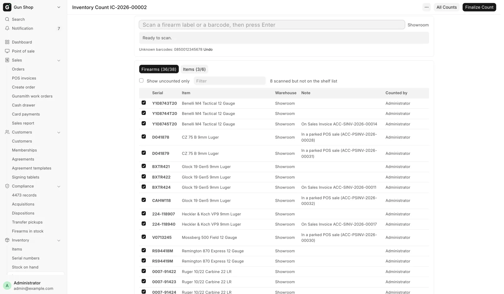
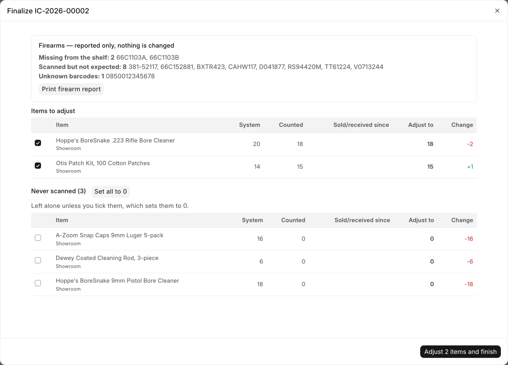

# Count the shop

For stock staff who walk the shop with a scanner, and the stock manager who finishes the count, when you check the shelves against what the system says.

Finishing a count corrects ammo and accessory quantities in one step. Any firearm that is missing or out of place is reported for a person to look into, never changed.

<figure markdown>
{ .screenshot }
<figcaption>An open count: the scan box, the Firearms and Items tabs, and what has been counted so far.</figcaption>
</figure>

## Before you start

- Open the page from the sidebar: **Inventory**, then **Inventory count**. The page title is **Inventory Count**.
- **Stock User**, **Stock Manager** and **System Manager** can start a count and scan into it. Counter accounts (Sales User, Sales Manager) cannot open the page.
- Only a **Stock Manager** or **System Manager** can finish (**Finalize Count**) or cancel a count.
- Count a gun by scanning its FastBound label: the barcode is the serial number. You can also type the serial.
- Count ammo, optics and accessories by scanning the UPC. Each scan adds 1.
- Several people can scan into one count at once, from different devices. Every scan saves the moment it is made, and a count can stay open for days.
- You can keep selling while you count. Close the register before you finish, though: an item with an unclosed register sale cannot be adjusted.

## Start a count

1. Click **New Count**. Earlier counts are listed below it, with **Continue** on an open one and **View** on a finished one.
2. In **Warehouses**, pick the warehouses to count. Leave it empty for the whole store.
3. In **Item groups**, pick the groups to count, for example only ammunition. Leave it empty for every group. A group includes the groups under it.
4. Leave **Include guns held for customers** ticked to count guns held for pickup too.
5. Click **Start Counting**.

Anything outside the warehouses and groups you picked never shows as a difference.

## Scan the shop

1. Click in the box that reads "Scan a firearm label or a barcode, then press Enter".
2. If the count covers more than one warehouse, pick the one you are standing in, next to the scan box.
3. Scan each firearm label and each product barcode. The bar under the box says what happened, for example "Counted {serial}."
4. For a gun whose label will not scan, open the **Firearms** tab and tick its row. **Counted by** shows "(by hand)".
5. For a case of 50 or a damaged label, open the **Items** tab and type the number in **Type a quantity**. A typed number replaces the count; scanning still adds 1.
6. For an item with no barcode that the list does not show, pick it in "Item with no barcode or stock", type the **Qty**, and click **Add item**.
7. To take back a mistake, click **Undo last** on the item's row, or **Undo** next to an unknown barcode.

Only the person who made a scan, or a Stock Manager, can remove it.

| Tab | What it lists |
|---|---|
| **Firearms** (found/expected) | Every gun expected on the shelf, with **Note** and **Counted by**. A gun not on the list is marked "Not on the shelf list" |
| **Items** (counted/total) | Each item per warehouse, with **System**, **Counted** and a badge: **OK**, **Short** or **Over** |

Tick **Show uncounted only** to see what still has to be walked to. Type in **Filter** to find a serial, model or item.

The **Note** column says why a listed gun may not be on the shelf, for example "Customer's gun (held for pickup)" or "On an open counter order". If your role can see orders, it names the order or the parked register sale.

## Finish the count

A **Stock Manager** or **System Manager** does this.

1. Click **Finalize Count**. Scanning pauses while the window is open.
2. Read **Firearms — reported only, nothing is changed**: guns **Missing from the shelf**, guns **Scanned but not expected**, and **Unknown barcodes**. Click **Print firearm report** for a paper copy.
3. Check **Items to adjust**: **System**, **Counted**, **Sold/received since**, **Adjust to** and **Change**. Untick any row you do not want adjusted.
4. Check **Never scanned**. These are left alone unless you tick them, which sets them to 0. **Set all to 0** ticks them all.
5. Read **Cannot be adjusted here**, if it appears. Fix those items, then adjust them by hand.
6. Click **Adjust N items and finish**, or **Finish count** when nothing is ticked.

<figure markdown>
{ .screenshot }
<figcaption>The Finalize window: the firearm report first, then the items to adjust.</figcaption>
</figure>

!!! warning "A missing firearm needs a person"
    The count never changes a firearm's record. A gun on **Missing from the shelf** may need an ATF theft or loss report. Find out what happened to it before you change anything in the bound book.

To cancel an open count (a wrong start or an abandoned walk), a Stock Manager opens it, opens the page menu and clicks **Cancel this count**. Nothing is adjusted, and the scans are kept.

## What happens next

- Each ticked item is set to what was counted, plus anything sold or received after it was scanned.
- Firearms are not touched: no adjustment, no disposition and nothing sent to FastBound.
- The firearm report stays with the count. Open it again from **All Counts** to see or print it.

For a one-off fix to a single item, use **Adjust Quantity** instead. See [Fix a mistake](corrections.md).

## Troubleshooting

| You see | Fix |
|---|---|
| "{code} is not a serial number or barcode the system knows…" | Ask a manager to add the barcode to the item, or click **Undo** next to it. |
| "{item} cannot be counted here: it is tracked by serial number…" | Scan the gun's own label, not the box barcode. |
| "{n} register sales from {date} are not closed yet…" | Close the register, or wait for the nightly close at 11 PM, then finalize. Or untick those items. |
| "{name} added that, so only they or a Stock Manager can remove it." | Ask them or a Stock Manager. |
| "Nothing has been counted yet. Scan something first…" | Scan first, or cancel the count. |

Other messages from this page are on [Troubleshooting](../help/troubleshooting.md).
