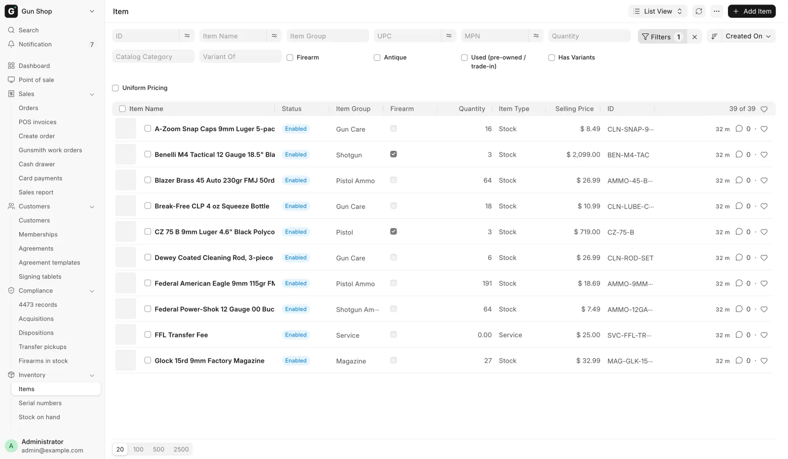
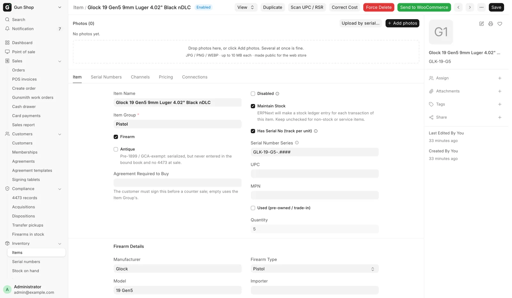
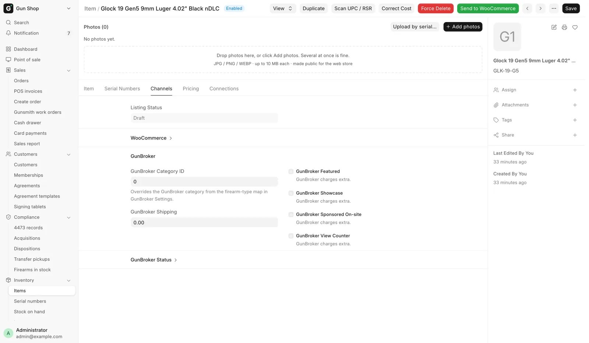
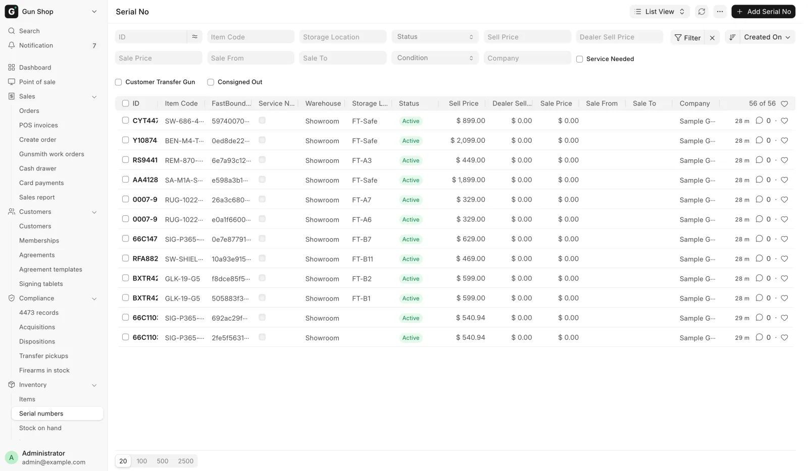
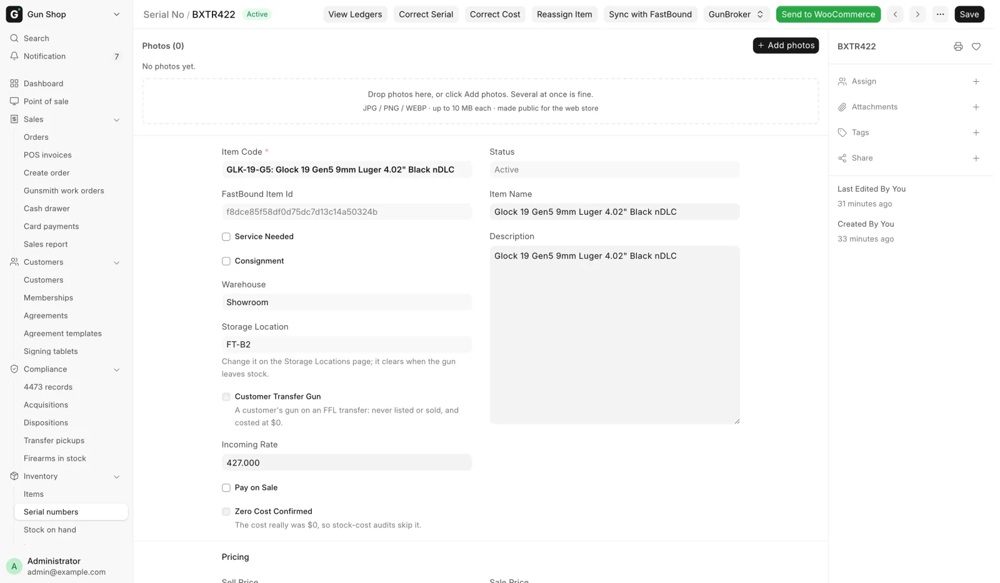

# Models, serials and prices

For anyone who receives, prices or lists guns, before your first receiving shift and whenever a price needs changing.

The store tracks firearms differently from a general retail POS. Most of the other pages follow from two things: what a record stands for, and where a gun's price lives.

Open the records from the sidebar: **Inventory**, then **Items** (one row per model) or **Serial numbers** (one row per gun).

<figure markdown>
{ .screenshot }
<figcaption>One row per model. The Firearm tick box at the top filters the list down to guns.</figcaption>
</figure>

## One Item per model, one Serial No per gun

An **Item** is a model, such as "Glock 19 Gen5 9mm". It holds what every gun of that model shares: manufacturer, model, caliber, firearm type, UPC and MPN, item group and web category.

A **Serial No** is one physical gun filed under its model. It holds what only that gun has: serial number, condition, cost, its own price and photos, where it sits, its link into the FastBound bound book, and whether it is on hold or sold.

- **Stock** for a firearm is the number of Active serials. Ten Glock 19s are one Item with ten Serial Nos.
- **The bound book** works per serial. Every gun received writes its own acquisition, and every gun sold writes its own disposition. See [The bound book](../compliance/bound-book.md).
- **A sale** names the serial. The cashier picks the gun in hand, and that serial goes on the Form 4473.
- **A used gun** of a model you already stock goes under the same Item. A new model gets a new Item, usually filled from the distributor catalog with **Scan UPC / RSR**.

Anything that is not a firearm is a plain Item counted by quantity. Gun parts such as uppers, barrels and triggers are plain items too. A receiver or frame is a firearm and is tracked by serial.

## Item groups

The **Item Group** decides whether an item is a firearm. An item in **Firearm**, or in **NFA** under it, is a serialized bound-book firearm. Everything else is ordinary stock.

| Group | What goes in it |
|---|---|
| **Firearm** | Pistol, Revolver, Rifle, Shotgun, Other Firearm, Receiver (stripped receivers and frames) |
| **NFA** (under Firearm) | Suppressor, SBR, SBS, DD, MG, AOW |
| **Parts** | Uppers, Barrels, Bolt Carrier Groups & Charging Handles, Triggers, Lower Parts & Kits, Muzzle Devices, Handguards & Rails, Stocks & Grips |
| **Accessory** | Optic, Magazine, Holster, Cleaning, Light, Knife, Safe, Misc Accessory, Slings & Mounts, Sights, Optic Mounts |
| **Ammunition** | Pistol Ammo, Rifle Ammo, Shotgun Ammo, Rimfire Ammo |

Gun parts are not firearms: no serial, and no FFL at web checkout. New and used guns share the same groups; the **Used (pre-owned / trade-in)** tick marks a used model. There are no Handgun, Long Gun, New Firearm or Used Firearm groups. An older item still filed in one counts as a firearm until it is moved.

## Two ways to price a firearm

**Uniform Pricing** on the Item decides where the price lives.

| | Uniform Pricing ticked | Not ticked (per gun) |
|---|---|---|
| Use it for | New, identical stock | Used, surplus and collector guns |
| The price lives on | The Item's **Selling Price** | Each Serial No's **Sell Price** |
| Sale prices | **Sale Price** on the Item, for every unit | **Sale Price** on each gun; the Item's is ignored |
| At the register | The serial is picked for you | The cashier picks the gun; the line reprices |
| Web store | One product for the model, stock = free guns | One product per gun, SKU `ITEM::SERIAL` |
| GunBroker | Cannot be listed | Listed one gun at a time |

The register, the web store and GunBroker all read the price the same way, so they never disagree about what a gun costs.

A price of 0 means "not priced yet", not a free gun. The web store and GunBroker refuse to publish it, and the register will not check out a per-gun line until the gun has a price.

### Choosing

- New guns from a distributor: tick **Uniform Pricing**, set the Item's **Selling Price** once, and list the model.
- Trade-ins, consignments, used and surplus guns: leave it unticked, and price each gun at receiving or afterwards.
- New and used stock can share a model only if they share a pricing mode. When used guns of a model you sell new need their own prices, file them under a separate per-gun Item.

### One web listing for a pool of guns

A store may keep a model twice: a uniform-priced Item that is the web product, and a per-gun Item with more of the same model. **Sells Through Listing** on the per-gun Item names the uniform-priced one, so a web order for the listing can be filled from the pool. Set it on the pool, never on the listing, and leave it blank on an ordinary item.

## Set or change a price

For a per-gun price:

1. Open the Item and go to its **Serial Numbers** tab.
2. Click the gun's **Sell Price** cell.
3. Type the price and confirm.

You can also change **Sell Price** on the Serial No itself. For a uniform-priced item the cell reads `· uniform` and cannot be edited; change the Item's **Selling Price** on its **Pricing** tab instead.

To run a sale, fill **Sale Price** (below the normal price), and optionally **Sale From** and **Sale To**. An empty Sale From starts now; an empty Sale To runs until you clear it. Leave **Sale Price** at 0 for no sale. The sale applies at the register and on the web store.

## The Item form

<figure markdown>
{ .screenshot }
<figcaption>The model-level record. Everything on it is true of every unit filed underneath.</figcaption>
</figure>

| Field or tick | What it means |
|---|---|
| **Firearm** | A bound-book item of any type, NFA included. Drives the 4473 gate, FastBound and the Serial Numbers tab. Filled in from the item group, with **Has Serial No (track per unit)** |
| **Antique** | Pre-1899 or GCA-exempt. Still needs a serial, but no bound book, 4473 or NICS |
| **Used (pre-owned / trade-in)** | Pre-owned stock. Shows **Barrel Length (in)**, **Finish**, **Year Made** and **Condition Grade** |
| **Manufacturer**, **Model**, **Caliber**, **Firearm Type** | The model's details. Firearm Type uses the ATF list |
| **Importer** | Reference only. Each gun's importer marking is on its Serial No |
| **UPC** | The barcode, one per item. Scanning finds the item at the register and on Receive Goods |
| **MPN** | The manufacturer part number, also sent to FastBound |
| **Selling Price** | What the register charges, for a uniform-priced item |
| **Cost** | What the store pays, from the last receiving |
| **MAP**, **MSRP** | Reference figures. Neither is charged |
| **Quantity**, **Catalog Category** | Read-only. Catalog Category comes from the distributor catalog |

**Firearm Type** is one of Pistol, Revolver, Rifle, Shotgun, Receiver, Other Firearm, Silencer, Short Barreled Rifle, Short Barreled Shotgun, Machine Gun, Destructive Device or Any Other Weapon. **Condition Grade** is New, Excellent, Very Good, Good or Fair.

A stock item in a firearm item group is always tracked by serial, even if **Has Serial No (track per unit)** was left unticked. Receive Goods keeps the model, caliber and firearm type current, and fills the manufacturer only when it is blank.

The **Channels** tab holds the publishing details: **Listing Status** (Draft, Listed, Reserved or Sold), the WooCommerce and GunBroker product ids with any sync error, and **GunBroker Category ID**. See [List a gun online](list-online.md).

<figure markdown>
{ .screenshot }
<figcaption>The Channels tab, with the web store section collapsed and GunBroker open below.</figcaption>
</figure>

The **Serial Numbers** tab lists every gun under the item. Click **Sell Price** to price a gun, **Service Needed** to clear the gunsmith flag, and **WooCommerce** to list or unlist that gun. The **✎ fix** link corrects a mistyped serial. **Show disposed / inactive** shows guns that have left.

**Scan UPC / RSR** looks a UPC, distributor stock number or part number up in the distributor catalog. **Apply to Form** fills the item. On a saved item it fills only empty fields, so it never overwrites what you typed. On a brand-new item it shows as the **Lookup from RSR Catalog** banner.

## The Serial No form

<figure markdown>
{ .screenshot }
<figcaption>Every gun in the system. The filters are the status flags and price fields described below.</figcaption>
</figure>

<figure markdown>
{ .screenshot }
<figcaption>The per-gun record: the item it belongs to and this gun's own prices. The bound-book fields sit under Firearm Details.</figcaption>
</figure>

**Firearm Details** describe this one gun, as the bound book records it. A blank **Manufacturer**, **Model**, **Caliber** or **Firearm Type** uses the Item's. A blank **Importer** means no importer; it never falls back to the Item. **Condition** defaults to Very Good.

!!! warning "Federal recordkeeping"
    Change Manufacturer, Importer, Model or Caliber on a gun already in the bound book, and the system asks whether to push the change to FastBound. Answer yes. If you decline, you see "Saved locally — FastBound was not updated." and the two books disagree about what the gun is.

| Field | What it means |
|---|---|
| **Photo**, **Photo Gallery** | This gun's pictures. See [Photos](photos.md) |
| **Sell Price**, **Sale Price** | This gun's price and sale. Ignored on a uniform-priced item |
| **Service Needed** | The gunsmith flag. The gun is not ready until it clears |
| **Storage Location** | Where it sits. Change it on [Find and move stock](find-and-move.md) |
| **FastBound Item Id** | Its bound-book record. Empty means it is not in FastBound |
| **Reserved via Woo**, **Reserved via GunBroker** | Sold online and waiting to ship. No other channel can sell it |
| **Consignment**, **Consignment Commission %**, **Consignor** | The store is selling it for someone. See [Consignment](consignment.md) |
| **GunBroker Free Shipping** | Lists on GunBroker with free shipping |

A gun recorded with no serial, or with another gun's serial, gets a labeled record name, such as `NSN (FB 1234)`. **Ledger Serial** keeps the bound book's serial. It cannot be sold or listed online yet (**Gun not sellable yet**).

The buttons **Correct Serial**, **Correct Cost** and **Reassign Item** are on [Fix a mistake](corrections.md). **Sync with FastBound** compares this gun with the bound book; see [FastBound](../admin/fastbound.md).
