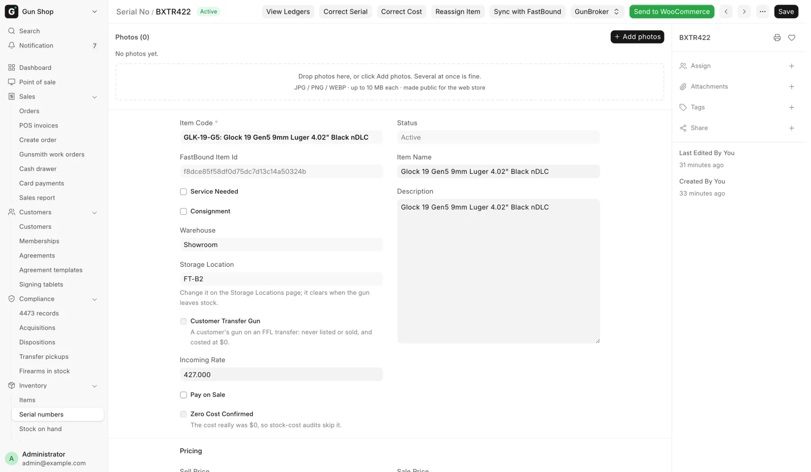
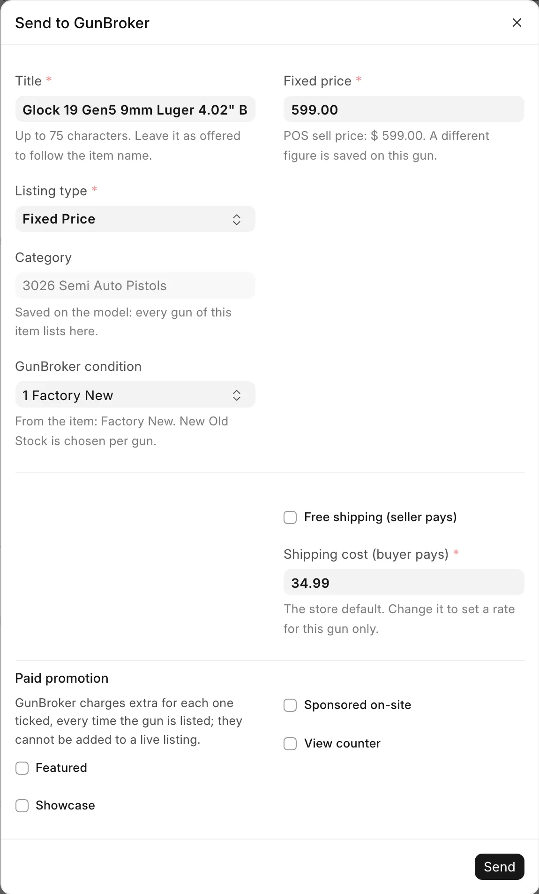

# List a gun online

For inventory staff with the Stock Manager or System Manager role, when a gun, a model or an accessory should go on the web store or on GunBroker.

You never build a product in WordPress or on the GunBroker site. You press a button in the POS, and the channel receives what the record describes.

## Before you start

- The channel must be switched on. The web store needs **Enable sync**, and GunBroker needs **Enable GunBroker**. Without it, the GunBroker buttons do not appear. See [Web store and GunBroker setup](../admin/online-channels.md).
- The record needs a price. A gun with no sell price and a model with no selling price are refused.
- Put the photos on first. See [Photos](photos.md).
- On GunBroker, every listing needs a category, and a gun needs a shipping rate unless it ships free.

!!! warning "GunBroker sales are real"
    With **Sandbox mode** off, a GunBroker listing is a real offer to a real buyer, and a seller cannot cancel a completed sale.

## Which form to list from

| What you are listing | Open | One listing for |
|---|---|---|
| Ammunition, optics, parts, anything not a firearm | The Item | The model, with the quantity in stock |
| A firearm Item with **Uniform Pricing** ticked | The Item | The model, with the number of free guns (web store only) |
| Any other firearm | The Serial No, one gun at a time | That one gun |

Open an Item from **Items** under **Inventory** in the sidebar, and a gun from **Serial numbers**. Gun parts such as uppers, barrels and triggers are regular items: they list by model, carry no serial, and the web checkout does not ask for an FFL. A receiver or frame is a firearm. See [Models, serials and prices](items-and-serials.md).

<figure markdown>
{ .screenshot }
<figcaption>Per-gun channel actions live on this form's toolbar, to the right of Sync with FastBound. The GunBroker group joins them once GunBroker is enabled.</figcaption>
</figure>

## Put it on the web store

1. Open the Item or the Serial No.
2. Click **Send to WooCommerce**.

On a per-gun firearm Item, **Send to WooCommerce** sends every Active gun at once and reports how many went. The Serial No buttons show only for a per-gun firearm whose status is Active.

To take a record off the store:

1. Click **Delist from WooCommerce**.
2. Confirm.

Delisting is not a deletion. The product stays in WordPress as a draft at stock 0, an orange **Delisted from WooCommerce** indicator shows on the form, and no automatic job puts it back. Only pressing **Send to WooCommerce** again does.

After the first send, edits made in WordPress to the title, description, photos or categories are kept. A later content change in the POS reaches the store only when you press **Send to WooCommerce** again. Price and stock follow the POS by themselves.

## When a gun sells

A gun sold at the counter or on the web store keeps its product page. The page stays published at stock 0 with the store's sold marking, so the address keeps working in searches. A counter sale takes the gun off sale on the website right away.

- A gun removed for any reason other than a sale is set to draft instead.
- A gun somebody already took off the store by hand stays down.
- A gun that comes back, through a return or an undone disposition, goes back on sale at the next update.

## Put a gun on GunBroker

1. Open the gun's Serial No. A consigned gun needs its **Consignor** set first.
2. In the **GunBroker** button group, click **Send to GunBroker**.
3. Check each field in the dialog (see the table). The store's figures are filled in.
4. Click **Send**.

On success you see the GunBroker item number. If the gun is already listed, the message links the existing listing instead of making a second one.

| Field | What to enter |
|---|---|
| **Title** | Leave it to follow the item name (75 characters). A change is kept for this gun. |
| **Listing type** | Fixed Price or Auction. |
| **Category** | A change is saved on the Item's **GunBroker Category ID** and moves every gun of that model. |
| **Fixed price** | Leave it to follow the POS sell price. A change is kept for this gun. |
| **Starting bid** | Auction only. Starts at the sell price. |
| **Reserve (optional)** | GunBroker charges for one, and refuses it on a 1-day or 3-day auction. |
| **Buy Now (optional)** | At least the starting bid and the reserve. |
| **Auction length (days)** | 1, 3, 5, 7, 10 or 14. |
| **If it does not sell** | Relist until sold, or Do not relist. |
| **Free shipping (seller pays)** | Ticked, the buyer pays nothing and the shipping box goes away. |
| **Shipping cost (buyer pays)** | Required unless shipping is free. A change is kept for this gun. |

<figure markdown>
{ .screenshot }
<figcaption>Send to GunBroker on a fixed-price gun: title, listing type, category, price, and the free shipping box above the shipping cost.</figcaption>
</figure>

**Category** is read-only when there is one choice. An antique, or a gun the category map files under Curios & Relics by age, lists only under its mapped category, and a modern gun is never offered an antique or C&R category.

The listing takes the Item's UPC and **MPN**. GunBroker fills Manufacturer, Model and Caliber from its own catalog by UPC.

A send that comes back "Listed, with notes" is live. Each note says what to fix on GunBroker by hand:

| Note | What to do |
|---|---|
| No UPC, so GunBroker could not fill Manufacturer, Model and Caliber | Click **open the listing** in the note, then Edit and add them on GunBroker. |
| The title was shortened to GunBroker's 75-character limit | Check the title reads well, or set a shorter one. |
| Some photos were left off — the listing hit the per-listing picture limit | Put the best photos first in the gallery. |

Other notes are on [Web store and GunBroker setup](../admin/online-channels.md).

## Change or end a GunBroker listing

On a fixed-price listing, the price and title follow the gun. Change the POS sell price, **GunBroker Price** or **GunBroker Title** on the Serial No and the listing updates by itself. To change the shipping, category or listing type, end the listing and send the gun again.

| Button | What it does |
|---|---|
| **Reprice on GunBroker** | Sends the current POS price. Refused on an auction. |
| **GunBroker Status** | Shows the POS state beside GunBroker's answer. |
| **End GunBroker Listing** | Asks you to confirm, then ends the listing and checks it ended. |
| **Clear "Sold Unknown"** | Shows only when the gun is flagged. Clears the flag. |

A relisted gun gets a new item number. When the end cannot be confirmed, the POS says so: open the item on GunBroker and use End Item Early. Until you do, the gun can still be bought there.

!!! warning "Sold Unknown is a double-sale guard"
    When GunBroker cannot find a listing but reports the same SKU as sold, the POS locks the gun and flags it. Pressing **Clear "Sold Unknown"** states that you checked GunBroker and the gun was not sold there. A note describing what you checked is required, and it is recorded against the serial.

## Auctions

The form shows a "GunBroker auction" indicator with the bid count and the end time. It turns red once there are bids.

The first bid promises the gun to the high bidder. **GunBroker Bid Lock** is ticked on the serial and the gun comes off the counter and the web store at once.

- A withdrawn bid releases the lock. Press **Send to WooCommerce** to put the gun back on the web store.
- An auction that ends unsold is listed in the daily audit. Send the gun again to relist.
- You cannot change an auction's price while it runs. End it and list it again.
- With bids on it, **End GunBroker Listing** is refused. Cancelling bids is done on the GunBroker site.

## List a model on GunBroker

Ammunition, optics and parts list as one fixed-price listing with the quantity in stock. Firearms are refused here, uniform-priced ones included.

1. Open the Item.
2. Click **Send to GunBroker**.
3. Enter the shipping rate and send.

**Reprice on GunBroker**, **GunBroker Status** and **End GunBroker Listing** work on the Item as on a gun. **Sync GunBroker Quantity** repairs a count that has drifted.

Every counter or web sale updates the quantity, selling out ends the listing, and new stock relists it. A listing a person ended by hand never comes back on its own. **State Restrictions** on the Item become the listing's excluded states.

## Troubleshooting

| You see | Fix |
|---|---|
| Not sent to WooCommerce: no sell price is set | Set the price, then send it again. |
| Not sent to WooCommerce: this Item uses Uniform Pricing | List it from the Item form instead. |
| Not sent to WooCommerce: this product was taken off the store by hand | Open the Serial No and press **Send to WooCommerce** there. |
| This gun has no GunBroker shipping cost of its own … | Type a shipping cost, or tick free shipping. |
| The GunBroker buttons are missing | Guns list from the Serial No, models from the Item. Or GunBroker is switched off. |

More messages are on [Web store and GunBroker setup](../admin/online-channels.md#listing-messages).
