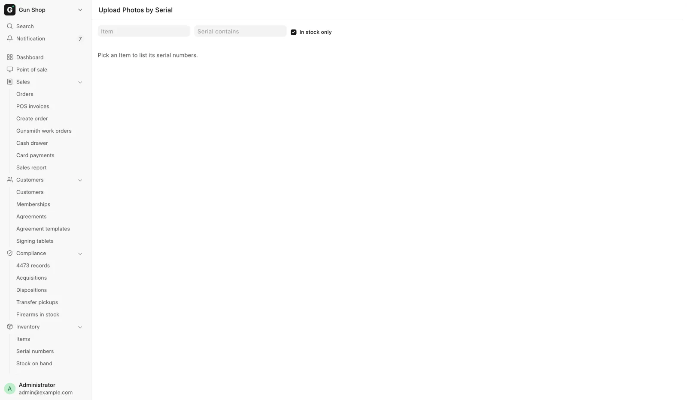

# Photos

For whoever prices and lists stock, when a model or a gun needs pictures for the web store and GunBroker.

Photos live in two places: on the Item, for shots of the model, and on each Serial No, for shots of that one gun.

<figure markdown>
{ .screenshot }
<figcaption>The page opens empty. Pick an Item and every serial under it gets its own card and drop zone.</figcaption>
</figure>

## Before you start

- Save the form first. The photo buttons are greyed out while a form is new or has unsaved edits, and the hint under the drop zone says which.
- JPG, PNG, WEBP and GIF are accepted, up to 10 MB each and 50 files per upload.
- **Upload Photos by Serial** opens for **Stock User**, **Stock Manager**, **Item Manager** and **System Manager**.

!!! danger "Photos are public"
    Photos added here are made public so the web store can fetch them. Never put a Form 4473, an ID scan or any other document in a gallery.

## Photograph a batch of guns

Use **Upload Photos by Serial** when a batch of used guns has come in and each needs its own shots. Open it from the Item form's photo strip with **Upload by serial…**, which carries the item across. Or open **Serial numbers** in the sidebar and pick **Upload photos by serial** from the list's menu.

1. Pick the **Item**. Only serial-tracked items are offered.
2. Leave **In stock only** ticked to hide sold and inactive guns.
3. To narrow a long list, type in **Serial contains**.
4. Find the gun's card. It shows status, warehouse, photo count and thumbnails.
5. Drop this gun's photos on its card, or click the drop zone to choose files.

A green message confirms each batch, and the thumbnails refresh. Order, captions and removal are done on the Serial No form.

## Work with one gallery

The photo strip sits at the top of the Item form and the Serial No form. Its heading counts the photos, for example **Photos (6)**.

| Control | What it does |
|---|---|
| **＋ Add photos** | Opens the file picker. You can also drop files on the drop zone |
| **☆** | Makes that photo the featured one |
| **✎** | Sets the **Caption (also the alt text)**, up to 140 characters |
| **×** | Removes the photo from this gallery |
| **⠿** | Drag to reorder |

The featured photo is marked **★ Featured** and always sits first. To feature another one, click its **☆**.

Removing asks "Remove this photo? The file is deleted if nothing else uses it." The same photo can sit on an Item and on one of its guns; the file goes only when nothing points at it any more.

## The first photo sells the gun

The order you arrange is the order shoppers see: the featured photo first, then the rest as you dragged them. The web store makes the first image the product's main picture, and GunBroker makes it the listing thumbnail.

Put the best full-side shot first and let condition close-ups follow. Changing the order does not republish on its own; the next push to that channel carries it.

## What happens next

- The photos show on the next push to the web store or GunBroker. See [List a gun online](list-online.md).
- A gun's first photo becomes its thumbnail on the Item's **Serial Numbers** tab.

## Troubleshooting

| You see | Fix |
|---|---|
| "Save first, then add photos." or "Save the form first — photo actions write to the document directly." | Save the form, then upload. |
| "<file> is not a photo (allowed: .jpg, .jpeg, .png, .webp, .gif)." | Convert it, or pick another file. |
| "At most 50 photos per upload." | Split the batch. |
| "No serials match." | Clear **Serial contains**, or untick **In stock only**. |
| **Woo Sync Error** on the item or gun names an image under `/private/files/` | The photo was attached another way and is private. Remove it and add it again through the photo strip. |

A photo attached outside the photo strip can be private, and the web store cannot fetch a private picture. The push tries to make that one picture public, and only the picture: a 4473 or ID scan attached to the record stays private. If two pushes ran at once and one reports the file missing, push once more before looking further.
