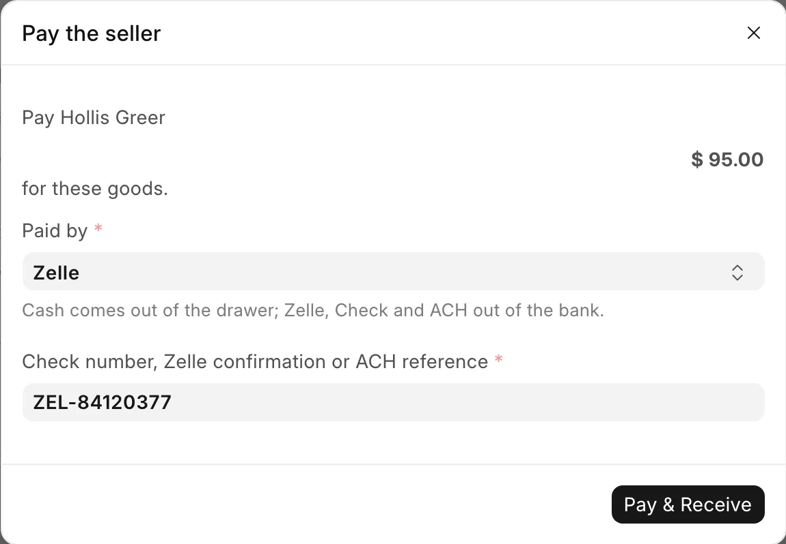

# Buy from a private seller

For stock staff and managers, when the store buys a gun or other goods from a private person, not a dealer.

You book the purchase on [Receive Goods](receive-goods.md) and pay the seller in the same step. A gun taken in part-exchange for a sale goes through [Trade-ins](../counter/trade-ins.md) instead. A gun left with the store to sell for its owner is a [consignment](consignment.md).

## Before you start

- You need the **Stock Manager** or **System Manager** role.
- Have the seller's photo ID. Federal law (27 CFR 478.125(e)) requires an unlicensed seller's name and address in the bound book, so every seller field is required.
- The seller needs a customer record. Pick an existing one or add one. See [Customers](../counter/customers.md).

## Steps

1. Open **Receive Goods**.
2. Set **Acquisition Source** to **Individual**. The supplier picker is replaced by the seller block.
3. Pick the **Seller (Customer)**. This fills in the name and address below.
4. Check and complete the seller block (see the table below).
5. Scan each item and fill in its card, as on [Receive Goods](receive-goods.md#3-fill-in-the-line-card). Enter what you are paying per unit as **Cost**.
6. Click **Submit & Receive**. The **Pay the seller** dialog opens.
7. Pick **Paid by**: Cash, Zelle, Check or ACH. Cash is preselected.
8. For Zelle, Check or ACH, type the **Check number, Zelle confirmation or ACH reference**. It is required.
9. Click **Pay & Receive**.

| Seller field | Notes |
|---|---|
| **Seller First Name**, **Seller Middle Name**, **Seller Last Name**, **Suffix** | Middle name is optional. FastBound keeps the names separately. |
| **Seller ID Type** | Driver License, State ID, Passport, Military ID, Other. |
| **Seller ID Number** | Required. |
| **Seller ID Document** | Optional photo or scan of the ID. Stored privately. |
| **Street Address**, **City**, **State**, **ZIP** | Required, as printed on the ID. Two-letter state, real ZIP. |

<figure markdown>
{ .screenshot }
<figcaption>The seller payment is asked for before anything is received. Here Zelle is picked, so its confirmation number is required.</figcaption>
</figure>

The dialog reads "Pay" with the seller's name and the amount, "for these goods." The amount covers every line on the receipt, the guns included. Its note reads "Cash comes out of the drawer; Zelle, Check and ACH out of the bank."

!!! warning "Federal recordkeeping"
    An uploaded **Seller ID Document** is made private on the way in. Never attach a government ID to any other field, and never put one in a photo gallery. Photo galleries are public so the web store can read them.

## When nobody is paid at receipt

The **Pay the seller** dialog is skipped when:

- the **Acquisition Type** is something other than blank, `Purchase` or `Individual`, such as `Consignment`;
- it is a customer transfer;
- every line costs $0.

## What happens next

- The bound book names the seller. Each gun's acquisition record holds the seller's name, ID and address. That is where an auditor looks. In receipt lists the supplier shows as `Individual Seller`, a placeholder the system creates on first use.
- The seller is paid. Cash comes off what the [cash drawer](../counter/cash-drawer.md) should hold straight away. Zelle, Check and ACH come out of the bank.
- A missing payment is flagged. A private-seller purchase with no payment on record shows on the Cash Drawer page under "Purchases from private sellers with no seller payment recorded", where a manager records it.

If a manager cancels a receipt that paid a seller, the payment stays recorded, because the money already left. Amending the receipt carries the payment over. If the seller gave the money back, a manager undoes the payment on the [Cash drawer](../counter/cash-drawer.md#seller-payments) page.

## Troubleshooting

| You see | Fix |
|---|---|
| `Pick how the seller was paid.` | Pick Cash, Zelle, Check or ACH under **Paid by**. |
| `Enter the <method> reference.` | Type the check number, Zelle confirmation or ACH reference. |
| `The seller would be paid <amount>, not the <amount> shown when you clicked Submit. Nothing was saved; …` | A line changed after the dialog opened. Check the lines and submit again. |
| `Row #N: cost of $0 for <serial> needs confirming.` | Enter what you paid. If the gun really was free, see [When a gun really was free](receive-goods.md#when-a-gun-really-was-free). |
