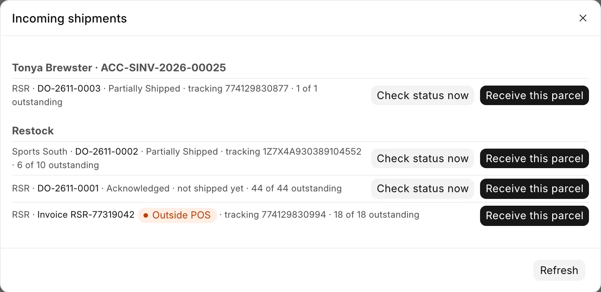

# Receive a distributor delivery

For stock staff, when a parcel arrives from a distributor: a restock, or goods ordered for a customer.

The POS usually knows the parcel is coming. It may be a customer's ship-to-store order from the counter, a restock, or something ordered on the distributor's website or by phone. You receive it on [Receive Goods](receive-goods.md), starting from the list of incoming shipments.

## Before you start

- You need the **Stock Manager** or **System Manager** role.
- Open the box and have the guns and the packing slip in front of you.

!!! warning "Every gun is confirmed against the firearm in your hands"
    The distributor's catalog fills in manufacturer, model, type and caliber, and its invoice fills in the serial when it sent one. The bound book records the gun, not the catalog row. Read each field against the firearm, and scan the serial off the gun when the distributor sent none.

## Open the incoming list

1. Open **Receive Goods**.
2. Click **Incoming shipments (_n_)** at the top right.

<figure markdown>
{ .screenshot }
<figcaption>A customer's distributor order with its tracking, and a parcel ordered outside the POS with its orange pill.</figcaption>
</figure>

The list shows one group per customer order, with each distributor order under it. Each order shows its status, the tracking number (or "not shipped yet") and _n of m_ outstanding.

A parcel ordered outside the POS shows as **Invoice** and its number, with an orange **Outside POS** pill. The POS learns about it from the distributor's invoices, so nobody types it in.

**Check status now** asks the distributor for its latest invoice, tracking and serials before you open the box. An Outside POS invoice has no such button.

## Receive the parcel

Pick one of these ways. They all end on the same table.

### Scan first

1. Scan the product's UPC in the scanner box.
2. When an order is waiting for that item, the page asks **Hold it for this order?** Press <kbd>Enter</kbd> for **Yes, hold for this order**, or choose **No — into store stock**. The answer holds for that item for the rest of the session, so ten magazines ask once.
3. For a gun, scan or type the serial off the firearm. The page checks it against the serials the distributor said it shipped, and moves the line to the right order when the serial belongs to another one.

### Stage the whole order

1. In **Incoming shipments**, click **Receive this parcel** or **Receive whole order**.
2. Accessories are staged at the quantity due. Guns are staged one row per unit, with the distributor's serial filled in where it reported one.
3. Scan or open each staged row to confirm it. A staged row is unconfirmed until you do. What you type on a staged gun's card (sell price, antique, year made) is kept.

### An Outside POS invoice

1. Click **Receive this parcel** on the invoice. The page matches each invoice line to an item first ("Matching … to items…"), then stages the lines.
2. A line that cannot be matched is listed under **Some lines could not be matched**. Scan those as plain stock.

### From the Distributor Order

1. Open the order from **Purchasing**, then **Distributor orders**, and click **Receive**.
2. An order with a firearm on it opens Receive Goods with its lines staged and a note: "… staged — scan each gun, check its details against the firearm, then Receive."
3. An accessory-only order is received in one step: read the preview of items and quantities, then click **Submit Receive Goods**.

Then finish as on [Receive Goods](receive-goods.md): check each card and click **Submit & Receive**.

## Parcels in several shipments

An order can arrive in several boxes. Each receive books only what was invoiced since the last one. **Received Qty** on each order line adds up, and **Receive Status** on the order reads Not Received, Partial or Received.

You cannot receive more than is still outstanding on an order or left on an invoice. The page refuses the extra and names the line.

!!! note "A line with no cost"
    A line received from a distributor order needs a **Unit Cost** above zero. Fix it on the order line from the distributor's invoice. A truly free line cannot be received from the order. Receive it on the Receive Goods page, where a $0 cost is confirmed with a reason.

## Picking the supplier by hand

If you pick a distributor's supplier by hand while that distributor has parcels on the way, a warning lists them. If the parcel is one of them, receive it from **Incoming shipments** instead, so a customer's goods are not booked as plain restock.

## What happens next

- Each order is booked on its own. Units for each distributor order are received against that order's supplier and invoiced cost, and held for the customer whose order they fill. Store stock and each Outside POS invoice get their own receipt. No supplier has to be picked.
- The customer's order moves on. A gun received for a customer's sale is attached to that sale, which clears it to hand over or ship on [Pending Orders](../orders/pending-orders.md). For a counter pickup with a register shift open, the $0 pickup ticket opens on the register at the same time.
- The bound book and FastBound are written as for any receive.

## Troubleshooting

| You see | Fix |
|---|---|
| `SKU …: firearm receive needs N serial number(s) from the distributor, got M.` | Receive it on Receive Goods: open **Incoming shipments**, stage the order, and scan each serial off the gun. |
| Could not load incoming orders. Showing the last known list — Refresh to retry. | Click **Refresh** in the dialog. Do not treat the parcel as store stock because the list is empty. |
| `<order> <SKU>: N unit(s) scanned but only M outstanding on this order.` | Check the count. Receive any extra as plain stock. |
| `Invoice <n> has already been received.` | Someone booked this parcel already. Check the **Inventory Receipts** report. |
| `Distributor <name> has no Supplier set, so <order> cannot be received. …` | Ask a manager to set **Supplier** on the distributor. See [Distributor setup](../admin/distributors.md). |

More messages: [Troubleshooting](../help/troubleshooting.md).
