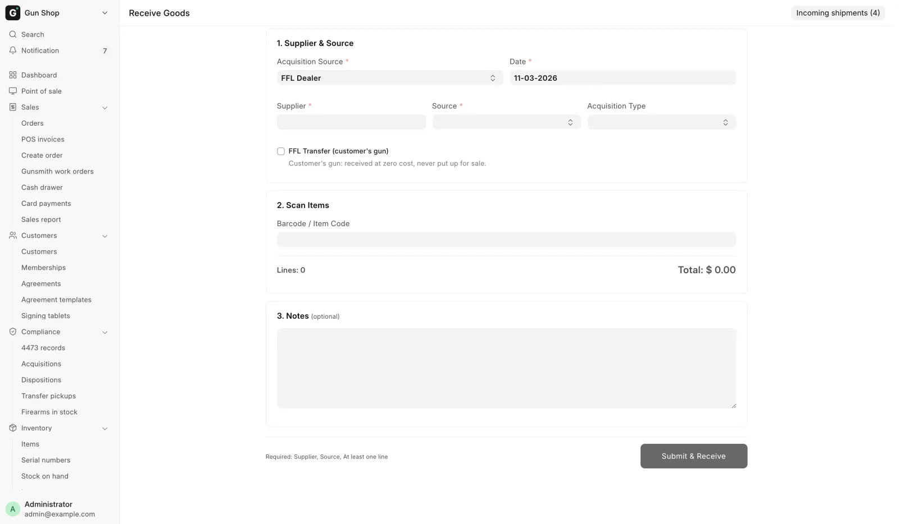

# Receive goods

For stock staff, whenever anything comes into the store: a delivery, a gun bought over the counter, or a customer's gun for transfer.

**Receive Goods** is the one page for booking stock in. Open it from the sidebar under **Purchasing**, then **Receive goods**, or with the **Receive goods** button on the [Dashboard](../start/dashboard.md).

<figure markdown>
{ .screenshot }
<figcaption>Where the goods came from at the top, the scanner below it, and the running line count and total underneath. Submit & Receive stays in the footer.</figcaption>
</figure>

## Pick the page for what arrived

The steps below are the same for every receive. Some sources add their own steps:

| What arrived | Read |
|---|---|
| A distributor parcel or restock | [Receive a distributor delivery](receive-distributor.md) |
| A gun the store buys from a private person | [Buy from a private seller](private-seller.md) |
| A customer's gun shipped in for a transfer | [Customer transfers](../counter/transfers.md) |
| A gun left with the store to sell for its owner | [Consignment](consignment.md) |
| A gun taken in part-exchange at the register | [Trade-ins](../counter/trade-ins.md) |

## Before you start

- You need the **Stock Manager** or **System Manager** role to submit. The page also opens for **Stock User**, **Purchase User** and **Purchase Manager**, but **Submit & Receive** fails for them.
- A firearm from a dealer needs a supplier marked as an FFL dealer with a license number on file. See [The FFL gate](#the-ffl-gate).
- Have the serial numbers in front of you. A firearm line needs one serial per unit.
- The **Source** list comes from FFL Settings. If the choice you want is missing, ask a manager to add it on [FFL Settings](../admin/ffl-settings.md).

## Steps

### 1. Say where the goods came from

1. Set **Acquisition Source**. **FFL Dealer** is the default and covers every licensed dealer or distributor. Choose **Individual** for a private seller.
2. Check **Date**. It starts at today.
3. For an FFL purchase, pick the **Supplier**.
4. For a private seller, fill in the seller block. See [Buy from a private seller](private-seller.md).
5. Pick a **Source**. This is your own buying channel for reporting, not an ATF field.
6. Pick an **Acquisition Type** if you use one. The list is the bound-book acquisition types from your FastBound account. Left blank, the system picks one from the source. Choose `Consignment` for a gun left with the store to sell.

### 2. Scan or search for the item

1. Click into **Barcode / Item Code** and scan.
2. With no barcode, type part of the SKU or item name. Use the arrow keys and <kbd>Enter</kbd> to pick.
3. Pick a result. A card opens for that line.

The list also searches the distributor catalogs. A barcode no item carries opens the Create Item dialog, filled in from the catalog when it is found there.

### 3. Fill in the line card

Every line asks for **Qty**, **Cost** and **Sell Price**.

- **Cost** is what the store paid per unit. It is required. A real cost of $0 needs a reason, see [When a gun really was free](#when-a-gun-really-was-free).
- **Sell Price** is optional on a firearm. A manager can set it later per gun on the item's **Serial Numbers** tab.
- On a non-firearm item, or a firearm marked **Uniform Pricing**, the **Sell Price** you type becomes the register's price.

A firearm line asks for more:

| Field | Notes |
|---|---|
| **Serial Number(s)** | One serial per line of the box. The count must match Qty. |
| **Manufacturer**, **Model**, **Type**, **Caliber** | Required. What the bound book records. |
| **Importer** | Only for imported guns. Always starts blank. |
| **Antique (pre-1899 / GCA-exempt)** | See [Antique firearms](#antique-firearms). |
| **Year Made** | Shows only while Antique is ticked. Optional. |

Manufacturer, Model, Type and Caliber are filled in from the distributor or the catalog where the system knows them. Check each one against the gun in your hands. **Importer** belongs to one physical gun, so state it for this gun or leave it blank.

**Storage location** says where the goods go. A slot holds one firearm, and several guns on one line fill the next free slots. Leave it blank if you are not sure: the goods go on the [Not placed](find-and-move.md) list for someone to place later.

Tick **Service needed (gunsmith / repair)** if the unit needs work before it can be sold. The gunsmith clears the flag on the item's **Serial Numbers** tab.

Click **Add to Receipt**. The line drops into the table and the scanner is ready for the next item.

### 4. Review and submit

1. Check the table. Gun lines show a **FIREARM** mark and their serials, and an antique also shows **ANTIQUE**.
2. To change a line, click it, edit, then click **Save**. Click **Remove** to drop it.
3. Add anything worth recording under **Notes**.
4. Read the line above the button. When it reads "Ready to receive." the button unlocks.
5. Click **Submit & Receive**. For a private seller, the **Pay the seller** dialog opens first.

A green message lists each receipt made, and the page clears for the next delivery. If one receipt fails, **Some receives did not go through** names it, and its lines stay on the page to fix and submit again.

## When a gun really was free

Leave **Cost** at zero and three controls appear. The page asks because a $0 nobody confirmed looks the same as a cost nobody looked up.

1. Tick **Cost really was $0** only when the store truly paid nothing: a supplier gift, a promotion, a warranty replacement. A cost not looked up yet gets entered, not confirmed.
2. Pick a **Zero Cost Reason**: `Supplier gift`, `Promotional item`, `Warranty replacement`, `Sample` or `Other`.
3. For `Other`, write one line under **What happened**.

The answer is kept on the receipt and on each gun. A customer transfer and a consignment skip the question.

## Antique firearms

Tick **Antique (pre-1899 / GCA-exempt)** for a gun that is not a regulated firearm. It is still tracked by serial number and appears on Firearms In Stock. No bound-book acquisition is written, nothing goes to FastBound, and no Form 4473 or NICS check happens when it sells.

**Year Made** is optional and never blocks the receive. A whole item is antique or not, so two lines of one item with different answers are refused. An item with guns already in the bound book cannot be marked antique: "Already in the bound book — cannot be marked Antique (a booked gun leaves only via a disposition)."

## The FFL gate

A firearm cannot be received from a supplier who is not a verified FFL dealer. The check runs on every receipt, however it was built.

1. In the sidebar, open **Purchasing**, then **Suppliers**, and open the supplier.
2. Tick **Is FFL Dealer**.
3. Click **Search ATF** to fill in the license from the ATF directory.
4. Click **Verify FFL** to confirm it against the live check.

A status of `Pending` is accepted, so the first receipt from a new supplier is not blocked. `Failed` and `Expired` are refused. See [Verify an FFL](../compliance/ffl-verification.md).

## What happens next

- The stock is in. Each line is on the shelf in its location, and past receives are on the **Inventory Receipts** report (see [Reports](../manager/reports.md)).
- The bound book is written. Each non-antique firearm gets an acquisition record in the [bound book](../compliance/bound-book.md), and it is sent to FastBound.
- Each gun carries its details. The serial record holds the manufacturer, importer, model, caliber, year, cost, price and service flag. The item keeps the model, caliber and type you confirmed. Manufacturer only fills a blank item, and importer stays on the gun.

!!! warning "All or nothing"
    The receive is one step. If FastBound rejects a firearm, nothing is booked: no stock, no serial, no acquisition, no seller payment. You see the reason. Fix it and receive again. A slot someone filled a moment ago also stops the whole receive.

A gun received against a customer's order is held for that order. When a manager cancels a receipt, each gun goes back to how it was before that receipt.

## Troubleshooting

| You see | Fix |
|---|---|
| `Cannot receive firearm from supplier '<name>' — not registered as FFL Dealer.` | Follow [The FFL gate](#the-ffl-gate). |
| `Need N serial(s), got M.` | One serial per line in the box, no blank lines, matching Qty. |
| `Firearm details required: ...` | Fill in the named fields on the card. |
| `Row #N: cost of $0 for <serial> needs confirming.` | Enter the real cost, or tick **Cost really was $0** and pick a reason. |
| FastBound rejected the receive and nothing was booked | Read the message, fix the firearm details or the supplier's FFL, and receive again. |

More messages: [Troubleshooting](../help/troubleshooting.md).
